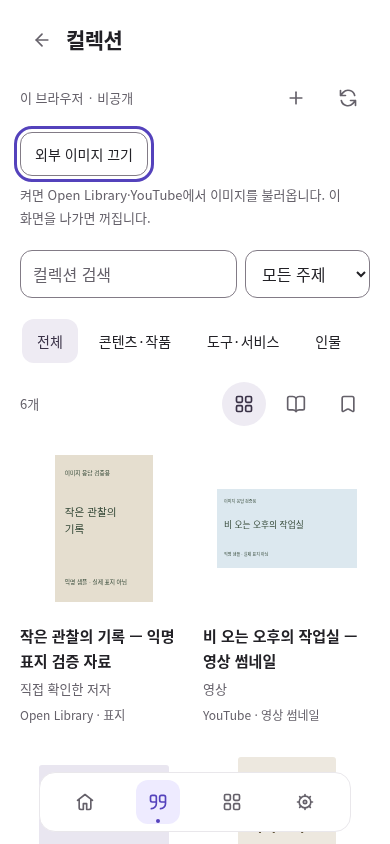

# 컬렉션 표지·썸네일 — 선택해서 보기

검토일: 2026-10-13 (한국 시간). 선행 #66 → #67 위의 후속 변경. 운영 SQL·병합·배포는 수행하지 않았다.

## 사용 흐름

`npm run dev`로 실행한 앱에서 `index.html?section=records&view=collection`을 연다.

1. 책을 추가하고 제목·저자·메모를 쓴다. **표지·썸네일**을 펼쳐 ISBN을 입력하고 **ISBN 출처 연결**을 누른다. 기존 주소가 있으면 **ISBN 주소로 바꾸기**이며 Open Library로 바뀐다는 안내를 먼저 보여준다. 제목·저자는 자동 결정하지 않는다.
2. **외부 이미지 확인**으로 한 항목만 미리 본 뒤 저장한다. 직접 Open Library의 ISBN/책 주소를 출처에 넣어도 된다.
3. 영상은 YouTube 출처를 저장한다. 목록의 **외부 이미지 보기**를 켜면 화면에 가까운 책·영상의 이미지를 불러온다. 상세 화면에서 제공자 출처를 직접 열 수 있다.
4. **외부 이미지 끄기**, 화면 이탈, 계정/작업공간 전환 때 이미지를 제거하고 진행 중 처리를 폐기한다. 재진입/새로고침 때는 기본 꺼짐이다.
5. 기존 컬렉션 백업을 받거나 사본으로 복구하면 출처 주소가 그대로 유지되어 표지를 다시 연결할 수 있다. 이미지 파일을 백업한 것은 아니다.

## 범위와 보존 계약

- `collection-media.js`는 출처에서 표시할 이미지를 결정하는 화면 모듈이다. **Collection v1 / backup v1 / storage.js / SQL을 바꾸지 않았다.** 별도 이미지 필드·기기 간 설정·자동 공개를 추가하지 않는다.
- 책: 검증 숫자가 맞는 ISBN-10/13 또는 Open Library edition ID(`OL…M`). 작품/work ID와 임의 이미지 URL은 지원하지 않는다. ISBN이 실제 배정됐거나 사용자의 제목·저자와 맞는지는 사용자가 출처에서 확인한다.
- 영상: 기존 YouTube oEmbed 조회 결과의 `thumbnail_url` 중 동일 영상 ID와 고정된 `i.ytimg.com/vi/…/*.jpg` 형태만 사용한다. 예측한 파일명을 만들어 요청하지 않는다. YouTube 재생/iframe은 넣지 않는다.
- 음악·영화·예술 작품·인물·도구는 기존 제목/아이콘 표시를 유지한다. 영상 썸네일을 앨범 표지로, 소유자 사진을 앱 로고로 표현하지 않는다. 모든 종류의 표지 자동 수집이 완성된 것은 아니다.
- 입력만으로 조회하지 않는다. 외부 이미지는 기본 꺼짐이다. 원문·메모·계정 식별자·앱 인증값을 이미지 URL/요청에 넣지 않고 Referer를 제외한다. 도서 이미지는 anonymous CORS, YouTube 이미지는 표준 img 삽입(브라우저의 외부 쿠키 정책 적용)이다. 이미지 제공자에 대한 접속 자체는 발생한다.
- 화면 밖 이미지는 IntersectionObserver로 지연한다. 성공한 영상 메타데이터는 해당 화면·작업공간 메모리에 최대 100건만 재사용하고 이탈 때 지운다. 자동 재시도하지 않는다. 18초 제한, 404/잘못된 이미지/1px 빈 이미지/연결 실패는 제목과 출처로 복귀한다.
- 비율을 `object-fit: contain`으로 보존하고 이미지 전후의 슬롯 크기는 유지한다. 썸네일 로드가 자료 목록 위치를 바꾸지 않는다. 화면 오류와 저장 오류는 독립적이다.
- 이미지를 서버·IndexedDB·백업·공개 사본에 복사하지 않는다. 서비스워커는 기존대로 타 도메인 요청을 캐시하지 않는다. 브라우저의 일반 HTTP 캐시를 제거하거나 오프라인 표지를 보장하지 않는다.

## 근거와 한계

[공식 구현·오픈소스 비교](../life-tools-design/open-source-review.md)의 2026-10-13 절을 참조한다. Open Library의 커버 서버 API/CORS 구현과 oEmbed 등록 및 앞선 조회 계약을 참고했다. 새 패키지를 설치하거나 제공자 서버 코드를 앱에 복사하지 않았다. 공개 API 사용 가능성과 각 이미지의 재배포 권리는 별개다. 이번 변경은 비공개 화면의 출처 연결이며 다른 공개 페이지에 이미지를 자동 포함하지 않는다.

**실서비스 이미지 확인은 미완료**다. `openlibrary.org`, `covers.openlibrary.org`, `www.youtube.com`, `developers.google.com`의 최초 확인은 모두 환경 프록시 CONNECT 403이었다. 제공자 HTTP 오류나 CORS 실패로 단정하지 않는다. Cloud 환경 설정 초안에 기존 도메인을 보존하며 `openlibrary.org`, `covers.openlibrary.org`, `www.youtube.com`, `i.ytimg.com`, `developers.google.com`을 추가해 저장했지만 적용/게시하지 않았다. 작업 종료 전 재조회에서도 실행 환경은 기존 spec 38이었다. 설정 화면에서 검토·저장·Publish 후 재검증하거나 Local의 정상 네트워크에서 확인해야 한다. 차단을 우회하지 않았다.

## 검증 결과

[증거 폴더](evidence/collection-covers/). Linux Chromium 151.0.7922.173, 모의 Auth/공개 제공자 응답, 실제 IndexedDB. 샘플 SVG에는 **이미지 응답 검증용 / 실제 표지 아님**을 표기했다. 이 화면을 실제 도서 표지나 실제 YouTube 조회 결과로 보고하지 않는다.

| 검증 | 결과 |
| --- | --- |
| Node | 412/412. ISBN·출처 제한·동일 영상 이미지·v1 백업 보존 포함 |
| 표지 브라우저 | 9개 흐름: 기본 요청 0, 명시 연결/보기, 데이터 불변, 취소/늦은 응답, 실패·1px 복귀, 편집 입력 유지, scope/복구, 화면 밖 요청 제한·시간 초과, 터치 조작 |
| 기존 메타데이터 | 7개 흐름 통과 |
| 기존 컬렉션 | 12개 흐름 통과. 계정 경계·실제 저장 abort·두 탭 충돌·백업 복구 포함 |
| 플랫폼/PWA | 9/9. 이전 v92 → v93의 동일 원문/초안 보존과 새 모듈 해시 확인, 오프라인 편집·재인증 |
| 정적 | HTML 18 / JS 63 / 로컬 참조 286 / PWA 통과 |
| 시각 | 1440·820·390px 로드, 390px 꺼짐·로딩·실패: 6상태. 가로 넘침 없음, 조작 44px 이상·입력 16px 이상, 작은 글자 측정 최소 6.05:1 |
| 오류 관찰 | 표지 검사 pageerror 0·예상 밖 외부 요청 0. 의도한 이미지 404 console 3건. 플랫폼은 의도한 Auth/transport 오류 3건을 별도 분류 |

실제 Apple 기기·OS·Chrome/Safari, VoiceOver, 네이티브 한글 IME/Files, 운영 계정은 검증하지 않았다. 터치 가능한 Chromium context와 390/820px 크기를 iPhone/iPad 실기로 표현하지 않는다.

### 시각 검토

승인된 목록·자료별 형태를 유지했다. 실제 연결 이미지는 자르지 않고 기존 슬롯 안에 맞춘다. 이미지보다 제목·저자·제공자 링크가 읽기 기준이며 이미지가 없어도 자료를 선택할 수 있다. 조작 프레임을 새로 만들지 않고 기본 버튼/초점 스타일을 재사용했다. Space 키로 켜고 끈 뒤 초점을 유지하며 별도 터치 context에서 상세 진입·켜기·끄기를 확인했다.

[1440px](evidence/collection-covers/loaded-1440.png) · [820px](evidence/collection-covers/loaded-820.png) · [꺼짐](evidence/collection-covers/disabled-390.png) · [로딩](evidence/collection-covers/loading-390.png) · [없음](evidence/collection-covers/missing-390.png)

## CI 및 Local 인계

선행 #67의 [Actions 실행 38261965693](https://github.com/wonchance-art/life-haedo/actions/runs/38261965693)은 컬렉션·조회 단계를 통과한 뒤 전체 browser 작업의 20분 제한에 도달했다. 실패한 기능 검사를 통과로 바꾸지 않았다. 모든 검사를 유지하고 제한만 45분으로 늘린 독립 커밋을 남겼다. 새 CI의 전체 완료는 별도 확인해야 한다.

1. #66 → #67 → 이 PR 순서로 검토·통합한다. 시작 시 #67 head는 `eafdab036b04d9af28c748e2dc952c98121883c6`, 미병합이었다. Local 미커밋 작업·기존 자료를 보존하고 실제 병합 시점을 다시 확인한다.
2. 신규 SQL·키·제공자 로그인은 필요 없다. `collection-media.js`의 HTML 포함, prepare-site allowlist, SW v93을 함께 적용한다. 다른 PR에서 캐시 버전이 올라갔다면 새 통합 버전으로 다시 증가시킨다.
3. `npm run check`, `npm test`, `tests/collection-media-browser.cjs`, `tests/collection-metadata-browser.cjs`, `tests/collection-library-browser.cjs`; 준비 산출물의 `tests/platform-life-browser.cjs`를 실행한다. CI는 고정된 Playwright를 사용한다.
4. 실제 외부 제공자에서 공개 책 1권(ISBN·edition), 존재하지 않는 표지, 공개 YouTube 영상 1건을 검사한다. 메타데이터 성공과 이미지 성공을 따로 확인한다. archive.org 등으로 실제 리디렉션되는 경우 해당 실제 목적지와 CORS를 기록한다. 차단을 우회하는 프록시를 추가하지 않는다.
5. 실제 Mac/iPad/iPhone에서 이미지 꺼짐 기본값, 명시 켜기/끄기, 유형과 출처, 한글 입력, 저장 후 재열기·백업·사본 복구를 확인한다. 병합·배포는 Local 담당이다. 제공자 실연결이 확인되기 전 전체 표지 기능 검증 완료로 보고하지 않는다.

## 다음 우선순위

1. 위 실연결을 확인하는 동안 독립적으로 **저장한 컬렉션 선택 → 순서·섹션 on/off → 비공개 취향 페이지 미리보기** 계약과 기존 내 페이지 연결을 검토한다.
2. 음악·영화·작품의 공식 메타데이터/이미지 제공 조건을 비교한다. 현재 영상 썸네일을 임의로 앨범·포스터로 재사용하지 않는다.
3. 컬렉션 선택 동기화는 별도 저장·충돌·복구 계약부터 검토한다. 현재 기기 이동은 전용 백업이다.
