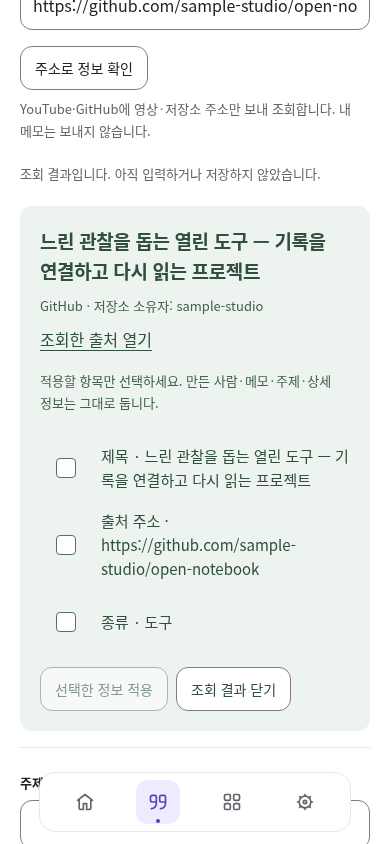

# 컬렉션 주소 조회 → 검토 → 저장

검토일: 2026-10-12. 선행 [PR #66](https://github.com/wonchance-art/life-haedo/pull/66) 위의 독립 후속 변경이며 병합·배포는 Local 담당이다.

## 사용 목표와 계약

`index.html?section=records&view=collection` → 추가/수정 → 출처 주소 입력 → **주소로 정보 확인** → 원하는 제목·주소·종류 선택 → **선택한 정보 적용** → 내용 수정 → **저장** → 다시 열기/전용 백업.

- 기존 IndexedDB/Collection/CAS/백업을 재사용한다. SQL·저장 형식·계정 경계·원문·발췌·기존 동기화·공개 투영은 변경하지 않는다. 컬렉션 자체는 여전히 **이 브라우저 비공개**다.
- URL 입력만으로 통신하지 않는다. 조회 버튼에서만 공개 제공자에 정규화된 영상 ID/저장소 경로를 보낸다. 추적 쿼리/fragment/사용자 비밀번호·세션·개인 메모를 요청에 넣지 않는다. 별도 API 키나 프록시 서버를 추가하지 않는다.
- HTTPS YouTube 단일 영상과 GitHub 저장소 루트만 조회한다. GitHub 이슈/하위 파일·YouTube 재생목록·임의 사이트는 직접 입력으로 보관할 수 있다. HTTP 주소의 수동 보관 계약은 그대로다.
- 후보는 화면 메모리뿐이며 저장하지 않는다. 채널과 저장소 소유자를 따로 표시하고 `creator`에 자동 입력하지 않는다. 적용은 제목/주소/빈 신규 항목의 종류에 한정한다. 채널·소유자 표시 자체는 영구 저장 필드가 아니다.
- 이미 쓴 제목/주소는 기본 미선택. 검토 중 해당 입력을 바꾸면 선택을 해제한다. 만든 사람/상세 값이 생기면 종류 변경을 막는다. 선택 없음은 적용 불가. 원격 HTML·iframe·이미지·설명문을 실행하거나 개인 메모로 넣지 않는다.
- 주소 변경·편집 취소·저장·화면 이탈·계정 scope 폐기 때 요청을 취소하고 토큰/초안 동일성을 확인한다. 늦은 응답은 현재 입력을 바꾸지 않는다.
- 10초 제한, 64 KiB 응답 상한, 문자열 길이/형식 검사, 자격 증명·Referer 제외, 리디렉션 거부. 제한/비공개/삭제/네트워크 오류 때 직접 입력을 보존한다. 자동 재시도하지 않는다.

## 참고와 선택

[공식 API 및 오픈소스 비교](../life-tools-design/open-source-review.md)의 2026-10-12 메타데이터 절. 네이티브 `fetch`/AbortController/URL과 기존 DOM 헬퍼로 작은 읽기 어댑터를 만들었다. 신규 패키지·백엔드·임의 사이트 스크래핑은 없다. 조회 대상 확대나 안전한 이미지 처리에 실제 요구가 생기면 그때 비교를 갱신한다.

## 검증 증거

익명 한글 자료, 모의 Auth/외부 API + 실제 IndexedDB. [증거 폴더](evidence/collection-metadata/).

| 구분 | 결과 | 한계 |
| --- | --- | --- |
| 실제 GitHub | Linux Chromium에서 이 앱 어댑터로 `jakearchibald/idb` 조회 성공. 제목 `idb`, 종류 도구, 소유자 표기 확인. 서버 응답 HTTP 200, CORS `*`도 별도 확인 | 공개 저장소 1건. 실계정/비공개 저장소 접근 안 함 |
| YouTube | 공식 oEmbed 등록 레지스트리의 YouTube endpoint 확인. 모의 응답으로 제목·채널 구분, HTML 미삽입, 저장 검사 | 환경 프록시가 실제 YouTube 요청을 403으로 차단. 실서비스 HTTP/CORS 성공을 주장하지 않음 |
| Node | 408/408 (조회 계약 신규 4 포함) | 브라우저/운영 서비스 검사를 대신하지 않음 |
| 조회 브라우저 | 7 흐름 통과. 요청 내용/수동 입력 유지/늦은 응답/저장·재열기·백업/종류 전환 | 모의 API. 의도한 429 console 오류 1건, pageerror·예상 밖 외부 요청 0 |
| 기존 컬렉션 회귀 | 12 흐름 통과: 계정·공간 분리, 실제 저장 abort, 두 탭 충돌 사본, 백업 실패/복구, 보관, 검색, 터치 모드 | 모의 Auth, 실제 Apple 기기 아님 |
| 시각 검토 | 1440·820·390px 후보 + 390px 로딩/오류, 5상태. 긴 한글 제목·URL, 가로 넘침 없음, 44px 조작, 16px 입력, 측정 작은 글자 최소 6.05:1 | 시각 검토와 자동 수치는 구분. Apple IME/VoiceOver/Files/실제 터치 미검증 |
| 플랫폼/PWA | v91 → v92 교체, 기존 원문·초안 유지, 오프라인 편집/재인증 회귀 | 모의 OAuth. 실제 Google 제공자 및 운영 배포 미검증 |
| 정적 | HTML 18 / JS 62 / 참조 283 / PWA 통과 | 외부 통신/조작은 위 별도 검사 |

### 화면 검토

민트 표면은 조회 후보에만 사용한다. 기존 폼과 제목 중심 구성을 유지한다. 큰 체크박스가 화면을 압도하는 첫 결과를 고쳐 표시 20px/터치 44px로 분리했다. 모바일은 단일 열·긴 주소 줄바꿈이며 적용/닫기 버튼이 줄바꿈된다. 후보 닫기/적용 후 입력으로 초점을 돌려준다. 기본 새 항목 작성은 조회 없이도 가능하다.

[820px](evidence/collection-metadata/candidate-820.png) · [1440px](evidence/collection-metadata/candidate-1440.png) · [오류](evidence/collection-metadata/error-390.png) · [로딩](evidence/collection-metadata/loading-390.png)

## Local 인계

1. 선행 #66의 저장/복구를 먼저 검토하고 후속 PR을 순서대로 통합한다. 현재 이 브랜치는 #66 head `64ec702`에 기반하며 main에 바로 중복 cherry-pick하지 않는다. 다른 진행 중 UI PR과 `collection-ui.js`, HTML, Pages CI, SW allowlist 충돌을 확인한다.
2. 이 변경에는 운영 SQL, Auth 변경, 비밀 키가 없다. SW `haedo-v92`; Local의 통합 버전이 더 높다면 캐시 버전을 다시 증가시켜 단일 산출물을 준비한다.
3. `npm run check && npm test`; 개발 서버에서 `tests/collection-metadata-browser.cjs`, `tests/collection-library-browser.cjs`; 준비 산출물로 `tests/platform-life-browser.cjs` 실행. `PW_MODULE_PATH`, `BASE_URL`, `SITE_DIR`, `OLD_SITE_DIR`는 현지 실행 환경에 맞춘다.
4. Local의 정상 네트워크/실제 브라우저에서 공개 YouTube 영상 1개를 명시 조회하여 제목/채널, 실패 시 직접 입력, 실제 CORS를 확인한다. 불가하면 기능 성공으로 보고하지 말고 직접 입력 경로를 유지한다. 우회 프록시를 도입하지 않는다.
5. 실제 Mac/iPad/iPhone에서 URL 붙여넣기 → 키보드/터치 선택 → 한글 수정 → 저장/새로고침 → 백업을 확인한다. 병합·공개 배포 후 새 SW와 기존 자료 유지까지 Local에서 판정한다.

## 다음 우선순위

1. 유형에 맞는 실제 표지·썸네일: 저작권/출처·외부 이미지 요청·실패 상태부터 계약을 정하고 도서/음악/영화 등 공식 제공 범위를 비교한다.
2. 취향 페이지 구성: 저장한 컬렉션을 명시 선택·순서 조절·섹션별 on/off하여 비공개 미리보기로 연결한다.
3. 컬렉션 기기 간 이동: 현재 전용 백업을 유지하면서 선택 동기화 계약/충돌/용량부터 검토한다. 자동 공개와 혼동하지 않는다.
