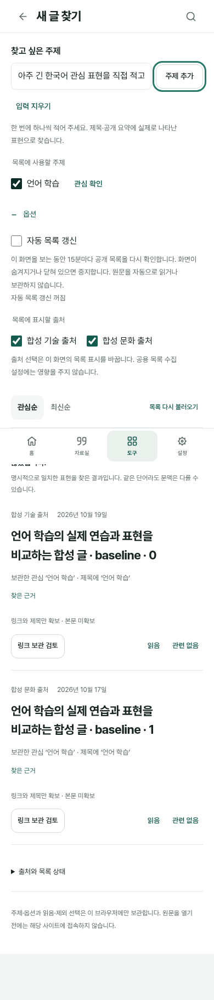

# 주제 선택과 새 글 후보 자동 갱신

2026-10-19 KST. 사용자가 확정한 자동화 범위는 **새 글 후보 목록 자동 수집·갱신**이다. 직접 보관한 주제와 켜고 끄는 옵션을 한 화면에서 다룬다. 원문·개인 자료의 자동 보관과 자동 관심 추출은 이번 범위가 아니다.

## 실행 지시와 완료 기준

목표는 도구 → 새 글 찾기에서 주제를 입력하거나 선택하고 출처·자동 갱신을 조정한 뒤 새 후보를 받는 흐름이다. 기존 관심, 원문·버전·발췌·사진, 읽음·제외 피드백을 보존한다. 개인 주제·설정은 현재 계정·작업공간의 이 브라우저에만 저장하고 공개 수집·백업·동기화·공개 사본에 넣지 않는다.

완료 기준은 명시한 주제·출처가 결과에 적용되고 재진입 후 유지되는 것, 자동 갱신을 켜고 중지할 수 있는 것, 숨김·화면 이동·계정/공간 전환과 늦은 응답에서 이전 화면을 바꾸지 않는 것, 공개 수집의 성공 자료를 다음 실행에도 보존하는 것, 실패·충돌 시 기존 자료와 미보관 입력을 복구하는 것이다. 실제 기기·사용자 효용과 운영 배포는 별도 확인한다.

## 두 가지 갱신

| 실행 위치 | 동작과 제어 | 보존·제한 |
| --- | --- | --- |
| 새 글 찾기 화면 | 자동 목록 갱신은 기본 꺼짐. 켠 동안 화면이 보이고 온라인일 때 15분 간격으로 같은 출처의 고정 JSON을 다시 받는다. 화면 숨김·이동·끄기에서 요청과 타이머를 취소한다. | 개인 주제는 브라우저에서만 적용한다. 앱을 닫은 동안의 브라우저 실행을 약속하지 않는다. 원문 열기·읽음·보관을 자동 수행하지 않는다. |
| GitHub Actions 공개 수집 | main에 반영된 뒤 매일 06:15 UTC(15:15 KST) 공개 피드를 수집하고 기존 필수 검사 이후 생성 사이트에 포함해 배포한다. main push와 기본 브랜치 수동 실행에도 같은 수집을 적용한다. | 앱의 개인 자동 갱신 토글과 별도인 공용 카탈로그 작업이다. 고정 공식 출처의 메타데이터만 다루고 개인 주제·계정·원문을 입력받지 않는다. GitHub 일정 실행은 지연·누락될 수 있다. |

첫 진입의 목록 불러오기와 수동 새로고침은 자동 옵션이 꺼져 있어도 제공한다. 출처 선택은 현재 후보 목록의 표시 범위이며 공개 수집 작업 전체를 중지시키는 설정이 아니다. 등록 출처에 없는 주제는 결과가 없을 수 있고, 이 기능을 인터넷 전체 검색이나 의미 이해로 표시하지 않는다.

## 주제·설정 계약

기존 `InterestProfile.manual`과 명시 저장 CAS를 재사용한다. 사용자가 직접 추가한 관심을 새 글 찾기 안에서도 선택하고, 끈 항목은 원래 관심을 삭제하지 않고 별도 설정에 ID로 남긴다. 예시 주제도 클릭하기 전에는 저장하지 않는다. 분석 기능은 기존 품질 판정에 따라 비활성이다.

`DiscoverySettings`는 별도 schemaVersion 1, workspaceId, revision, deleted, updatedAt과 autoRefresh, disabledInterestIds, disabledSourceIds를 갖는다. 계정·공간별 meta CAS에서 저장하고 초기화도 revision을 증가시킨다. 페이지 중단에서는 타이머·진행 요청을 취소하고, 탭 복귀 후 같은 계정의 인증 확인과 화면 표시가 끝난 통지에서만 재개한다. visibility/online만으로 인증 전 갱신을 재개하지 않는다. 수동 갱신 취소 후에도 입력·체크박스 노드를 재생성하지 않고 버튼·로딩 속성을 복구한다. 삭제된 옛 주제의 비활성 ID는 새 주제를 명시 선택할 때 현재 주제 기준으로 정리해 40개 한도에서 새 선택이 막히지 않게 한다. 원문·관심·피드백 프로필의 형식은 바꾸지 않는다. 설정 쓰기 실패나 충돌이 자동 실행의 켜짐을 확정하지 않으며, 끄기는 진행 중 요청부터 즉시 중지한다.

주제 추가 입력은 한 주제씩 명시적으로 저장한다. 정확 표현과 기존 작은 동의어로 찾는 현재 검색 방식은 유지한다. 같은 단어의 문맥 적합성과 광범위한 의미 검색의 누락은 사용자 평가로 확인할 후속이다.

## 공개 수집의 연속성과 배포

기존 `scripts/update-discovery-feed.py`의 robots·HTTPS 호스트 제한·권리·날짜·원자 갱신을 재사용한다. 새 parser·작업 서버·DB·AI API는 추가하지 않는다. 공개 수집기는 임의 주제 검색을 받지 않는다.

다음 실행이 Git의 오래된 고정 사본으로 이전 성공 자료를 되돌리지 않도록, 고정된 운영 Pages 주소의 직전 공개 카탈로그를 제한된 HTTPS GET으로 읽고 검증한 뒤 수집의 기준으로 삼는다. 카탈로그 404만으로 처음이라 판단하지 않는다. 같은 고정 origin의 SW가 카탈로그 도입 전 버전이거나, 검증된 main `38b4559`의 SW v133 또는 `58e5cd5`의 SW v134가 정확히 일치하는 승인 SHA인 경우에만 최초 Git 사본을 사용한다. 변조된 같은 버전·미승인 SW·카탈로그 도입 이후의 404, 그 외 조회·검증 실패는 배포를 중단한다. 부분 실패는 해당 출처의 직전 성공과 시각을 유지하고, 전체 실패·손상된 결과는 배포하지 않는다. 갱신 JSON은 생성 사이트에만 넣으며 Git의 고정 카탈로그·기존 평가 증거를 수정하지 않는다.

PR에서는 수집·배포를 실행하지 않는다. 기존 check, browser 집계와 blog 검사를 build/deploy의 필수 의존으로 유지한다. 이번 작업에서 workflow_dispatch·main 병합·운영 배포를 실행하지 않는다. 정기 동작은 해당 워크플로가 기본 브랜치에 반영된 이후다.

## 최신 main 통합과 검증 기록

main `58e5cd5`의 여행 글·탭 복귀 보완과 앞선 연재·공개 9칸·자료 준비/기기 이어쓰기·공개 표지를 합쳐 소유 API·화면·인증 복귀·게시 산출물·CI 검사를 양쪽 모두 유지했다. SW의 155개 셸 자산은 두 부모의 합집합이며 중복이 없다.

주제·출처·자동 갱신의 실제 화면, 계정/공간 CAS·실패·중지·늦은 응답, v134 → v135 서비스워커와 기존 원문·관심·피드백·설정 보존, 생성 사이트의 신규 모듈·공개 카탈로그를 확인한다. 최종 실행 결과는 아래에 기록한다.

[기계 판독 검수 결과·제품 SHA](evidence/discovery-automation/verification.json)에 최종 통합 제품 기준을 고정했다.

| 실제 실행 | 결과·확인 범위 |
| --- | --- |
| 정적·단위 | HTML22·JS143·로컬 참조615, 전체 단위998/998 |
| 자동화 화면 | 23/23. 주제·출처 재열기, 기본 off·15분 due, 중지/숨김/이동/계정·공간 전환, CAS 충돌·다른 탭 off/reset, off 저장 실패, IME 입력·초점, 삭제 ID40개 후 새 선택, 최초 fetch 중 on/off, 인증 보류 중 복귀 차단·검증 후 단일 재개, visibility 이벤트 없는 수동 취소 복원 포함 |
| 기존 발견·원문·보관 | 19/19. 실제 고정 카탈로그·원문 복귀·명시 링크 보관·중복 제외·피드백/원문 보존 |
| 서비스워커·생성 사이트 | 기준 main의 v134 worker → v135 9/9, 전체 이전 생성 사이트 v133·v134 → v135 10/10, main 로그인 복귀 호환5/5. 새 모듈과 기존 셸·원문/사진·정확 근거 보존 |
| 공개 수집 | fixture30/30. 실제 로컬 dry run 5출처 중4성공·D2기존HTTPS 이동 실패·50개·invalid0. 후보/격리 산출물 SHA `be0e56a56450b570aee5c24405b8853c22bdfb9a48f9ac7ce9771b58354f248b` 일치. Git 카탈로그·기존 비교 증거 불변 |
| 독립 검수 | 설정/보존·구조·양부모 API/셸/경로 합집합 대조. 브라우저 콘솔·페이지 오류/개인 전송·모델/원문 사이트 요청0. 코드/옵션 저장이 본문·읽음·개인 보관을 자동 실행하지 않음 |

브라우저는 Chromium151과 합성 계정·자료·Auth HTTP다. 가시성·IME는 명시 합성 이벤트이며 Apple OS/Google 제공자 실기와 다르다. 실제 수집의 고정 own-origin 두 URL은 환경의 승인된 proxy/urllib로 확인했고, Actions의 Node HTTPS 전송은 별도 고정 응답 fixture로 검증했다. 별도 여행 글 복귀는 실제 Chromium cached history/native 뒤로 가기와 기존 8개 보존 흐름을 확인했다. 자동화의 persisted 복귀는 합성 이벤트·실제 SDK 인증 대기로 검증하며 둘을 혼동하지 않는다. 운영 일정 실행·배포·사용자 추천 유용성은 미검증이다. 현재 PR HEAD의 원격 필수 CI는 해당 PR 검사 결과를 따른다.

## 실행·체험 순서

`npm run dev` 뒤 `http://127.0.0.1:4173/index.html?section=tools&view=external-discovery` 또는 도구 → 새 글 찾기에서 주제를 추가하거나 예시를 선택한다. 이 localhost는 Cloud 외부 기기의 접속 주소가 아니다. 실제 계정 체험은 인증·배포 주소가 준비된 환경에서 수행한다.

1. 저장된 주제와 출처 체크를 바꾸고 목록에 반영되는지, 다시 열어도 유지되는지 확인한다.
2. 옵션 → 자동 목록 갱신을 켜면 저장 성공 후 다음 확인 시각을 표시한다. 끄기·화면 이탈은 진행 요청부터 중지한다.
3. 원문은 명시 새 탭으로 열고, 실제 보관은 기존 검토에서 확인한다. 정기 수집은 main 반영 이후의 공용 작업이며 개인 토글과 별도다.
