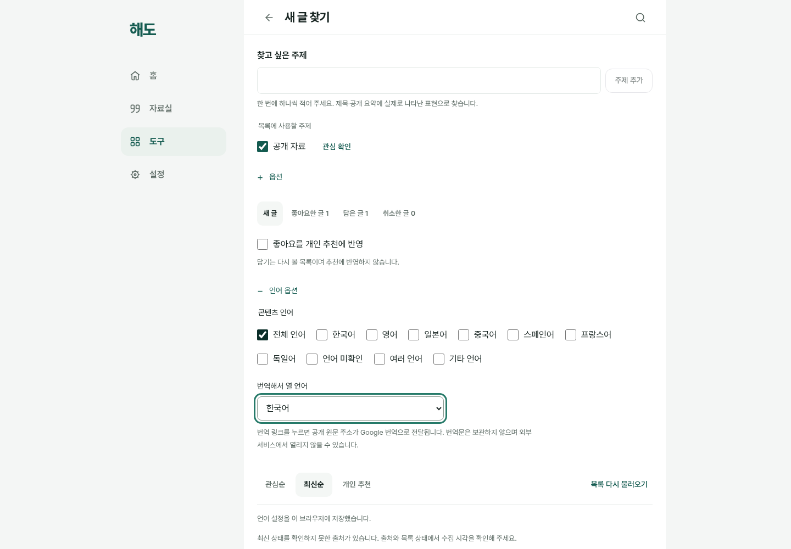
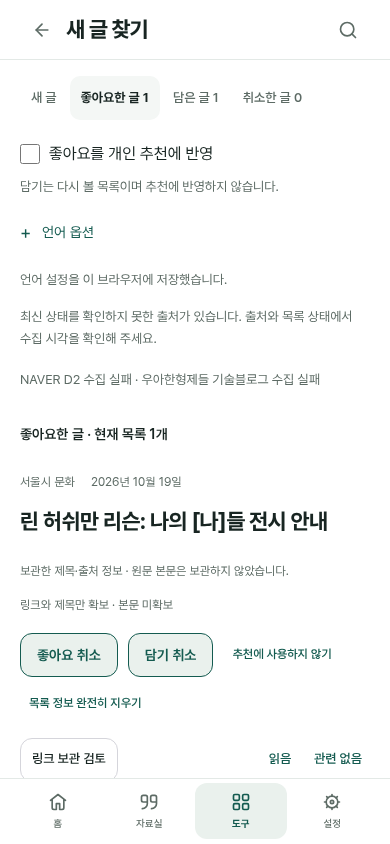

# 발견·반응·언어 옵션의 운영 출시 검수

2026-10-19 KST. 사용자의 다음 진행 요청에 따라 검증된 발견 흐름을 실제 운영에 반영했다. 도구 → 새 글 찾기에서 주제/출처·화면 자동 갱신·원문 언어와 번역 대상을 고르고, 새 글을 원문 또는 명시 번역 링크로 열며, 좋아요/담기 목록으로 다시 돌아오는 흐름이다. 개인 추천은 기본 꺼짐인 로컬 규칙 기반이며 좋아요만 긍정 신호로 사용한다. 제목 자동 번역·새 모델/서버·본문 수집·개인 자료 자동 전송은 추가하지 않았다.

## 출시 식별과 두 차례 중단의 보존

- 제품 head `c82ab50dbd2d65e8af261124daa5a6472a677a6c` / [PR103](https://github.com/wonchance-art/life-haedo/pull/103), [제품 PR CI39211803404](https://github.com/wonchance-art/life-haedo/actions/runs/39211803404) 필수8개 성공.
- 최초 main37f7858의 [39256747829](https://github.com/wonchance-art/life-haedo/actions/runs/39256747829)는 로컬 서버 동시 연결 대기열5로 스크립트 응답이 막혀 blog 실패·배포 생략이었다. [원본 실패](evidence/discovery-release/initial-ci-failure.json)와 [독립 재현/수정](development-server-concurrency.md)을 유지한다. 대기열128 비교12/12·실제 수정 서버12/12와 PR109 CI39258861890 필수8개 성공을 확인했다.
- 다음 main14a9cb1의 [39260729215](https://github.com/wonchance-art/life-haedo/actions/runs/39260729215)는 기존 연재 검사가 새 계정의 작업공간 생성 전에 snapshot을 읽어 실패했다. [원본 실패](evidence/discovery-release/series-ci-failure.json), [준비 완료 경계](series-account-readiness.md)를 유지한다. 실제 전체6개와 B 작업공간 생성250ms 지연의 원본 실패/수정 성공을 구분한다. PR110 CI39262836992 필수8개 성공 뒤 병합했다.
- 최종 main `0c4270be62fd0dfadbd781fb042356c142e43e8b`의 [push39265349518](https://github.com/wonchance-art/life-haedo/actions/runs/39265349518)는 attempt1에서 필수8개와 build/deploy를 합친10개 모두 성공했다. 병합 tree는 검수한 fba6711과 같고 준비 사이트 입력의 공개 allowlist175개는 제품 c82ab50과 같다. 실제 생성 feed·공개 config는 아래에서 따로 대조했다.
- GitHub Pages 배포 영수증의 main SHA·github-pages 환경·성공 상태와 공개 **SW v138**을 대조했다. [전체 검수 JSON](evidence/discovery-release/verification.json)은 해당 실행과 공개 파일 해시를 연결한다.

두 보완은 로컬 서버와 기존 검사 대기 두 줄뿐이다. 제품·SQL·시간 제한·기존 assertion은 바꾸지 않았다. 실패한 실행을 재실행 성공으로 덮거나 무시하지 않았으며 두 실패 모두 build/deploy 전에 차단됐다. 이전 실제 운영은 main58e5cd5/SW134/feed404였다.

## 실제 공개 수집·artifact·배포 파일

이번 push에서 **7출처 중 5성공**, 총 **90개** 공개 링크 메타데이터를 게시했다. 부분 실패 여부는 `true`이고 수집기 종료값은2다. generatedAt은 `2026-10-19T14:14:11Z`이며 브라우저 수신 시각·기사 발행일과 다르다. 원문 언어 표기 수는 `{"ko": 50, "en": 40}`이고 본문 언어 감지나 번역 결과가 아니다.

| 출처 | 이번 상태 | 공급 기사 | 마지막 성공 UTC | 실패 |
| --- | --- | --- | --- | --- |
| naver-d2 | error | 0 | 없음 | 허용되지 않은 피드 이동 (HTTPS·등록 호스트만 허용) |
| seoul-culture | ok | 10 | 2026-10-19T14:14:11Z | 없음 |
| woowahan-tech | error | 10 | 2026-10-19T05:50:54Z | 피드 응답 오류 (HTTP 403) |
| readersnews-books | ok | 20 | 2026-10-19T14:14:11Z | 없음 |
| seoul-environment | ok | 10 | 2026-10-19T14:14:11Z | 없음 |
| arxiv-cs-cl | ok | 20 | 2026-10-19T14:14:11Z | 없음 |
| mit-linguistics | ok | 20 | 2026-10-19T14:14:11Z | 없음 |

실패 출처는 마지막 성공 기사·시각을 보존하고 실패/stale을 표시한다. 성공 이력이 없는 출처는0개/lastSuccess 없음으로 남기며 최신 성공으로 만들지 않는다. 모든 기사는 link_only·metadata_only·빈 summary이며 본문·이미지·개인 주제는 수집하지 않았다.

seed HTTP는404, seed 방식은 `verified-pre-catalog-404-bootstrap`다. bootstrap 증거의 이전 cache는 `134`, SHA는 `cb4fd4ed6112856883eab180fc3d390eae7693e835d2407b77fac3ce67ba9967`다. 정확한 이전134 worker일 때의 최초404만 허용하며, 이후138에서 feed404/손상이 생기면 빈 seed로 조용히 재출발하지 않는다.

이번 실행의 **candidate = 설치 artifact = Pages archive 내부 = 실제 공개 JSON** SHA-256은 모두 다음과 같다.

`1034adb7f01f325550dd453b8129f90179b95bc33773c25badf2032faae43b48`

공개 후보 JSON은 저장소의 고정90개 파일과 바이트가 같다고 가정하지 않았다. 실제 공개 feed·Pages 전체 archive·수집 영수증을 별도 ignored 로컬 사본으로 보존했고, 내려받은 공개 파일160개를 artifact와 대조했다. 수집 영수증은 GitHub 보관7일이며 Pages artifact의 별도 만료 시각도 JSON에 남겼다. 생성된 공개 플랫폼 설정은 값 자체를 문서에 복사하지 않고 해시만 기록한다.

## 실제 배포 바이트의 자동 검수·화면 검토

다운로드한 HTML/JS/CSS/vendor/SW/feed의 응답·바이트·해시를 고정했다. 앱 파일은 최종 main blob과 같고, 생성 feed는 위 수집/설치/배포 영수증과 같다. 누락 파일을 작업트리로 보충하지 않았다. 별도 localhost 미러의 플랫폼 config만 명시적으로 모의 설정으로 바꾸고, 실제 SDK·IndexedDB와 중립적인 합성 관심/자료를 사용했다. 운영 origin에서 로그인하거나 DB를 쓰지 않았다.

이 배포 바이트로10개 연결 검사를 통과했다. 전체/한국어/영어/선택 없음 필터, 세 모드의 빈 언어 조건, 명시 좋아요/담기와 필터·재열기 독립성, 번역 대상/끄기·원문 링크 보존, 설치 shell158개 해시, 실패 시 stale 공급과 offline shell/로컬 자료 보존을 확인했다. 예상 밖 외부 요청·페이지 오류·개인 표식 유출·모델 요청·실제 외부 HTTP·모의 원격 쓰기는0이다. 의도한 실패 probe의 콘솔 오류는 따로 분류했다.

번역 팝업은 명시 클릭 후 로컬 합성 HTML로 가로챘다. 실제 Google 번역 응답·원문 독서를 증명하지 않는다. 실제 이전 운영 worker134만 현재 배포 shell에서138로 바꿔 로컬 메타 보존을 확인한 것으로, 이전 전체 앱/실제 사용자 DB의 복귀 검증과 같지 않다. 기존 별도 전체 앱 업데이트 CI와도 구분한다. offline reload에서는 모의 Auth 응답을 유지했으며 실제 기기의 완전한 네트워크 단절 로그인 검증이 아니다.

검사 도구의 첫 수집에서는 quoted data SVG 안의 url()을 별도 파일로 오탐해 중단됐다. 수집기만 보완했고 첫 코드·160개 파일과 진단을 보존했다. 최초 stdout은 남지 않은 한계를 명시하며168은 파일160개와 디렉터리8개의 합이라는 보정도 별도 기록했다. 첫 smoke는 비동기 guard가 실제 설치 완료 전 진행해 실패했다.20초 상한을 유지한 await polling으로 보완한 새 context의10개 성공만 최종 결과로 인용한다. 원본 실패·최소 재현·최종 보고서 해시는 검수 JSON에 연결했다.

worker 전환 전 비어 있지 않은 샘플은 원문/수동 관심/피드백/언어 설정이고, 기존 설정·반응·workbench는 기본 상태였다. 비어 있지 않은 좋아요/담기는 전환 후 실제 UI에서 저장해 두 목록·콘텐츠 언어 선택 없음·reload에서 검증했다. 이를134→138 전환 전 반응 샘플의 보존으로 과장하지 않으며 기존 별도 후보 PWA9과 구분한다.

총괄과 독립 담당이 다음 두 장을 직접 확인했다.390폭 언어 옵션의 overflow와 native focus는 펼친 상태의 DOM 검사이며,390 PNG는 그 뒤 옵션을 접은 저장 목록이다. 같은 캡처 상태로 섞어 표시하지 않는다.

## 보존·복구와 남은 완료 조건

기존 Core/sync/workbench/writing/preservation 모델과 IndexedDB 버전1은 유지한다. 관심·출처 설정·반응·언어 설정은 계정/공간별 독립 CAS 메타이며 공개·원문/사진 백업·기존 동기화 계약에 끼워 넣지 않는다. 앱 배포는 개인 자료 게시나 전체 초안 전송의 동의가 아니다. 실제 계정·개인 자료를 읽거나 초기화하지 않았다.

이전58e5cd5 코드 archive는 로컬에 별도 보관했다.134는 새 메타를 물리 삭제하지 않아도 발견/반응/언어 UI가 없고,136은5출처 registry여서 새 출처 반응 검증에 부적합하다. 복구가 필요하면 현재7출처·CAS·언어 키와 마지막 성공 공개 feed를 유지하는 호환 전체 코드/자료를 사용하고 더 높은 SW cache 버전을 검수한다. 캐시/IndexedDB 전체 삭제는 복구 절차가 아니다. 실제 rollback→재업그레이드 자체는 실행하지 않았다.

정기 workflow는 active이며 매일06:15UTC/15:15KST로 설정됐다. 이번 검증 실행은 **push**다. 첫 예정 **10월20일15:15KST**의 실제 schedule event·수집/배포 영수증은 아직 미확인이고 GitHub 지연/생략 가능성이 있다. 앱의 기본 off인15분 visible-screen 재조회와 공용 일일 수집은 별개다.

실제 Apple 기기·실제 OAuth·Google 번역 결과·원문 실독 유용성은 미완료다. 사용자 평가 값은 null이며 링크 열기·좋아요·자동 검사 수를 추천 개선 점수로 만들지 않는다. 기존 field CLI는 전체 언어만 지원하므로 제한 언어 UI와 같은 조건의 재현으로 주장하지 않는다. 다음 큰 작업 묶음의 이유·선행·완료 기준은 [최신 로드맵](../life-tools-design/roadmap.md)에 기록했다.
