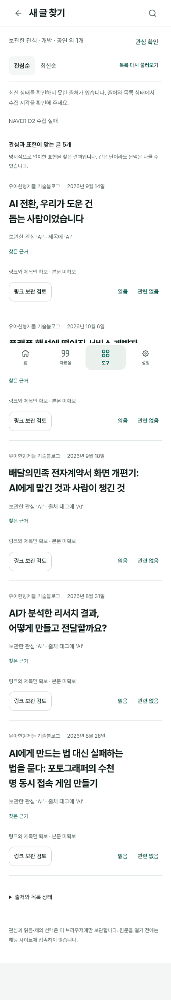

# 수동 관심에서 새 글 찾기

현재 후속은 [공급 보완·동일 카탈로그 비교](discovery-expansion.md)다. 실제 공급을 50개로 확대하고 영문 관심 뒤 한글 조사 근거를 보완했으며 SW는 v131이다. 아래 20개·v130·기존 검사 수치는 최초 구현의 검증 이력으로 보존한다. 최신 공급·검색·비교와 검수는 후속 기록을 우선한다.

2026-10-19 KST. 이번 단위는 로드맵 4→5의 **실제 외부 공급 → 명시 보관한 관심 → 아직 보관하지 않은 글 → 원문 → 같은 목록 → 기존 가져오기 검토 → 명시 링크 보관 → 피드백·되돌리기**다. 브랜치 `codex/discovery-interest-validation`, [검토 PR #103](https://github.com/wonchance-art/life-haedo/pull/103)에서 구현했다. 원본 저장소·기존 자료·MODEL-01/02/03 증거는 유지했다. main 병합·공개 배포·운영 데이터 변경은 실행하지 않았다.

## 직접 확인

`npm run dev`로 실행하고 공용 인증 설정이 있는 로컬 환경에서 `http://127.0.0.1:4173/index.html?section=tools&view=external-discovery`를 연다. Cloud의 localhost는 다른 기기에서 열 수 있는 체험 주소가 아니다. `life.html`의 같은 경로도 유지한다.

1. 도구 → 관심 확인에서 `AI` 또는 `전시`를 입력하고 보관한다.
2. 새 글 찾기를 연다. 이번 카탈로그에서 AI는 5개, 전시는 3개다. 일치 표현·출처·날짜·본문 미확보를 확인한다. 관련 글이 없으면 수를 채우지 않는다.
3. 제목을 눌러 원문을 새 탭에서 읽고 돌아온다. 같은 목록의 초점·스크롤을 복구한다. 원문 이동은 읽음 피드백을 자동 저장하지 않는다.
4. `링크 보관 검토 → 원문·출처 확인 → 자료만 보관`으로 제목·URL·작성자·확보 범위를 확인하고 저장한다. 기존 자료 읽기로 이동한 뒤 새 글 찾기로 돌아오면 보관한 URL은 제외된다. 본문을 보관하려면 기존 입력 화면에서 사용자가 직접 제공하고 검토한다.
5. 읽음·관련 없음은 명시적으로 누를 때만 목록에서 제외한다. 되돌리기로 다시 표시하고 새로고침 후에도 계정·공간별 상태를 확인한다.

익명 인증 HTTP 모사를 사용한 자동 검수와 실제 Google 로그인, 실제 게시자 사이트 읽기·사용자 만족도는 구분한다.

## 공급과 검색의 의미

[공급·권리·파서 선택·수동 갱신 기록](discovery-sources.md)이 상세 근거다. 최종 수집 시각은 2026-10-18T18:23:24Z, 한국 시각 10월 19일 03:23:24다. 서울시 문화 10개·우아한 기술블로그 10개, 총 20개다. D2는 robots의 HTTPS→HTTP 이동을 차단해 실패·이전 성공 없음·0개로 남겼다. 별도 조사 때의 Atom 200 응답을 현재 성공 자료로 대체하지 않았다. 중단된 정책브리핑 RSS·오래된 자료·영문 대체 공급으로 수를 채우지 않았다.

모두 `metadata_only` / `link_only`다. 제목·URL·공식 작성자/분류·공식 날짜만 쓰고 RSS의 본문·요약·이미지·연락처는 복사하지 않는다. `publishedAt`, `updatedAt`, 원천 수집 성공·시도, 브라우저 수신 시각을 분리한다. 공식 수정일만 있는 글을 발행일로 바꾸지 않는다.

검색은 **저장된 manual 관심**과 제목·공식 태그 등의 명시적 표현 일치다. 공개된 작은 동의어 묶음과 조사 경계만 허용하고 의미·화자·찬반을 추론하지 않는다. 근거는 실제 필드의 정확 UTF-16 구간이며 원문을 정규화하지 않는다. 단어가 일치해도 문맥이 다를 수 있다는 한계를 표시한다. 관련순은 최대 5개, 최신순은 같은 출처·보관 제외·피드백 제외 조건에서 날짜순이다. 자동 관심 추출은 [MODEL-03 기각](interest-extraction-model03.md)을 유지한다. 모델 다운로드·추론·사용자 본문 전송은 없다.

실제 공개 카탈로그의 공급 가능성만 조사한 [표본 결과](evidence/external-discovery/supply-coverage.json)는 AI 5개·전시 3개, 공연·독서·클라우드·기후변화·접근성 각 0개다. 이는 문맥 적합성·새로움·사용자 선호에 대한 정답 평가가 아니다. 공급이 좁다는 후속 과제를 남긴다.

## 보존·실패 복구 계약

| 경계 | 구현과 확인 |
| --- | --- |
| 공개 요청 | 같은 출처의 고정 `assets/life/discovery-feed.json` GET만 사용. query·body·cookie·Authorization·referrer를 보내지 않는다. 모듈 로드·목록 표시만으로 원문 사이트에 접속하지 않는다. 원문 링크는 사용자 클릭의 native 새 탭과 `noopener noreferrer`를 사용한다. |
| URL 정체성 | HTTPS·등록 호스트·기본 포트만 허용. fragment·알려진 추적 키만 제거하며 필수 query의 원래 순서/중복/인코딩은 유지한다. 기존 `bundle.sources[].url`을 기준으로 보관 여부를 판정한다. 피드 ID가 재사용돼도 canonical URL이 다르면 피드백·되돌리기 대상을 바꾸지 않는다. |
| 관심·피드백 | 계정·작업공간별 IndexedDB meta의 독립 revision CAS. 원문/workbench revision·자료/구성/사진 백업·서버 동기화·공개 사본에는 넣지 않는다. 다른 탭 충돌은 입력 의도를 보존하고 최신 상태 확인 후 재시도한다. 초기화는 revision/tombstone을 유지한다. |
| 명시 보관 | 새 발견 화면도 기존 Core 가져오기·원자 저장을 그대로 사용한다. `toImportInput`은 항상 빈 본문·link_only로 전달한다. 합성 summary/full_text 공급도 허락 없이 본문을 가져오지 않는다. 취소는 미적용 검토만 지우고 원문을 보존한다. |
| 저장 후 조회 실패 | 저장 성공을 기록한 뒤 목록 조회가 실패하면 재저장 버튼 대신 ‘자료를 보관했습니다 / 보관한 글 열기’를 표시한다. 다시 조회·열기만 수행하며 같은 commit을 재실행하지 않는다. 기존 명시 저장·불변 원문 버전은 유지한다. |
| 늦은 응답 | workspace generation·현재 계정·현재 화면을 확인한다. 공간 변경·로그아웃·다른 계정 진입 뒤 옛 관심·목록·피드백을 되살리지 않는다. 보관 실패 의도는 명시 재시도/선택 취소 전까지 화면 이탈을 막는다. |
| 새 수집 실패 | 수동 updater는 출처별 이전 성공 자료·수집 시각을 보존하고 실패·시도 시각을 분리한다. 이전 파일 손상·쓰기 실패는 원본을 덮지 않는다. 카탈로그 실패/빈 공급/일치 없음은 서로 다른 상태다. |
| 오프라인·업데이트 | SW v129→v130. 공개 카탈로그는 앱 SHELL 밖 별도 cache의 network-first. 실패 fallback은 stale 헤더와 이전 browserFetchedAt을 유지한다. 원천 수집 7일 경과도 별도 판정한다. 캐시된 개인 셸이 있어도 실제 인증 확인 실패를 우회하지 않는다. |
| 게시 산출물 | `prepare-site.mjs`의 명시 허용 목록에 JS 3개·CSS·공개 JSON을 포함했다. 생성 사이트에서 원본 바이트·스크립트 순서를 확인했다. 개인 검수 증거·모델 가중치는 사이트에 복사하지 않는다. |

## 실제 검수

Linux Chromium 151.0.7922.173, 실제 로컬 앱·동봉 SDK·IndexedDB·서비스워커를 사용했다. 테스트마다 공개 실제 카탈로그와 합성 경계 응답을 구분했다. 운영 계정·개인 자료를 사용하지 않았다.

| 검사 | 결과·범위 |
| --- | --- |
| `npm test` | 729/729 통과, 실패·생략 0. 공급 9·검색 17·피드백 모델/저장 16 등 새 회귀와 기존 전체 단위 검사 포함. |
| `npm run check` | HTML 19·JS 118·로컬 참조 477 및 PWA 셸 통과. 동작/운영 성공의 대체 증거로 사용하지 않는다. |
| 외부 발견 E2E | 17/17. 실제 전시 3개·명시 보관/중복 제외·life.html, 관심순/최신순, popup 복귀, 피드백/undo, ID 재사용, 실제 IDB 쓰기 실패, 두 탭 CAS, 저장 후 조회 실패/commit 1회, 빈 결과/실패 fallback, 늦은 응답/공간/계정/로그아웃, 이탈 복구, 3폭 검사. |
| 새 PWA | 최종 모듈 바이트로 9/9. v129→v130 기존 원문·구성·수동 관심·피드백 보존, 설치 모듈 4개 SHA, 독립 feed 갱신, 실패/오프라인 stale·수신시각, 피드백 재열기/undo, 캐시 없음, 엄격한 인증 거절과 복구, query/auth/body 차단. |
| 기존 관심 PWA | v126→v130 6/6. 원문·수동 관심 보존, 모델 가중치 제외, 오프라인 캐시 재열기와 엄격한 인증 실패의 차이 확인. |
| 기존 사용 흐름 | 홈 13·핵심 경험 5·가져오기 3, 합계 21/21. 기존 초안·원문/과거 버전·검색/초점/스크롤·백업 범위·계정 전환을 보존했다. 각 suite 1회, 예상한 인증 오프라인 오류 1건 외 console/page/external 0. |
| 사이트 생성·인증 복귀 | prepare-site 2/2, platform-auth 22/22. 새 공개 자산 바이트·script 순서·이전 비공개 canary/SDK 제외와 index/life 경로 allowlist. 위 단위 검사 합계에 포함. |
| 시각·접근성 | 실제 20개 공급과 긴 한글 제목으로 1440·820·390px 직접 캡처 검토. 가로 넘침 없음·측정 버튼/링크 44px 이상, 본문/보조/강조 대비 15.83/5.59/7.95:1. 최신순·관심 없음도 검토. |

E2E feed GET 31회와 PWA GET 7회에서 개인 query/body/auth/referrer 전송을 관측하지 않았다. E2E 예상 503 2건·PWA 의도한 전송 실패 6건을 예기치 않은 콘솔 오류와 분리했다. 각 보고서의 예상 밖 console/page/model/external 요청·운영 쓰기는 0이다. popup은 합성 게시자 응답으로 native opener/referrer·복귀만 검수했다. 실제 게시자 페이지 읽기·유용성 검증으로 세지 않는다. 기존 홈·핵심 경험·가져오기 회귀 결과는 증거 목록의 `regression-summary.json`을 따른다.

[기계 판독 결과·SHA 목록](evidence/external-discovery/manifest.json), [통합 E2E](evidence/external-discovery/browser.json), [PWA](evidence/external-discovery/pwa.json), [실제 수집 결과](evidence/external-discovery/source-update.json), [시각 검수](evidence/external-discovery/visual.json). 원응답 전체 RSS·본문·개인 자료·모델 가중치는 증거에 넣지 않았다. 상세 로컬 로그는 `.local/`에 둔다.

## 반대 검토와 남은 조건

단순한 최신순 목록만으로 충분할 수 있다. 따라서 같은 공급의 최신순을 제공하고, 관련순이 더 낫다고 선언하지 않는다. UI 근거·새 기능 수·검사 개수로 사용자 효용을 대신하지 않는다. 독립 검수에서 발견한 잘못된 기존 URL 필드 참조와 feed ID 재사용 undo는 canonical URL 계약으로 수정해 회귀했다. 본문 자동 수집 대신 기존 링크 검토를 재사용해 권리·출처·보존 비용을 제한했다.

| 우선순위·담당 | 미검증 질문·다음 최소 작업 | 완료 기준 |
| --- | --- | --- |
| P1 총괄·공급/평가 | AI·전시에 편중된 공급을 넓히면 실제 새로운 관심 글을 찾는가. 다음 단위에서 문화/독서 등 빈 관심의 공식 출처·권리·수집 가능성을 비교하고 동일 시점 카탈로그의 관심순/최신순 비교 표본을 준비한다. | 실패/권리/날짜를 숨기지 않은 실제 공급, 각 관심의 후보 부족과 문맥 오류·중복/새로움 표시. 사용자 선택은 별도 평가로 남긴다. |
| P1 사용자 체험·총괄 | 관심순이 최신순보다 실제 유용한가. 접근 가능한 실행본에서 두 순서의 글을 보고 읽을 만함/이미 앎/무관함을 비교한다. | 동일 출처·시점·보관 제외 조건, 사용자 직접 평가와 피드백/취소/복귀 부담 기록. 에이전트 정답이나 자동 검사로 통과 처리하지 않는다. |
| P1 릴리스·기기 | 현재 PR 최종 CI와 통합 후보 확인 후 허용된 릴리스 절차에서 운영 주소·캐시 버전을 확인하고 Mac/iPad/iPhone에서 Google·IME·터치·탭 복귀를 체험한다. | 실제 주소·SHA·SW, 기기/OS/브라우저·각 결과 기록. Cloud localhost·폭 모사를 실기 증거로 대체하지 않는다. |
| P2 모델 평가 | 자동 추출 실패 단계의 구체적 개선 가설·비용 상한·새 독립 평가가 생길 때 재개한다. | 후보 생성/검색/NLI 단계별 결과와 근거·화자·부분 수집 검사. 현재 기각을 임계값만 바꿔 뒤집지 않는다. |

정적 공급 갱신은 명시 CLI 실행과 통상 게시 절차를 요구한다. 자동 타이머·사이트 배포는 이번 단위의 완료 범위가 아니다. [최신 로드맵](../life-tools-design/roadmap.md)의 앞부분을 현재 상태로 다시 확인하고 다음 단위를 정한다.
