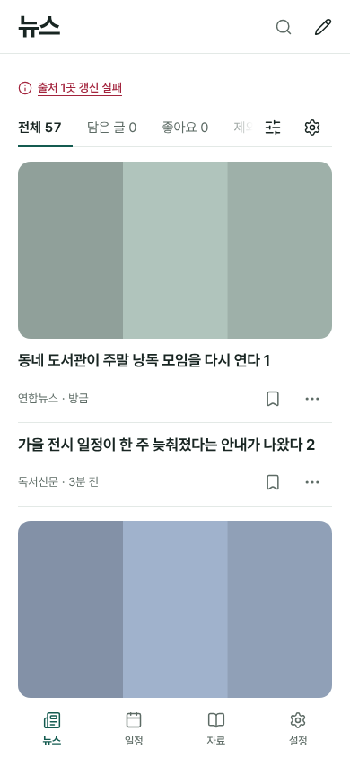

# 뉴스 카드 피드 — 1단계, 보완, 2단계 화면(넓게 찾기)

2026-11-11. 소유자가 Chrome 새 탭의 Discover 피드 화면을 붙여 요청했다: "뉴스 탭을 구글 크롬 떴을 때 추천하는 뉴스들처럼 나오게 바꾸고 싶은데. 지금은 너무 지정된 곳에서만 나와서 지나치게 제한적인 듯." 이 문서는 그 요청의 1단계, 같은 날의 1단계 보완(A1~A4), 소유자가 같은 날 승인한 2단계의 화면 연결([넓게 찾기](#2단계-화면--넓게-찾기)) 기록이다. 로컬 브랜치의 구현과 로컬 검사까지이며 병합·배포·운영 수집·운영 DB 적용은 하지 않았다.

## 실행 지시

- **목표:** 뉴스 목록이 여러 매체의 글을 카드로 보여 주고, 다섯 건에서 끊기지 않는다.
- **이번 범위(1단계):** 기기 밖으로 나가는 정보를 넓히지 않고 할 수 있는 것만 한다.
  1. 표시 상한 해제: 처음 20건, `더 보기`로 20건씩.
  2. 카드 모양.
  3. 기사 이미지: 공개 목록에 주소를 실을 준비까지 하고, 표시는 설정(기본 꺼짐) 뒤에 둔다.
  4. 고정 출처 확대: 권리·robots를 확인한 공식 RSS만.
- **1단계에서 하지 않은 것:** 관심 주제를 외부 집계·검색 서비스로 보내 넓게 받는 것(2단계, 소유자가 2026-11-11에 승인한 뒤 아래 절로 연결). 원문 페이지에서 `og:image`를 긁어 오는 것(계속 하지 않는다).
- **보존:** 담기·좋아요·읽음·관련 없음·추천에 사용하지 않기·기사 정보, 네 탭과 필터, 관심순·개인 추천(기본 꺼짐)·읽기 비교, 앱 안 읽기와 분할 읽기, 뉴스 설정의 계정 동기화, 자동 갱신(기본 꺼짐), 번역, 오프라인에서 이전 목록 표시, 출처 실패 시 이전 성공 자료 유지, 자료로 보관. 꺼진 기본 상태의 외부 요청 수(같은 출처의 공개 목록 한 건).
- **완료 기준:** 아래 검수 절의 검사가 실제 종료 코드 0으로 끝나고, 주요 미해결 결함이 없다.

무엇을 뒤집고 무엇을 유지했는지는 [뉴스 개편 근거](news-redesign-research.md)의 2026-11-11 절에, 출처 판정은 [출처 표](discovery-sources.md)에 있다.

## 사용 장면과 방향

출근길 iPhone에서 뉴스를 열어 여러 매체의 새 글을 위에서 아래로 훑는다. 읽을 글은 담고, 관심 없는 글은 그 자리에서 치운다. 화면 모드는 고르기(Operate)다.

방향 한 문장: 사진과 제목이 앞서고, 출처와 시간은 한 줄로 물러나며, 조작은 카드 오른쪽 아래 두 개뿐이다.

참고한 화면(확인일 2026-11-11, 가져온 것은 정보 배치와 동작이다):

| 앱 | 보는 것과 하는 일 | 근거 |
| --- | --- | --- |
| Google Discover(Chrome 새 탭) | 이미지, 제목, 출처·경과 시간 순서의 카드. 카드 오른쪽 아래 More 메뉴에서 주제·출처 단위로 관심 없음을 고른다. | 소유자가 붙인 화면, [Google 검색 도움말](https://support.google.com/websearch/answer/2819496?hl=en) |
| Google News | 글마다 ⋮ 메뉴에서 저장, 더/덜 보기, 출처 숨기기. | [기존 조사](news-redesign-research.md) |
| Feedly | Title-only·Magazine·Cards 보기를 고른다. | [기존 조사](news-redesign-research.md) |
| Reeder | 안 읽은 수 배지 없음, 새 글은 "새 글 n건"으로 알림. | [기존 조사](news-redesign-research.md) |

가져온 것: 이미지 → 제목 → 출처·시간 → 오른쪽 아래 메뉴의 배치, 카드 메뉴에서 바로 치우기. 피한 것: 활동 기록으로 고르는 자동 추천, 끝없이 이어지는 스트림, 반응 수, 출처 아이콘 요청, 요약 표시, 자리표시 그림.

## 구현

### S1 표시 상한

- 순위 계산이 후보 전체를 돌려주고(`Discovery.rank`의 `limit` 상한을 5에서 목록 전체로), 화면이 20건씩 보인다. 기본 결과 크기 5는 그대로라 읽기 비교 등 다른 사용처는 바뀌지 않는다.
- 목록 아래에 `57건 중 20건`과 `더 보기`가 있다. 남은 글이 없으면 둘 다 없다. 스크롤로 더 불러오지 않는다.
- `더 보기` 뒤 초점은 새로 나온 첫 카드로 간다.
- 탭·정렬·출처·관심 주제·콘텐츠 언어를 바꾸거나 `지금 갱신`을 누르면 처음 20건으로 돌아간다. 15분 자동 갱신은 읽던 자리를 지키려고 펼친 개수를 유지한다.
- 담기·읽음·관련 없음 뒤에도 펼친 개수·스크롤·초점이 유지된다. 읽기 칸에서 돌아오면 보던 위치와 펼친 개수로 돌아온다.
- `전체` 탭의 숫자는 보이는 쪽이 아니라 후보 전체 수다.
- 최신순은 20건 쪽마다 같은 매체 3건까지다([A1](#a1-최신순의-매체-쏠림)). 한 번 그린 쪽의 순서는 탭·정렬·필터·갱신 전까지 고정이라 담기·읽음·관련 없음 뒤에 다른 카드가 자리를 바꾸지 않는다.

### S2 카드

[DESIGN.md의 뉴스 절](../../DESIGN.md)이 규격이다. 요약하면 다음과 같다.

- 이미지(있을 때만, 16:9, 14px 반경) → 제목(17px·650, 두 줄) → `출처 · 경과 시간`과 오른쪽 끝의 `담기`·`⋯`.
- 그림자·배경 상자 없이 구분선만 쓴다. 1101px 이상에서 목록만 볼 때는 머리줄·카드·`더 보기`가 680px 한 열이다([A2](#a2-넓은-화면의-한-열)). 1100px 이하는 화면 폭을 쓴다.
- 이미지와 제목이 하나의 버튼이고, `담기`·`⋯`는 그 뒤의 별도 44px 조작이다. 버튼 안에 버튼이 없다. 메타 줄을 눌러도 같은 글이 열린다(포인터 편의, 키보드는 버튼).
- `⋯`는 읽기 칸과 같은 글 옵션을 연다: 자료에 보관, 읽음, 관련 없음, (반응이 있는 글) 추천에 사용하지 않기, 기사 정보. 접근 이름은 `글 옵션: <제목>`이다. 닫힌 메뉴는 목록에 숨은 조작을 두지 않고, 열 때 내용을 만든다. Escape는 닫고 `⋯`로 초점을 돌려주며, 바깥을 누르거나 다른 카드의 `⋯`를 열면 닫힌다.
- 경과 시간은 `방금`·`N분 전`·`N시간 전`·`N일 전`이고 7일이 넘으면 날짜다. `<time datetime>`과 절대 시각 `title`은 유지한다. 발행일을 모르는 글은 시간을 표시하지 않는다(이전과 같다).
- 관심 주제와 맞은 글은 메타 줄에 주제 이름 배지를 둔다(글자라서 색에 기대지 않는다). 좋아요한 글의 하트 표식도 메타 줄에 있다.
- 읽기 칸 옆(1101px 이상)에서는 목록이 280~440px로 좁아지므로 이미지를 제목 오른쪽의 96px 썸네일로 줄인다.
- `제외한 글` 탭도 같은 카드 모양이고 오른쪽 끝이 `되돌리기`다.

### S3 기사 이미지

- **수집기:** 출처 피드가 스스로 적은 대표 이미지 주소(`media:content`·`media:thumbnail`·이미지 `enclosure`)만 `imageUrl`로 싣는다. HTTPS, 등록한 이미지 호스트, 2,048자 이하만 받고 data URL과 다른 호스트는 버린다. 한 피드에서 반복되는 주소는 로고로 보고 뺀다. 본문·description은 계속 복사하지 않고, 원문 페이지는 읽지 않는다. 출처별로 `images` 항목(호스트·안내 문구·근거 주소)이 있어야만 수집한다.
- **검증기 세 곳:** 수집기(`scripts/update-discovery-feed.py`), 배포 관문(`scripts/refresh-discovery-artifact.cjs`), 브라우저(`assets/life/discovery.js`)가 같은 규칙을 쓴다. 브라우저는 쓸 수 없는 이미지 주소를 만나면 이미지만 버리고 글은 남긴다. 배포 관문은 그런 목록을 게시하지 않는다.
- **이전 판과의 호환:** 새 출처와 새 필드가 이전 판 화면의 목록을 비우지 않도록 공개 목록을 두 구간으로 나눴다([출처 표의 두 구간 형식](discovery-sources.md)). 이미지 필드가 없는 기존 목록도 그대로 읽는다.
- **표시 설정:** 뉴스 설정 → `출처·갱신` → `기사 이미지 보기`. 기본 꺼짐이고, 기본값은 `assets/life/discovery-settings.js`의 `DEFAULT_SHOW_IMAGES` 한 곳에서 정한다. 설명 문구: "켜면 목록을 열 때 각 매체 서버에서 기사 이미지를 받습니다. 그 매체가 접속 사실을 알 수 있습니다. 이미지는 보관하지 않으며, 꺼 두면 이미지를 요청하지 않습니다." 필터 패널의 `기사 이미지`가 이 설정으로 데려간다.
- **저장:** 기존 뉴스 설정 문서(`discoverySettings`)의 `disabledSourceIds`에 예약 항목 `option-images-on`/`option-images-off`로 둔다(처음 판의 선택 필드 `showImages`는 [A4](#a4-과도기-이전-판-기기)에서 결함이 확인되어 바꿨다). 고르기 전에는 항목이 없어서 이전에 저장한 설정의 모양이 그대로다. 저장·충돌·다시 저장·계정 동기화는 다른 뉴스 옵션과 같은 경로다.
- **꺼짐:** ``를 만들지 않는다. 이미지 요청은 0건이다.
- **켬:** ``. 16:9 상자가 자리를 먼저 차지한다. 받지 못했거나 1px짜리 이미지는 상자를 없애고 글 카드로 둔다(다시 요청하지 않는다). 목록을 다시 그려도 같은 이미지 요소를 재사용해 다시 요청하거나 깜빡이지 않는다. 끄면 요소를 지우고 받던 요청을 멈춘다. `기사 정보`에 그 출처의 이미지 안내 문구가 보인다.
- [컬렉션 표지](collection-covers.md)의 외부 이미지 보기와 같은 원칙(기본 꺼짐, 명시적으로 켬, Referer 제외, 이미지를 복사·보관하지 않음, 없어도 제목으로 읽힘)을 따른다. 다른 점은 이 설정이 계정에 저장되어 기기 간에 이어진다는 것이다(2026-11-01 계정 자동 연동 지시).
- **읽기 비교:** 비교는 순위 입력만 고정해 보관한다. 화면이 비교에 넘기는 목록에서 이미지 주소와 출처의 이미지 안내를 빼므로, 저장되는 비교의 모양은 이전과 같다. 비교가 받는 출처·글 수의 한도(20곳·500건)는 공개 목록의 한도(100곳·2,000건)에 맞췄다. 맞추지 않으면 출처가 20곳을 넘는 순간 비교를 시작할 수 없다.

### S4 출처

9곳에서 28곳이 됐다. 추가 19곳, 탈락·보류 후보, 로컬 수집 결과, 최신순 상위 20건의 출처 분포와 섞기 규칙의 계산은 [출처 표](discovery-sources.md)에 있다. 추가한 출처도 뉴스 설정의 `목록에 표시할 출처`에서 끌 수 있다.

## 1단계 보완 (2026-11-11 총괄 후속 지시)

### A1. 최신순의 매체 쏠림

- **문제:** 실제 수집에서 최신순 첫 20건이 SBS 19·연합뉴스 1이었다. "여러 매체가 섞여 나온다"는 목표가 최신순에서 깨졌다.
- **규칙:** `Discovery.spreadLatest`(`assets/life/discovery.js`). 최신순으로 늘어놓고 20건 쪽마다 같은 매체 3건까지 담는다. 넘친 글은 다음 쪽으로 넘긴다(버리지 않는다). 남은 매체가 적어 상한으로 20건을 못 채우는 쪽만 상한을 풀어 채운다. 쪽 안은 최신순이다. 입력 순서와 무관한 순수 함수라 같은 목록이면 기기마다 같은 순서다.
- **매체:** 피드가 아니라 발행처다. 등록부의 발행처 키(`PUBLISHERS`, 수집기 `SOURCES`의 `publisher`)로 센다. 연합뉴스 종합·문화·세계, SBS 뉴스·생활문화, 서울시 6개 피드, MIT News 2개 피드가 각각 한 매체다. 넓게 찾은 글은 받은 매체 이름(`sourceName`, 대소문자 무시)으로 센다.
- **적용 범위:** 최신순(기본)에만. 관심순은 사용자가 고른 주제 일치가 먼저이므로 적용하지 않는다. 개인 추천의 자체 순위에도 적용하지 않는다(개인 추천이 근거를 찾지 못해 최신순 기준 목록으로 돌아갈 때는 그 목록이 이 규칙을 따른다). 읽기 비교·평가 같은 다른 사용처는 `spread`를 요청하지 않아 이전 순서 그대로다.
- **근거(2·3·4건 비교):** 로컬 실제 수집으로 계산했다. 2건은 매체 11곳이지만 첫 쪽의 가장 오래된 글이 23시간 전, 4건은 8곳에 8시간 전, 3건은 8곳에 12시간 전이었다. 3건이 섞임과 신선도의 중간이다. 재측정(2026-11-11T15:01Z, 노컷뉴스 날짜 보정 뒤): 규칙 없음 첫 쪽 2곳(연합 10·SBS 10) → 첫 쪽 8곳(연합 3, SBS 3, 노컷 3, 서울시 3, arXiv 3, 독서신문 2, NASA 2, Global Voices 1), 둘째·셋째 쪽도 각 8곳, 391건 중복·누락 0. 표는 [출처 표](discovery-sources.md)에 있다.
- **쪽 고정:** 최신순에서 한 번 그린 순서는 그 화면이 유지되는 동안 고정한다(`current.order`, 정렬 방식과 함께 기억해 관심순·개인 추천에서 돌아오면 새로 계산한다). 담기·읽음·관련 없음으로 글이 빠져도 나머지는 자리를 지키고 빈자리는 다음 글이 채운다. 새로 계산하는 때는 탭·정렬·필터·출처·언어·관심 주제를 바꿀 때, `지금 갱신`·자동 갱신으로 목록이 바뀔 때, 넓게 찾기 결과가 도착할 때다.
- **노컷뉴스 날짜:** 노컷뉴스 RSS는 한국 시각에 `GMT`를 붙인다. 보정 전에는 최신 글이 미래 시각이라 시간 없는 글로 맨 뒤에 있었다. 보정 규칙은 [출처 표](discovery-sources.md)의 노컷뉴스 날짜 보정 절에 있다.

### A2. 넓은 화면의 한 열

1101px 이상에서 목록만 볼 때 `#discoveryListPane`이 최대 680px이다. 머리줄(탭·필터·설정 아이콘)·카드·`더 보기`가 같은 왼쪽·오른쪽 선을 쓰고, 1440px에서 머리줄의 마지막 아이콘과 카드의 `⋯`가 같은 세로선에 온다(검사가 위치를 잰다). 2026-11-07의 "목록 최대 960px"은 행 목록 때의 결정이었고 카드 피드에서는 이 열로 대체했다([DESIGN.md](../../DESIGN.md), [뉴스 개편 근거](news-redesign-research.md)). 글을 열 때의 목록 | 구분선 | 읽기 배치는 그대로이고, 820·390은 화면 폭을 쓴다.

### A3. 조건부 출처

연합뉴스·SBS·노컷뉴스("개인·비상업" 조건)와 명시 허용 문구 없이 선례로 넣은 기술블로그 3곳을 [출처 표](discovery-sources.md)에서 "조건부 · 소유자 판단 대기"로 표시하고 조건 원문을 인용했다. 동작은 그대로다. 이미지 주소 수집을 끄는 자리도 그 절에 적었다. NPR은 넣지 않았다.

### A4. 과도기: 이전 판 기기

같은 계정의 다른 기기가 아직 이전 셸(서비스워커가 새 판을 받기 전)일 때 새 판이 남긴 계정 문서를 받는 경우를 실제 이전 판 고정본(`tests/fixtures/discovery-old-client/`, 기준 커밋 `c767df3`의 뉴스 네 파일)으로 띄워 확인했다(`tests/news-old-shell-sync-browser.cjs`).

- **결함과 수정:** 처음 판은 `기사 이미지 보기`를 설정 문서의 새 필드 `showImages`로 저장했다. 이전 판 검증기는 모르는 필드가 있는 설정을 거절하므로 그 기기는 원격 설정을 보류하고 자기 로컬 설정을 쓴다. 그 기기에서 뉴스 설정을 하나라도 바꾸면 자기 판을 올려 새 옵션이 계정에서 사라졌다(재현). 이전 판 검증기는 `disabledSourceIds`의 모르는 ID는 받아 지키므로, 옵션을 그 안의 예약 항목(`option-images-on/off`, `option-wide-on/off`, `option-wide-clear`)으로 옮겼다. 출처 ID는 `option-`으로 시작하지 않는다(검사로 고정). 새 판도 자기가 모르는 `option-*` 항목을 지운다고 거절하지 않고 지킨다.

| 문서 | 이전 셸 기기에서 | 그 기기가 읽기만 할 때 계정 사본 | 그 기기가 같은 종류를 고치면 | 그 기기가 새 셸을 받은 뒤 |
| --- | --- | --- | --- | --- |
| 설정 — 수정 전(새 필드 `showImages`) | 뉴스 열림(이전 판 5행), 자기 로컬 설정, 원격은 보류 | 그대로 | **새 옵션이 덮임(결함)** | — |
| 설정 — 수정 후(예약 항목) | 뉴스 열림, 새 설정을 그대로 받아 적용 | 그대로 | 옵션을 지키고 자기 변경을 더함(`option-images-on`, `option-wide-on`, `seoul-culture`) | 옵션·변경 모두 보임 |
| 설정 — 넓게 찾기를 끄고 서버 사본 지우기가 남은 상태 | 뉴스 열림 | 그대로 | 지우기 표시를 지킴(`option-wide-off`, `option-wide-clear`, `seoul-culture`) | 새 셸이 `life_news_wide_clear`를 불러 지운 뒤 표시를 뗌 |
| 반응 — 추가 출처의 글 | 뉴스 열림, 그 반응은 안 보임(담은 글 0, 보류) | 그대로 | 그 기기가 반응을 남기면 계정 사본은 그 기기 판(`naver-d2`만)이 됨. 반응 문서는 복구 사본 대상이라 진 쪽은 복구 사본으로 남지만 추가 출처 반응은 계정에서 빠진다(관찰) | 읽기만 했던 기기는 새 셸에서도 바로 보이지 않음(보류 행을 다시 받지 않음, 아래 한계). 새 셸에서 반응을 남기면 둘 다 계정에 남음 |
| 반응 — 넓게 찾기로 받은 링크 | 뉴스 열림, 안 보임(보류) | 그대로 | (추가 출처 반응과 같은 종류) | 바로 보이지 않음(같은 한계) |
| 읽기 비교 — 출처 20곳 초과 | 뉴스 열림, 비교 안 보임 | 그대로 | 측정하지 않음 | 도착하지 않음(계정 사본은 유지) |

설정이 덮이거나 뉴스가 열리지 않는 경우는 수정 뒤 없다. 반응·읽기 비교의 두 관찰은 [알려진 한계](#알려진-한계와-미검증)에 적었다.

## 2단계 화면 — 넓게 찾기

소유자 승인(2026-11-11): 뉴스 설정에 **직접 적은 관심 주제만**, **설정에서 켰을 때만** 외부 집계 서비스(Google 뉴스)로 보낸다. 좋아요에서 뽑은 낱말은 보내지 않는다. 받는 서비스 이름을 설정에 적는다. 결과는 계정 전용 비공개 저장소에 둔다. 서버(`haedo-news-wide` Edge 함수와 비공개 스키마)는 다른 작업자의 `news/wide-server` 브랜치이고, 이 화면은 그 계약 문서(`docs/design-review/news-wide-feed.md`, 판 `ab94caf` — 응답 형식·오류 코드는 `5a9466c`와 같고 10항 주제 규칙만 바뀌었다)의 「클라이언트가 지킬 계약」 14항에 맞췄다. 서버 코드는 이 브랜치에 들어 있지 않으며, 검사는 계약대로 답하는 가짜 서버로 했다.

- **설정:** 뉴스 설정 → 관심 주제 아래 `넓게 찾기`(기본 꺼짐, `DEFAULT_WIDE_SEARCH`). 설명: "켜면 위에 직접 적어 켜 둔 관심 주제와 콘텐츠 언어(한국어·영어)를 Google 뉴스로 보내 여러 매체의 최신 글을 받습니다. 좋아요·담은 글·읽은 글은 보내지 않습니다. 글을 누르면 Google 주소를 거쳐 원문으로 갑니다. 받은 결과는 내 계정에만 보관되고, 끄면 지웁니다." 받는 서비스 이름은 어댑터의 이름(`Google 뉴스`)을 그대로 쓴다. 켜 두면 보내는 주제 목록(주제마다 언어별 건수·`이전 목록`·`받지 못함`·`횟수 제한`, 보내지 않는 주제는 `보내지 않음 · 이유`)과 "보내는 주제 · 위에서부터 8개까지", 받는 예·받지 않는 예가 보인다.
- **저장:** 계정 설정 문서의 예약 항목 `option-wide-on/off`(A4의 형식). 저장된 값만 요청을 일으킨다(저장 전·충돌 중에는 보내지 않는다).
- **보내는 것:** `{ "topics": [...], "languages": [...] }` 두 필드뿐이다. 주제는 `effectiveProfile(관심 주제, 뉴스 설정).manual` — 사용자가 적고 켜 둔 주제 — 의 표시 이름만, 적은 순서대로 앞의 8개(대소문자만 다른 중복은 하나)다. 좋아요·담기·읽음·개인 추천 프로필·자동 추출 낱말이 이 함수에 들어오는 길이 없다(검사: 좋아요·담기가 있고 적은 주제가 0개면 요청 0건). 언어는 콘텐츠 언어 설정에서 한국어·영어만(둘 다 없으면 보내지 않는다).
- **주제 규칙:** 어느 글자를 받는지는 서버의 규칙이고 화면이 따로 다시 짜지 않는다(총괄 지시). 화면은 서버의 철자(NFC, 공백 한 칸, 앞뒤 공백 제거)와 길이(1~40자)만 맞춘다. 서버가 요청을 `invalid_topic`으로 거절하면 주제마다 한 번씩 따로 물어 거절된 주제를 찾고, 그 주제는 설정에 "보내지 않음 · 서버가 받지 않는 주제입니다. 아래 받지 않는 예를 확인해 주세요."로 표시하고 빼고 보낸다. 목록 아래에 "주제는 글자·숫자와 일부 기호만 받습니다. 따옴표·괄호·쌍점·별표, 글자·숫자 사이가 아닌 빼기, 이어진 점, 낱말 사이의 대문자 OR·AND·NOT은 받지 않습니다. 받는 예: … · 받지 않는 예: …"가 한 번 보인다. 빠진 자리는 9번째 이후 주제가 채운다. 안내의 예는 계약 10항에서 가져왔다(받는 예 `K-pop`, `3-1`, `.NET`, `10%`, `1,000원`, `Yahoo!`, `왜?`, `Portland OR` · 받지 않는 예 `"기후"`, `site:example.com`, `50:50`, `-날씨`, `a,-b`, `1..10`, `기후 OR 날씨`, `기후*`). 화면은 글자 규칙을 미리 검사하지 않으므로 서버 `topics.mjs`의 `normalizeTopic`과 어긋날 별도 규칙이 없다.
- **부르는 때:** 설정이 켜진 채로 뉴스를 열 때(같은 주제·언어의 답이 5분 안이면 다시 묻지 않는다), `지금 갱신`·`목록 새로고침`을 누를 때, 관심 주제나 그 사용 여부·콘텐츠 언어를 바꿔 저장했을 때, 다른 기기에서 바뀐 주제·설정을 받았을 때. 15분 자동 갱신은 공개 목록만 다시 받고 넓게 찾기를 부르지 않는다(서버 캐시가 30분이고 계정당 시간·하루 호출 한도가 있다. 켜 둔 탭이 한도를 쓰지 않게 한다). 같은 주제·언어의 요청이 진행 중이면 다시 보내지 않고 목록 위에 `넓게 찾는 중`이 보인다.
- **표시:** `전체`의 최신순에 섞는다(A1 상한에 넓게 찾은 글의 매체도 센다). 관심순에서는 주제가 맞은 고정 출처 글 뒤에 최신순으로, 개인 추천에서는 섞지 않는다. 카드는 같은 글 카드(이미지 없음), 메타 줄 `매체 이름 · 경과 시간` 뒤에 글자 표시 `넓게`(제목 `넓게 찾기로 받은 글`)와 찾은 주제 배지. 매체 이름이 없으면 `Google 뉴스`. 같은 `id`는 한 번만, 고정 출처 글과 **제목과 매체 이름이 정확히 같을 때만** 넓게 찾은 쪽을 숨긴다(느슨한 일치 없음). 이미 자료에 있는 주소, 읽음·관련 없음으로 뺀 글, 고른 콘텐츠 언어가 아닌 글은 넣지 않는다.
- **목록 위 한 줄(13px, `role=status`):** `넓게 찾는 중` / `넓게 찾기 · 일부 주제를 새로 받지 못했습니다. <시각> 기준 목록이 섞여 있습니다.`(stale) / `넓게 찾기 · 받을 수 있는 횟수를 다 썼습니다. <시각> 기준 목록입니다.`(limited, 다시 시도 버튼 없음) / `넓게 찾기 · 새 글을 받지 못했습니다. 고정 출처의 글만 보입니다.`(모든 주제 failed) / `넓게 찾기 · 지금 가져오지 못했습니다. 고정 출처의 글은 그대로 보입니다.`(503 `auth_unavailable`·`setup_required`, 500, 연결 실패, 제한시간) / `넓게 찾기 · 받은 결과를 확인하지 못했습니다. 고정 출처의 글만 보입니다.`(형식이 다른 답) / `넓게 찾기 · 로그인 계정을 다시 확인해 주세요.`(401만) / `넓게 찾기 · 서버가 받지 않는 주제가 있습니다. 뉴스 설정에서 확인해 주세요.` / `이 계정에서는 넓게 찾기를 쓸 수 없어 꺼 두었습니다.`(403). 5xx·연결 실패는 세션을 버리지 않고 이미 보이던 넓게 찾은 글도 그대로 둔다.
- **403 `not_enabled_for_account`:** 설정을 꺼진 상태로 저장하고(서버 사본 지우기를 한 번 부른다 — 허용되지 않은 계정의 `not_allowed` 답은 실패가 아니다), 설정과 목록 위에 위 문장을 보인다. 다시 부르지 않고 로그아웃시키지 않는다. 고정 출처 목록은 그대로다. 사용자가 다시 켜면 새 선택으로 보고 한 번 더 묻는다.
- **누르기:** 카드 본체가 `<a target="_blank" rel="noopener noreferrer" referrerpolicy="no-referrer">`이고 접근 이름은 `<제목> · 새 탭에서 열림`이다. 주소는 그릴 때와 누를 때 두 번 `https://news.google.com/`으로 시작하는지(https, 호스트 `news.google.com`, 자격 증명·포트 없음) 확인하고, 아니면 열지 않는다. 앱 안 읽기 칸과 비공개 읽기 Edge에는 넘기지 않는다. 메타 줄을 눌러도 열지 않는다(링크는 제목 하나).
- **담기·⋯:** `담기`는 링크만 보관한다(제목·매체 이름·Google 주소·받은 시각, `coverage: link_only`, 본문 없음). 반응 기록이 공급자 호스트를 받도록 공개 목록 등록부와 따로 `SNAPSHOT_SOURCES`에 `google-news`를 두었다. `읽음`·`관련 없음`은 고정 출처 글과 같은 판단 저장·동기화 경로(`discoveryProfile`의 제외 목록, 주소 기준)다. `자료에 보관`은 기존 링크 보관 흐름으로 제목·Google 주소만 넘긴다(URL만 있는 자료, 본문 확보로 표시하지 않음). `기사 정보`에 "넓게 찾기로 받은 글 · 주제 ‘…’ · 글을 누르면 Google 주소를 거쳐 원문으로 갑니다."가 더해진다.
- **좋아요·추천에 사용하지 않기:** 넓게 찾은 글은 읽기 칸을 열지 않으므로 좋아요(읽기 칸에만 있다)가 없다. 담기는 추천에 쓰지 않는 기록이라 `추천에 사용하지 않기`도 넓게 찾은 글에는 두지 않는다. 좋아요는 기기 안의 개인 추천 프로필에만 쓰이고 밖으로 나가지 않지만, 넓게 찾은 글에 좋아요를 열려면 새 탭 열기와 별도의 조작을 카드에 하나 더 두어야 해서 이번에는 넣지 않았다(필요하면 소유자 판단).
- **끄기:** 끄면 넓게 찾은 글을 화면에서 바로 걷어내고, 설정 저장 뒤 `life_news_wide_clear`를 부른다(본문 `{}`). 성공 전까지 계정 설정에 `option-wide-clear`를 남겨, 실패하면 설정에 "서버에 보관한 결과를 아직 지우지 못했습니다. 뉴스를 다시 열 때 다시 시도합니다."와 `지금 다시 지우기`를 보이고, 다음에 뉴스를 열 때(어느 기기든) 다시 지운다. 성공하면 표시를 뗀다.
- **안전:** `title`·`sourceName`은 `textContent`, 링크는 `element.href` 속성으로만 넣는다(HTML 문자열을 조립하지 않는다). `sourceUrl`은 검증만 하고 화면에 쓰지 않는다. 응답은 엄격히 읽는다: `supplier`가 `google-news-rss`가 아니거나 모양이 다르면 통째로 버리고, 항목은 32자 16진 `id`, 500자 이하 제목, 200자 이하 매체 이름, `news.google.com` 링크, 계약의 시각 형식, `ko`/`en`만 받고 나머지는 버린다. 모르는 필드는 무시하고 200건까지만 쓴다. 이 기기 시계보다 5분 넘게 앞선 발행 시각은 시각으로 보이지 않는다. 결과와 주제는 화면의 메모리에만 있고 공개 파일·서비스워커 캐시·localStorage·sessionStorage에 두지 않는다(검사). 로그아웃·계정 전환 때 화면에서 걷어내고, 계정·화면이 바뀐 뒤 도착한 응답은 버린다. 콘솔에 주제·제목을 찍지 않는다(검사). 요청은 `credentials: omit`, `cache: no-store`, `redirect: error`, `referrerPolicy: no-referrer`이다.

## 검수

로컬 Chromium, 합성 인증, 익명 합성 목록이다. 기사 이미지는 검사가 만든 단색 띠 PNG이고, 등록 이미지 호스트로 가는 요청은 검사가 가로채 응답한다. 실제 매체·이미지 서버·운영 서버로 나간 요청은 없다. 폭만 바꾼 Chromium 결과이며 Apple 기기 확인이 아니다.

새 검사는 다음 두 파일이다.

- `tests/discovery-card-feed.test.cjs`(12개): 두 구간 형식, 이전 판 검증기, 이미지 주소 규칙, 표시 상한, 읽기 비교, 설정 모델, 수집기의 이미지 추출·로고 제거·실패 격리, 세 등록부의 일치, 배포 관문, 첫 배포의 9곳 → 두 구간 전환.
- `tests/news-card-feed-browser.cjs`(19개): S1(20건·더 보기·초점·초기화·복귀), S2(구조·키보드 순서·경과 시간·메뉴·세 폭·분할 읽기), S3(꺼짐 0건, 켬의 속성·자리·실패·재요청 없음·끄기, 이미지 필드 없는 목록, 잘못된 주소, 이전 판 화면 + 새 목록, 읽기 비교), S4(추가 출처·끄기·등록 밖 출처 거절).

2026-11-11 로컬 실행 결과(실제 종료 코드 기준):

| 검사 | 결과 |
| --- | --- |
| `npm run check` | 0 |
| `npm test` | 0 (2,513개 통과) |
| `node scripts/check-markdown-links.cjs` | 0 |
| 새 브라우저 검사 `tests/news-card-feed-browser.cjs` | 0 (19/19) |
| 뉴스·설정·홈·PWA 브라우저 검사 22개와 v162 서비스워커 갱신 경로 | 모두 0 |
| `scripts/verify-prepared-site.mjs`(생성 사이트·서비스워커 갱신) | 0 |

변이 확인: 고친 곳 30군데를 하나씩 되돌려 새 검사가 실패하는 것을 확인했다(상한 5건, 초기화, 더 보기 초점, 꺼짐에서의 이미지 요청, no-referrer, lazy, 실패 이미지 처리, 이미지 요소 재사용, 고정 비율 상자, 닫힌 메뉴의 숨은 조작, 바깥 누름, 경과 시간, 조작 중첩, 이미지 호스트 검사, 확인하지 않은 출처의 이미지, 로고 제거, 두 구간 분리, 이전 판 화면 + 한 구간 목록, 배포 관문의 두 조건, 읽기 비교의 한도와 이미지 제거 등).

규칙이 바뀌어 함께 고친 기존 단언(약화가 아니라 새 규칙으로 교체):

- `tests/life-news-browser.cjs`: 목록 5건 → 20건(세 곳).
- `tests/life-discovery-languages-browser.cjs`: 전체 언어에서 5건 → 방식별 후보 전체 15건.
- `tests/life-discovery-reactions-browser.cjs`: 최신순 기준 목록 5건 → 후보 전체 6건.
- `tests/records-news-browser.cjs`: 행의 칸(주제·제목·담기) → 카드의 구조(제목 조작, 메타·담기·글 옵션).
- `tests/discovery-feed-update.test.cjs`, `tests/discovery-ci.test.cjs`: 등록부 9곳 고정 → 첫 등록부 9곳 + 추가 출처, 합성 피드와 게시본을 두 구간 형식으로.

격리 PostgreSQL이 필요한 검사(`run-account-docs-postgres.cjs`, `run-discovery-private-postgres.cjs`)는 돌리지 않았다. 이번 변경은 SQL과 Edge 함수를 건드리지 않는다.

재현하지 못한 실패 1건: `tests/settings-browser.cjs`의 "390 rows open their screens and return with back and forward"가 중간 실행에서 한 번 실패했다(백업 화면을 12초 안에 열지 못함). 그때 같은 기계에서 전체 단위 검사와 변이 확인을 함께 돌리고 있었다. 단독 재실행과 최종 실행에서는 통과했다. 이 검사가 다루는 화면은 이번에 바꾼 파일을 쓰지 않는다. 원인은 확정하지 못했고 실패 로그는 작업 보고에 경로를 적었다.

### 1단계 보완·2단계 화면의 검수 (2026-11-11 후속)

넓게 찾기 서버는 검사가 정의한 가짜 서버(요청 가로채기)다. 계약 `ab94caf`의 응답 모양·오류 코드와 주제 규칙의 줄인 사본으로 답한다. Google 뉴스·매체·운영 서버로 나간 요청은 없다(각 검사가 바깥 요청을 막고 0건을 단언).

새로 더하거나 넓힌 검사:

- `tests/discovery-card-feed.test.cjs`(12 → 17개): A1 쪽 나누기(실제 수집 분포를 본뜬 합성 목록에서 첫 쪽 매체 6곳 이상, 어느 쪽도 상한 초과 없음, 완주 시 중복·누락 0, 입력 순서와 무관), 짧은 목록의 상한 풀기와 넓게 찾은 글의 매체 이름, 뉴스 목록만 `spread`를 쓰는지, 브라우저·수집기 발행처 일치, 노컷뉴스 날짜 보정.
- `tests/news-wide-remote.test.cjs`(새, 10개): 보내는 주제의 계획(직접 적은 주제만, 순서, 8개, 중복, 서버가 거절한 주제), 언어, 응답의 엄격한 읽기와 악성 값, 링크 전용 반응 기록, 요청 본문·머리글, 401·403·400·503·500·연결 실패의 구분, 계정·화면이 바뀐 뒤의 응답, 서버 사본 지우기(`not_allowed` 포함), 설정 예약 항목.
- `tests/news-wide-search-browser.cjs`(새, 17개): 꺼짐 0건, 켬의 요청 본문, 주제 0개면 0건, 서버가 거절한 주제, 섞기·중복 제거·매체 상한·끝까지 한 번씩, 새 탭과 주소 재확인, 악성 응답, stale·limited·failed, 403(꺼 둠·재요청 없음·세션 유지), 503(`auth_unavailable`·`setup_required`)·500·연결 실패·401, 끄기와 지우기 재시도, 중복 요청·늦은 응답·로그아웃·저장소에 남지 않음, 15분 자동 갱신, 담기·관련 없음·읽음·자료에 보관, 820·390·1440 화면.
- `tests/news-old-shell-sync-browser.cjs`(새, 6개): A4 표의 경우들.
- `tests/news-card-feed-browser.cjs`(19 → 20개): 한 매체가 몰린 목록에서 첫 쪽 3건·매체 6곳 이상, 읽음 뒤 자리 고정, `지금 갱신` 뒤 다시 계산(A1, 새 검사), 끝까지 한 번씩과 쪽마다 상한, 담기·읽음 뒤 자리 고정, 머리줄·카드·더 보기의 같은 열과 1440 세로선, 820·390 전체 폭(A2, 기존 검사에 단언 추가).

규칙이 바뀌어 함께 고친 기존 단언(약화가 아니라 새 규칙으로 교체):

- `tests/news-card-feed-browser.cjs` S1: 최신순이 `card-0…56` 순서 → 모든 글이 한 번씩, 쪽마다 최신순·매체 상한. S1 담기·읽음: 다음 글을 `card-31`로 고정 → 화면에 그려진 순서의 다음 글.
- `tests/records-split-resize-browser.cjs` 뉴스 목록만 보기: 목록이 960px 틀을 채움 → 680px 한 열이고 자료 목록과 같은 시작선(960px 틀 단언은 유지).
- `tests/structure-baseline-browser.cjs`: 새 이름 공간 `DiscoveryWideRemote`.

실행 결과(2026-11-11, 실제 종료 코드):

| 검사 | 결과 |
| --- | --- |
| `npm run check` | 0 |
| `npm test` | 0 (2,528개 통과) |
| `node scripts/check-markdown-links.cjs` | 0 |
| `tests/news-card-feed-browser.cjs` | 0 (20/20) |
| `tests/news-wide-search-browser.cjs` | 0 (17/17) |
| `tests/news-old-shell-sync-browser.cjs` | 0 (6/6) |
| 뉴스·발견·설정·홈·PWA 브라우저 검사 23개(1단계 때의 목록과 `shell-same-account-reverify-browser`)와 v162 서비스워커 갱신 경로 | 모두 0 |
| `scripts/verify-prepared-site.mjs`(이전 판 `30e94f0` → 새 판) | 0 |

변이 확인: 고친 곳 22군데를 하나씩 되돌려 20군데에서 새 검사가 실패했다(쪽 상한, 발행처 묶기, 다음 쪽으로 넘기기, 뉴스 목록만의 spread, 노컷뉴스 보정, `not_allowed`, 403·5xx 구분, 화면의 spread 요청, 쪽 고정, 680px 열, 꺼짐 0건, 15분 자동 갱신, 누를 때 주소 재확인, 403 꺼 둠, 정확 일치 중복 제거, 서버가 거절한 주제, 지우기 재시도, 제목을 글자로, 초점 복귀 대상). 살아남은 둘은 같은 뜻의 이중 확인이다: 링크의 호스트 확인(앞의 `https://news.google.com/` 접두사 확인이 같은 것을 막는다), 응답 도착 때 설정이 꺼졌는지 확인(끄면 요청 번호가 먼저 바뀌어 응답을 버린다).

이번 작업 중 검사가 잡아 고친 결함: 초점 복귀가 `제외한 글` 칸의 숨은 원문 링크를 골라 초점을 잃음(넓게 찾은 링크를 복귀 대상에 넣으며 생김), 쪽 고정이 개인 추천을 끈 뒤에도 남아 최신순이 개인 추천 순서로 보임(`life-discovery-reactions-browser` 6건 실패, 실패 로그 보존), 끄기를 두 번째 할 때 서버 사본 지우기를 다시 부르지 않음.

### 화면

익명 합성 목록과 단색 띠 이미지다. 실제 기사나 실제 매체 이미지가 아니다.

[390 끔](evidence/news-card-feed/cards-off-390.png) · [넓게 찾기 1440](evidence/news-card-feed/wide-on-1440.png) · [넓게 찾기 820](evidence/news-card-feed/wide-on-820.png) · [넓게 찾기 390](evidence/news-card-feed/wide-on-390.png) · [넓게 찾기 설정 1440](evidence/news-card-feed/wide-settings-1440.png) · [설정 390](evidence/news-card-feed/wide-settings-390.png) · [이전 목록 안내](evidence/news-card-feed/wide-notice-stale-1440.png) · [지금 가져오지 못함](evidence/news-card-feed/wide-notice-unavailable-1440.png) · [쓸 수 없는 계정](evidence/news-card-feed/wide-not-enabled-settings-1440.png) · [820 켬](evidence/news-card-feed/cards-on-820.png) · [820 끔](evidence/news-card-feed/cards-off-820.png) · [1440 켬](evidence/news-card-feed/cards-on-1440.png) · [1440 끔](evidence/news-card-feed/cards-off-1440.png) · [1440 읽기 칸 옆](evidence/news-card-feed/cards-split-1440.png) · [390 글 옵션](evidence/news-card-feed/card-menu-390.png)

### 슬롭 점검

unslop 지침을 참고한 수동 점검이다([해도 적용 범위](../../.agents/skills/unslop/INSTALLATION.md)). 점수나 자동 검사가 아니다. 1440·820·390px 화면을 보고 `references/signs.md`의 묶음별로 대조했다.

| 묶음 | 찾은 것 | 처리 |
| --- | --- | --- |
| 표면·색 | 그라디언트·빛 번짐·색 테두리 없음. 강조색은 고른 카드의 테두리와 눌린 담기에만 있다. | 유지 |
| 글자 | 카드 안 크기 3종(제목 17, 메타 13, 배지 12), 굵기 2종(650, 400). | 유지 |
| 아이콘 | 담기·더보기·하트 모두 기존 Lucide 부분집합, 조작 20px·글 안 16px. 이모지 없음. | 유지 |
| 간격 | 처음 값이 4의 배수가 아닌 곳이 있었다(카드 안쪽 여백 14·6px, 메타 간격 6px, 이미지 위 2px). | 12·8px, 4px, 4px로 고침 |
| 문구 | `더 보기`, `57건 중 20건`, `기사 이미지 보기`, `글 옵션`. 느낌표·과장어 없음. 없는 수치 없음. | 유지 |
| 구성 요소 | 같은 모양 카드의 반복은 소유자가 요청한 목록 형태다. 카드마다 그래프·배지 장식 없음. 주제 배지는 일치한 글에만 있다. | 유지(소유자 결정) |
| 그림 | 이미지는 매체가 피드에 적은 것만. 자리표시·생성 그림 없음. | 유지 |
| 움직임 | 새 움직임 없음. `transition: all`·반복 움직임 없음. | 유지 |

2단계 화면을 더한 뒤 같은 방식으로 다시 봤다(1440·820·390, 넓게 찾기 켬/끔, 설정, 상태 안내). 새 요소는 테두리만 있는 12px 글자 표시 `넓게`, 목록 위 13px 한 줄 안내, 설정의 확인란 하나·설명·주제 목록이다. 색 면·그라디언트·이모지·새 아이콘·움직임은 없다. 처음 판의 "서버가 받지 않는 주제" 이유가 주제마다 같은 긴 문장을 되풀이해, 이유는 짧게 하고 규칙 설명은 목록 아래 한 번으로 줄였다.

일부러 따르지 않은 unslop 규칙: 제목 굵기 400~500 권고(해도 목록 제목은 650), 작은 글자의 음수 자간 금지(제목 17px에 -0.01em, 기존 목록 제목과 같은 값).

## 알려진 한계와 미검증

- **최신순의 출처 쏠림:** 1단계에서는 최신순 첫 20건이 SBS 19·연합 1이었다. A1에서 쪽마다 같은 매체 3건까지로 고쳤다(첫 쪽 8곳). 그 대가로 첫 쪽에 10시간 넘게 지난 글이 섞인다.
- **이미지가 있는 글의 비율:** 로컬 수집에서 40%(405건 중 162건)다. 이미지 요소를 주는 피드는 28곳 중 9곳이다.
- **이전 셸 기기의 반응 기록(A4 관찰, 미해결):** 이전 셸 기기는 추가 출처나 넓게 찾기 링크에 남긴 반응이 든 반응 문서를 보류한다. 그 기기에서 반응을 하나 남기면 계정 사본이 그 기기 판으로 바뀌어 추가 출처 반응이 계정에서 빠진다(진 쪽은 그 기기의 복구 사본). 서비스워커가 새 셸을 받기까지의 짧은 창이지만 기록이 빠질 수 있다. 줄이는 안: 반응 문서도 설정처럼 이전 판이 지키는 위치에 새 출처 반응을 두거나, 계정 문서 동기화가 보류한 문서 종류의 쓰기를 막는다(`assets/life/account-docs-sync.js`·`storage.js`, 이 작업의 담당 밖).
- **보류 행을 새 셸이 다시 받지 않음(A4 관찰, 미해결):** 이전 셸에서 보류된 문서는 로컬 값이 없는 종류이면 새 셸이 된 뒤에도 `retryDeferred`가 다시 받지 않아, 그 기기에서 바로 보이지 않는다(`account-docs-sync.js`의 보류 재시도, `storage.js`의 계정 문서 목록). 계정 사본은 지켜진다. 담당 밖이라 보고만 한다.
- **이전 셸 화면의 필터 표시:** 예약 항목을 이전 판 화면은 꺼진 출처로 세어 필터 아이콘에 `적용 1`처럼 보일 수 있다. 목록·설정 동작은 그대로다.
- **넓게 찾기의 실제 서버:** 서버(`news/wide-server`)와의 실제 왕복, 운영 Auth, 허용 계정 설치, Supabase Edge의 IP에서 Google 뉴스가 주는 응답은 확인하지 않았다(통합 뒤). 가짜 서버는 계약 문서 `ab94caf`의 형식·오류 코드와 주제 규칙(줄인 사본)을 따른다. 계약이 바뀌면 `assets/life/discovery-wide-remote.js`와 `tests/news-wide-*.cjs`를 함께 고친다.
- **401의 처리:** 넓게 찾기의 401은 목록 위 한 줄로 로그인 계정 확인을 알릴 뿐 로그인 화면으로 보내지 않는다. 셸의 계정 재확인 흐름이 같은 세션 문제를 따로 잡는다.
- **주제 거절의 요청 수:** 서버가 주제 하나 때문에 요청을 거절하면 주제마다 한 번씩 다시 묻는다(최대 8번, 이후 거절된 주제를 뺀 한 번). 서버 캐시 덕에 공급원 호출은 늘지 않지만 Edge 호출 수는 늘어난다. 서버가 거절한 주제를 응답에 적어 주면 줄일 수 있다(서버 계약 제안).
- **실제 기기:** Mac·iPad·iPhone의 실제 브라우저, VoiceOver, 실제 매체 이미지 서버의 응답(핫링크 차단 여부 포함)은 확인하지 않았다.
- **운영 수집:** GitHub Actions의 실제 수집·게시(9곳 게시본에서 두 구간 목록으로 넘어가는 첫 실행)는 합성 피드와 실제 수집기로만 검사했다. 운영 실행은 병합 뒤 확인할 일이다.
- **출처 약관:** 2026-11-11에 읽은 문장을 근거로 했다. 약관이 바뀌면 그 출처를 내리거나 다시 검토해야 한다.

## 2단계를 붙일 때의 확장 지점 (1단계 때의 기록, 2단계 화면에서 쓴 방식)

1단계 때 적은 네 자리 중 실제로 쓴 방식은 다음과 같다.

- **공급 형식:** 공개 목록이 아니라 계정 요청(`discovery-wide-remote.js`)으로 받고, 기존 비공개 읽기 경로(`discovery-private-remote.js`)의 계정·화면 확인 방식을 따랐다. 이미지는 없다.
- **출처 등록부:** 공개 목록 등록부(`ALLOWED_SOURCES`)는 그대로 두고, 반응 기록용으로만 공급자 ID `google-news`와 호스트 `news.google.com`을 `SNAPSHOT_SOURCES`에 더했다. 넓게 찾은 글의 매체는 등록하지 않고 받은 이름으로만 보인다.
- **화면:** 같은 카드·더 보기·글 옵션을 쓰고, 공급원 표시와 고지는 뉴스 설정의 `넓게 찾기` 항목에 두었다.
- **순위:** `Discovery.spreadLatest`(A1)에 고정 출처 글과 넓게 찾은 글을 함께 넣는다.
