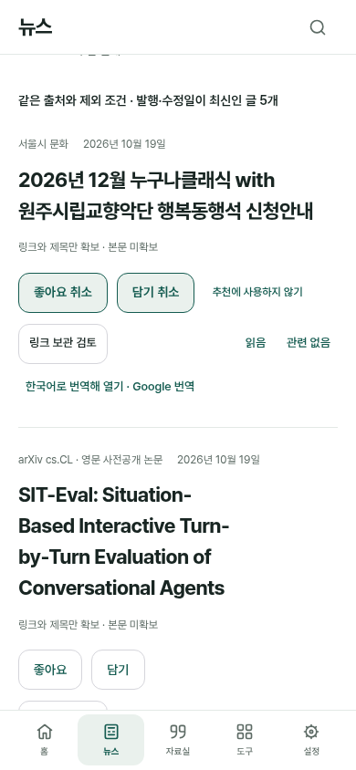
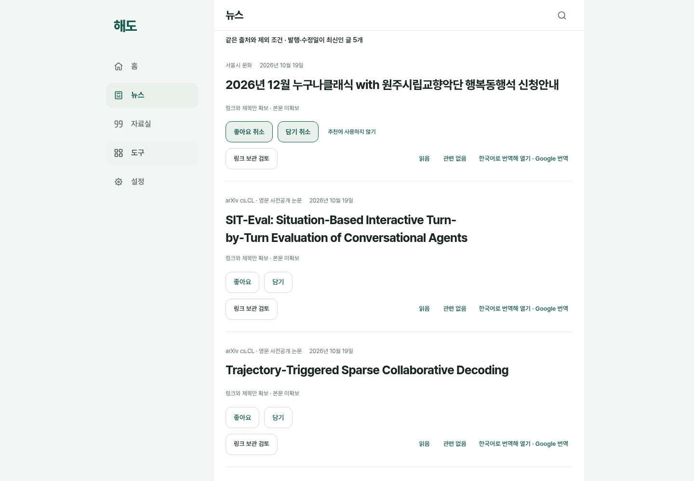

# 홈 다음 뉴스 메뉴

2026-10-20 KST. 사용자가 홈 다음에 뉴스를 두고 수집 글을 표시하도록 요청했다. 메뉴 순서는 **홈 → 뉴스 → 자료실 → 도구 → 설정**이다. `index.html?section=news`가 기존 `external-discovery` 화면·인스턴스를 재사용한다. 최초 진입은 최신순이고, 관심순·개인 추천·좋아요/담기·주제/출처·언어/번역 설정은 그대로다. 같은 공간의 재진입에서는 사용자가 고른 목록과 정렬을 초기화하지 않는다.

새 화면·수집기·저장 형식·라이브러리를 만들지 않고 기존 공식 7출처 공개 목록을 재사용했다. 뉴스는 언론 속보 전용 서비스가 아니라 기존 연구·기술·문화·책·환경의 외부 글 목록이다. 본문·이미지를 자동 수집하지 않는다. SNS 원본 쓰기·새 모델·개인 자료 자동 전송을 추가하지 않았다.

탐색·모션 순서·로그인 복귀 허용 목록·하위 화면의 복귀를 같은 경로로 연결했다. 기존 `?section=tools&view=external-discovery`, `?view=external-discovery`, `life.html` 주소를 유지한다. 뉴스 루트의 불필요한 뒤로가기를 없애고 미저장 주제/언어/반응 검사가 통과한 다음 URL을 바꾼다. 저장 실패 때 입력과 기존 URL·현재 메뉴를 유지한다. 모바일 다섯 메뉴는 기존 flex·44px 최소 조작 크기로 수용해 공통 CSS를 바꾸지 않았다. 신문 모양 아이콘은 기존 로컬 SVG 체계다.

## 검수와 한계

[검수 JSON](evidence/news-navigation/verification.json)에 범위·해시·실패 이력·최종 결과를 기록했다. 단위1078, 공통 진입13, 외부 글19, 자동 갱신23, 반응24, 언어14가 통과했다. 뉴스 연결6개는 주제 없이 최신 글 표시→좋아요/담기→언어→홈 왕복/history/기존 주소/reload→미저장 입력 차단→390/820/1440 화면을 검수하며 CI에 등록했다. 콘솔/페이지/예상 밖 외부 요청·모델 요청·모의 DB 쓰기는0이다.

기존 외부 글/반응 검사의 일부는 첫 화면을 관심순으로 가정해 최초 실패했다. 해당 검사가 관심순을 명시 선택하도록 고쳐 기존 assertion을 유지한 뒤 전체를 통과했다. 승격한 뉴스 runner의 최초 실행은 개발 서버가 중지돼 연결 실패·검사0개였으며, 원본을 남기고 서버 재시작 뒤 별도 결과로 확인한다. 실패를 제품 통과 증거로 인용하지 않는다.

정확한 기존 운영 v138 worker fixture를 보존했고 v138→139의 PWA9개가 통과했다. 양쪽 앱 모듈은 현재 코드인 old-worker-only 검사이며 실제 이전 전체 앱·사용자 DB 검증과 구분한다. 원문·수동 관심·피드백·기존 설정·언어 설정·반응과 캐시/오프라인 경로를 대조했다. 전체 cache/IndexedDB 삭제를 복구로 쓰지 않는다.

다음 이미지는 실제 코드·공개 메타데이터와 합성 Auth/로컬 반응으로 만든 **스크롤 후 기사 읽기 위치**다. 첫 화면 fold의 증거로 부르지 않는다. 총괄390/1440과 독립390/820/1440 직접 시각 검토에서 차단 문제는 없었다. 실제 Google 번역 결과·Apple 기기·실독 유용성·운영 로그인/DB 쓰기는 미실행이다.

## 출시와 로드맵

PR112의 최종 필수 CI는8개 성공했지만 첫 main 검사39361306314는 새 history 검사에서 실패해 배포가 생략됐다. 원본 보고서 보관 누락과 원인 확정 한계·400ms 비교·수정은 [화면 전환 완료 경계](news-history-readiness.md)에 기록했다. 운영 SW138과 후보139를 구분한다.

현재 문서 작성 기준은 SW139 검수 후보이며 운영 반영 완료는 해당 PR의 최종 CI·main 배포·실제 공개 파일 영수증으로 확인한다. 이전 SW138 출시 증거는 [운영 출시 검수](discovery-release.md)를 따른다. 제품 변경과 분리된 그 문서 PR111의 증거도 이번 브랜치에 포함한다.

사용자의 전체 로드맵 시각화 요청에는 [PNG](../diagrams/rendered/product-roadmap-20261020.png)·[SVG](../diagrams/rendered/product-roadmap-20261020.svg)·[PDF](../diagrams/rendered/product-roadmap-20261020.pdf)를 제공했다. 이는 10월20일 뉴스 배포 전 시점의 상태도이며 출시 뒤 날짜를 소급 변경하지 않는다. 최신 진행과 후속 완료 조건은 [로드맵](../life-tools-design/roadmap.md)을 따른다.
