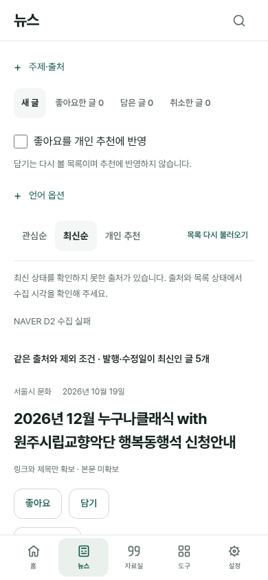
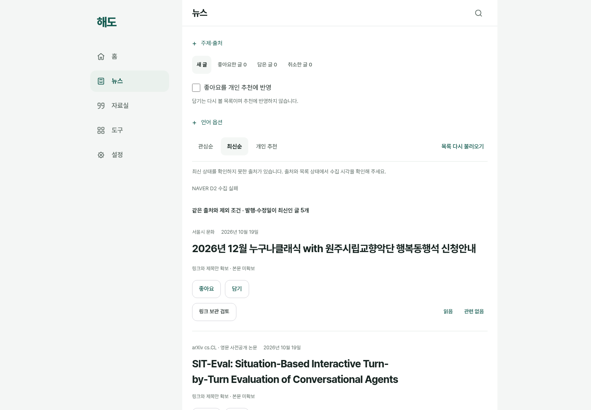

# 뉴스에서 바로 읽기와 같은 언어의 추천 비교

2026-10-20. 사용자가 다음 작업 진행과 즉시 사용을 요청했다. 기존 뉴스·공개 수집·반응·언어 옵션을 재사용해 첫 화면의 읽기 진입을 고치고, 비교 도구의 언어 조건을 맞춘다. 새 수집기·모델·서버·저장 형식은 추가하지 않는다.

## 실제 사용에서 확인한 문제와 보완

390×844의 스크롤 0 첫 화면에서 주제 편집기가 약395px를 차지해 첫 기사 제목이 y935 아래에 있었다. 앞선 뉴스 캡처는 기사가 보이는 곳으로 스크롤한 이미지였으며 이 문제의 해결 증거가 아니다. 주제 저장 뒤 최신순은 그대로인데 저장 안내만 있어 주제 필터가 적용됐다고 오해할 여지도 있었다. 한국어 표현과 영문 제목·태그의 차이로 빈 관심순이 나오는 경우도 확인했다.

- `주제·출처`를 기본 접힌 native details로 제공한다. 사용자가 열어 주제 입력·선택·출처/갱신 옵션을 쓴다. 입력 노드와 한글 조합·초점·미저장 이동 차단, 같은 공간의 열림 상태를 유지한다.
- 주제 저장으로 정렬을 자동 전환하지 않는다. 저장 뒤 `관심순으로 보기`를 사용자가 선택한다. 최신순과 주제 찾기의 차이를 설명한다.
- 주제 찾기는 공개 제목·태그 등의 실제 표현을 활용한다. 검색어 자동 번역과 번역 링크의 언어 설정을 구분하고 영문 표현을 직접 입력할 수 있게 안내한다. `Linguistics` 예시도 누르기 전에는 저장하지 않는다.
- 기존 비교 CLI에 `--content-languages all|none|ko,en`을 연결했다. 후보·좋아요 근거·신호 진단·신호 제거 기준에 같은 언어 조건을 쓴다. [사용법·보존 계약](discovery-field-languages.md)을 따른다.

## 바로 사용하는 순서

1. [뉴스](https://wonchance-art.github.io/life-haedo/index.html?section=news)에서 로그인하고 최신 글을 연다.
2. 주제로 찾으려면 `주제·출처`에서 표현을 추가하고 `관심순으로 보기`를 누른다. 연구 논문은 사전공개·발표일 기준과 출처를 확인한다.
3. `언어 옵션`에서 볼 콘텐츠 언어와 번역해서 열 언어를 따로 선택한다. 번역 링크는 명시 클릭 때만 공개 원문 주소를 Google 번역으로 보낸다.
4. 좋아요와 담기를 사용하고 각각의 목록에서 다시 연다. 추천을 원할 때만 좋아요 활용을 켠다. 좋아요·담기와 자료실의 링크 사본 보관은 별개다.

## 검수 범위와 남은 조건

실제 공개 feed는90개/7출처이며 검수 고정본 SHA는 `cb38f60f57749776c82abf4c795984bd244dc5e60a26a2e6908a7f9fb41d753c`다. 이 bytes로 언어 비교의 후보 풀이 전체90/영어40/선택없음0임을 확인했다. 주제·반응을 제공하지 않은 비교이므로 개인 추천은 disabled, 사용자 효용은 null이며 만족도·추천 개선을 증명한 결과가 아니다.

UI 변경 전에는 실제 feed+모의 Auth·실제 로컬 IndexedDB로10흐름을 확인했다. 원문·번역 각각의 명시 클릭은 모의 페이지로 응답했고, 운영 Google·출처 본문·개인 계정·DB에 접근한 결과가 아니다. 최종 UI의 첫 화면·입력 보존·업데이트와 최종 배포 확인은 아래 영수증에 확정한다.

공개 수집 설정은 매일06:15UTC(15:15KST)이며 이번 착수는 예정 시각 전이다. push 수집·배포 성공을 첫 실제 schedule 성공으로 세지 않는다. 실제 Apple 기기의 터치·IME·탭 복귀와 외부 번역 품질, 직접 읽은 뒤 유용성은 별도 미확인이다. 자동 관심 추출 비활성·AI 보고서 미구현, 책의 추가 확장 보류도 유지한다.

## 최종 영수증

후보는 **SW142 / [PR115](https://github.com/wonchance-art/life-haedo/pull/115)**다. [로컬 검수 JSON](evidence/news-ready/verification.json)에 코드 해시·검사 범위·실제 feed 언어 조건·남은 조건을 기록했다. 단위1082, 정적22HTML/146JS/624참조, 뉴스8·발견19·자동갱신23·반응24·언어14·PWA9, 실제 공개 feed 핵심7개를 확인했다. 첫 화면390/1440은 스크롤0·기사 제목 실제 hit·44px 조작을 검수하고 독립 시각/보존 검토를 마쳤다. PWA9는 기존 v138 worker→v142이며 양쪽 앱 모듈은 현재 코드인 old-worker-only 검사다.

기존 자동 갱신 검사 두 곳은 재로드 뒤 접힌 주제를 열지 않아 실패했다. 원본을 유지하고 실제 summary 클릭만 보완해 전체23개를 통과했다. 실제 feed 검수 어댑터의 중복 주제/숨은 예시 가정 오류 두 번도 보존하고 별도 핵심7개 결과와 구분한다. 제품 단언·제한 시간을 완화하지 않았다.

직전 main45b47ae/SW141은 CI10개와 운영11파일 일치가 확인된 기준이다. 이번 후보의 최종 HEAD CI와 main push/build/deploy는 [PR 검사](https://github.com/wonchance-art/life-haedo/pull/115/checks)를 따르며, PR 통과·main 병합·실제 공개 적용을 구분한다. 공개 적용은 새 SW와 실제 파일 바이트 및 공개 feed를 별도로 대조한다.

