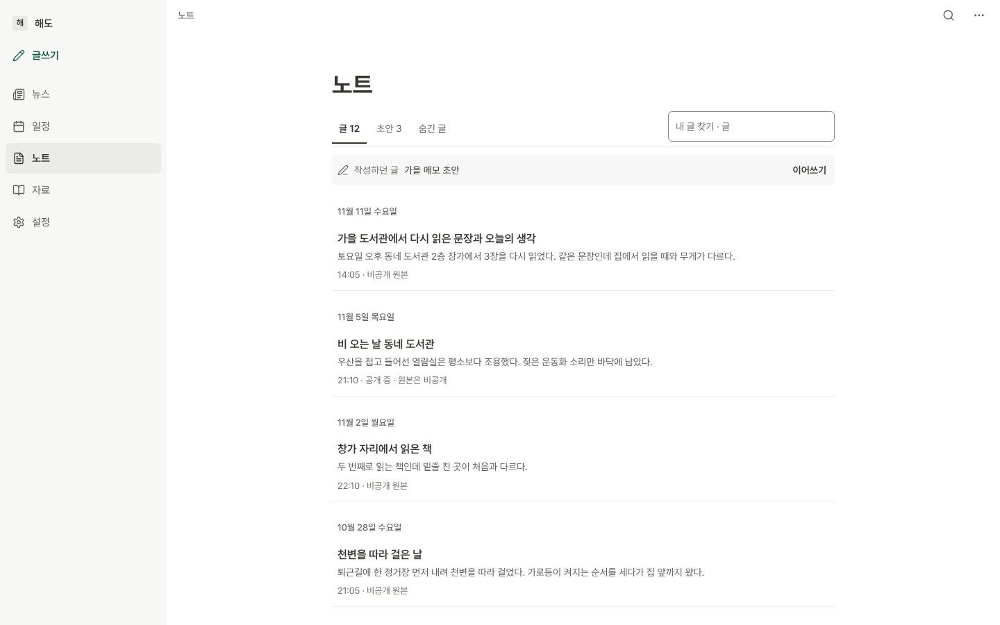
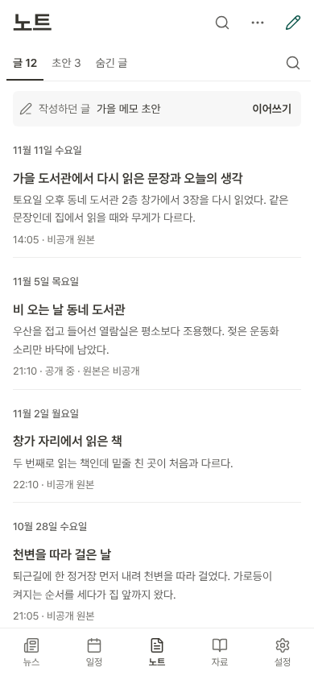
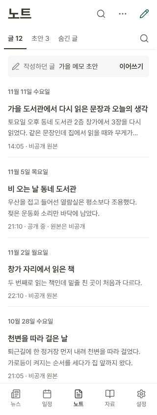
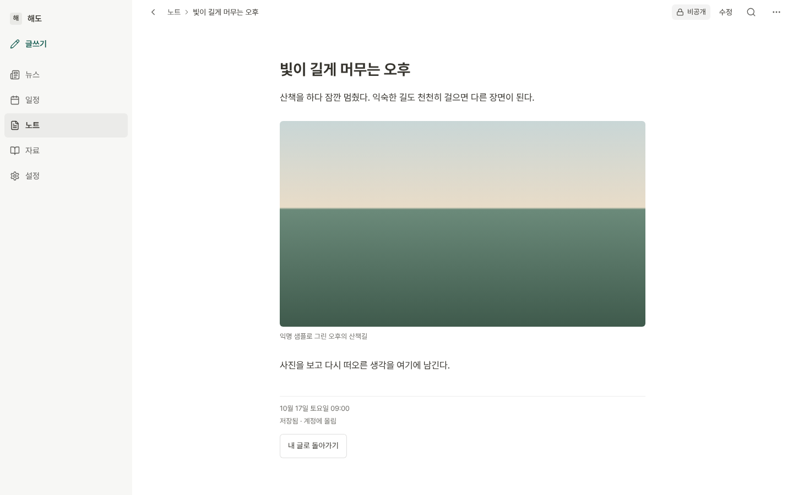
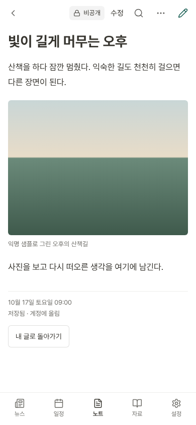
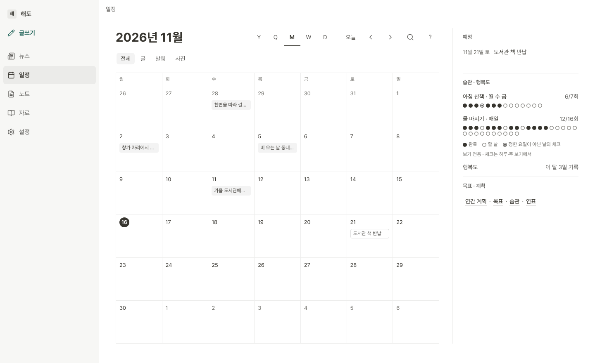
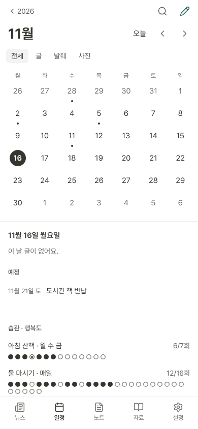
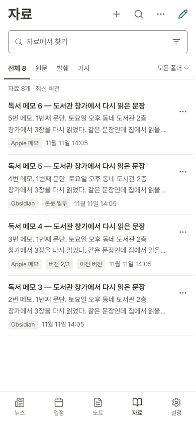

# 노션 방향 시안 — 화면 정리 제안 (2026-11-16)

- 요청(소유자, Designer 세션에 직접): "노션 레퍼런스 있으면 참고해보자. 현재 디자인 너무 구리고 난잡하다."
- 기준: main `c76e693` · 배포 `haedo-v220`. 비교 화면은 격리 브라우저의 익명 샘플이다.
- 이번 범위: 진단, 노션 원칙 조사, 시안 비교. **앱 코드는 바꾸지 않았다.**
- 시각 방향을 바꾸는 일은 소유자 결정이다. 구현은 승인 뒤 총괄이 작업 지시서로 나눈다.
- 시안: Design 캔버스 「해도 노션 방향 시안」(비공개 artifact, 소유자 계정). 데스크톱 1440과 iPhone 390에서 지금(v220) 화면과 시안을 나란히 둔다. 시안은 일정 목록, 글 읽기, 자료 세 화면이다.

## 왜 난잡해 보이는가

캡처(`unslop-audit-2026-11/`, `v218-design-check/`)와 v220 화면에서 확인한 원인이다. 하나하나는 작지만 한 화면에 겹친다.

| # | 원인 | 보이는 곳 |
| --- | --- | --- |
| 1 | 틀 안의 틀. 회색 캔버스 위에 흰 판이 있고, 그 안에 메뉴가 또 있다. | 데스크톱 일정·자료·뉴스 |
| 2 | 본문 전에 조작 줄이 2~3개 있다. | 자료 머리: 아이콘 5개, 검색 칸, 폴더 선택, `폴더 관리`, 탭, 개수 줄 |
| 3 | 같은 조작·표시가 행마다 되풀이된다. | 일정 목록: 행마다 종류 아이콘(연필·책, `rowMark`)과 제목 버튼과 같은 일을 하는 틸색 `글 읽기 →`. 자료: 행마다 정보·폴더 아이콘 |
| 4 | 틸색이 여기저기 쓰여 아무것도 앞에 서지 않는다. | 링크, 탭, 선택 상태, 행 행동, 알림 |
| 5 | 굵기가 많고 무겁다(650·700·750). 회색 분할 상자와 모서리 크기가 섞여 있다. | 제목, 탭, 분할 버튼, 카드 |
| 6 | 상태·메타 줄이 곳곳에 붙는다. | `수정 11월 11일 · 비공개 원본`, `자료 8개 · 최신 버전`, 프로필 소개 |
| 7 | 글 읽기에 도구 막대가 두 줄이다. | iPhone 읽기: 뒤로·비공개·글쓰기 줄, 그 아래 수정·내려받기·⋯·검색 줄 |
| 8 | iPhone 일정 첫 화면에 블로그 소개 묶음이 있다. 글보다 먼저 보인다. | `느린 오후의 기록` 묶음 |

## 노션에서 가져올 원칙

확인일 2026-11-16. 노션 앱에 직접 로그인해 재지는 않았다. 공식 도움말·출시 노트·디자인 블로그와, 노션 화면을 재현하는 공개 코드에서 읽은 값이다.

- 노션 디자인 쪽이 밝힌 기준은 절제다. "Good tools get out of your way."라고 했고, 간격은 이웃 블록에 따라 정한다(목록은 촘촘하게, 문단은 넉넉하게)[B1]. 디자인 책임자는 "새 도구가 모두 소리치면 안 된다"며 새로움보다 품질을 택한다고 했다[B2][F]. 2025년 Notion Mail은 "토글·라벨·버튼이 너무 많다"를 고칠 문제로 꼽았다[B3].
- 면은 둘뿐이다. 흰 본문과 아주 옅은 따뜻한 회색 사이드바다. 사이드바 값은 2020–21년 `#F7F6F3`[RNX], 2022-12 `#FBFBFA`[NE dev]로 바뀌어 왔다. 경계는 그림자 대신 1px 옅은 선(`rgb(237,237,236)`, 2022-12 `rgb(233,233,231)`)이다[NE][RNX].
- 글자색 하나(`#37352F`)에 투명도 단계만 둔다. 보조 글자, 구분선, 호버(8%)와 눌림(16%)을 같은 공식으로 만든다[RNX][NE][MF].
- 강조색은 선택·체크·주 행동에만 쓴다. 링크는 글자색에 옅은 밑줄이다[NE][RNX].
- 꼬리표는 높이 20px, 좌우 6px, 모서리 3px이다. 옅은 배경에 같은 계열의 짙은 글자를 쓴다[NE][RNX][API].
- 글자 단계가 적다. 페이지 제목 40, 제목 30·24·20, 본문 16, 보조 14 정도다. 본문 폭은 약 708px이다[ZN][RNX][NE].
- 상단 바는 경로, 공유, 댓글, 즐겨찾기, `•••`뿐이다. iPhone 상단은 공유, 댓글, `•••` 세 개다[H].
- 조작은 평소 숨기고 호버 때만 보인다. 블록 손잡이, 표지 추가, 사이드바 접기가 그렇다. 모바일에는 호버가 없다[H].
- 긴 목록은 속성 숨기기와 처음 N개만 보이기로 정리한다[H][R 2024-06].

해도에 옮길 때 바꾼 점:

- 호버에만 의존하는 조작은 쓰지 않는다. 해도는 iPad·iPhone 터치가 주 사용 환경이다. 시안은 항상 보이는 `⋯` 하나로 대신했다.
- 노션 파랑 `#2383E2`는 흰 바탕에서 글자 대비가 3.9:1이다. 4.5:1에 못 미친다. 캔버스의 파랑 선택지는 `#1A6FC3`(흰 바탕 5.1:1, `#F7F7F5` 4.8:1)으로 어둡게 했다.
- 사이드바는 `#F7F7F5`로 두었다. `#F7F6F3`보다 노란 기가 적고, `#FBFBFA`보다 흰 읽기 면과 구분된다. 메타 글자 `#6F6E69`가 이 바탕에서 4.76:1이다.
- 선택 바탕은 노션 호버(8%)보다 옅은 6%로 두었다. 흰 바탕 위 선택에서는 메타 글자가 4.60:1로 통과한다. 사이드바 위 선택(`#EBEBE9`)에서는 메타 글자가 4.28:1로 미달이므로, 사이드바 항목에는 보조 글자(`#5F5E5B`, 5.43:1) 이상만 쓴다. 시안의 사이드바는 이 규칙을 지킨다.

출처:

| 약어 | 출처 |
| --- | --- |
| H | Notion 도움말: [Customize & style](https://www.notion.com/help/customize-and-style-your-content), [Writing & editing basics](https://www.notion.com/help/writing-and-editing-basics), [Navigate with the sidebar](https://www.notion.com/help/navigate-with-the-sidebar), [Workspaces on mobile](https://www.notion.com/help/workspaces-on-mobile) |
| R | [Notion 출시 노트](https://www.notion.com/releases) 2021-10-19(색 대비), 2022-03-03(더 깊은 색), 2024-06-11, 2026-07-30(고대비 모드) |
| B1 | [Updating the design of Notion pages](https://www.notion.com/blog/updating-the-design-of-notion-pages) |
| B2 | [Meet Randy](https://www.notion.com/blog/meet-randy) |
| B3 | [Q&A with Notion Mail founders](https://www.notion.com/blog/qa-with-notion-mail-founders) |
| F | [Fortune 2026-06-12, Randy Hunt 인터뷰](https://fortune.com/2026/06/12/it-isnt-our-goal-for-design-to-be-distinctive-says-notion-design-head-randy-hunt-on-prioritizing-quality-over-novelty-when-building-ai-apps/) |
| API | [Notion API property object](https://developers.notion.com/reference/property-object) |
| NE | `notion-enhancer`(MIT). npm 0.11.0은 2021-12-31 게시, dev 브랜치 `src/core/variables.css`에 2022-12~2023-01 값. 2024-11 이후 멈췄다. 노션 인라인 스타일을 덮어쓰는 코드라 당시 값이 들어 있다 |
| RNX | npm `react-notion-x` 8.0.8(2026-09). 노션 페이지를 재현하는 코드 |
| MF | [matthiasfrank.de Notion colors](https://matthiasfrank.de/en/notion-colors/)(2차 출처, 검색 요약으로 확인) |
| ZN | [zenn.dev 실측 메모](https://zenn.dev/ikenohi/scraps/f0d8482d1362d5)(2차 출처) |

NE·RNX·MF·ZN의 값은 노션 공식 값이 아니다. 실제 화면과 다를 수 있다. 시안은 이 값을 그대로 옮기지 않고 해도 대비 기준에 맞춰 고쳤다.

## 참고 오픈소스·스킬 조사 (2026-11-16)

비교 표와 근거는 [오픈소스 검토 기록](../life-tools-design/open-source-review.md)의 「노션풍 화면의 참고 오픈소스·스킬」 절에 있다. 요약:

- **그대로 설치할 노션 디자인 오픈소스·스킬은 없다.**
  - 퍼져 있는 노션 DESIGN.md는 사실상 한 원본(VoltAgent)과 그 복사본이다. 값은 노션 작업 앱이 아니라 홍보 사이트에서 왔다.
  - 노션 이름이 붙은 스킬은 값이 틀렸거나 라이선스가 흐리다.
  - Tiptap의 노션형 템플릿은 유료다.
- **쓸 만한 것은 셋이다.**
  - Radix Colors sand(MIT): 노션 색조에 가장 가깝다. 대조와 앞으로의 어두운 화면 값에 쓴다.
  - 이미 들인 Tiptap의 MIT 확장(Placeholder·Focus·suggestion): D2 편집기의 노션 느낌을 낸다.
  - Anthropic `frontend-design` 등 지침의 몇 문장: "강조는 한 곳", 같은 카드·메타 문자열 반복 경계.
- **노션의 차분함 일부는 4.5:1 미달인 옅은 회색 글자에서 온다.** 해도는 이것을 옮기지 않는다. 시안의 회색은 일부러 더 짙다.

## 다른 방안

1. **노션 값을 들이지 않고 원칙만 옮긴다.** 이 문서의 시안이 그 방식이다. 기준 파일은 지금의 `DESIGN.md` 하나로 유지한다.
2. **한 화면 먼저 실제로 바꾸고 실기기에서 써 본 뒤 넓힌다.** 공통 토큰(묶음 A)과 일정 목록만 먼저 바꾼다. 소유자가 iPhone·iPad에서 며칠 쓰고 판단한다. 맞으면 B·C로 넓히고, 아니면 토큰만 되돌린다. 숨긴 화면이나 실험용 분기는 두지 않는다.
3. **편집기의 노션 느낌은 D2에서 따로 낸다.** 빈 줄 안내, 현재 블록 표시, `/` 메뉴는 이미 들인 Tiptap 확장으로 만든다. 터치 기기에서는 보이는 `+`·`⋯` 버튼과 `위로/아래로 옮기기`를 쓴다. 화면 정리와 섞지 않는다.
4. **비교 대상을 노션 하나로 좁히지 않는다.** 해도는 협업 문서 도구가 아니라 개인 글·자료 앱이다. 읽기 화면은 Apple 메모·Bear·iA Writer류의 본문 집중이 더 가깝다. 노션에서는 목록·속성·메뉴의 절제만 가져온다.

## 시안의 값

해도 규칙(Pretendard, Lucide, 44px 조작, 소유자 상태 문구, 기능어)을 그대로 두고 노션의 절제만 가져왔다.

| 항목 | 지금(v220) | 시안 |
| --- | --- | --- |
| 바탕 | 옅은 초록 회색 캔버스 + 흰 판 | 흰 바탕 하나. 데스크톱 메뉴만 따뜻한 회색 `#F7F7F5` |
| 글자색 | 짙은 초록 회색 여러 단계 | 먹색 `#37352F`, 보조 `#5F5E5B`, 메타 `#6F6E69`. 흰 바탕과 `#F7F7F5` 위에서 모두 4.5:1 이상 |
| 강조색 | 짙은 틸, 여러 곳 | 한 화면에 한 곳(`글쓰기`). 캔버스에서 틸 `#145B50`·파랑 `#1A6FC3`·먹색을 바꿔 볼 수 있다 |
| 구분 | 회색 상자, 카드 | 머리카락 선 `rgba(55,53,47,.09)`, 선택은 `rgba(55,53,47,.06)` 바탕 |
| 굵기 | 650·700·750 | 400·500·600. 화면 제목만 700 |
| 모서리 | 섞여 있음 | 4~6px |
| 크기 | — | 화면 제목 34(데스크톱)·24(iPhone), 글 제목 36·26, 행 제목 16, 본문 17·16, 메타 13 |
| 조작 | 44px | 44px 유지. 보이는 바탕은 28px, 누르는 범위는 44px |

## 화면별 변경

시안 화면(캔버스 보드를 격리 브라우저에서 같은 값으로 그린 것, 11-16 메뉴 결정 반영):

| 데스크톱 1440 | iPhone 390 · 320 |
| --- | --- |
|  |   |
|  |  |
|  |  |
| |  |

지금 화면은 [unslop 점검 캡처](unslop-audit-2026-11/)와 [v218 점검 캡처](v218-design-check/)에 있다.

11-16 메뉴 결정과 독립 검수를 반영한 최종 규칙은 [구현 계약](notion-visual-contract.md)이 기준이다. 아래는 시안 요약이다.

**노트 (예전 일정 목록)**

- 행 전체가 제목 버튼 하나의 동작이다. 행마다 있던 종류 아이콘과 제목 버튼과 같은 일을 하는 `글 읽기 →`를 뺐다.
- 행은 제목, 발췌, 메타 한 줄(시각 · 공개 표시 문구 그대로, 예: `14:05 · 비공개 원본`), 사진이 있으면 오른쪽 작은 사진이다.
- `글 · 초안 · 숨긴 글`은 회색 분할 상자 대신 밑줄 탭이다. 그 아래 `작성하던 글 · 이어쓰기` 한 줄.
- 머리: 데스크톱은 경로와 `통합 검색`·`글 메뉴`, iPhone은 `통합 검색`·`글 메뉴`·`글쓰기`.

**일정 (달력만)**

- 모든 단위가 같은 틀이다: 제목, 단위 글자 탭 `Y Q M W D`, `오늘 ‹ ›`, `통합 검색`, `단축키 (?)`, 거르기 `전체 · 글 · 발췌 · 사진`, 본문, 옆 칸 `예정 → 습관 · 행복도 → 목표 · 계획`.
- 월 칸은 회색 채움 대신 1px 선 격자이고, 오늘은 먹색 원이다. iPhone은 단계 막대 없이 `‹ 2026`.

**글 읽기**

- 도구는 한 줄이다: 뒤로, 공개 알약, `수정`, `통합 검색`, `⋯`(사진 포함 백업·삭제), iPhone `글쓰기`.
- 제목 바로 아래 본문이 오고, 글 끝 선 아래 날짜·저장 상태·`내 글로 돌아가기`를 둔다(11-02 결정, D1 배치 유지). 처음 시안의 제목 아래 속성 줄은 이 결정과 어긋나 뺐다.

**자료**

- 머리: `가져오기` · `통합 검색` · `⋯`(기록 선택·폴더 관리) · `글쓰기`.
- 검색 칸은 테두리를 유지하고 안에 `검색 필터` 하나. 개수 상태 줄(`자료 8개 · 최신 버전` 등)은 탭 아래 메타로 그대로 둔다.
- 행의 정보·폴더 아이콘 둘은 `⋯` 하나로 합친다. 원천과 사실 표시(`본문 일부`, `버전 2/3`, `이전 버전` 등)는 꼬리표로 모두 남긴다.

## 바꾸지 않는 것

- 전역 메뉴 뉴스·일정·자료·설정, 글쓰기 자리(데스크톱 왼쪽 메뉴 맨 위, iPhone 오른쪽 위).
- Y/Q/M/W/D 글자 보기, iPhone 하단 탭, 습관 확인 칸(44px 정사각, 모서리 12).
- 저장 상태 문구 세 가지, 공개는 명시적 선택, 비공개 기본.
- Pretendard, Lucide 선 아이콘, 조작 44px, 본문 대비 4.5:1.
- 가짜 반응·팔로워 같은 사회적 장식은 넣지 않는다.

## 노션에서 가져오지 않는 것

- 페이지마다 이모지 아이콘과 표지 이미지. 해도 규칙(이모지 라벨 금지, 기능어)과 맞지 않는다.
- 사이드바의 페이지 나무, 데이터베이스 보기, 글자색·배경색 블록. Markdown 정본과 맞지 않거나 해도에 없는 기능이다.
- 노션 로고·워드마크·손그림 삽화·`Untitled` 같은 고유 문구, 화면 구성을 그대로 베끼는 것.
- 노션 전용 서체(Lyon Text 등)와 영문 UI 서체. 한글 본문은 Pretendard를 유지한다.
- 호버에만 나타나는 조작. 터치에서 찾을 수 없다.
- `/` 메뉴·블록 끌어 옮기기 같은 편집기 기능을 화면 정리와 함께 들이는 것. 편집기는 이미 정한 D2 범위(`write-read-redesign.md`)에서 따로 한다.

## 소유자 판단 (11-16 진행 지시로 기본값 확정)

소유자가 11-16 "디자인 위주로만 ㄱㄱ"로 진행을 지시했다. 아래 항목은 시안의 권고값으로 진행하고, 구현은 [구현 계약과 작업 분리](notion-visual-contract.md)를 따른다. 같은 날 메뉴 결정(뉴스·일정·노트·자료·설정, [notes-menu](notes-menu.md))에 맞춰 시안의 `일정 목록`은 `노트`가 됐다. 일정은 달력만 맡는다.

1. 이 방향을 채택할지. 채택하면 `DESIGN.md`의 현행 규칙("옅은 초록 회색 캔버스·짙은 틸 조작")이 바뀐다.
2. 강조색: 틸 유지 / 파랑(노션 파랑을 대비 기준에 맞춰 어둡게 한 `#1A6FC3`) / 먹색. 시안 기본값은 틸이다.
3. iPhone 일정 첫 화면의 블로그 소개 묶음을 빼고 설정이나 공개 블로그 쪽으로 옮길지.
4. 행마다 있던 수정·`글 읽기 →`를 빼는 것(행 전체 눌러 읽기).
5. 자료 행의 정보·폴더를 ⋯ 하나로 합치는 것. 폴더 옮기기가 한 번 더 눌러야 하는 일이 된다.

## 구현 묶음 제안 (승인 뒤)

| 묶음 | 내용 | 보존·검사 |
| --- | --- | --- |
| A. 바탕과 토큰 | `DESIGN.md`·`.impeccable/design.json`·공통 CSS 변수의 색·굵기·모서리, 회색 캔버스와 흰 판 걷어 내기, 데스크톱 메뉴 바탕 | 실제 표면색 기준 대비·색각 검사, 모든 화면 1440·820·390 캡처 비교 |
| B. 일정 목록과 글 읽기 | 행 정리, 읽기 도구 막대 한 줄, 속성 줄 | 기존 링크·키보드 이동, 저장 상태 문구, 공개 알약 동작, 일정 브라우저 검사 전체 |
| C. 자료·뉴스·설정 머리 | 아이콘 묶음을 ⋯로, 검색 줄과 거르기, 탭 | 여러 개 고르기·폴더 관리·버전 거르기 접근 경로, 자료 브라우저 검사 전체 |

A가 먼저다. B와 C는 A 뒤에 병렬로 맡길 수 있다. 디자인 최종 판단과 공통 스타일 통합은 디자인 책임자 한 명이 맡는다.

## 확인하지 못한 것

- 시안은 캔버스 안의 정적 화면이다. 실제 앱의 상태(빈 목록, 저장 실패, 긴 제목, 한글 입력)는 구현 때 확인한다.
- 실제 iPad·iPhone 확인은 하지 않았다.
- 노션의 값 중 공식 문서에 없는 것은 공개 코드·2차 출처에서 얻은 근삿값이다(위 출처 참고). 현재 노션 사이드바 색과 기본 폭은 확인하지 못했다.
