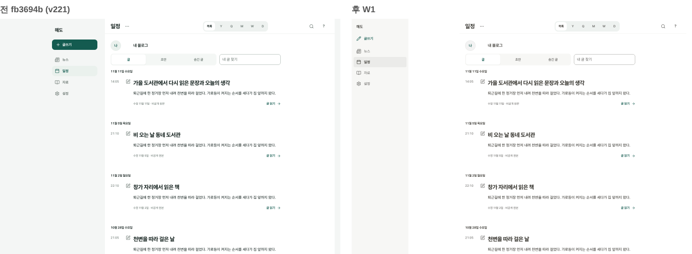
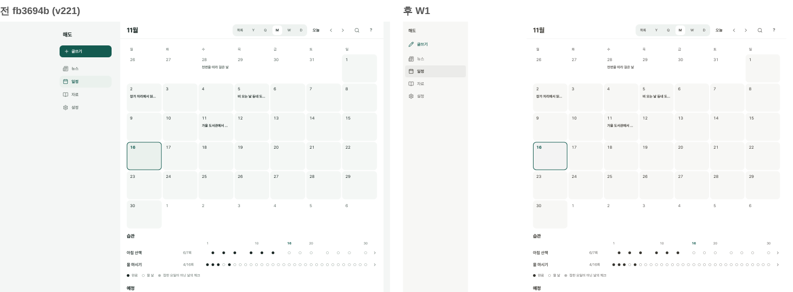
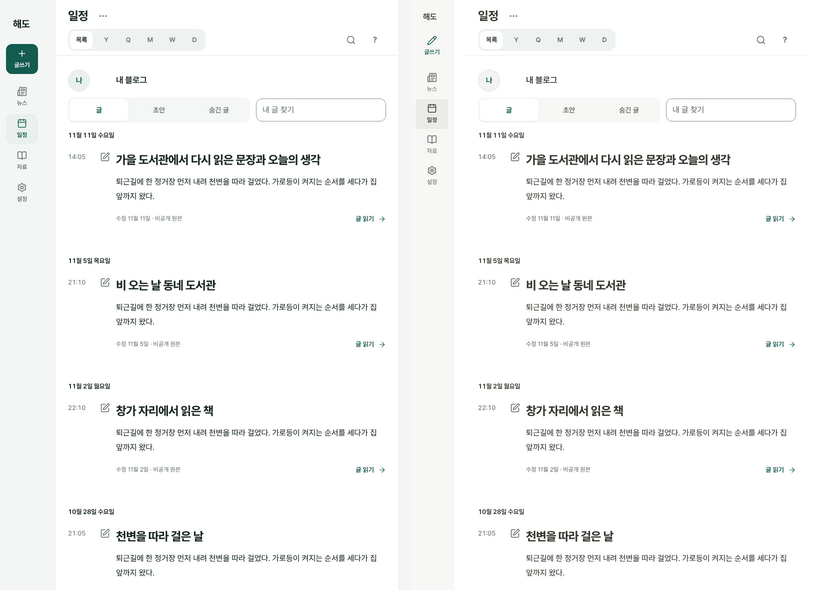
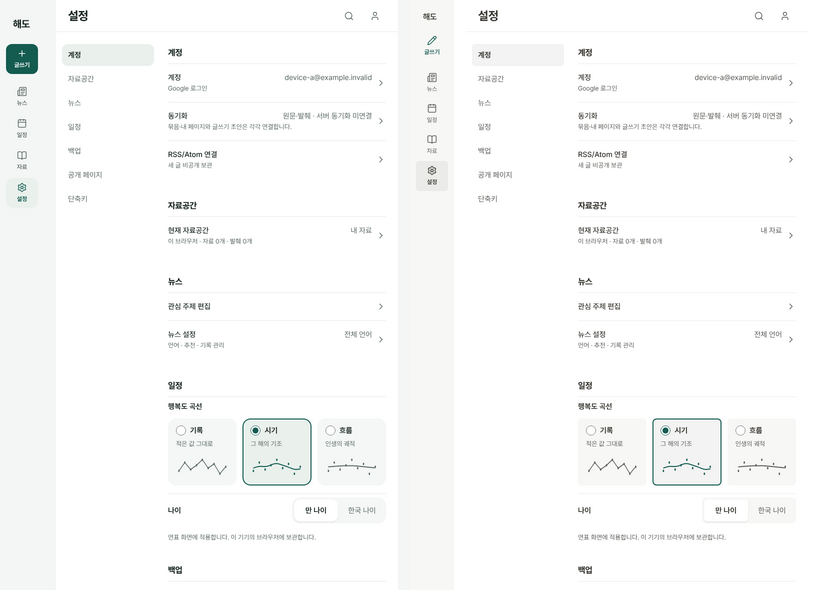
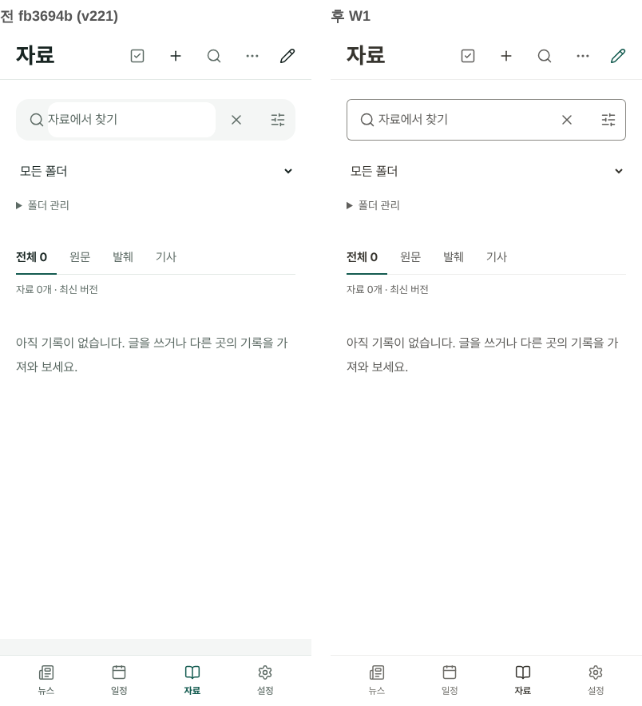
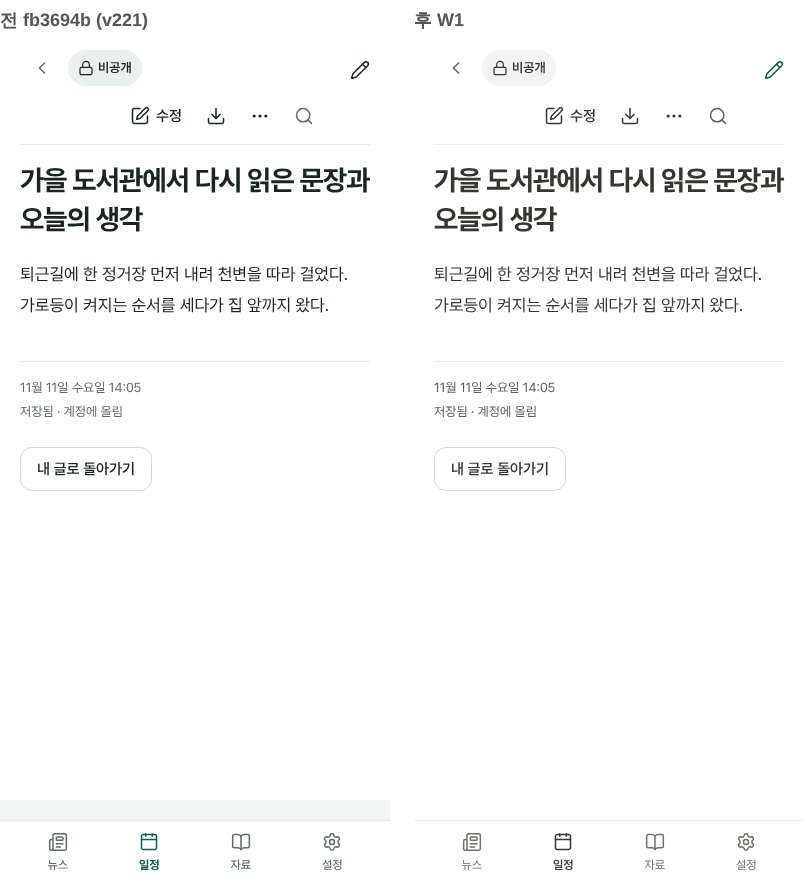
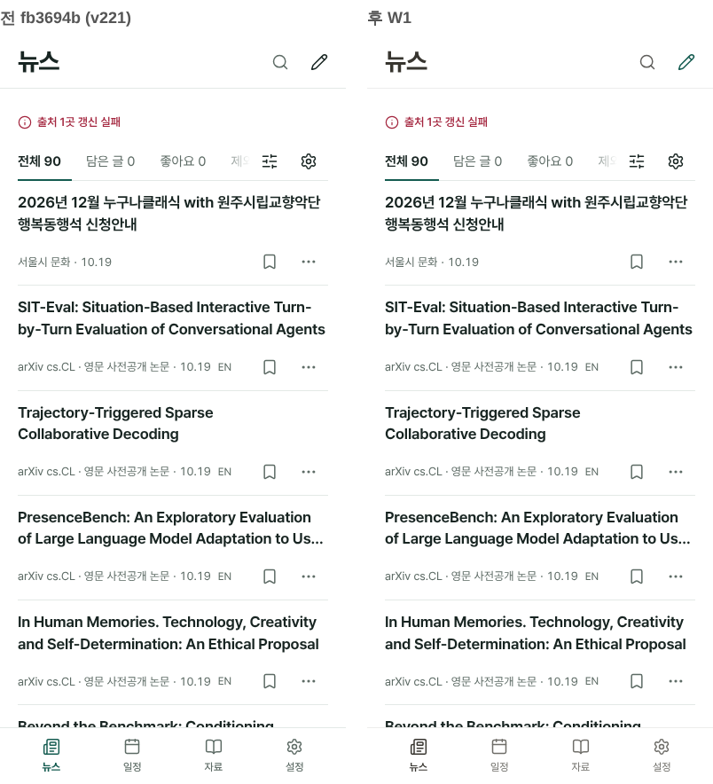
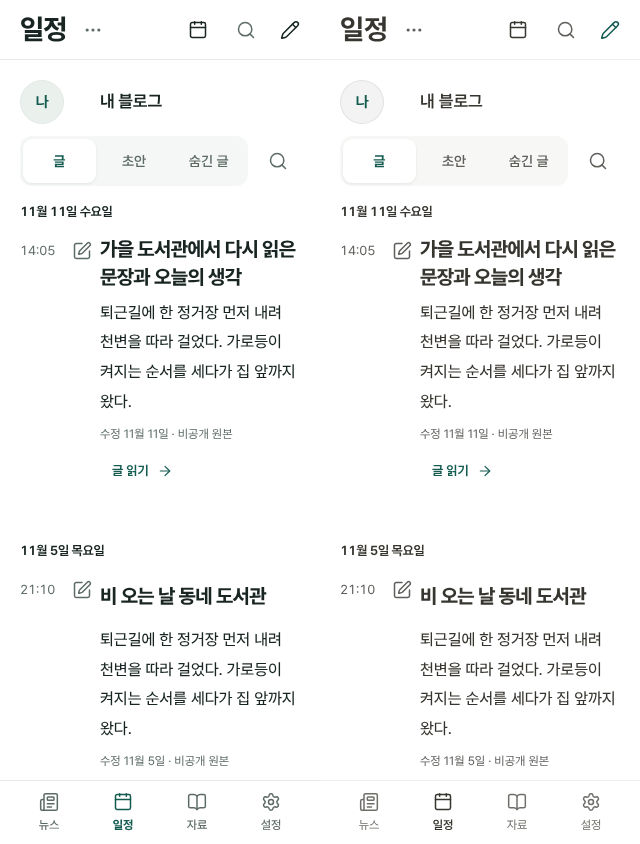

# 노션 방향 W1 바탕·토큰 — 구현 보고 (2026-11-16, Designer)

- **지시:** 총괄의 11-16 작업 지시(소유자 11-16 "권장대로 계속 진행"). [구현 계약](notion-visual-contract.md)의 W1이다.
- **기준:** 통합 브랜치 `claude/confident-ramanujan-kc31xs` 최신 head `fb3694b`(= main, v221 배포판, #248 `f919e5f` 포함). 처음에는 `0a42b6f`에서 만들었고, 통합 브랜치가 움직여 W1 커밋을 그 위로 옮겼다(충돌 없음).
- **범위:** 앱 화면(`body.haedo-shell`)의 바탕·색·굵기·모서리 토큰, 메뉴 면, 하단 탭, 회색 채움 이전, 노트 아이콘, `DESIGN.md`·`.impeccable/design.json`.
- **하지 않은 것:** 화면 본문(노트·일정·글 읽기·자료의 행·머리 구조)은 W2–W4 담당이라 손대지 않았다. `ui.css`·`home.css`·`workbench.css` 파일 자체도 고치지 않았다. 공개 페이지가 같은 파일을 읽기 때문에, 바뀌는 규칙은 `haedo-shell.css` 안 `.haedo-shell` 범위에 두었다. 예외는 앱(`index.html`·`life.html`)만 읽는 `schedule.css`·`annual-plan.css`·`records.css`의 틀 시작선 한 줄씩이다. 곧 들어올 F(`ui.css` `.life-save-quiet`)와 충돌하지 않는다. `sw.js` CACHE는 올리지 않았다(총괄이 배포 때).

## 바꾼 것

| 파일 | 내용 |
| --- | --- |
| `assets/haedo-shell.css` | 토큰(아래 표), 메뉴 면(1101px 이상 240px, 761–1100px 88px, 화면 높이), 조용한 `글쓰기`(채움 없는 틸 연필·글자), 현재 항목 선택 면·먹색·600, 하단 탭 현재 먹색 600·나머지 메타 400, iPhone 연필 틸, 굵기 750·650·550 → 700·600·400, 큰 제목 자간 -0.01em, 모서리 토큰, 계정 메뉴 그림자, 회색 채움 이전·검색 일치 강조·두 번째 표시(`.haedo-shell` 범위) |
| `assets/haedo-type.css` | `--haedo-text-page-title: 34px`(W2–W4가 쓴다), 굵기 토큰 400/500/600/700 |
| `assets/life/icons.js`, `vendor/lucide/` | 노트 아이콘 `note` = Lucide 1.51.0 `file-text`(아래 출처) |
| `DESIGN.md`, `.impeccable/design.json` | 색·모서리·메뉴 규칙과 설명을 새 기준으로 |
| `assets/life/schedule.css`, `assets/life/annual-plan.css`, `assets/life/records.css` | 메뉴 폭이 216 → 240px로 바뀌며 어긋난 틀 시작선 두 곳(아래 "메뉴 폭에 맞춘 틀 시작선"). 각 한 줄이며 W2·W4가 이어받는다 |
| `tests/` 5개 | 바뀐 규칙을 단언하던 곳(아래). 규칙 변경이며 단언 약화가 아니다 |

### 토큰과 실제 표면 대비

값은 계약 표와 같다. 아래 "실측"은 W1 화면을 격리 브라우저(가짜 클라우드, 익명 샘플)에서 열어 계산된 스타일로 잰 값이다.

| 쓰임 | 글자 / 표면 | 대비 |
| --- | --- | --- |
| 본문 먹색 / 흰 바탕 | `#37352F` / `#FFFFFF` | 12.26 (실측) |
| 데스크톱 메뉴 보조 / 메뉴 면 | `#5F5E5B` / `#F7F7F5` | 6.04 (실측) |
| 데스크톱 현재 항목 먹색 / 메뉴 면 위 선택 표시(`#EBEBE9`) | `#37352F` / `#EBEBE9` | 10.27 |
| 데스크톱 `글쓰기` 틸 / 메뉴 면 | `#145B50` / `#F7F7F5` | 7.41 (실측) |
| iPhone 하단 탭 나머지 메타 / 흰 바탕 | `#6F6E69` / `#FFFFFF` | 5.11 (실측) |
| iPhone 하단 탭 현재 먹색 / 흰 바탕 | `#37352F` / `#FFFFFF` | 12.26 (실측) |
| iPhone 연필 틸 / 흰 바탕 | `#145B50` / `#FFFFFF` | 7.95 (실측) |
| 입력·검색 칸 테두리 / 흰 바탕 | `#8A8984` / `#FFFFFF` | 3.50 (비글자 3:1) |
| 습관 완료 칸 흰 글자 / 먹색 채움 | `#FFFFFF` / `#37352F` | 12.26 |

- 메타 `#6F6E69`는 메뉴 면 위 호버(4.45)·선택(4.28)에서 미달이라 메뉴에는 쓰지 않는다. 메뉴의 보조 글자는 `#5F5E5B`다.
- 색각: 이번 단계는 상태색을 바꾸지 않았다. 현재·선택 상태에는 색 말고도 굵기(600)나 면을 함께 쓴다.

## 전·후 화면 (익명 샘플, 가짜 클라우드, 기준 `0a42b6f` → W1)

왼쪽이 전, 오른쪽이 후다. 1440·820은 50%로 줄였다. 네 폭 모두 가로 넘침 0, 콘솔·페이지 오류 0이었다(일정 목록·M·D·자료·뉴스·설정·글 읽기 × 1440·820·390·320).

| 화면 | 그림 |
| --- | --- |
| 일정 목록 1440 |  |
| 일정 M 1440 |  |
| 일정 목록 820 |  |
| 설정 820 |  |
| 자료 390 |  |
| 글 읽기 390 |  |
| 뉴스 390 |  |
| 일정 목록 320 |  |

남는 것은 의도한 차이다. 달력의 회색 칸, 행의 종류 아이콘·`글 읽기 →`, 틸 탭·버튼처럼 화면 본문에 속한 것은 W2–W4가 바꾼다.

## 공개 페이지

- 공개 5쪽(`blog`·`cover`·`series`·`share`·`taste`)은 `haedo-shell.css`를 읽지 않는다. `body`에 `haedo-shell` 클래스도 없다.
- 이 5쪽이 읽는 파일 중 바뀐 것은 둘이고, 둘 다 화면 규칙을 바꾸지 않는다.
  - `ui.css`가 가져오는 `haedo-type.css`: 새 변수만 더했다.
  - `share.html`의 `icons.js`: 그림 하나만 더했다.
- 공개 검사 결과는 아래 "검사" 절에 있다.

## 사용처 분류

### `--soft`(앱에서는 새 선택 면) 사용처

| 사용처 | 지금 두 번째 표시 | W1 조치 | 남은 담당 |
| --- | --- | --- | --- |
| `ui.css:109` 검색 일치 `mark` | 없음 | `--haedo-mark`로 분리 | — |
| `ui.css:124` 원천 선택 `aria-pressed` | 없음 | 1.5px 먹색 테두리 | W4(모양 다듬기) |
| `ui.css:357` 기능 메뉴 현재 항목 | 없음 | 600 | — |
| `ui.css:474` 찾기 탭 `aria-pressed` | 먹색 | 600 | — |
| `ui.css:58·98·116·202·316`, `workbench.css` 여러 곳, `settings.css:47`, `home.css:72` | 틸 글자 | 없음(지금은 틸이 두 번째 표시) | 틸 → 먹색 600으로 바꿀 때 각 단위(W2·W4·W5) |
| `settings.css:75` 설정 목차 현재 | 먹색·650 | 없음 | W4(650 → 600) |
| `ui.css:349` 기능 메뉴 열림, `ui.css:356`·`workbench.css:296` 호버, `habit-tracker.css:22`·`platform.css:117` 눌림 | 일시 상태 | 없음 | — |
| `ui.css:21` `::selection` | — | 셸이 이미 `#DCECE4`로 덮음 | — |
| `home.css:8` 아바타 | 장식 | 없음 | W2(프로필 묶음 이동) |

### 틸(`--color-primary`, `--haedo-accent`) 사용처

규칙은 계약의 "틸 규칙"이다. 아래 집계는 선택자 이름으로 1차 분류한 것이다. 각 단위는 자기 파일에서 줄마다 다시 판단해 고친다. 공개 4곳은 범위 밖이다.

| 담당 | 토큰 정의 | 유지 | 먹색으로 | 그대로(공개) |
| --- | --- | --- | --- | --- |
| W1 | 2 | 19 | 0 | 0 |
| W2 | 0 | 5 | 33 | 0 |
| W3 | 0 | 0 | 0 | 0 |
| W4 | 0 | 9 | 15 | 0 |
| W5 | 3 | 21 | 33 | 0 |
| 공개(범위 밖) | 0 | 0 | 0 | 4 |

- **W1:** 자기 파일의 "먹색으로"는 모두 고쳤다(환영 화면 아바타 등). 노트 목록의 보조 쓰기 버튼(`haedo-shell.css` `#lifeMain[data-mode=home] .life-primary`, 틸 글자)은 notes-menu가 노트에서 쓰기 버튼을 없앨 때 함께 정리하도록 W2로 넘겼다.
- **W3:** `photo-post.css`는 틸 토큰 대신 팔레트 밖 파랑 `#3156D3`(링크, unslop 점검 지적)을 쓴다. 계약의 "글 안 링크는 먹색 + 밑줄"에 따라 W3가 고친다.
- **줄 단위 목록:** 같은 분류 스크립트로 다시 만들 수 있다. 판단 기준은 계약의 틸 규칙이다. 주 행동·초점·체크·인용 바·진행 막대·빈 상태 첫 행동은 유지하고, 탐색·탭·거르기·눌림·현재·행·머리 아이콘은 먹색으로 바꾼다.

## 바뀐 규칙에 맞춰 고친 검사

| 검사 | 전 | 후 | 이유 |
| --- | --- | --- | --- |
| `unified-home-browser.cjs:442` | `글쓰기` 흰 글자·틸 채움 | 틸 글자·채움 없음 | 메뉴 면 위 조용한 글쓰기(계약) |
| `app-motion-browser.cjs:160` | 현재 탭 750·틸 | 600·먹색 | 탐색의 틸은 글쓰기 하나 |
| `habit-tracker-browser.cjs:135`·`:298` | 완료 채움 `rgb(24, 37, 34)` | `rgb(55, 53, 47)` | 먹색 토큰 변경 |
| `sns-blog-experience-browser.cjs:105` | 메뉴 예약 216px | 240px | 메뉴 폭 토큰 변경 |
| `records-split-resize-browser.cjs:275`·`:283` | 1920px에서 `End` = 700px, 끌기 뒤 300px | `End` = 구분선 `aria-valuemax`, 끌기 뒤 최대값 − 400px(최대값 − 400 ≥ 280도 단언) | 700은 메뉴 216px일 때 1920px 화면의 최대값이었다. 최대값 식(`내용 폭 − 44 − 420`)은 같은 검사의 1440px 단계가 따로 단언한다 |

`habit-tracker-browser.cjs:118`(오늘 표시 750·틸)은 W1에서 바뀌지 않는다. 계약대로 W2가 고친다.

## 메뉴 폭에 맞춘 틀 시작선

메뉴 면을 216 → 240px로 넓히자 브라우저 검사 두 개가 실제 어긋남을 잡았다. 둘 다 고쳤고 기준판에서는 통과하던 검사다.

- **일정·연간 계획 1101px 이상** (`planning-frame-browser`): 일정·연간 계획의 넓은 틀은 메뉴 216px를 전제한 식(`max(16px, (100vw − 1000px)/2) + 224px − 메뉴 폭`)으로 시작선을 맞췄다. 메뉴가 넓어지면 목표·습관·연표의 `‹`·제목보다 12px 왼쪽에 놓였다(1440px에서 456 대 468). 이제 다른 화면의 768px 틀과 같은 식 `max(16px, (100% − 768px)/2)`을 쓴다. 메뉴 216px에서는 이전 식과 값이 같다.
- **자료 나눔 1101px** (`records-split-resize-browser`): 원문을 열면 목록 280 + 구분선 44 + 읽기 칸 420이 들어가야 한다. 메뉴 240px에서 1101px 화면의 내용 폭이 742.5px라 읽기 칸이 418.5px로 줄었다. 1101–1103px에서만 틀 시작선을 최대 1.5px 당겨 792px(744 + 틀 안쪽 여백 48)를 남긴다. 1104px 이상은 시작선이 다른 화면과 같다.
- 두 파일은 계약상 W2(`schedule.css`)·W4(`records.css`) 담당이다. 메뉴 폭을 바꾼 단위가 같은 커밋에서 맞춰야 CI가 녹색이라 W1에서 한 줄씩 고쳤다. 이후 시각 변경은 각 단위가 한다.

## 노트 아이콘 출처

- npm `lucide-static@1.51.0`. tarball sha512가 `vendor/lucide/UPSTREAM.json`의 기록과 같다.
- `package/icons/file-text.svg`를 바꾸지 않고 복사했다. SHA-256 `aa6b6d77f35a0cb22a412fcdf8a3a317850ff6aa58810c91eab2b42a2311150d`.
- `tests/icons.test.cjs`가 모양 일치와 "개념 하나에 그림 하나"를 확인한다(통과).

## 검사

결과는 실제 종료 코드로만 판정했다.

- `npm run check`: 0 (22 HTML, 202 JS, 803 로컬 참조)
- `npm test`: 0 (2860/2860)
- `node scripts/check-markdown-links.cjs`: 허용 목록 밖 0
- 브라우저 검사(`pages.yml` 묶음 1–7과 시작 성능): 결과는 아래 표
- 공개 검사 4개(로컬 PostgreSQL 16 UTF8, 소켓 전용): 결과는 아래 표

<!-- w1-suite-results -->

## 확인하지 못한 것

- 실제 Mac·iPad·iPhone, Safari/WebKit, VoiceOver, forced-colors 실기
- 어두운 화면(아직 없음)
- PostgreSQL 17(CI 판)과의 차이
