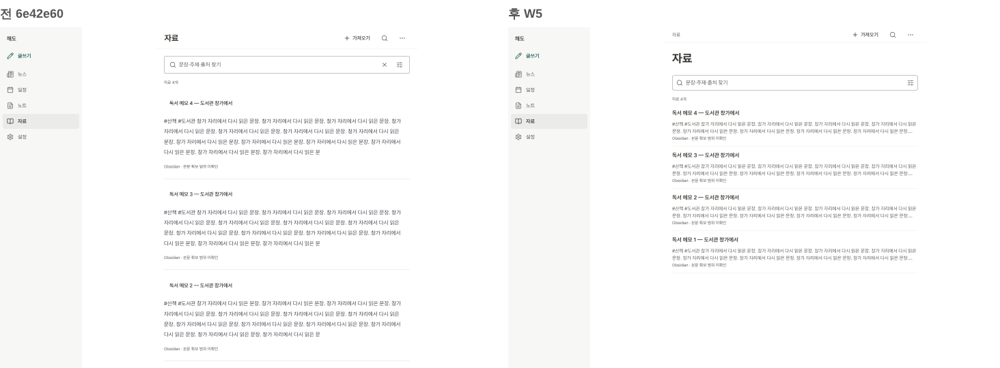
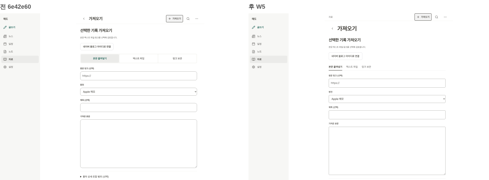
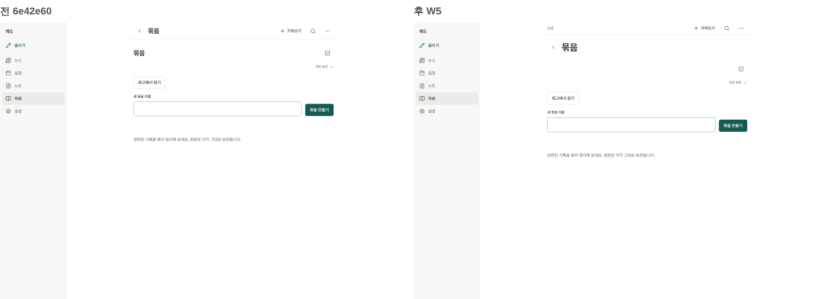
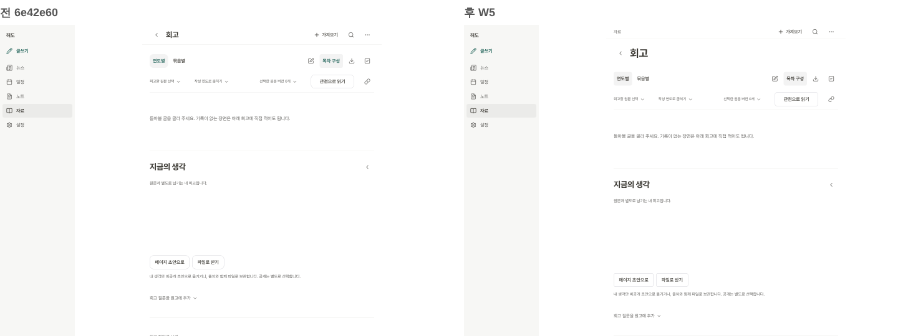
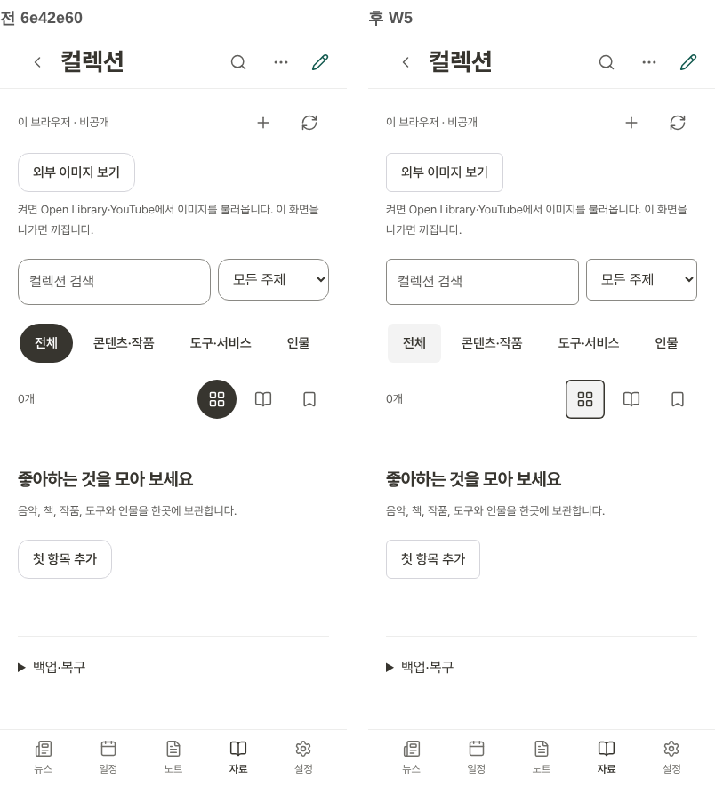
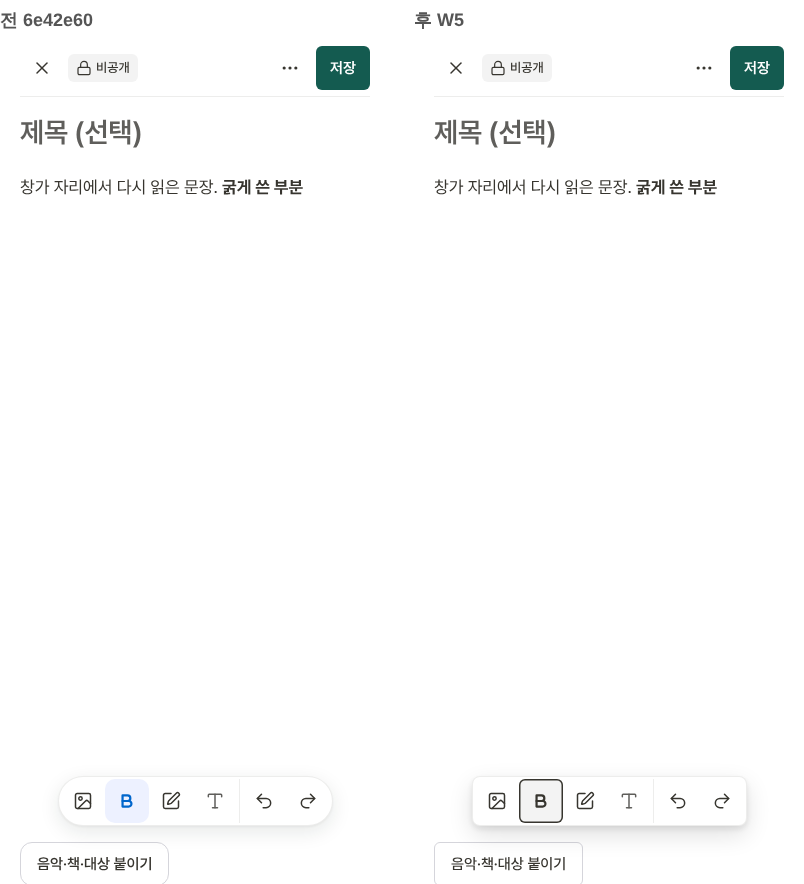
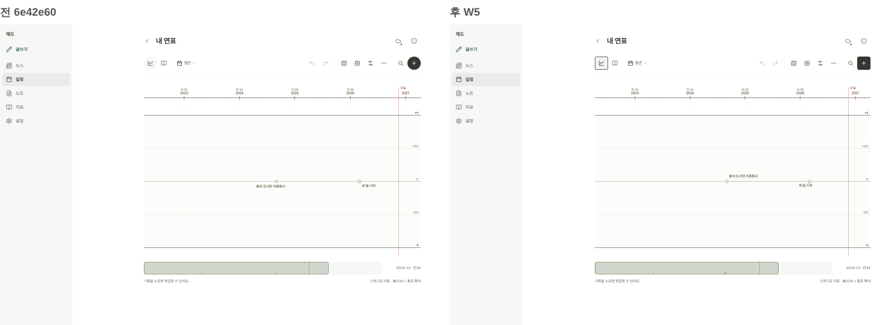
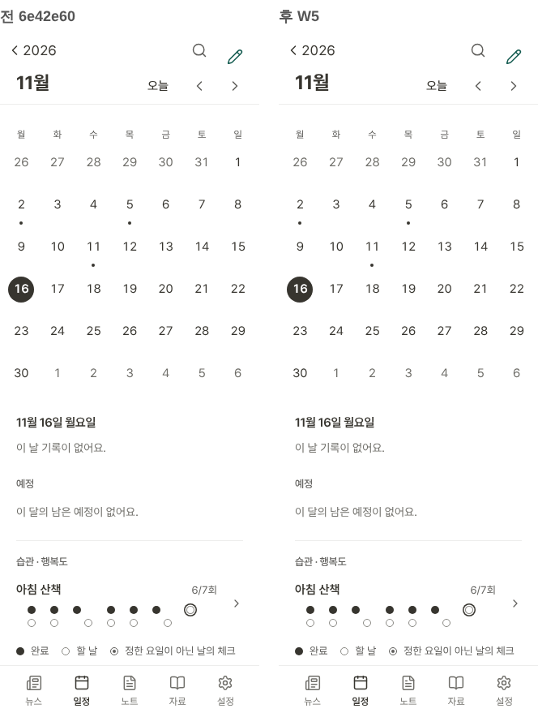

# 노션 방향 W5 마무리 — 구현 보고 (2026-11-18, Designer)

- **지시:** 총괄의 11-18 W5 시작 알림. [구현 계약](notion-visual-contract.md)의 W5에 W3·W4가 넘긴 일을 더한 범위다.
- **기준:**
  - 통합 브랜치 `claude/confident-ramanujan-kc31xs` `6e42e60`(S·W3·W4)에서 시작했다.
  - 그 뒤 통합 `b1fb704`(W4 재검수 마이너: 뉴스 스크롤 판정, 멈춤 감시 도우미)를 합쳤다. 충돌은 없었다.
- **브랜치:** `claude/pr-application-9gkdpx`, PR [#263](https://github.com/wonchance-art/life-haedo/pull/263)(초안, 기준은 통합 브랜치). 앞서 올린 W1 보고서 문서 수정(`04aa652`)도 이 브랜치에 그대로 있다.
- **하지 않은 것:**
  - 공개 5쪽(`blog`·`cover`·`series`·`share`·`taste`)의 모양
  - 저장·동기화·공개 로직과 데이터 키, 문구의 뜻
  - 작성기 줄 높이·제목 위치(D1)와 `⋯` 메뉴 자리 규칙
  - `sw.js` CACHE(총괄이 배포 때 올린다)
  - `.github/workflows`, `AGENTS.md`, 로드맵(총괄이 병합 때 기록한다)

## 커밋

| 커밋 | 내용 |
| --- | --- |
| `220dfb2` 준비 | W1–W4 밖 CSS 11개의 굵기 750·650·550·450과 옛 모서리를 토큰으로 바꿨다. `ui.css`는 고리(`var(--ui-…, 지금 값)`)로 바꿨다. 앱의 글 안 링크는 먹색이고, 연표 시작선은 메뉴 폭에서 잰다 |
| `7588dc5` | 앱의 글 안 링크 밑줄을 `--field-line`(3.50:1)으로 바꿨다. 총괄의 11-18 확정에 따른 것이고 W3 읽기와 같은 값이다 |
| `6ff8b6e` A | 열림·켜짐·현재의 두 번째 표시를 `haedo-shell.css` 공통 규칙 하나로 모았다. 머리 경로와 큰 제목 줄(`.haedo-title-band`)은 `home.css`에서 셸로 옮겼다. `ui.css`에 남은 틸 상태(아이콘 단추, 자료 제목 호버 등)는 앱 값으로 바꿨다 |
| `02b3775` C | 작성기 부품 세 가지, 사진 설명 왼쪽 정렬, 좁은 작성기의 공개 글자, 좁은 일정 제목 최소 24px, 뉴스 탭 간격 |
| `580d629` B | 자료 하위 화면 머리, 주제 행·검색 칸, 가져오기 글자 탭, 컬렉션 거르기, 앱 아이콘 단추 6px, `최신 내용 확인` |
| `0e55e05` E | W1 틸 분류표의 W5 몫(작업대·연표·플랫폼·연간 계획)을 먹색으로 바꿨다. 다시 찾기·회고도 큰 제목을 쓴다. 겹친 소제목은 화면 읽기 전용이다. 계약·`DESIGN.md`를 고쳤다 |
| `7e47c7a` F | 강제 색 모드에서 켜진 서식·작업대 눌림에 윤곽을 더했다. 가져오기 현재 탭의 선이 보인다 |
| `55b8cd8` G | 틸 분류표에서 `ui.css`에 남은 줄을 고리로 바꿔 앱에서만 먹색이 되게 했다 |

## 바꾼 것

| 파일 | 내용 |
| --- | --- |
| `assets/haedo-shell.css` | 고리의 앱 값(`--ui-link-color`·`--ui-*-weight`·`--ui-*-radius`·`--ui-pressed-*`·`--ui-title-hover-*`·`--ui-accent-text`·`--ui-accent-line`) |
| | 두 번째 표시 공통 규칙: 선택 면 + 먹색 + 안쪽 1.5px 먹색 테. 강제 색 모드에서는 `Highlight` 2px |
| | 머리 경로·큰 제목 줄(`home.css`에서 옮김) |
| | 1101px 이상에서 `최신 내용 확인`을 머리 줄 안에 둔다 |
| | 가져오기 방법 글자 탭, 단추 모양 링크 밑줄 없음 |
| `assets/life/ui.css` | 값을 바로 바꾸지 않고 고리만 걸었다(공개 페이지는 지금 값 그대로). 링크, 굵기, 모서리, 눌림·현재, 제목 호버, 아이콘 단추 모서리, 남은 틸 9줄이 대상이다 |
| `assets/life/ui.js` | 큰 제목을 쓰는 화면에 주제·컬렉션·가져오기·묶음·다시 찾기·회고를 더했다. 주제 행은 자료 행 클래스(`records-row`)를 쓴다 |
| `assets/life/workbench-ui.js` | 묶음·다시 찾기 본문 첫 줄의 같은 이름(`h2`)은 화면 읽기 프로그램에만 남긴다. 선택 자료 페이지·책과 같은 방식이다 |
| `assets/life/photo-post.css` | `글 저장`: 틸 주 버튼·6px·600 |
| | 떠 있는 서식 막대: 8px·중립 그림자. 단추·고르기·서식 판은 6px/8px |
| | 켜진 서식과 작성자 토글: 선택 면 + 먹색 테(Quill 파랑 `#06c` 덮기 포함) |
| | 사진 설명 `text-align: start`. 360px 미만에서만 좁은 작성기 글자를 숨긴다. 강제 색 윤곽 |
| `assets/life/records.css`, `collection.css` | 검색 칸 규칙을 주제까지 넓혔다. 컬렉션의 고른 거르기·하위·결과 줄은 선택 면 + 먹색 600이다 |
| `assets/life/workbench.css` | 눌림·현재·열림은 먹색 600, 옅은 면 단추는 먹색 글자, 책 제목 호버는 먹색 밑줄. 강제 색 윤곽 |
| `assets/timeline-shell.css` | 시작선(메뉴 폭 + 768px 열의 왼쪽), 아이콘 단추 6px |
| | 보기·도구 켜짐: 선택 면 + 먹색 테. 축척 칩: 선택 면 + 먹색 600. 쪽 점: 먹색. 강제 색 윤곽 |
| `assets/platform.css`, `annual-plan.css` | 호버는 틸 대신 먹색이다(제목은 `--field-line` 밑줄) |
| 그 밖의 앱 전용 CSS(`blog-manager`·`nine-board`·`naver-blog`·`material-writing`·`original-attachments`·`writing-ai-ui`·`settings`·`haedo-motion` 등) | 굵기·모서리 토큰만 바꿨다. `home`·`records`·`discovery`·`settings`에서는 셸 공통 규칙과 겹치는 덮어쓰기를 지웠다 |
| `assets/life/schedule.css` | 좁은 iPhone 제목 `clamp(24px, …, 28px)` |
| `assets/life/discovery.css` | 760px 이하 탭 사이 16px |
| `tests/notes-menu-browser.cjs:548` | 좁은 제목의 아래 한계를 새 규칙(24px)으로 바꿨다. 규칙 변경이며 단언 약화가 아니다 |
| `tests/subview-navigation-browser.cjs:14` | 화면 제목 찾기를 한 줄 머리(`.haedo-page-heading`)와 1101px 이상 큰 제목 줄(`.haedo-title-band`) 두 곳으로 넓혔다. 앱의 `pageHeading()`과 같은 두 자리이고 제목 글자 단언은 그대로다. 가져오기·다시 찾기가 큰 제목 줄로 옮긴 데 따른 규칙 변경이다(CI run 44355081229 묶음 4에서 처음 드러남) |
| `docs/design-review/notion-visual-contract.md`, `DESIGN.md` | 아래 "계약 갱신" |

## 계약 갱신과 남은 판정

총괄은 답을 받지 못한 판정을 권고대로 통합했다. W5에서 아래처럼 정했다.

| 판정 | 통합본 | W5 결정 | 이유 |
| --- | --- | --- | --- |
| S 일정 M 1101–1279px 옆 칸 | 달력 아래 | 채택(계약에 적음) | 옆 칸 305px이면 칸이 58–70px이 되어 꼬리표가 한두 글자만 보인다 |
| S 좁은 iPhone 제목 | 350px 이하에서 칸을 따라 줄어듦(320px에서 23px) | **최소 24px** | 올해 가장 긴 제목(6.04em)이 24px에서 145px라 146px 칸에 들어간다. 그보다 작은 제목 글자는 쓰지 않는다 |
| W3 도구 줄 65px | 유지 | 채택 | 작성기 줄과 높이가 같아야 읽기 ↔ 편집에서 제목이 안 움직인다(D1) |
| W3 좁은 화면 두 줄 | 문제 알약 줄바꿈 | 채택 | 문제 문구를 줄이지 않는다 |
| W3 사진 설명 | 가운데 | **왼쪽** | 시안과 본문 정렬에 맞췄다. 공개 블로그는 그대로다 |
| (6) 좁은 작성기의 공개 표시 | 아이콘 하나 | **360px 이상 글자** | 공개·비공개는 개인정보 경계라 아이콘 모양에만 맡기지 않는다. 360px 미만은 읽기 화면과 같은 아이콘 규칙이다 |
| W4 옮긴 조작 표 | — | 채택 | `⋯`의 `목록`은 같은 메뉴 안의 구역 이름이다(중첩 하위 메뉴가 아님) |
| (7) 뉴스 `제외한 글` 문구 | — | **줄이지 않음** | 탭 이름은 접근 이름이고 검사가 기댄다. 760px 이하 탭 사이 16px로 390px에 두 자리 개수까지 들어간다 |

계약 본문(`notion-visual-contract.md`)에 넣은 것:
- 링크 밑줄 값과 처음 값의 이력
- 두 번째 표시 공통 규칙
- 글 끝 저장 상태(11-16 소유자 지시대로 문제만 보임)
- 도구 줄 65px·두 줄
- 일정 M 옆 칸·좁은 제목
- 자료 하위 화면(집중 편집 화면은 한 줄 머리)
- 뉴스 탭 줄
- 굵기·모서리 토큰과 `ui.css` 고리 규칙

## 화면 근거

1440·820·390·320에서 전(`6e42e60`, 따로 띄운 같은 서버)과 후를 찍었다. 대상 화면은 다음 19개다:
- 노트, 노트 글 메뉴 열림, 일정 M
- 자료, 주제, 컬렉션, 가져오기, 묶음, 다시 찾기, 회고, 선택 자료 페이지, 자료 작성
- 뉴스, 설정, 글 읽기, 작성기
- 연표, 연표 목록, 목표 대화상자

샘플은 가짜 클라우드와 익명 샘플이다(글 3개, 가져온 자료 4개, 습관·목표·연표 하나씩).

- **결과:** 76장 × 2. 가로 넘침 0, 콘솔·페이지 오류 0이다. 화면 안의 44px 미만 조작(단추·요약·탭·입력)은 전후 모두 0이다.
- **바뀐 화면:** 59장이다. 같은 픽셀은 노트·자료·설정 전부와 일정 M 390·820, 글 읽기 1440·390·320이다.
  - W5가 손댄 규칙이 이 화면들에서는 이미 W1–W4 값과 같았다. 글 읽기의 링크 밑줄은 W3가 같은 값을 먼저 썼다.

| 화면 | 전후 |
| --- | --- |
| 주제 1440: 큰 제목, 자료 검색 칸, 자료 행(제목 1줄·발췌 2줄·메타) |  |
| 가져오기 1440: 큰 제목, 방법 글자 탭, 머리 `가져오기` 켜짐 테 |  |
| 묶음 1440: 큰 제목, 겹친 소제목 화면 읽기 전용 |  |
| 회고 1440: 큰 제목, `연도별` 먹색 600 |  |
| 컬렉션 390: `전체` 선택 면, 보기 전환 6px 테 |  |
| 작성기 390: 서식 막대 8px, 켜진 굵게 먹색 테 |  |
| 연표 1440: 시작선, 보기 전환 6px 테 |  |
| 일정 M 320: 제목 24px |  |

- **공개 페이지:**
  - 공개 5쪽과 `privacy.html`은 1440·390 전체 페이지 픽셀 해시가 전후 같다(외부 요청 차단).
  - 로그아웃 첫 화면(`index.html`)은 머리의 `로그인` 하나만 바뀌었다. 단추 모양 링크라 틸 밑줄 글자·12px에서 먹색·6px·밑줄 없음으로 바뀌었다. 의도한 변경이고 나머지 계산된 스타일은 같다.

## 틸 전수 조사

22개 앱 화면 × 1440·390과 자료 읽기 화면에서 보이는 모든 요소를 조사했다. 대상은 계산된 `color`·`background`·테두리·`fill`·`stroke`·밑줄·그림자 가운데 틸 세 값(`#145B50`·`#104A41`·`#0C3D35`)이다.
- **남은 것:** 계약의 "틸 유지"뿐이다.
  - 메뉴 `글쓰기`
  - 주 버튼: `글 저장`, `기록에 저장`, `원문·출처 확인`, `묶음 만들기`, 빈 상태의 `빈 책 만들기`, 다시 찾기 행의 `관련 기록 보기`
- **W5에서 없앤 것:**
  - 회고: `연도별`·`목차 구성`
  - 다시 찾기: `기준 기록 고르기`
  - 연표: `5년` 칩
  - 자료 읽기: `함께 읽을 기록`
  - 화면에 보이지 않는 상태(책 장면, 열린 목차, 렌즈 등)는 W1 분류표의 줄 번호대로 고쳤다.

## 실제 표면 대비

계산된 글자·선 색을 실제로 칠해진 바탕(반투명 층 합성)에 대어 WCAG 2로 잰 값이다.

| 쓰임 | 글자·선 / 표면 | 대비 |
| --- | --- | --- |
| 본문·행 제목 먹색 / 흰 바탕 | `#37352F` / `#FFFFFF` | 12.26 |
| 글 안 링크 글자 / 흰 바탕 | `#37352F` / `#FFFFFF` | 12.26 |
| 글 안 링크 밑줄(비글자) / 흰 바탕 | `#8A8984` / `#FFFFFF` | 3.50 |
| 검색 칸 안쪽 1px 선(비글자) / 흰 바탕 | `#8A8984` / `#FFFFFF` | 3.50 |
| 열린 `⋯`·눌린 보기 전환·켜진 서식·연표 켜짐의 먹색 테(비글자) / 선택 면 | `#37352F` / `#F3F3F3` | 11.04 |
| 고른 거르기·회고 `연도별`·연표 축척 칩 먹색 600 / 선택 면 | `#37352F` / `#F3F3F3` | 11.04 |
| 가져오기·뉴스 현재 탭 먹색 600과 2px 선 / 흰 바탕 | `#37352F` / `#FFFFFF` | 12.26 |
| 가져오기·뉴스 나머지 탭, 자료 행 메타 / 흰 바탕 | `#5F5E5B` / `#FFFFFF` | 6.48 |
| `글 저장` 흰 글자 / 틸 | `#FFFFFF` / `#145B50` | 7.95 |
| 메뉴 `글쓰기` 틸 / 메뉴 면 | `#145B50` / `#F7F7F5` | 7.41 |
| 메뉴 현재 항목 먹색 / 메뉴 면 | `#37352F` / `#F7F7F5` | 11.43 |

- 선택 면과 흰 바탕의 차이는 1.11:1뿐이다. 그래서 어느 상태도 면만으로 나타내지 않고, 위의 테나 600 글자와 함께 쓴다(계약 "두 번째 표시").

## 강제 색 모드

`forced-colors: active`를 흉내 내 각 상태의 표시가 남는지 쟀다. Windows 고대비 실기 확인은 아니다.

| 상태 | 남는 표시 |
| --- | --- |
| 열린 글 메뉴 `⋯`, 메뉴 현재 항목, 눌린 보기 전환, 머리 `가져오기` 켜짐 | `Highlight` 2px 윤곽 |
| 가져오기 현재 방법 탭 | 600 글자와 2px 선. 선을 `CanvasText`로 칠한다(W5 F 전에는 바탕색으로 사라졌다) |
| 회고 `연도별` 등 작업대 눌림·열림 | `Highlight` 2px 윤곽과 600(W5 F 전에는 600뿐이었다) |
| 작성기 켜진 서식 | `Highlight` 2px 윤곽(W5 F 전에는 표시가 없었다. W5 전의 파랑도 강제 색에서 사라졌다) |
| 컬렉션 고른 거르기 | 1px 테두리와 600 |
| 뉴스 현재 탭 | 600과 밑줄 |
| 연표 보기 전환·축척 칩 켜짐 | `Highlight` 2px 윤곽(축척 칩은 600 함께) |

## 검사

- `npm run check`: 0. HTML 22, JS 202, 로컬 리소스 803, 오프라인 목록 548.
- `npm test`: 0.
- `node scripts/check-markdown-links.cjs`: 0.
- **`pages.yml` 브라우저 검사:** 하나씩 실제 종료 코드로 돌렸다. 바뀐 CSS(`ui.css`·`haedo-shell.css`)를 모든 앱 화면이 읽으므로 전부 대상이다. 결과는 아래 "브라우저 검사 결과"에 적는다.
- **도커 전용이라 이 환경에서 돌리지 못한 것:** `check-blog-backend`, `integrated-release-installation`, `material-continuity-backend`. CI에서 확인한다.

### 브라우저 검사 결과

- **GitHub CI run 44355081229**(`345cb75`):
  - `check`, `browser_suites` 묶음 1·2·3·5·6·7, `blog`(도커 전용 3개 포함)는 모두 성공했다.
  - 묶음 4에서는 `subview-navigation-browser` 한 단계만 실패했다(27개 중 25 통과). 1440px에서 가져오기·다시 찾기의 화면 제목을 옛 자리(`.haedo-page-heading h1`)에서 찾다가 12초 제한에 걸렸다.
  - 원인은 W5에서 두 화면의 제목을 큰 제목 줄로 옮긴 것이다. 위 표처럼 검사의 제목 찾기를 새 자리까지 넓혔다. 로컬에서 고치기 전 같은 2건이 재현됐고, 고친 뒤 27/27 통과(종료 코드 0)했다.
- **최종 head의 CI:** 이 보고서를 담은 커밋의 run에서 확인한다(PR #263).
- **로컬 `pages.yml` 묶음:** 하나씩 돌린 66단계는 모두 0이었다. 진행 중에 실행 환경(컨테이너)이 다시 시작되어 나머지는 끊겼다. 그 66단계 일부는 W5 E–G 이전 판에서 돌았으므로, 최종 판의 전체 결과는 CI를 기준으로 한다.

## 남은 것·후속 후보

- **다시 찾기 행의 `관련 기록 보기`:** 채운 틸 주 버튼이 행마다 반복된다. 계약의 "행은 먹색·회색"과 어긋나 보이지만, 틸 분류표에서 `.life-primary`는 "유지"라 이번에는 바꾸지 않았다. 행의 주 행동을 옅은 면 단추로 바꿀지는 다음 판단이다.
- **책(`view=books`):** 목록과 편집·읽기 장면이 같은 모드라 한 줄 머리를 유지했다. 목록 장면만 큰 제목으로 바꾸려면 `ui.js`의 머리 판단에 장면을 넘겨야 한다.
- **`photo-post.css`에 남은 12px 두 곳:** `.photo-recovered`(복구 안내)와 `.photo-inspector` 입력칸이다. 총괄 지시가 이 파일에서는 작성기 부품 세 가지만이라 손대지 않았다.
- `expression-sample.html`(`assets/design-expression/ui.css`)은 독립 시안이라 틸 분류표의 줄을 고치지 않았다.

## 미검증

- 실제 iPhone·iPad·Mac에서는 확인하지 않았다. 폭 모사만 했다.
- VoiceOver로 겹친 소제목(`h2`, 화면 읽기 전용)과 머리 `h1`의 읽힘을 확인하지 않았다.
- Windows 고대비 실기 확인은 없다(강제 색 흉내만).
