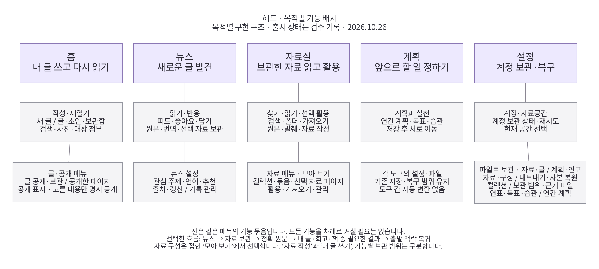
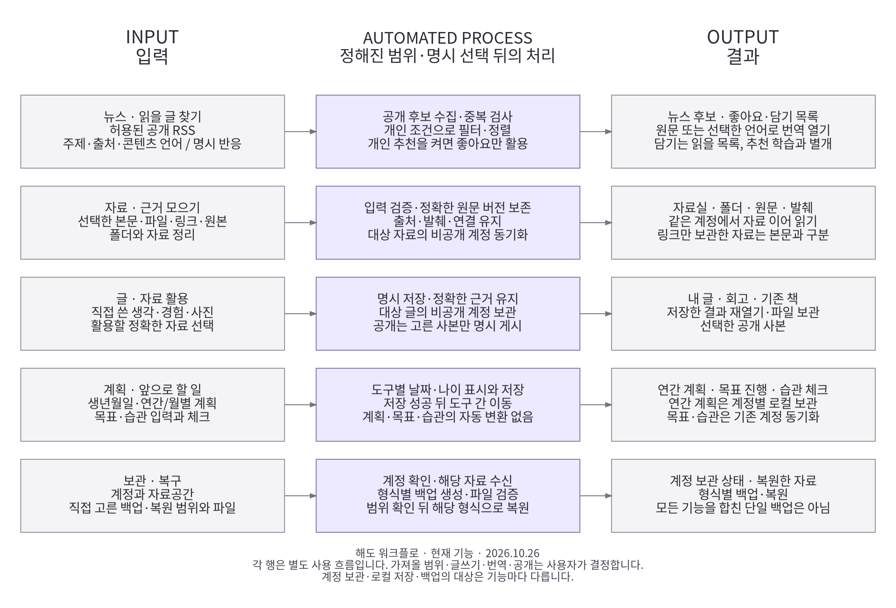

# 기능 목적에 따른 워크플로와 배치

후속: 이 문서는 구현 전 설계 기록이다. 실제 반영 범위·엄격 검수·출시는 [통합 구현 기록](purpose-workflow-implementation.md)을 따른다.
2026-10-26 KST. 기준은 확인한 배포 main `c9c21ef21cda138f1a81bacc808199dedf49b3a3`이다. **이 문서는 설계 결과이며 제안한 이름·배치를 운영 화면에 적용한 상태는 아니다.** PR136의 메뉴 통합과 PR137의 초기 로딩 개선은 기존 구현으로 유지한다. 기능 조사·독립 검토·도식 검수와 앱 구현/실사용 검증을 구분한다.

## 설계 결론

해도의 핵심은 **발견한 정보를 내 자료로 활용하고, 필요한 경우 글이나 계획으로 남기는 것**이다. 모든 자료가 글·공개까지 갈 필요는 없다. 읽기, 개인 보관, 습관 체크만으로도 작업은 끝난다.

대표 메뉴는 다섯 개를 유지하고 **홈 → 뉴스 → 자료실 → 계획 → 설정**으로 이름을 맞춘다. 이 순서는 메뉴 순서이며 필수 작업 순서가 아니다. 현재 ‘도구’가 연간 계획·목표·습관만 담고 있으므로 표시 이름을 ‘계획’으로 구체화한다. 내부 `tools` ID와 기존 주소는 유지한다.

- **홈:** 내가 쓴 글을 읽고 이어 쓰는 곳.
- **뉴스:** 새로 읽을 정보를 발견하는 곳.
- **자료실:** 가져온 원문을 찾고 읽고 활용하는 곳.
- **계획:** 연간 방향·목표·반복 실천을 조정하는 곳.
- **설정:** 계정·자료공간·보관 실패·파일 이동을 관리하는 곳.

기능의 대표 위치는 한 곳으로 정하되, 해당 자료·글에서 바로 이어갈 수 있는 문맥 진입은 남긴다. ‘버튼 중복 제거’ 때문에 읽던 글을 다시 찾게 만들지 않는다. 저장 구조는 배치와 별개이며 합치지 않는다.

[배치 SVG](../diagrams/rendered/product-placement-20261026.svg) · [배치 PDF](../diagrams/rendered/product-placement-20261026.pdf)

## 화면별 배치

| 영역 | 기본 화면에 남길 것 | 접어서 관리할 것 | 다음 행동과 복귀 |
| --- | --- | --- | --- |
| 홈 | 내 글·초안·보관함, 검색, 새 글 쓰기, 계정의 저장 글 열기 | 글 공개·보관, 공개한 페이지, 공개 표지, 프로필 | 정확한 글 읽기/수정 → 같은 탭·검색·글 위치 |
| 뉴스 | 현재의 피드/좋아요/담기 아이콘, 정렬, 설정 아이콘, 기사 제목·출처 | 관심 주제 → 언어 → 추천 → 출처·갱신/기록 관리 | 원문/번역 읽기 또는 자료실 보관 → 같은 뉴스 위치 |
| 자료실 | 검색·폴더·자료 목록, 가져오기, 선택 | 모아 보기(컬렉션·묶음·선택 자료 페이지), 활용(다시 찾기·회고·책·연표), 가져오기·관리(자료 작성·네이버·Obsidian·원본·휴지통) | 정확한 원문 → 발췌/글쓰기/선택 활용 → 같은 검색·폴더·선택 |
| 계획 | 연간 계획·목표·습관 세 목적지와 현재의 상호 이동 | 각 화면의 표시·파일 설정 | 작성/체크 → 저장 확인 → 현재 계획 또는 선택한 다른 계획 화면 |
| 설정 | 현재 자료공간, 계정 보관 상태 | 파일: 자료·글 / 계획·연표 | 필요한 범위의 재시도·파일 보관/복원 → 출발 화면 |

자료실의 컬렉션·묶음·선택 자료 페이지는 현재 상시 탭이다. 이를 접으면 기본 화면에서 자료가 앞서지만, 해당 목록 진입은 **한 번에서 메뉴 열기+선택 두 번**으로 늘어난다. 읽기·찾기를 우선한다는 설계 가정에 따른 제안이다. 구현 비교에서 반복 사용자가 손해를 보는 경우에는 자주 쓰는 진입을 유지한다. 클릭 수나 화면 공간이 개선됐다고 아직 측정한 것은 아니다.

모바일도 같은 목적 순서를 쓴다. 상시 설명·숫자·기능 카드·보조 패널은 추가하지 않는다. 조작은 44px 이상, 아이콘은 접근 가능한 이름과 키보드 초점을 갖는다. 선택 자료에 필요한 작업은 선택한 동안에만, 파일 범위 설명은 파일을 고를 때만 보여 준다.

## 기능별 목적과 결과

아래 기능은 별도로 ‘제안’이라고 적은 연결을 제외하고 기준 코드에 존재한다. ‘현재 있음’은 이번에 모든 기능을 실행 검증했다는 뜻이 아니다.

### 홈: 내 결과물을 쓰고 보여 주기

| 기능 | 목적·입력 | 처리와 결과 | 권장 위치 |
| --- | --- | --- | --- |
| 내 글·초안·보관함 | 완성/미완성/보관한 내 글 다시 찾기 | 기존 세 글 형식을 변환하지 않고 목록·검색 → 원래 작성기/읽기 | 홈 기본 목록 |
| 새 글 쓰기·수정 | 생각·사진·첨부를 글로 남기기 | 초안 임시저장 → 명시 저장 → 비공개 글과 계정 보관 상태 | 홈 주 행동, 글의 수정 조작 |
| 계정의 저장 글 | 다른 기기에서 저장한 글 이어 열기 | 기존 사본 대조 → 같은 글 열기 또는 필요한 정확한 원격 판 받기 | 홈의 현재 서버 글 진입 |
| 글 공개·보관 관리 | 특정 글의 게시·서버 변경·실패 해결 | 범위 검토 후 공개/철회, 보관 중지·재시도·충돌 조정 | 읽는 글의 더보기에서 그 글로 바로 진입 **제안**, 홈 메뉴의 전체 관리는 유지 |
| 공개한 페이지 | 별도 선택 자료 페이지 등 공개 결과 관리 | 실제 공개 목록 확인 → 열기/철회 | 홈 메뉴 |
| 연재·모음 | 저장한 글을 순서와 목차로 함께 읽기 | 정확 글을 선택·구성 → 연재 읽기, 별도 공개·파일 | 기존 글/페이지 구성 문맥; 공개 관리는 홈 메뉴 |
| 공개 표지 | 이미 공개된 결과물을 하나의 입구로 묶기 | 공개 항목 선택·순서·소개 검토 → 표지 별도 게시 | 홈 메뉴의 개별 공개 관리 다음 |
| 글 파일·근거 파일 | 읽기용 또는 편집/근거 보존용 파일 만들기 | HTML / 사진 ZIP / 선택 글과 정확 근거의 전용 파일 | 기존 글 읽기의 HTML/사진 ZIP, 일반 글→근거 파일 직통은 **제안**; 전체 종류·복원은 설정 |

현재 홈 서버 글 목록은 `AccountBlogUI`의 `openRemote`를 쓰고, 글 관리에는 별도 ‘새 사본으로 받기’ 목록이 있다. **발견·이어 열기의 대표 목록을 기존 AccountBlogUI로 통합**하는 것이 제안이다. 처음 받는 글의 수신은 반드시 남기며, 의도적인 별도 사본 생성도 명시 조작으로 유지한다. 글별 공개·보관 중지·재시도·충돌 처리는 글 관리의 고유 목적이므로 없애지 않는다.

근거: [home.js](../../assets/life/home.js), [account-blog-ui.js](../../assets/life/account-blog-ui.js), [blog-manager.js](../../assets/life/blog-manager.js), [photo-post-ui.js](../../assets/life/photo-post-ui.js), [blog-series.js](../../assets/life/blog-series.js), [public-cover-ui.js](../../assets/life/public-cover-ui.js), [preservation-ui.js](../../assets/life/preservation-ui.js).

### 뉴스: 새 정보를 발견하고 고르기

| 기능 | 목적·입력 | 처리와 결과 | 권장 위치 |
| --- | --- | --- | --- |
| 피드·정렬 | 준비된 새 글 후보 중 읽을 것 찾기 | 출처·언어·관심·제외 조건을 적용한 목록 | 뉴스 기본 한 줄 탐색 |
| 관심 주제 | 읽고 싶은 소재 지정 | 직접 입력/선택한 주제로 관심순 계산 | 뉴스 설정 첫 묶음; 전체 편집은 보조 경로 |
| 원문 언어·번역 언어 | 읽을 수 있는 언어 선택 / 원문을 선택 언어로 열기 | 복수 원문 언어 필터 / 명시 클릭 시 외부 번역 링크 | 뉴스 설정의 언어 묶음, 번역은 해당 기사 |
| 좋아요 | 명시적 긍정 반응 보관 | 좋아요 목록, 개인 추천을 켰을 때만 추천 신호 | 기사 아이콘·좋아요 목록 |
| 담기 | 나중에 읽을 링크 목록 만들기 | 담기 목록. 자료 원문 보관이나 추천 학습이 아님 | 기사 아이콘·담기 목록 |
| 읽음·관련 없음·제외 복구 | 해당 URL을 후보에서 빼거나 되돌리기 | 개별 후보 제외/복구. dislike 학습이 아님 | 기사 더보기, 복구는 뉴스 설정 |
| 반응 해제 기록 | 좋아요·담기를 모두 해제한 기존 행 확인 | 반응 목록 관리. 후보 제외나 부정 평가가 아님 | 뉴스 설정의 기록 관리 |
| 개인 추천 | 좋아요 표현과 관련된 후보 찾기 | 명시 opt-in 뒤 제목·태그 기반 규칙과 근거 | 뉴스 설정; 읽는 중 자동 재정렬 금지 |
| 읽기 비교 | 목록의 실제 도움 여부 판단 | 고정 조건 목록과 직접 입력한 의향/읽기/도움 기록 | 뉴스 설정의 추천 묶음 |
| 자료실 보관 | 후보를 내 자료로 활용하기 | 보관 검토 → 확보 범위 확인 → 명시 저장 → 정확 원문 | 기사 더보기의 ‘자료실에 보관’ 이름 **제안** |
| 출처·갱신·사본·초기화 | 공급 상태와 개인 목록 관리 | 수집 상태 확인, 화면 재조회, 기존 형식의 사본/복구 | 뉴스 설정의 마지막 관리 묶음 |

현재의 별도 뉴스 설정을 공통 설정과 다시 합치지 않는다. 피드/설정의 중복 정렬 조작은 피드를 대표로 정리한다. ‘보관 검토’를 ‘자료실에 보관’으로 바꾸더라도 실제 검토·명시 저장 단계는 유지한다. 담기/좋아요의 본문 문구를 다시 늘리지 않는다.

근거: [discovery-ui.js](../../assets/life/discovery-ui.js), [discovery-recommendations.js](../../assets/life/discovery-recommendations.js), [discovery-language-settings.js](../../assets/life/discovery-language-settings.js), [discovery-reading.js](../../assets/life/discovery-reading.js), [interest-ui.js](../../assets/life/interest-ui.js).

### 자료실: 원문을 확보하고 활용하기

| 기능 | 목적·입력 | 결과 / 다른 기능과의 차이 | 권장 위치 |
| --- | --- | --- | --- |
| 가져오기 | 본문·TXT/Markdown·링크 검토 | 출처와 확보 범위를 가진 정확 원문; 링크만 있으면 본문 미확보 | 자료실 가까운 조작 |
| 검색·폴더 | 원문을 다시 찾고 기본 위치 분류 | 검색과 폴더 조건의 자료 목록; 자료당 주 폴더 하나 | 자료실 기본 |
| 통합 검색 | 자료·저장한 페이지·컬렉션·9칸의 정확 항목 찾기 | 읽기 전용 결과 → 실제 대상 왕복 | 기존 검색 진입; 일반 자료 검색과 목적 구분 |
| 원문·발췌·주제 | 정확한 내용 읽기, 구절·내 메모 정리 | 원문 판과 UTF-16 구간이 연결된 발췌; 주제는 발췌 분류 | 원문 읽는 자리 |
| 이어 읽기 | 읽던 정확한 원문 위치 재개 | 같은 계정·공간의 로컬 읽기 위치 한 개; 명시 구절 이동을 우선 | 기존 홈/자료실의 이어 읽기와 원문 문맥 |
| 자료 수정·삭제 | 보관한 자료를 고치거나 치우기 | 수정은 새 불변 판, 기존 인용은 옛 정확 판 유지; 삭제/복구는 기존 휴지통 계약 | 해당 자료의 읽기·관리 조작 |
| 자료 작성 | 직접 입력을 자료 원문으로 저장 | 기존 `write`의 Core 원문; 홈 블로그 글과 다름 | 가져오기 옆 접힌 입력 경로, 이름 **제안** |
| 묶음 | 관련 원문들의 관계 정리 | 정확 원문 참조 모음; 원문 병합/복사 아님 | 선택 자료 활용, 전체 목록은 모아 보기 |
| 컬렉션 | 책·음악·작품·인물·장소 등 대상 수집 | 대상 메타데이터와 개인 메모; 원문 폴더와 다름 | 모아 보기 |
| 선택 자료 페이지 | 고른 자료를 설명·배치하여 보여 주기 | 비공개 구성/미리보기, 필요 시 별도 공개 사본 | 선택 자료 활용, 전체 목록은 모아 보기 |
| 9칸 | 선택 대상과 이유를 시각적으로 구성 | 정확 대상을 참조하는 구성; 빈 칸 유지 | 기존 페이지/원문/대상 선택 문맥 |
| 이 자료로 글쓰기·인용 | 원문을 근거로 내 글 시작 | 자료 전체: 작성 준비→명시 새 글 / 선택 구절: 정확 인용을 기존 글 작성기에 전달. 미채택 메모 자동 복사 없음 | 정확 원문·선택 자료 곁 |
| 다시 찾기·관련 기록 | 내 자료 사이의 연결 근거 탐색 | 실제 주제·묶음·공통 표현에 따른 후보 | 원문 곁, 전체 탐색은 자료 메뉴 |
| 회고 | 선택한 자료를 돌아보고 내 생각 작성 | 직접 쓴 회고, 필요하면 글/책에 활용 | 선택 자료 활용, 전체 목록은 자료 메뉴 |
| 책 만들기 | 자료·회고를 장과 원고로 구성 | 내 책/목차/원고; 컬렉션의 ‘책 정보’와 다름 | 자료 메뉴의 활용 |
| 연표 | 사건·기간을 시간·목록·지도로 보기 | 별도 연표; 미래 계획과 다른 데이터 | 자료 메뉴의 활용, ‘시간 보기’ 이름 교정 **제안** |
| 네이버·Obsidian | 특정 원천의 목록/갱신을 검토해 자료로 받기 | 확보된 범위와 정확한 새 판; 원본 서비스 변경 없음 | 가져오기 문맥 + 자료 메뉴의 관리 |
| 원본 첨부 | 파일 원형 보관·재열기 | 검증된 바이트/다운로드; 본문 자동 추출·글 삽입 아님 | 자료 메뉴, 해당 원문에서의 기존 연결 |
| 휴지통 | 제외한 자료의 복구 | 기존 폴더·정확 참조를 가진 자료 복귀 | 자료 메뉴의 관리 |

폴더·주제·묶음·컬렉션·9칸을 하나의 분류 모델로 합치지 않는다. 읽기 전에 폴더나 묶음을 반드시 만들게 하지 않는다. 네이버 연결 UI가 있다는 사실을 실제 예약 수집 운영 완료로 표현하지 않는다.

근거: [ui.js](../../assets/life/ui.js)의 `renderHeader`, `featureMenu`, `arrangeRecords`, `renderManagement`, `renderTime`; [workbench-ui.js](../../assets/life/workbench-ui.js), [source-folders-ui.js](../../assets/life/source-folders-ui.js), [collection.js](../../assets/life/collection.js), [reading-position.js](../../assets/life/reading-position.js), [source-edit-ui.js](../../assets/life/source-edit-ui.js), [original-attachments-ui.js](../../assets/life/original-attachments-ui.js).

### 계획·설정: 실천하고 보관을 관리하기

| 기능 | 목적·입력 | 처리·결과 | 권장 위치 |
| --- | --- | --- | --- |
| 연간 계획 | 연간 문장과 날짜 있는 월 계획 배치 | 연도/월/분기/선택 나이 표시, 해당 공간의 계획 저장 | 계획의 독립 목적지 |
| 목표 | 목표일과 진척 관리 | 정렬·진행/완료, 100%의 목표 완료 | 계획의 독립 목적지 |
| 습관 | 정한 요일의 반복 행동 체크 | 날짜별 체크·취소·연속 횟수 | 계획의 독립 목적지 |
| 현재 자료공간 | 같은 계정의 자료 범위 전환 | 입력 저장 보호 뒤 선택 공간으로 이동 | 설정; 현재 ‘자료 관리’ 이름 교정 **제안** |
| 계정 보관 | 현재 서버 반영 상태·실패 해결 | 실제 ACK·재시도·충돌 상태와 결과 | 설정; 자료 오류는 현재 화면에서 재시도, 충돌은 계정 보관으로 이동 |
| 자료·글 파일 | 필요한 자료/구성/컬렉션/글 근거 이동 | 기존 네 종류의 포함 범위와 복원 방식 유지 | 설정의 ‘자료·글’ 그룹 |
| 계획·연표 파일 | 계획 또는 연표·목표·습관 이동 | 연간 계획 전용 파일 / 플랫폼 파일 두 형식 유지 | 설정의 ‘계획·연표’ 그룹 |

계획 세 기능은 서로 이동할 수 있지만 **연간 계획 → 목표 생성 → 습관 자동 생성**은 구현돼 있지 않다. 세 기능의 목적·날짜·완료 의미를 그대로 둔다. 습관을 쓰기 위해 연간 계획을 먼저 만들게 하지 않는다.

파일 메뉴는 ‘자료·구성 / 자료만 내보내기 / 컬렉션 / 선택 글·근거’와 ‘연간 계획 / 연표·목표·습관’으로 묶는다. 하나의 전체 백업으로 표시하지 않는다. 자료·구성 복원은 새 공간 사본이지만 **연간 계획 복원은 검토 후 현재 공간의 계획을 교체**하므로 모든 복원을 새 사본 생성으로 통칭하지 않는다. 연간 계획의 저장 실패는 현재 표에서 로컬 재저장/최신 계획 확인으로 해결한다. 선택 글의 편집 ZIP·읽기 HTML은 해당 글의 기존 파일 경로를 쓰고, 원본 파일 포함 여부도 실제 포맷대로 안내한다.

근거: [haedo-navigation.js](../../assets/haedo-navigation.js), [annual-plan.js](../../assets/life/annual-plan.js), [annual-plan-ui.js](../../assets/life/annual-plan-ui.js), [platform-ui.js](../../assets/platform-ui.js), [platform-store.js](../../assets/platform-store.js), [보관 범위 계약](management-clarity.md).

## 입력 → 자동 처리 → 결과

[확대 SVG](../diagrams/rendered/product-workflow-20261026.svg) · [PDF](../diagrams/rendered/product-workflow-20261026.pdf)

자동은 사용자가 맡긴 범위 안에서 동작하는 처리다. 사용자 결정과 자동 처리를 다음과 같이 나눈다.

| 입력/시작 | 사용자가 결정 | 자동으로 처리 | 작업의 끝 |
| --- | --- | --- | --- |
| 허용 공용 RSS·주제·언어 | 읽을 글·관심/언어·추천 opt-in | 공용 후보 정기 수집, 화면 목록 재조회, 조건별 정렬 | 뉴스 후보 또는 원문/번역 열기 |
| 선택 본문·파일·링크 | 가져올 범위와 명시 보관 | 검증·정확 원문/출처 보존·계정 보관·검색 | 읽을 수 있는 자료 또는 링크 자료 |
| 내 글·사진·정확한 근거 | 채택 내용·글 저장·별도 공개 범위 | 초안 임시저장, 기본 블로그 글의 명시 저장 후 본문·사진 계정 보관, 정확 참조 확인 | 비공개 저장 글; 별도 선택 시 공개 사본 |
| 연간/월 계획·목표·습관 | 각 계획 입력·날짜별 체크 | 각 모델의 저장·날짜/진척 계산 | 조정한 계획 또는 실행 기록 |
| 자료공간·보관 상태·파일 | 전환·재시도·복원 범위 | 범위 검증·기존 저장/복구·상태 확인 | 확인된 반영/복원과 원래 작업 복귀 |

공용 뉴스 수집은 등록된 출처를 대상으로 한다. 개인 주제·언어는 브라우저의 후보 필터이며 임의 인터넷 전체를 검색하는 명령이 아니다. 코드상 운영 예약 수집과 온라인으로 열린 뉴스 화면의 15분 재조회는 별개다. 현재 수집기는 제목·링크 중심이며 한국어·영어 출처가 중심이다. 다국어 선택 UI가 다른 언어의 공급 자체를 만들어내지는 않는다. 이번 조사에서 예약 작업을 새로 실행하거나 모든 출처의 성공을 확인하지 않았다.

좋아요만 명시 opt-in 개인 추천의 신호다. 담기·클릭·읽음·제외·읽기 평가는 서로 다른 목적이며 자동으로 호감/도움 판단으로 바꾸지 않는다. AI 자기 이해·보고서, 외부 계정 전체 자동 수집, 계획 간 자동 변환은 이 그림의 현재 자동 처리에 포함하지 않는다.

## 실제 사용자 동선

1. **새 글에서 내 글로:** 뉴스 → 원문/명시 번역 읽기. 담기로 나중에 읽을 목록에서 끝낼 수 있다. 자료실 보관을 선택하면 출처/확보 범위 검토 → 정확 원문 → 자료로 글쓰기 → 저장 → 읽기 → 출발 뉴스로 이어진다. 보관 검토부터 원문·작성·복귀의 기반은 이미 있다. 기사 이름·설정 배치를 다듬는 것이 후속 변경이다.
2. **내 자료를 다시 활용:** 가져오기 → 자료실 검색/폴더 → 정확 원문 → 발췌 또는 선택 활용 → 묶음/회고/책/내 글 중 필요한 결과 → 저장 → 같은 원문·자료 목록. 읽기만 하고 끝내는 경로도 동등하게 유지한다.
3. **직접 쓰고 이어 쓰기:** 홈 → 새 글/초안 → 명시 저장 → 비공개 계정 보관 상태 → 글 읽기/수정 → 같은 홈. 다른 기기는 계정 글 목록에서 기존 사본 대조 후 연다. 미완성 초안의 자동 기기 이동을 약속하지 않는다.
4. **선택한 결과 공개:** 정확한 저장 글 → 그 글의 공개·보관 → 실제 내용/사진 검토 → 명시 게시 → 필요하면 공개 표지에 추가 → 표지 별도 게시. 일반 글 읽기에서 관리까지의 직접 연결은 제안이며, 자료로 글쓰기 결과의 직접 연결은 이미 있다.
5. **계획과 실천:** 계획 → 연간 계획 / 목표 / 습관 중 필요한 화면 → 작성·조정·체크 → 저장 확인 → 그대로 사용하거나 다른 계획 화면으로 명시 이동. 기존 상호 이동을 재사용하고 자동 데이터 전환을 넣지 않는다.
6. **실패 후 복귀:** 실패한 자료/글/계획에서 상태 확인 → 필요한 재시도/충돌 선택/파일 복원 → 실제 결과 확인 → 출발 화면. 저장 실패 시 입력·화면·주소를 유지하고, 메뉴 이동만으로 전송·게시를 실행하지 않는다.

모든 왕복은 원래 검색·폴더·탭·정확 항목·선택·스크롤·초점을 보존한다. 직접 링크와 새로고침처럼 출발 문맥이 없으면 대표 상위 화면으로 돌아간다. 새로 도착한 판이나 다른 계정의 늦은 응답으로 읽던 원문/작성 중 입력을 바꾸지 않는다.

## 보관 범위는 별도로 유지

| 대상 | 현재 계약 | 설계에서 하지 않는 약속 |
| --- | --- | --- |
| 자료·저장한 구성·폴더·컬렉션·저장한 9칸·원본 | 기본 계정 보관, 기기의 캐시/전송 대기/복구, 서버 ACK 확인 | 캐시 첫 표시 = 최신 동기화 완료 |
| 기본 사진 글 | 명시 글 저장 후 본문·원본 사진의 기본 비공개 계정 보관; 실패/중지는 별도 | 모든 초안·입력·첨부의 자동 서버 보관 |
| 작성 준비·초안·읽기 위치 | 각각 기존 계정/공간별 로컬 계약; 선택 이어쓰기 경로는 별도 | 모든 자료 기능과 동일한 자동 연동 |
| 뉴스 관심·언어·반응·읽기 평가 | 현재 계정/공간별 브라우저 로컬 | 다국어/반응 설정의 기기 간 자동 일치 |
| 연간 계획 | 계정/자료공간별 로컬 저장·전용 파일 | 목표·습관과 같은 원격 동기화 |
| 목표·습관·연표 | 기존 계정별 플랫폼 동기화·별도 플랫폼 백업 | 현재 자료공간의 Core/구성과 같은 저장 단위 |
| 공개 글·페이지·표지 | 각각 명시 선택·검토·게시/철회 | 비공개 저장이나 표지 선택 = 자동 공개 |

현재 홈/사진 글 읽기에는 상태와 관계없이 ‘이 브라우저’라고 표시하는 부분이 남아 있다. 이를 모든 글의 ‘계정 보관 완료’로 치환하지 않는다. 목록은 읽기에 필요한 최소 정보만 두고, 보관 상태는 기존 실제 응답을 가진 상태 영역에서 표시한다. 글마다 새 서버 조회를 추가하여 초기 로딩을 느리게 하지 않는다.

## 적용할 작업 묶음과 완료 기준

### 우선 1: 목적에 맞는 메뉴와 결과물까지의 이동을 한 번에 정리

**이유:** 같은 단어가 다른 저장 결과를 만들고, 완성한 글을 공개하려고 다시 찾아야 하는 경로가 남아 있다.

**범위:** 도구→계획, 자료 작성/연표/현재 자료공간 명칭, 홈의 자료 바로가기·정확한 보관 표현, 뉴스 설정 순서·자료실 보관 이름, 자료실 보조 탭과 선택 활용의 배치, 일반 글의 정확 관리·파일 진입, 계정 글 발견의 대표 목록, 설정 파일 그룹을 하나의 UI 변경으로 묶는다. 기존 기능·콜백·라우터·반환 문맥을 재사용한다. 새 프레임워크·서비스·저장 모델은 필요 없다.

**선행:** 이번 목적표·제안 배치와 기준 화면을 같은 익명 자료로 대조한다. 자료 탭을 접는 안은 기본 본문 가시성 이득과 전문 목록 진입 증가를 함께 평가한다. 별도 사본 만들기와 기존 글별 복구 기능을 빠뜨리지 않는다.

**완료:** 홈/뉴스/자료/계획의 시작→결과 저장·재열기→출발 화면 복귀, 모든 파일 목적지, 옛 주소·새로고침·키보드·390/820/1440px, 입력/한글 조합·계정 전환·저장 실패·정확 원문·사진/파일 바이트를 확인한다. 새 상시 설명 행이나 첫 화면의 동기화 대기를 추가하지 않는다. 구현·독립 검수·허용된 출시는 이 묶음 안에서 끝내고 메뉴 하나씩 다음 작업으로 나누지 않는다.

### 우선 2: 실제 두 기기의 한 작업 완주로 배치 효과 검증

**이유:** 코드상 목적 일치와 실제로 찾기 쉬운지는 다른 문제다. **선행:** 소유자 계정·두 기기·대표 자료와 원본. **완료:** A 가져오기/분류 → B 찾기·원문/원본 읽기 → 회고 또는 글 저장 → A 반영·같은 위치 복귀·오프라인/백업까지 대조하고 재현된 지연/막힘을 함께 고친다. 사용자만 할 수 있는 체험을 자동 검수 통과로 대체하지 않는다.

기존 로드맵의 ‘내부 문서·첨부의 정확 연결’은 별도의 다음 기능 목표로 유지한다. 이번 배치 설계를 링크 해석·전체 자동 수집·AI 추천·계획 자동 변환의 구현으로 확대하지 않는다.

## 조사·검토 근거

총괄과 자료, 뉴스, 글쓰기, 계획·설정, 정보구조·시각, 독립 검토의 **7개 역할**로 조사했다. 2026-10-26 원격 main을 읽기 전용 갱신해 기준 커밋을 확인했다. 초기 조사한 PR137 head와 병합 main의 파일 tree는 같다. 다른 체크아웃의 오래된 상태나 환경에 남은 에이전트 이름을 신규 기능 완료로 해석하지 않았다.

현재 동작 근거는 [메뉴 통합](feature-flow-integration.md)·[초기 속도](startup-performance.md)·[계정 자료](account-library.md)·[뉴스에서 글쓰기](news-to-writing.md)·[연간 계획](annual-plan.md)과 위 코드다. 기존 공개 결과는 [PR136](https://github.com/wonchance-art/life-haedo/pull/136)·[PR137](https://github.com/wonchance-art/life-haedo/pull/137)의 기록을 따른다.

설계 선택은 관찰된 사용 빈도 통계가 아닌 코드·현재 요구를 근거로 한 가설이다. 새 제품 의존성을 도입하지 않으며 기존 공통 탐색, 메뉴, 정확 대상 전달, 저장 보호, 파일 화면을 재사용하는 안이다. 그림은 기존 Graphviz·로컬 한글 글꼴을 쓰는 문서 산출물이다.

### 이번 검증

분야별 조사와 최종 독립 검토에서 남은 설계 차단은 없다. 담기/자료 보관, 반응 해제/후보 제외, 자료 작성/내 글 작성, 작성 준비/직접 인용, 연간 계획의 교체 복원/자료의 새 사본 복원을 구분하도록 보완했다. 누락된 연재·이어 읽기·자료 수정 목적을 포함했다.

새 문서와 최신 로드맵·도식 인덱스의 로컬 링크 **48개**를 확인했다. 두 구조도는 각각 **본문 상자 15개·연결 10개**이며 PNG 직접 시각 검토, PDF 한글 추출, Chromium의 SVG 글자 경계 확인을 마쳤다. 상자/전체 밖 글자·외부 리소스/요청·도식 실행 오류는 없었고 검사용 브라우저를 종료했다. 독립 검토에서 제품 실행 파일이 기준 main과 같음을 확인했다.

앱 코드는 변경하지 않았으므로 앱 단위·동작 검사나 배포를 새로 실행하지 않았다. 문서·그림 검증을 실제 기기 사용성·메뉴 발견 시간·앱 회귀 검증으로 확대하지 않는다. 다음 구현 묶음의 완료 기준은 위에 따로 정의했다.
