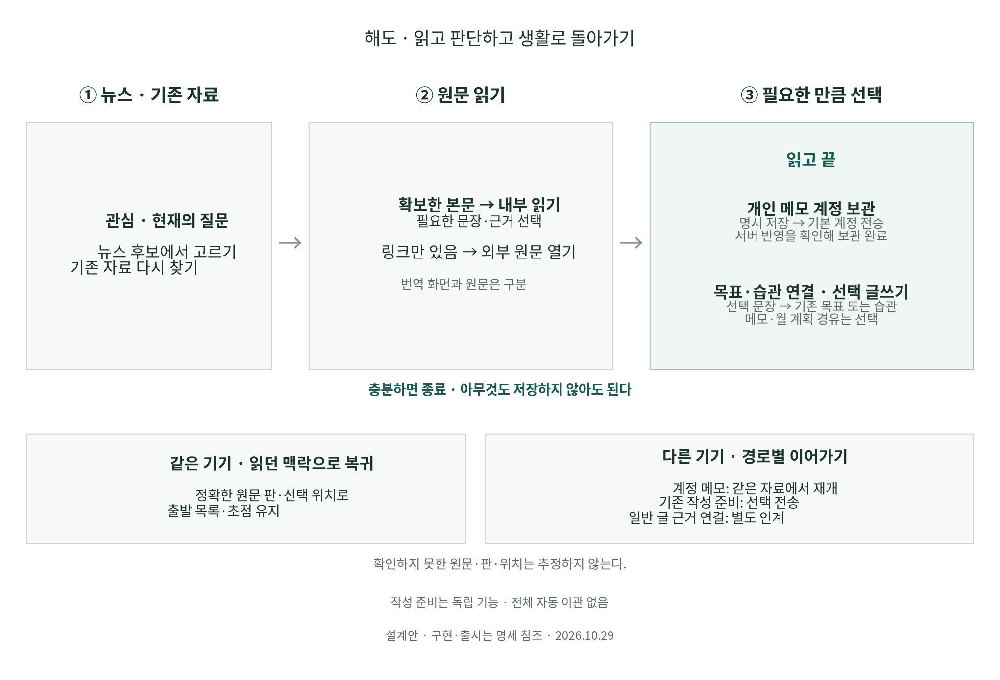

# 관심 글에서 내 판단·다음 선택까지

2026-10-29 KST. [제품 목적](../life-tools-design/product-purpose.md)의 대표 여정 A를 구현에 넘기기 위한 **설계 명세**다. 이 문서의 새 조작·화면은 구현·출시 전이다. 코드 기준은 main `30e94f0`(PR141 포함), 설계 기준은 PR142다. 앱을 오래 사용하거나 글을 많이 만드는 대신 필요한 자료를 읽고 자기 판단 후 생활로 돌아가게 한다.

## 목표·범위·완료

**관심/질문 → 뉴스 또는 기존 자료 → 원문 읽기 → 메모·판단/작은 행동/글쓰기 중 선택 → 중단 후 재개 → 정확 근거 복귀**를 하나의 작업으로 설계한다. 읽고 아무것도 남기지 않아도 완료다. 질문 입력·링크 보관·글 생성·AI·공개를 필수 단계로 만들지 않는다.

대표 예시는 ‘외국어 학습을 지속하려면?’이라는 필요로 영어 후보와 기존 메모를 읽고 ‘이번 주에는 짧게라도 매일 해보기’라는 개인 판단을 남기는 장면이다. 행동 문구는 사용자의 의도이며 일정·수행·효과를 생성하지 않는다. 합성 예시이며 사용자의 실제 응답을 만들지 않는다.

범위는 기존 뉴스/자료 읽기와 작성 준비의 연결·간결한 메모 진입·복귀·저장 상태다. 뉴스 공급 확장·추천 모델·AI API·새 읽기 엔진·새 서버 도메인은 이 명세의 선행 조건이 아니다. 다른 세션의 [계정 연속성 인계 PR140](https://github.com/wonchance-art/life-haedo/pull/140)와 일반 글 근거 이동을 연결한다.

완료는 아래 정상·실패 여정을 실제 후보에서 끝내고 입력·정확 판·기존 공개/보관 경계·간결한 본문을 보존하는 것이다. 이 문서와 그림의 검수는 제품 검수의 대체물이 아니다.

[SVG](../diagrams/rendered/reading-decision-journey-20261029.svg) · [편집 원본](../diagrams/reading-decision-journey-20261029.dot)

## 현재 기능과 실제 변경

| 연결 | 현재 확인한 기능 | 이번 실행에 필요한 변경 |
| --- | --- | --- |
| 뉴스 → 원문/번역 | 명시 외부 링크, 관심·복수 언어·반응·읽기 비교 | 읽기만으로 끝내는 경로 유지. 외부 방문·번역 성공·실독을 자동 확정하지 않음 |
| 뉴스 → 자료 → 작성 준비 | 링크 검토·명시 보관, 정확 source/version seed, 동일 요청 중복 방지, 같은 세션 뉴스 복귀 | 기존 진입 재사용. 메모 목적일 때 글 제목·개요를 먼저 요구하지 않는 좁은 표현 추가 |
| 자료 → 내 생각 | 정확 본문에서 발췌·메모, 작성 준비의 question/material.note/blocks | 본문 없는 링크에도 쓸 수 있는 메모 경로를 기존 준비 위에 제공. 새 인용·원문 생성 금지 |
| 준비 → 완성 글 | 명시 투영·미리보기·PhotoPost·저장·같은 글 재개 | 메모/질문을 자동 투영하지 않음. 기존 글쓰기 전환을 그대로 연결 |
| 준비 → 다른 기기 | MaterialContinuity의 선택 준비 전송·정확 원문 closure·saved 글 refs | 기존 검토/수신 화면을 문맥에서 연결. 준비/본문/사진의 상태를 따로 표시 |
| 일반 계정 글 → 근거 | 글 본문·사진 재개와 구조화 근거의 이동은 별도 | PR140의 일반 글 근거 실행 계약과 통합 검수. 준비 경로로 조용히 우회하지 않음 |
| 네이버 정확 사진 복구 | PR141에서 main 통합됨 | 재구현하지 않음. 이번 여정에서 해당 자료를 쓸 때 기존 정확 판 복구 재사용 |

근거: [뉴스→글쓰기](news-to-writing.md), [자료 기반 글쓰기](material-writing.md), [선택 준비 이어쓰기](material-continuity.md), [읽기 비교](discovery-quality.md), [사진 복구](naver-media-continuity.md). 문서의 과거 날짜별 ‘미배포’는 최신 PR·설치 기록과 대조한다.

## 구현자가 먼저 열 파일

| 역할 | 실제 코드 진입점 | 확인할 계약 |
| --- | --- | --- |
| 뉴스→링크 자료 | [ui.js](../../assets/life/ui.js) `DiscoveryUI.onImport`, [discovery.js](../../assets/life/discovery.js) `toImportInput` | 현재 변환은 coverage와 관계없이 링크만 준비 |
| 자료→정확 준비 | [ui.js](../../assets/life/ui.js) `materialWritingSeed`, [workbench-ui.js](../../assets/life/workbench-ui.js) | 정확 source/version/hash, 기존 seed 요청 재사용·복귀 |
| 준비·메모·투영 | [material-writing.js](../../assets/life/material-writing.js), [material-writing-ui.js](../../assets/life/material-writing-ui.js), [storage.js](../../assets/life/storage.js) | `read/saveMaterialWriting`, `createMaterialWritingPost`, question/note 미투영·CAS |
| 기기 이어쓰기 | [material-continuity-sync.js](../../assets/life/material-continuity-sync.js), [material-continuity-ui.js](../../assets/life/material-continuity-ui.js) | `preview/connect/sync/receive/handoff/shareOutput`, 검토 범위·소유 claim |
| 일반 글·정확 근거 | [blog-sync.js](../../assets/life/blog-sync.js), [source-reference.js](../../assets/life/source-reference.js) | `openRemote`, `build/resolve`, 현재 글 수신과 refs 설치 차이 |

## 화면과 조작

최상위 메뉴는 홈·뉴스·자료실·계획·설정이다. 새 ‘판단 센터’나 상시 보조 패널을 만들지 않는다. 기사/자료 제목·본문이 첫 화면의 중심이다. 설명은 내용 확보 범위·실패·기기 이동 검토에 필요한 순간만 표시한다. 아이콘은 접근 가능한 이름과 키보드 조작을 가진다.

| 화면 | 보이는 핵심 | 조작과 결과 | 복귀 |
| --- | --- | --- | --- |
| 뉴스/검색 목록 | 기존 기사 카드와 정렬·관심·언어 | 원문/번역은 외부 열기. 자료로 활용하려면 기존 링크 보관 검토 | 목록·필터·초점 유지 |
| 링크 보관 검토 | 선택 기사 제목·출처·URL·‘링크만’ 확보 범위 | 취소 또는 자료만 보관. 보관 후 현재 자료 열기 | 취소 시 뉴스 상태 불변 |
| 자료 읽기 | 확보한 정확 본문 또는 링크, 출처는 기존 정보 위치 | 기존 구절·메모와 글쓰기 진입. 새 `메모`는 아래 준비의 간결한 보기 | 원래 목록 또는 준비의 정확 자료 |
| 메모 보기(새 표현) | 선택 자료 제목, 메모 입력 한 칸, 접힌 질문/다른 자료 | 기존 material.note 저장. 작은 다음 행동도 같은 자유문에 적음. `글쓰기` 선택 시 기존 준비 전체 보기 | 읽던 정확 판과 위치로 |
| 기존 준비/글 | 채택 문단·인용·기존 작성기 | 명시 미리보기·초안·저장. output이 있으면 같은 글 재개 | 준비/원문/같은 세션 목록 |
| 기기 이어쓰기 | 기존 선택 준비 검토·전송/수신, 별도 계정 글 목록 | 전송 범위·설치 공간·충돌·saved 글/미완성 초안 차이 확인 | 전송/수신 후 현재 대상, 타 기기의 화면 위치는 추정하지 않음 |

**메모 보기의 선택 근거:** 단순 판단을 남기는데 글 제목·개요·초안 생성을 요구하면 목적보다 관리가 커진다. 기존 준비의 자료 메모를 얇게 보여주면 저장·충돌·선택 전송을 재사용할 수 있다. 새 메모 테이블·일정 모델·편집기를 추가하지 않는다. 기존 발췌의 메모는 구절이 있는 경우에 그대로 쓴다. 링크만 있는 자료에 가짜 구절을 붙이기 위해 발췌 모델을 늘리지 않는다.

첫 진입은 메모 화면만 열고, **첫 유효한 메모 저장에서 새 준비를 확정**한다. 현재 글쓰기 seed는 진입 즉시 빈 준비를 저장하므로 새 메모 경로의 차이를 명시적으로 구현한다. 기존 글쓰기 진입은 유지한다. 새 메모의 planId/요청 ID는 화면에서 한 번 정하고 기존 순수 모델로 미저장 입력을 구성한 뒤, 정확 자료 검증과 기존 wrapper CAS로 준비 전체를 한 번 저장한다. 빈 입력으로 닫으면 준비 생성 0이며 기존 준비의 메모를 지우는 편집은 명시 저장할 수 있다. 커밋 전 강제 종료의 입력 보존은 보장하지 않는다.

단순 기사 열기·외부 탭 복귀에는 준비·글·반응·전송 쓰기 0회다. 기존 세션 위치 기억은 유지한다. source/version이 같은 기존 준비 후보는 현재 공간의 기존 준비 목록에서 찾는다. 후보가 여러 개면 제목/질문/수정 시각으로 사용자가 고르고, `새 메모`도 명시 선택이다. 다른 준비를 임의 병합하거나 최신 항목을 자동 덮지 않는다. 이미 선택된 planId가 있는 재진입은 그 준비를 연다. 같은 클릭/재시도는 고정한 seed 요청 ID로 중복 생성하지 않는다.

편집 대상은 **계정·workspaceId + planId + materialId + sourceId/sourceVersionId/contentHash(null 포함)**로 고정한다. 같은 준비에 동일 source/version의 서로 다른 materialId가 있을 수 있으므로 자료 제목만으로 첫 메모를 선택하지 않는다. 중복 후보는 메모 일부·기존 자료 순서로 구분해 사용자가 선택한다. 저장·원문 왕복·준비 재열기마다 대상을 재검증하고 누락/변경 시 입력을 보존한 채 중단한다. 다른 자료의 note로 대체하지 않는다. 이 키는 기존 식별자의 조합이며 새 서버 객체가 아니다.

뉴스에서 직접 메모로 잇는 조작은 기존 링크 보관 검토에 목적을 전달해 보관 후 같은 정확 자료의 메모 보기로 연다. 검토 전 취소는 자료/준비 쓰기 0이다. 자료 보관 성공 후 준비 저장·화면 열기가 실패하면 보관한 source/version과 요청 ID를 유지하고 같은 대상으로 재시도한다. 이미 성공한 자료를 다시 가져오거나 메모 실패를 이유로 지우지 않는다. 보관 후 돌아가기는 삭제를 의미하는 취소로 표시하지 않는다.

표시 제목은 선택 자료 제목을 사용할 수 있으나 개인 질문·주장·본문을 자동 작성하지 않는다. 전용 메모 제목 입력은 요구하지 않는다. 글쓰기 전환 시 title/question/material.note/blocks/output 형식과 기존 제약을 유지한다. 기존 준비를 간결한 보기로 열어도 숨겨진 개요·다른 자료·output은 삭제하거나 다시 생성하지 않는다.

이는 UI 가설이다. 실행 세션은 기존 전체 준비 보기와 간결한 보기를 같은 합성 자료로 비교한다. 조작·재선택이 줄지 않거나 준비를 찾기 어려워지면 기존 메모 진입 문구·초점만 개선하는 더 작은 안을 채택한다. 새 보기를 무조건 만드는 것이 완료 조건은 아니다.

## 데이터·수명·전송 계약

| 정보 | 기존 소유 구조 | 저장·전송·삭제 기준 |
| --- | --- | --- |
| 후보 제목·URL·출처·언어 | Discovery와 명시 링크 자료 | URL 스냅샷은 확보 본문 아님. 링크 contentText/contentHash는 null 유지 |
| 확보 원문/판 | Core source/sourceVersion | 정확 ID·hash·UTF-16 위치 유지. 새 공급/번역/사진으로 옛 판 교체 금지 |
| 질문·판단·작은 행동 | MaterialWriting question/material.note | 비공개 준비 입력. 행동 문자열은 일정/완료 데이터가 아님 |
| 글로 채택할 문단/인용 | MaterialWriting blocks, SourceReference | 명시 채택·투영. 질문/메모 자동 복사 금지. 인용은 실제 확보 원문에서 검증 |
| 완성 글/근거 | PhotoPost, BlogEvidence, 기존 BlogSync | 로컬 저장과 서버 ACK 구분. 일반 계정 글의 정확 근거는 별도 인계 계약 |
| 목록/읽기 위치·초점 | 기존 returnContext/세션 읽기 위치 | 같은 계정·공간·탐색 세대에서만 적용. 서버/백업/공개에 세션 위치 추가하지 않음 |
| 좋아요·담기·읽음 제외·읽기 도움 | 기존 DiscoveryActions/Reading | 메모/판단과 독립. 반응·읽기·도움·추천 opt-in 자동 변경 금지 |

`메모 보기`는 기존 MaterialWriting의 **표현 상태**다. v1 형식에 mode/nextAction/readAt 같은 필드를 추가하지 않는다. 기존 `saveMaterialWriting` CAS·IME/flush·원자 output 영수증을 재사용한다. 준비 한도·필드 길이·PhotoPost 한도를 조용히 늘리거나 넘는 입력을 잘라내지 않는다. 입력은 화면에 남겨 수정·복사·재시도하게 한다.

계정 기본 보관을 원하는 사용자 방향은 유지하되 현재 지원 범위를 정확히 표시한다. 자료 자체의 기본 계정 보관, 준비의 로컬 저장, **선택 준비의 명시 전송**, saved 글의 별도 서버 보관은 서로 다른 계약이다. 새 메모 보기를 이유로 모든 질문/메모·초안의 자동 전송을 켜지 않는다. 계정 기본 정책을 준비까지 바꾸려면 전송 대상·제외/중지·이관·충돌을 확정하는 별도 계약 변경이 필요하며, 그 전에는 ‘계정에 보관됨’으로 합산하지 않는다.

다른 기기 재개는 다음 두 경로를 구분한다.

1. **준비에서 이어가기:** 현재 준비의 기존 이어쓰기 검토를 연다. 선택 원문의 전체 정확 본문과 비공개 질문·메모 등 포함 범위를 확인한다. 첫 수신은 새 독립 공간, 이후는 영수증의 같은 준비다. `output=writing`이면 소유 기기의 작성 claim을 유지하며 B에서 새 초안을 만들지 않는다. 미완성 글·사진은 자동 수신하지 않고 A에서 작성 중인 수정 초안도 보존한다. saved 글은 별도 원본/정확 revision/사진·refs 검증이 끝나야 완성 상태다.
2. **저장 글에서 이어가기:** 기존 계정 글 목록과 재개를 쓴다. 준비를 자동 생성하거나 다른 공간에 있는 근거를 추정 연결하지 않는다. 정확 근거가 미수신이면 본문은 읽되 근거는 미확보로 표시한다. PR140의 근거 이관이 검증되기 전에는 이 경로를 ‘정확 근거까지 이어짐’으로 통과시키지 않는다.

기기 A의 세션 뉴스 origin·스크롤을 B에 복제하지 않는다. B에서는 수신 준비/정확 글의 유효한 진입점으로 열고, B 자신의 목록으로 돌아간다. 원문 누락·계정 보관 실패·다른 글 revision을 ‘처음부터 다시 시작’으로 조용히 대체하지 않는다.

## 상태·실패·취소

상태는 화면의 단계와 보관 상태를 분리한다. ‘읽는 중/메모/글’ 하나의 상태 머신으로 서버 완료를 추정하지 않는다. 문맥에 필요한 상태만 작업 옆 한 줄로 표시하고 세부 오류는 펼친다.

| 상황 | 허용 동작·보존 | 성공으로 표시하지 않을 것 |
| --- | --- | --- |
| 외부 원문/번역 열기 실패 | 원래 링크·목록 유지, 명시 재시도. 전역 번역 끄기 즉시 반영 | 탭 열림=읽음/번역 완료 |
| 본문/구절 미확보 | 링크 열기·개인 메모 가능, 구조화 인용은 막음 | 요약·복사한 번역을 원문 인용으로 승격 |
| 메모 저장/용량 실패 | DOM 입력·선택·IME 유지, 다시 저장·복사·명시 취소 | 로컬 커밋 전 저장됨 |
| 다른 탭 CAS 충돌 | 덮지 않고 기존 충돌/새 준비 사본 복구 재사용 | 같은 source이므로 메모 자동 병합 |
| 동일 조작 반복·응답 유실 | 같은 seed/operation/영수증으로 확인·재시도 | 새 준비·새 글 중복 생성 |
| 화면 이동/한글 조합 | 기존 dirty/pending/flush 성공 뒤 이동. 외부 브라우저 이탈은 마지막 커밋 범위만 보장 | 브라우저 강제 종료의 마지막 키 보장 |
| 계정/공간 변경·늦은 응답 | 세대 확인, 이전 입력/결과를 새 화면에 설치하지 않음 | 다른 계정의 제목/메모·근거 노출 |
| 원문 판/글 revision 누락·변경 | 정확 대상 미확보 안내, 현재 판은 별도 명시 선택으로 열기 | 최신 판으로 대체하고 같은 근거라 표시 |
| 원격 실패/오프라인 | 기존 로컬 자료·준비·글과 재시도 유지. 표시/로컬/서버 ACK 각각 구분 | 일반 캐시를 계정 수신 완료라 표시 |
| 취소·나가기 | 외부 읽기와 미착수 작업은 변경 0. 미저장 메모는 저장/계속 편집/명시 취소 선택 | 뒤로가기=기존 준비·자료·반응 삭제 |

메모 수정·지우기는 기존 준비 안의 명시 편집과 저장이다. 준비 자체 제거는 기존 준비/인계 영수증 계약부터 확인한다. 새 ‘모두 지우기’를 만들지 않으며 글·원문·서버 사본까지 연쇄 삭제하지 않는다. 전송·충돌 선택에는 검토 후 입력이 바뀌면 예전 동의를 재사용하지 않는다.

## 구현 분담과 의존성

한 PR/작업 묶음에서 진입·저장·재열기·복귀·필요한 검수를 끝낸다. 내부 작업 순서만 나누고 버튼별 출시로 쪼개지 않는다. 기존 저장 형식·보관 정책을 변경하지 않는 화면 연결부터 시작한다.

| 담당 | 변경 경계 | 의존/산출물 |
| --- | --- | --- |
| 진입·복귀 | ui.js, workbench-ui.js | 현재 정확 source/version seed와 returnContext 재사용. 한 계정·공간·탐색 세대 확인 |
| 준비 표현 | material-writing-ui.js, material-writing-sources.js, 기존 CSS | 기존 note/question/blocks를 그대로 사용. compact 보기 시 숨은 자료·개요·output 보존 |
| 계정 연결 | 기존 material-continuity UI, PR140 일반 글 근거 담당 | 선택 준비 전송과 일반 글 수신의 소유권·공간·상태 차이 표기. 새 원격 도메인 도입 없음 |
| 독립 검수 | 아래 대표 여정과 기존 검사 재사용 | 입력/정확 판/실패/3폭·키보드/현재 PR141 사진을 같은 후보에서 확인 |

수정 전 실제 이름·API는 현재 코드에서 재확인한다. `ui.js`와 `workbench-ui.js` 통합은 한 담당이 맡고, 모델/원격/메뉴를 여러 담당이 동시에 고치지 않는다. 새 의존성을 추가할 이유가 없으며 기존 Quill·SourceReference·MaterialWriting·CAS·MaterialContinuity를 재사용한다. 새로운 라이브러리가 필요해지면 기존 [오픈소스 검토](../life-tools-design/open-source-review.md)의 공식 버전·라이선스·보안 비교 절차를 먼저 적용한다.

## 통합 검수와 채택 기준

| 대표 검사 | 통과해야 하는 결과 |
| --- | --- |
| 읽기만 종료 | 원문/번역을 열고 목록 복귀. 준비·글·읽음·좋아요·도움·공개 쓰기 0 |
| 링크만 있는 글의 판단 | contentText/hash null 유지 → 개인 메모 저장·재열기 → 허위 인용/본문/일정 0 |
| 확보 원문의 메모·근거 | CRLF·이모지·동명 자료와 옛 판 → 정확 구절 → 내 판단 → 원문 왕복. hash/UTF-16 범위 불변 |
| 새 메모·기존 준비 재개 | 빈 메모를 열고 닫으면 준비 0. 첫 유효 저장은 정확 준비 하나. 같은 자료의 여러 준비를 구분. 숨은 개요/다른 자료/output 불변. 연속 클릭·재시도에 준비/글 중복 0 |
| 대상·한도 반례 | 같은 준비의 동일 source/version·서로 다른 materialId 메모를 각각 편집해 상대 메모 불변 확인. 준비 20개가 찬 공간에서는 새 생성 실패 후 입력 유지·기존 준비 명시 선택 가능, 자동 삭제·한도 확장 0 |
| 메모→글 선택 | 메모는 기본 미채택, 명시 복사·인용만 투영 → 같은 글 저장/재열기 → 출발 맥락 복귀 |
| 실패·경합 | 저장 quota/CAS·ACK 유실·원문 누락·403·불완전 사진·계정/공간 전환을 주입. 원본·입력·선택하지 않은 복구 사본 보존 |
| 다른 기기의 준비 | A 명시 검토·전송 → B 새 공간 수신/같은 준비 재수신 → 정확 원문·메모 → A 반영. 미완성 초안 비전송과 saved 글 refs 별도 검증 |
| 일반 계정 글의 근거 | PR140 실행과 공동 확인. 준비 경로를 사용한 결과로 대체하지 않고 정확 글 revision·사진·refs/누락 상태 확인 |
| 미니멀/입력/갱신 | 390/820/1440px, 제목/출처/본문, 입력 16px·조작 44px·가로 넘침, 키보드/IME/scroll·외부 탭 복귀·PWA 갱신 후 보존 |

사진 복구 자체의 모든 회귀를 중복 작성하지 않고 PR141의 기존 검사를 재사용한다. 변경으로 영향을 받는 여정만 보강한다. 기존 selector·보존 단언·시간 제한을 통과 목적으로 약화하지 않는다. 동일 후보의 코드 해시·정상/오류 화면·실패 원인·수정 근거를 남긴다.

제품 채택은 기존 보기 대비 메모까지의 재선택/필수 입력/맥락 설명이 줄고, 사용자가 현재 저장 범위와 다음 동작을 이해할 수 있는지로 판단한다. 자동 검수는 사용자의 실제 이해·추천 도움·실천 효과를 입증하지 않는다. 개인 자료를 자동 분석하거나 상시 추적을 추가하지 않고 익명 합성 장면과 선택한 실제 체험을 구분한다.

## 이후 연결

후속 설계는 [생활 시스템 계약](../life-tools-design/life-system-contract.md)과 [계획·실행·기간 회고](planning-practice-review.md)에 구체화했다. 행동하려는 사용자는 메모/작성 준비를 먼저 만들지 않고 선택 문장을 기존 목표·습관에 직접 연결할 수 있도록 비교한다. 아래 다음 작업 설명은 이 상세 설계로 이어졌다.

이 명세의 구현·검수는 실행 세션에 넘긴다. 이 설계 세션은 다음으로 **월 방향→기존 목표/습관→확인 가능한 수행→기간 회고**의 내용 연결을 구체화한다. 읽기 메모의 행동 문구를 자동 일정으로 옮기지 않고 사용자가 실제로 선택하는 연결을 설계한다. 질문 중심 AI는 이 기본 흐름의 도움·추가 부담을 비교한 뒤 필요한 곳에만 검토한다.
