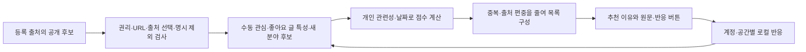

# 좋아요·담기와 개인 추천 시스템 조사

2026-10-19 KST. 조사 기준 소스는 `3f9e12c`다. 사용자 요청은 좋아요·담은 글을 다시 보고, 그 반응으로 추천을 정교하게 만드는 시스템에 대한 SNS 사례·오픈소스 종합 조사다. 아래는 **확인한 사실과 다음 구현을 위한 설계 제안**이다. 이번에는 제품 코드·데이터 형식·추천 순서·배포를 변경하지 않았다.

## 판단

해도에는 **독립적인 좋아요·담기 목록 + 로컬 내용 기반 개인 추천 + 사용자가 고칠 수 있는 추천 이유**를 우선 권한다. SNS의 후보 생성·점수 계산·재정렬 구조를 참고하되, 클릭과 체류를 극대화하는 목표나 대규모 학습 인프라를 그대로 가져올 근거는 없다. 목표는 읽을 만한 정보를 찾고 나중에 활용하는 데 드는 부담을 줄이는 것이다.

좋아요와 담기는 다른 신호다. 좋아요는 그 글에 대한 긍정 반응이지만 모든 주장에 대한 동의나 사용자 신념을 뜻하지 않는다. 담기는 나중 읽기·참고·반례 수집일 수도 있으므로 처음부터 긍정 취향으로 학습하지 않는다. 사용자가 요청한 추천 반영 범위를 화면에서 분명히 하고, 반영을 끄거나 특정 글을 학습에서 뺄 수 있게 한다. 버튼마다 별도 확인 절차를 요구하지 않는다.

현재 5개 출처·50개 후보는 모두 `link_only`다. 주로 제목·공식 분류·날짜를 갖고 있고 본문은 없다. 관심 분야의 후보가 없으면 순서를 바꾸는 알고리즘으로 해결할 수 없다. 공급 범위·메타데이터 품질과 순위 품질을 따로 평가해야 한다.

## 현재 해도가 하는 일과 재사용할 기반

| 항목 | 현재 구현 | 이번 연구에서 제안하는 확장 |
| --- | --- | --- |
| 관심순 | 직접 저장한 관심의 실제 표현·별칭을 제목/태그 등에 대조하고 근거·날짜로 정렬 | 기존 관심순을 비교 기준으로 유지하고 개인 추천 모드를 별도로 검증 |
| 읽음·관련 없음 | URL별 한 종류를 저장하고 두 상태 모두 추천에서 제외 | 읽음은 만족도와 분리, 관련 없음은 해당 글 제외로 유지 |
| 좋아요·담기 | 미구현 | 독립 토글, 각각의 목록, 재열기·해제·되돌리기 |
| 자료실 보관 | 링크 보관 검토 후 명시적으로 자료 생성 | 가벼운 담기와 구분하고 기존 가져오기 검토 재사용 |
| 저장·충돌 | 계정/작업공간별 로컬 CAS, 초기화 revision, 실패 입력 보존 | 같은 계약을 새 반응 메타데이터에 재사용 |
| 자동화 | 공개 고정 목록 수집·15분 화면 갱신 | 반응 기록이나 취향 학습과 구분 |

근거 코드: [순위·제외](../../assets/life/discovery.js), [현행 피드백 모델](../../assets/life/discovery-profile.js), [원문·보관·목록 UI](../../assets/life/discovery-ui.js), [로컬 저장소](../../assets/life/storage.js). 현재 피드백은 URL당 `already_read` 또는 `not_relevant` 한 행이며, 여기에 단일 enum으로 좋아요·담기를 끼워 넣으면 서로 덮어쓸 수 있다. canonical URL은 의미 있는 query를 보존하며 provider ID만으로 동일 글을 판단하지 않는다.

## SNS에서는 어떻게 구현하는가

공개 기술 설명·공개 코드의 확인 범위이며 모든 이용자에게 적용되는 현재 운영 정책·실험·모델 파라미터 전체를 재현한 결과가 아니다. 원문 발행일과 이번 확인일을 구분한다.

| 서비스 | 공식 자료에서 확인한 방식 | 해도에 적용할 원칙 |
| --- | --- | --- |
| Instagram | Explore 기술 설명은 후보 검색→1차/2차 순위→재정렬을 구분하며 여러 반응을 예측한다. 2025년 기술 글도 sourcing·early/late-stage ranking과 화면별 모델 운영을 설명한다. | 후보 확보와 정밀 순위를 분리. 여러 종류의 반응과 출처 다양성을 따로 취급 |
| YouTube | 시청 이력·좋아요·관심 없음·만족도 설문 등 여러 신호를 사용하며 장기 만족을 목표로 설명한다. 화면별 주요 신호도 다르다. | 클릭·오래 열어 둠을 실제 도움과 동일시하지 않고 읽은 뒤 유용성을 따로 확인 |
| TikTok | 공식 안내는 완주/스킵 같은 상호작용과 콘텐츠 정보·설정, 부정 피드백과 피드 조절을 설명한다. | 사용자가 추천을 조절하고 새 분야도 접할 경로를 유지. 외부 글의 실제 완독은 앱에서 관측할 수 없음을 인정 |
| X | 2026년 공개 저장소는 여러 후보 경로·행동별 예측·필터링·다양성 재정렬을 분리한다. | 개인 선호 점수와 반드시 지킬 제외 조건을 분리. 공개 SNS 가중치를 해도의 횟수 규칙으로 복사하지 않음 |
| Bluesky | 공식 custom feed starter는 인덱싱과 피드 알고리즘을 개발자가 구현하는 구조다. 사용자가 다른 피드를 고를 수 있다. | 최신순·관심순·개인 추천을 사용자가 선택하고 개인화를 해제할 수 있게 함 |

공식 근거:

- Meta [Explore 기술 설명, 2023-08-09](https://engineering.fb.com/2023/08/09/ml-applications/scaling-instagram-explore-recommendations-system/), [화면별 모델 운영, 2025-05-21](https://engineering.fb.com/2025/05/21/production-engineering/journey-to-1000-models-scaling-instagrams-recommendation-system/), [Instagram 순위 설명, 2023-05-31](https://about.instagram.com/blog/announcements/instagram-ranking-explained).
- YouTube [추천에 쓰는 신호](https://support.google.com/youtube/answer/16089387?hl=en), [장기 만족과 추천 목표](https://support.google.com/youtube/answer/16533387?hl=en).
- TikTok [Making your feed For You](https://www.tiktok.com/safety/en/making-your-feed-for-you). 확인한 페이지의 갱신 표시는 2025-07-24다.
- X [2026 공개 코드](https://github.com/xai-org/x-algorithm), Bluesky [피드 선택 설명](https://bsky.social/about/blog/7-27-2023-custom-feeds), [공식 피드 생성기](https://github.com/bluesky-social/feed-generator).

X의 현재 공개 README는 행동 가중치가 **예측 확률 또는 예측 연속값**에 적용되며, 좋아요·신고 횟수를 직접 상쇄하는 수식이 아니라고 설명한다. 기본 설정도 일부 공개되어 있으므로 전부 비공개라고 할 수 없다. 반면 일부 규칙·프롬프트와 운영 배포 관련 요소는 제외되어 있다. 현재 고정한 코드와 모든 운영 실험을 동일시하지 않는다. 2023 계열 `twitter/the-algorithm`과 2026 계열 `xai-org/x-algorithm`의 라이선스·확인 HEAD도 다르다.

## 반응의 의미와 화면 설계

| 행동 | 기록할 의미 | 초기 추천 반영 |
| --- | --- | --- |
| 좋아요 | 이 글을 긍정적으로 표시 | 허용된 반응의 글 특성을 개인 관련성의 근거로 검토. 신념·진실·전문성 판정은 생성하지 않음 |
| 담기 | 다시 볼 글로 지정 | 목록 관리가 기본. 좋아요와 같은 양성 신호로 자동 합산하지 않음 |
| 읽음 | 사용자가 직접 읽음 표시 | 해당 글의 재노출 제어. 만족·불만 신호로 쓰지 않음 |
| 관련 없음 | 이 글을 목록에서 제외 | 해당 URL 제외. 출처/주제 전체의 불호로 확대하지 않음 |
| 원문 열기·무반응 | 열었거나 반응이 관측되지 않음 | 열기=읽음, 무반응=싫어요로 학습하지 않음 |
| 취소·복구 | 현재 선택 상태 변경 | 한 글의 현재 유효 상태를 한 표로 사용. 반복 토글 횟수로 가중하지 않음 |

목록에서 해제한 행에는 되돌리기를 남기고, 다시 연 뒤에도 취소 항목을 관리·복구할 경로를 둔다. 복구 가능한 해제와 완전 삭제를 구분한다. 기사 아래 좋아요·담기를 독립 토글로 두고 `좋아요한 글`·`담은 글`에서 다시 연다. 두 상태를 동시에 가질 수 있고 하나를 해제해도 다른 상태나 자료실 원문은 지우지 않는다. 원문 링크·출처·확보 범위를 표시하며 작은 화면의 44px 조작 영역, 눌림 상태, 키보드 초점을 유지한다. 공개 좋아요 수·팔로워·인기도 경쟁은 필요하지 않다.

담기는 목록용 제목·출처·URL 등의 메타데이터를 남기는 행동이다. 원문을 확보하거나 자료실에 저장했다는 뜻이 아니다. 실제 자료 보관은 현행 검토로 연결한다. 원문이 공급 목록에서 빠졌거나 출처를 껐어도 개인 목록은 유지한다. 공급 목록에서 빠지면 마지막으로 보관한 메타데이터임을 표시한다. 원문 접근 가능 여부를 자동 검사하지 않으며, 목록을 열었다는 이유로 그 사이트의 본문을 자동 요청하지 않는다.

좋아요·담기를 누른 순간 현재 읽는 글이 사라지거나 목록이 재정렬되지 않게 한다. 개인 추천의 새 순서는 다음 목록 적용에 반영하고 현재 글·초점·스크롤을 보존한다. 자동 갱신에도 이 보존 경계를 검증한다. 추천 이유는 실제 계산 근거만 보여 준다. 예: 직접 고른 주제와 일치, 추천에 사용한 좋아요 글의 태그/표현과 유사, 최신 글, 같은 출처의 반복을 줄임. 내용 유사도를 진실 확률이나 본문 이해로 표시하지 않는다.

## 알고리즘 제안과 도입 단계

구조는 Google의 [후보 생성·순위·재정렬](https://developers.google.com/machine-learning/recommendation/overview/types), [내용 기반/협업 후보](https://developers.google.com/machine-learning/recommendation/overview/candidate-generation), [재정렬과 다양성](https://developers.google.com/machine-learning/recommendation/dnn/re-ranking)을 참고한 해도용 제안이다.

### 초기: 설명 가능한 개인 추천

고정된 작은 후보 전체를 브라우저에서 평가하는 것으로 시작한다. 출처 꺼짐·명시 제외·유효하지 않은 URL과 기존 보관 자료의 새 후보 제외는 먼저 적용하며 선호 점수로 뒤집지 않는다. 수동 관심, 추천에 쓰기로 한 좋아요 글의 공식 태그·제목 표현, 최신성을 각각 계산하고 목록 수준에서 비슷한 글·출처의 연속을 줄인다. 새 분야 노출은 사용자가 선택한 범위 안에서 제공한다.

설계 가설은 `관련성 = 수동 관심 근거 + 좋아요 글 특성과의 유사성 + 날짜 정보`, 이후 다양성 재정렬이다. 각 특징을 같은 척도로 다루고 결측 날짜는 미상으로 유지한다. 수집 시각을 발행일로 바꿔 신선해 보이게 만들지 않는다. 가중치·감쇠 기간·다양성 비율을 검증 없이 확정하지 않으며 개인 점수를 확률로 표시하지 않는다. 신호가 없거나 개인화를 끄면 직전에 사용자가 선택했던 기존 관심순/최신순으로 돌아간다. 최신순에는 개인 선호를 섞지 않는다. 정확한 순위 복귀 검사는 같은 feed·설정·제외 조건에서 수행한다.

단어·태그, 제목의 문자 n-gram/TF-IDF 등은 작은 비교 기준 후보다. 한국어 조사·동의어·다의어, 짧은 제목의 정보 부족은 별도 평가한다. 단어 유사성으로 의미 이해를 주장하지 않는다. 현재 50개를 평가하는 데 벡터 DB·ANN 서버가 반드시 필요하지는 않다.

### 다음: 한국어 내용 유사도와 학습

규칙 기준보다 놓치는 글이 많다는 근거가 생기면 한국어 임베딩·다중 관심 표현·학습 순위 모델을 비교한다. 원문 권리·실제 입력 범위, 모델 라이선스·기기 비용, 새 독립 평가를 먼저 확인한다. 좋아요 한두 개로 사용자 전체를 하나의 주제로 고정하지 않고 여러 관심과 최근 변화, 데이터 부족을 표현해야 한다. 기존 MODEL-02/03 관심 추출 기각을 이 기능 도입으로 뒤집지 않는다.

협업 필터링은 다른 사용자의 반응과 항목 교집합을 이용한다. 현재 한 사람의 로컬 기록에서는 협업 신호와 효과 근거가 부족하므로 우선 보류한다. 나중에 실제 참여자·공유 항목·데이터 사용 범위·운영 체계가 갖춰지면 내용 기반과 비교한다. 고정된 사용자 수나 좋아요 수만으로 전환하지 않는다.

밴딧·강화학습은 노출 정책과 보상, 탐색 비용을 정의하고 효과를 평가할 데이터가 생긴 뒤 검토한다. 초기에는 통제 가능한 다양성·새 후보 영역으로 시작한다. 클릭이나 담기 횟수를 늘리는 것을 최종 목적 함수로 두지 않는다.

## 오픈소스 비교

공식 조회일은 2026-10-19 KST다. 아래 날짜는 KST로 환산했으며 release 공개일과 default branch commit일을 구분했다. 6개 모두 조회 당시 archived=false다. 상세 확인은 [기계 판독 기록](evidence/recommendation-research/verification.json)에 고정한다.

| 도구 | API 최신 release·공개일 | 확인 HEAD·commit일 | 코드 라이선스 | 용도와 해도 적합성 |
| --- | --- | --- | --- | --- |
| [Gorse](https://github.com/gorse-io/gorse) | [v0.5.11](https://github.com/gorse-io/gorse/releases/tag/v0.5.11) · 2026-07-15 | [d3186be](https://github.com/gorse-io/gorse/commit/d3186be36756ce9bd87b1d53c79b7074512dc9c7) · 2026-10-18 | [Apache-2.0](https://github.com/gorse-io/gorse/blob/d3186be36756ce9bd87b1d53c79b7074512dc9c7/LICENSE) | 추천 API·작업·서빙을 갖춘 서비스. 별도 서버·DB/캐시·운영을 선택한 뒤 우선 비교 |
| [implicit](https://github.com/benfred/implicit) | [v0.7.3](https://github.com/benfred/implicit/releases/tag/v0.7.3) · 2026-05-09 | [8a95dbe](https://github.com/benfred/implicit/commit/8a95dbe24ca675a6edd86aafb3b4cd5ae7287edf) · 2026-05-09 | [MIT](https://github.com/benfred/implicit/blob/8a95dbe24ca675a6edd86aafb3b4cd5ae7287edf/LICENSE) | ALS/BPR·item-item 등 Python 학습. 공유 상호작용이 생기면 오프라인 기준선 |
| [RecBole](https://github.com/RUCAIBox/RecBole) | [v1.2.1](https://github.com/RUCAIBox/RecBole/releases/tag/v1.2.1) · 2025-02-24 | [7b02be5](https://github.com/RUCAIBox/RecBole/commit/7b02be5ec80a88310f2d04a27a82adfcbb5dc211) · 2025-02-24 | [MIT](https://github.com/RUCAIBox/RecBole/blob/7b02be5ec80a88310f2d04a27a82adfcbb5dc211/LICENSE) | 여러 추천 모델을 같은 틀에서 실험. 권리 문구 확인 후 연구 비교 |
| [Recommenders](https://github.com/recommenders-team/recommenders) | [1.2.1](https://github.com/recommenders-team/recommenders/releases/tag/1.2.1) · 2024-12-24 | [aa83321](https://github.com/recommenders-team/recommenders/commit/aa8332189cd495be6ffaa7e1c8054f1c180b5ef3) · 2026-09-28 | [MIT](https://github.com/recommenders-team/recommenders/blob/aa8332189cd495be6ffaa7e1c8054f1c180b5ef3/LICENSE) | 분할·모델·평가 예제. 평가 방법을 먼저 참고. 이전 Microsoft 저장소 |
| [TFRS](https://github.com/tensorflow/recommenders) | [v0.7.7](https://github.com/tensorflow/recommenders/releases/tag/v0.7.7) · 2026-01-23 | [a8a90ae](https://github.com/tensorflow/recommenders/commit/a8a90aee3f0b470cda96d47e26de99eedb7fc730) · 2026-10-06 | [Apache-2.0](https://github.com/tensorflow/recommenders/blob/a8a90aee3f0b470cda96d47e26de99eedb7fc730/LICENSE) | retrieval·ranking feature 학습. 단순 기준선을 넘을 가설과 학습 자료가 생긴 뒤 |
| [TorchRec](https://github.com/meta-pytorch/torchrec) | [제목 v1.9.2 / tag v1.9.2-rc3](https://github.com/meta-pytorch/torchrec/releases/tag/v1.9.2-rc3) · 2026-10-01 | [07aeb26](https://github.com/meta-pytorch/torchrec/commit/07aeb26716d9ed6a459f2034ebbd152fd11f4150) · 2026-10-18 | [BSD-3-Clause](https://github.com/meta-pytorch/torchrec/blob/07aeb26716d9ed6a459f2034ebbd152fd11f4150/LICENSE) | 대형 embedding·분산 학습 인프라. 실제 대규모 연산/메모리 병목이 확인된 뒤 |

당장 설치할 제품은 선택하지 않았다. Recommenders는 평가 방법 참고에 적합하고, implicit은 데이터가 갖춰졌을 때 비교할 작은 Python 기준선이다. Gorse는 제품용 서비스에 가깝지만 현재 정적 JS 모듈이 아니며 데이터 이동·인증·영속 저장·운영을 따로 설계해야 한다. TFRS/RecBole은 학습·실험 틀이며, TorchRec은 대형 추천 모델의 연산 인프라다. 어느 도구도 설치만 하면 한국어 뉴스 취향을 이해하는 완성 모델이 되지 않는다.

RecBole은 같은 고정 commit의 [LICENSE](https://github.com/RUCAIBox/RecBole/blob/7b02be5ec80a88310f2d04a27a82adfcbb5dc211/LICENSE)가 MIT지만 [README](https://github.com/RUCAIBox/RecBole/blob/7b02be5ec80a88310f2d04a27a82adfcbb5dc211/README.md#L345)에 데이터·코드의 academic-purpose 제한 문구도 있다. 적용 범위를 확인하기 전 제품 채택을 보류하며, 이 조사로 법적 결론을 확정하지 않는다. TorchRec은 GitHub release 제목·RC tag와 [PyPI 1.9.2](https://pypi.org/pypi/torchrec/json)가 다르므로 하나의 stable tag로 합치지 않는다.

공개 repository advisory API는 6개 모두 HTTP200·0건이었다. 실제 설치물·전이 의존성을 감사한 결과는 아니며 취약점 부재를 뜻하지 않는다. Gorse [release 이력](https://github.com/gorse-io/gorse/releases)의 보안 관련 수정처럼 advisory 밖의 변경도 별도로 확인했다. 패키지·모델·데이터를 실제 채택할 때 버전 고정·호환·각 라이선스·변경 이력을 다시 확인한다.

### SNS 공개 코드의 활용 범위

| 공개 코드 | 고정 HEAD·KST commit일 | 라이선스 | 활용 판단 |
| --- | --- | --- | --- |
| [xai-org/x-algorithm](https://github.com/xai-org/x-algorithm) | [862a123](https://github.com/xai-org/x-algorithm/commit/862a1235ca4d743cc48211309ebbbcc1a5a540a3) · 2026-10-17 | [Apache-2.0](https://github.com/xai-org/x-algorithm/blob/862a1235ca4d743cc48211309ebbbcc1a5a540a3/LICENSE) | 2026 추천 구조·행동별 예측·재정렬 참고 |
| [twitter/the-algorithm](https://github.com/twitter/the-algorithm) | [c54bec0](https://github.com/twitter/the-algorithm/commit/c54bec0d4e029fe34926ef3258a86ccacc0d0182) · 2025-09-04 | [AGPL-3.0](https://github.com/twitter/the-algorithm/blob/c54bec0d4e029fe34926ef3258a86ccacc0d0182/LICENSE) | 이전 계열 구조 참고. 2026 저장소와 구분 |
| [bluesky-social/feed-generator](https://github.com/bluesky-social/feed-generator) | [70e172e](https://github.com/bluesky-social/feed-generator/commit/70e172e16c659167707a7ef65eef7e37fdb606ff) · 2026-09-26 | [MIT](https://github.com/bluesky-social/feed-generator/blob/70e172e16c659167707a7ef65eef7e37fdb606ff/LICENSE) | 피드 선택·알고리즘 분리 참고. 완성 개인 추천 엔진 아님 |

3개 모두 archived=false, `releases/latest`는 404로 고정 release가 확인되지 않았다. 따라서 위 commit을 조사 기준으로 삼는다. 특히 AGPL-3.0인 이전 X 코드와 Apache-2.0인 2026 코드를 같은 라이선스로 취급하지 않는다. 공개 코드를 조사한 것이며 코드를 앱에 복사하거나 서버로 실행하지 않았다.

## 저장·반영·삭제의 계약

새 반응은 기존 원문과 읽음/제외 schema를 변경하지 않는 별도 계정·공간별 로컬 메타데이터로 설계한다. canonical URL별 `liked`·`bookmarked`와 변경 시각, 재열기용 최소 공개 메타데이터를 둔다. 제목·출처·URL·공식 날짜·확보 범위의 한정된 snapshot만 남기고 본문·개인 메모를 자동 복사하지 않는다. 재시도 intent는 단순 toggle 대신 대상 상태를 명시해 중복 클릭/재시도가 반응을 두 번 뒤집지 않게 한다.

CAS·owner 검사·계정 전환 시 취소·revision이 남는 초기화·최소 broadcast·실패 입력 보존을 재사용한다. 좋아요·담기 한도를 기존 제외 피드백 500개와 합치지 않는다. 용량이 차면 조용히 오래된 글을 지우지 않고 선택을 유지한 채 명시 관리·내보내기를 제공한다. 현재 메타는 동기화·기존 자료 백업·공개 사본에 자동 포함되지 않는다. 사용자에게 중요한 목록이므로 전용 내보내기·새 사본 복원과 향후 기기 이동 범위를 첫 구현 설계에 포함한다.

추천에 쓸 반응의 범위와 과거 기록 반영 여부를 명확히 한다. 반영 끄기는 좋아요/담기 목록을 유지하면서 기존 개인 프로필·개인 점수 캐시의 사용도 중지한다. 좋아요 해제·추천 제외는 파생 프로필을 다시 계산하고 늦은 작업을 무효화한다. 원본 revision·반영 정책 revision·실행 세대를 확인해 이전 계산이 삭제된 선호를 되살리지 않게 한다. 추천 초기화·반응 전체 삭제·자료실 원문 삭제는 서로 다른 동작이다. 복원도 삭제/초기화를 몰래 취소하지 않는 새 사본 절차로 설계한다.

반응 전체 삭제·추천 반영 철회 때에는 해당 범위의 파생 프로필·개인 점수/근거 캐시·진단/학습 사본을 제거하고, 제거 실패 중에도 재사용하지 않게 한다. 사용자가 유지한 담은 목록과 공용 기사 캐시는 구분한다. 앱 밖으로 내보낸 파일은 별도 사본이며 복원만으로 개인화 사용을 재개하지 않는다.

노출·클릭·체류 진단은 기본 미수집이다. 필요해 사용자가 켠 경우에만 로컬 건수·기한 한도와 지우기를 갖추며, 개인 진단을 자동 전송하지 않는다. 공개 수집 CI에 개인 반응·주제·계정 ID를 보내지 않는다. 실제 사용자 반응으로 모델을 학습하거나 서버로 전송하는 작업은 수행하지 않았다. 향후 공유 학습은 현재 로컬 반영과 다른 제품 범위다.

## 평가와 실패 후 복구

같은 시점의 feed SHA·출처 설정·공통 제외 조건과 평가 대상 집합을 고정해 최신순(A), 기존 관심순(B), 제안 개인 추천(C), 같은 C에서 좋아요 기여만 제거한 C0를 비교한다. C 대 C0는 반응 신호의 추가 가치, C 대 B/A는 기존 경험 대비 총가치다. 후보 검색 범위를 바꾸면 그 효과와 재정렬 효과를 나눠 기록한다. 처음부터 담기를 양성 신호로 넣지 않는다.

학습에는 판단 시점 이전에 발생하고 그때 실제 도착했던 유효 반응만 쓴다. 글도 당시 확보한 제목·태그·버전만 사용한다. 과거 발행일이 있다고 현재 수집한 메타데이터를 과거 후보로 소급하지 않는다. 개발에 사용한 반응으로 가중치를 고친 뒤 같은 자료를 독립 평가라고 부르지 않는다. 과거 공급 snapshot·노출 기록이 없으면 현재 파일로 재구성하지 않는다.

| 평가 항목 | 측정·해석 |
| --- | --- |
| Precision@K·NDCG@K | 별도로 판정한 관련성/도움과 순위. 미평가 항목을 0으로 바꾸지 않음 |
| 판정률·채움률 | 실제 판정된 항목과 요청 K 중 제시한 수를 함께 기록. 기권한 목록의 정밀도만 부풀리지 않음 |
| 출처·관심 커버리지와 다양성 | 같은 출처/비슷한 글 반복과 새로운 분야 노출을 함께 확인 |
| 읽기 의향·실독 후 도움 | 제목 단계와 실제 읽은 뒤 평가를 분리. 클릭/좋아요 수로 대체하지 않음 |
| 제어·복구 | 추천 끄기·철회 반영 지연, 취소/실패 후 목록과 원문 보존 |

실험 전에 K, 도움 등급·정밀도의 양성 기준, NDCG의 gain·공통 정규화 집합, 판단이 부족할 때 N/A로 남길 규칙을 고정한다. 소수 글을 합쳐 판정하면 그 표본 범위의 비교다. 전체 50개의 NDCG/recall로 일반화하지 않는다. 전체를 점수화하더라도 미평가 글의 정답은 생기지 않는다. 누락된 판단은 null로 남기고 판정률·불확실성을 보고한다. 한 사람의 반복 반응을 독립 사용자 표본으로 세어 A/B 유의성을 주장하지 않는다. 작은 파일럿의 실제 읽기 결과와 이유를 먼저 확인한다. [Google의 암묵 반응 평가 한계](https://research.google/pubs/on-evaluating-session-based-recommendation-with-implicit-feedback/), [샘플링 지표의 한계](https://research.google/pubs/on-sampled-metrics-for-item-recommendation/), [Microsoft 실험 사전 설계](https://www.microsoft.com/en-us/research/articles/patterns-of-trustworthy-experimentation-pre-experiment-stage/).

독립 평가 담당은 작은 합성 반례로 미노출 글을 음성으로 처리하면 비교가 뒤집히는 경우, 미래 좋아요가 과거 순위를 좋게 보이게 만드는 누수, 미평가 글이 있으면 정밀도가 범위로만 주어지는 경우를 계산했다. 이는 평가 방법의 반례 검증이며 실제 후보를 새 알고리즘으로 정렬하거나 사용자 유용성을 측정한 결과가 아니다. 인위적인 이상 순위의 점수·고정 표본 수를 제품 성능이나 A/B 기준으로 옮기지 않았다.

기능 검수는 독립 상태 동시 보관·개별 해제·되돌리기·새로고침 후 두 목록·공급 탈락 후 원문 재열기, 실제 CAS 충돌/용량/저장 실패, 두 탭 초기화와 계정/공간 전환, 추천 끄기 직후 늦은 계산 차단을 포함한다. 원문·출처·기존 읽음/제외·개인 메모·백업/공개 경계가 보존되어야 한다. 화면 폭 모사·합성 입력을 실제 Apple 기기 확인으로 보고하지 않는다.

## 다음 큰 구현 묶음과 완료 기준

1. **P1 반응에서 개인 추천까지 한 흐름:** 후보→좋아요/담기→각 목록 재열기/원문→해제·복구→추천 반영/끄기·이유 확인→전용 사본 보관까지 완주한다. 이미 검수된 발견·로컬 CAS·가져오기·원문 복귀를 재사용한다. 선행은 반응 의미·동일 후보 기준선·보존 계약이며 총괄은 통합, 반응/저장·목록 UX·랭커/평가·보존 검수는 독립 담당으로 나눈다. 완료 기준은 기능 회귀와 실패 복구, 개인화 해제 시 기준 순위 복귀, 현재 자료 불변이다. 구현 통과와 사용자 효용 판정은 구분한다.
2. **P1 공급·실기·유용성 검증:** 위 흐름을 운영 버전과 실제 기기에서 확인하고 선택한 분야의 공급을 보완한다. 이유는 제목 메타데이터와 제한된 출처가 만드는 품질 한계를 확인하기 위해서다. 선행은 허용된 릴리스·공식 출처의 권리 확인·실제 기기/직접 평가다. 완료 기준은 수집/배포 영수증, 실제 원문 복귀·한글/터치·자료 보존, 같은 조건에서 읽기 의향과 실독 후 도움의 비교다.
3. **P2 서버·다사용자 추천의 선택:** 충분한 협업 신호와 개선 가설이 생기면 Gorse/implicit 등의 기준선을 비교한다. 새 서버·공유 학습의 사용 범위와 운영·철회 체계를 먼저 구체화하고, 시간 분리 평가에서 개인 내용 기반을 개선할 때만 도입한다. 사용자 수 증가 자체나 오픈소스 인기만으로 선택하지 않는다.

이번 조사에서 공식 자료와 현행 코드를 나눠 검토하고, 별도 담당이 신호 의미·평가·보존 반례를 교차 확인했다. 제품·개인 데이터·운영 상태를 변경하거나 추천 효과를 측정한 결과는 아니다. 최신 [로드맵](../life-tools-design/roadmap.md)과 [오픈소스 선택 기록](../life-tools-design/open-source-review.md)에 이 판단을 연결한다.
