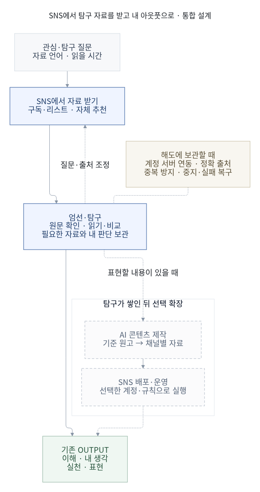

# SNS에서 탐구 자료를 받고 내 아웃풋으로 연결하기

2026-10-29 최신 사용자 결정은 **본인의 눈높이·관심에 맞는 자료를 추천받아 개인적으로 읽는 시스템**이다. 뉴스 제목 → 계정 전용 본문/가능한 이미지 → 출처 링크·직접 반응 → 필요한 자료 보관으로 연결한다. SNS 공개 배포는 독립 후속 흐름이다. [PR145](https://github.com/wonchance-art/life-haedo/pull/145)의 `bddd636`에 공개 메타데이터와 개인 본문을 분리한 구현·검수를 반영했다. Frontiers 본문·그림/MIT 본문/LLT 초록, 기존 관심·다중 언어·명시 좋아요를 지원한다. 전체 단위1,647개·읽기4/개인흐름7/기존발견19/PWA9·합성PostgreSQL12·설정된 테스트 계정의 실제 Auth/Edge/DB11조건을 통과했고 신규 private schema/Edge 설치와 테스트 정리를 완료했다. 프런트엔드 출시·사용자 효용·실기 검수와 구분하며, 이 PR142에는 런타임을 중복 포함하지 않는다.

2026-10-29. 설계 기준 코드 `55a74ae`를 포함한 PR142. 사용자 확정: **‘내가 읽을 탐구 자료를 추천받는 계정부터 시작’**한다. 이번 범위는 추천·계정 운영·자료 활용·후속 콘텐츠 자동화의 설계와 검수다. SNS 계정 생성/접속·팔로우·개인 자료 전송·AI 호출·예약/게시를 실행하지 않았다.

## 결정과 목적

**공개 출처와 선택한 SNS에서 발견한 자료를 해도 안에서 읽고, 가치 있는 자료만 정확한 근거와 함께 탐구한다.** 해도는 읽기·선택 보관·비교·활용의 중심이다. 내 페이지나 발행 계정을 먼저 완성해야 읽을 수 있는 구조로 만들지 않는다. 현재 해도의 홈·뉴스·자료실·계획·설정과 기존 저장 계약은 그대로 재사용한다.

최종 결과는 기존 [제품 목적](../life-tools-design/product-purpose.md)의 **이해·내 생각·생활의 실천·개인 글·선택 표현**이다. SNS용 초안·카드뉴스·대본은 선택한 표현을 돕는 중간 결과다. 개인 탐구가 충분하면 읽고 끝낼 수 있으며, 자료를 저장하거나 발행할 의무가 없다.

전체 흐름: **질문·관심 → 공개 출처/SNS 발견 → 해도 내부 읽기·그림·출처 → 선택 자료 엄선·탐구 → 내 판단 → 기존 Output**. 쓸 만한 탐구가 쌓였을 때 **AI 콘텐츠 제작 → 선택한 채널 배포·운영**을 연결한다. 지금의 성공은 좋은 입력을 받는 것이고, 발행량·팔로워 확보는 첫 단계의 성공 조건이 아니다.

[Mermaid](../diagrams/research-output-20261029.mmd) · [SVG](../diagrams/rendered/research-output-20261029.svg). 점선 제작·배포는 선택 확장이다. 당시 SNS 우선 가설의 도식이며, 최신 내부 읽기 목적지는 위의 변경과 전체 흐름을 따른다. 현재 앱의 전체 구현·계정 가동 상태를 나타내지 않는다.

## 상세 설계의 책임

| 문서 | 책임 |
| --- | --- |
| [실제 출처·첫 읽기 비교](research-source-pilot.md) | 읽기 자료 10개·공식 출처 8개·실제 SNS 게시 5개, 접근 반례와 첫 운영안 |
| [추천 알고리즘](research-recommendation.md) | 현재 규칙과 개선, 신호·다국어·품질·다양성·설명·평가 |
| [SNS 소비·편집 운영](research-sns-editorial.md) | 개인 탐구 브리프, 지속 가능한 계정 운영, 후속 제작과 채널별 기획 |
| [SNS 공식 기능·API](research-sns-platforms.md) | 네이티브 추천과 읽기 API의 차이, 게시 가능 범위와 실제 연결 조건 |
| [시스템 구조](research-output-architecture.md) | 현재 코드 재사용, 계정 보관, 정확 근거, AI 처리, 작업 상태·복구 |
| [오픈소스 비교](research-output-oss.md) | 도입/보류 근거, 운영 비용, 라이선스·유지보수·보안 확인 |

기능 후보 전체를 즉시 구현하라는 의미가 아니다. 아래 우선순위와 각 상세 문서의 현재/미구현 구분을 함께 적용한다.

## 추천 시스템을 두 층으로 나누기

| 층 | 실제 할 수 있는 일 | 통제하거나 관찰할 수 없는 것 |
| --- | --- | --- |
| SNS 자체 추천 | 검색·구독/리스트·실제 읽기·플랫폼의 관심/제외 기능으로 발견 입력을 조정 | 외부 플랫폼의 랭킹 가중치, 후보 풀 전체, 노출 확률, 모든 자료의 품질 |
| 해도의 연구 자료 엄선 | 사용자가 고른 링크와 허용 경로로 확보한 후보를 질문·근거·언어·중복·다양성으로 재정렬 | 수신하지 못한 개인 홈피드, 미확보 본문, 사용자가 말하지 않은 이해·도움 |

SNS 추천을 조절하기 위해 가짜 시청·좋아요·일괄 팔로우를 만들지 않는다. 해도에 남긴 반응도 SNS에 자동으로 되써 넣지 않는다. 플랫폼의 추천 반응과 해도의 개인 탐구 판단은 각각의 사실로 기록한다. SNS의 인기 점수는 연구 신뢰도나 내 생각의 가치로 바꾸지 않는다.

YouTube는 시청/검색 이력·좋아요·관심 없음 등의 추천 조절 기능을 안내한다. X는 계정별 Lists로 원하는 출처를 묶어 읽을 수 있다. Instagram도 추천 초기화·팔로잉 검토 등 조절 기능을 안내한다. 이는 추천을 바꿀 수 있는 사용자 조작이지 원하는 자료의 도착이나 외부 API 수신을 보장하는 계약은 아니다. [YouTube 공식 도움말](https://support.google.com/youtube/answer/6342839?hl=en), [X Lists 공식 도움말](https://help.x.com/en/using-x/x-lists), [Meta 공식 안내](https://about.fb.com/news/2024/11/introducing-recommendations-reset-instagram/)를 2026-10-29 확인했다. 기능 제공 여부는 실제 대상 계정에서 별도로 확인한다.

## 첫 SNS를 고르는 기준

플랫폼은 아직 사용자가 선택하지 않았다. [실제 공개 출처 비교](research-source-pilot.md) 뒤 첫 시범 제안은 **Bluesky의 OASIS·RetrievalPractice**로 구체화했다. 두 출처의 실제 게시에서 연구 요약/실천 해설까지 확인했기 때문이며 개인 추천 품질 우위는 측정하지 않았다. 다음 형식별 후보는 대안으로 유지한다.

| 원하는 입력 | 우선 비교할 출발점 | 해도 연결의 최소 경로 |
| --- | --- | --- |
| 짧은 글에서 연구자·논문·긴 원문을 발견 | X의 주제별 비공개 리스트 + 발견 피드 | 필요한 글/원문 링크만 선택 보관. 첫 실험에 유료 API를 요구하지 않음 |
| 긴 설명·강의·대담·시연 | YouTube의 구독 + 검색/추천 | 선택 영상 URL·명시 구간·원문 링크. 자막/전체 내용을 확보했다고 추정하지 않음 |
| 카드뉴스·짧은 영상에서 아이디어 발견 | Instagram의 선택한 계정/추천 | 선택 링크에서 출처 확인. 짧은 설명을 연구 결론으로 바로 채택하지 않음 |

텍스트·논문 링크 중심의 X 리스트는 실제 계정에서 출처 접근이 확인될 때 비교하고, 영상 중심이면 YouTube를 비교한다. 이번 공개 조사에서는 X 접근과 영상 재생 확인에 제약이 있었으므로 인기나 익숙함만으로 플랫폼을 확정하지 않는다. 먼저 한 플랫폼에서 소수의 읽을 자료가 도착하는지 관찰한다. API 후보별 차이는 [공식 기능 조사](research-sns-platforms.md)를 따른다.

새 계정이 항상 필요한 것은 아니다. 기존 계정의 비공개 리스트/구독만으로 질문과 무관한 사용을 충분히 분리할 수 있으면 먼저 재사용한다. 별도 계정이 필요할 때도 신원·프로필·공개 범위·기존 개인 기록의 변경을 사용자가 정한다. 기존 시청 이력 삭제나 추천 전체 초기화를 기본 단계로 넣지 않는다.

## 첫 운영 단위: 탐구 질문 하나

개인 탐구 브리프는 다음만 가진다. 처음부터 브랜드 전략·콘텐츠 캘린더·발행 목표를 요구하지 않는다.

| 입력 | 사용자 맥락에 맞춘 시작 예시 | 의미 |
| --- | --- | --- |
| 이번 질문 | 외국어 읽기를 꾸준히 이어갈 때, 어떤 조건과 방법을 비교하면 좋을까? | 외국어 학습·독서·집중력·Grit 관심을 하나의 검토 가능한 질문으로 좁힌 예시 |
| 자료 언어 | 한국어·영어·일본어·중국어·프랑스어 등 복수 선택 | 허용 언어와 실제 공급량을 구분. SNS 피드 전체에 이 필터를 강제한다고 표시하지 않음 |
| 번역 언어 | 원하는 표시/번역 언어 별도 선택 | 번역본의 언어를 원문 언어로 재기록하지 않음 |
| 자료의 깊이 | 원문 연구·검토 글·설명·개인 실천 기록을 구분 | 연구 논문도 설계/표본/한계에 따라 판단. 출처 유형만으로 진실을 확정하지 않음 |
| 제외·시간 | 반복 광고, 근거 없는 효과 단정, 이미 본 자료; 읽을 시간 | 제외 이유와 보류를 구분. 시간이 없어 넘긴 것을 싫어요로 학습하지 않음 |

**운영 가설:** 출처 10~15개 이내의 작은 목록, 질문 1개, 한 번에 후보 3~5개, 가능한 시간 안에서 읽기부터 시작한다. 숫자는 소규모 비교를 위한 초깃값이며 최적값이나 플랫폼 추천 학습 공식이 아니다. 일주일 등 정한 기간에 한 번 질문/출처를 조정하고, 매 글마다 긴 평가 양식을 요구하지 않는다.

출처 후보는 기관·연구자·전문 실무자·검토자 등 서로 다른 역할을 섞는다. 실제 계정/소속·원문 링크·수정 이력·이해관계·설명 범위를 확인한 뒤 선택한다. 다른 언어로 반복된 같은 논문과 이를 소개한 여러 게시물은 별개의 독립 근거로 세지 않는다. 반대 관점은 동일하게 근거를 확인하고, 다양성을 이유로 질 낮은 자료를 억지로 넣지 않는다.

사용 흐름은 **SNS에서 발견 → 읽기 또는 원문으로 이동 → 필요할 때만 링크/판단 보관 → 다음 질문**이다. 이미 확보한 제목·URL·언어·출처는 다시 입력하지 않게 한다. 원문을 자동 확보할 수 없는 경우에도 링크만 남기거나 읽고 종료할 수 있다. 읽기 작업 중 계정 설정/백업 화면을 거치지 않게 한다.

## 자체 추천을 추가할 때의 실행 계약

1. **후보 확보:** 선택 링크, 사용자가 고른 출처의 공식 읽기 경로, 기존 지원 피드에서만 후보를 모은다. 홈 추천 전체 수집과 허용 출처 수집을 같은 옵션으로 합치지 않는다.
2. **제외·정확성:** 소유 계정/공간, 언어, 제외 상태, 확보 범위, 정확 URL/원문 판, 중복 사건/연구를 먼저 확인한다.
3. **질문 적합성:** 질문과 자료 내용의 관련도, 검토할 수 있는 근거, 새로운 설명/한계, 읽기 부담을 계산한다. SNS 참여도와 발행 예상 반응은 이 순위에 섞지 않는다.
4. **목록 편집:** 비슷한 출처·같은 주장·같은 논문을 줄이고 질문을 다르게 설명하는 자료를 함께 제시한다. 근거가 부족하면 목록을 줄인다.
5. **이유·반응:** 추천 이유와 확보 범위를 짧게 보여 주고 명시적인 ‘도움 됨/제외 이유’만 해당 의미로 사용한다. 저장은 보관 의향, 좋아요는 선호이며 실독 도움과 다르다.

처음에는 기존 규칙 랭커를 재사용한다. 본문/다국어 의미 비교의 부족함이 실제 사례로 확인되면 lexical+embedding 검색을 비교하고, 충분한 데이터·평가 근거가 생기면 학습 랭커를 검토한다. 별도 추천 서버·벡터 DB·온라인 강화학습을 출발 조건으로 만들지 않는다. 상세 스코어·평가·전환 기준은 [추천 명세](research-recommendation.md)에 있다.

## AI와 SNS 제작은 유용한 탐구 뒤에 연결

개인 탐구 단계의 AI는 **선택한 근거의 비교·질문·차이/한계 정리**를 먼저 돕는다. 원문 전체를 확보하지 못하면 읽은 범위를 밝혀야 하며, AI 설명을 사용자 경험·연구 효과·확정된 개인 판단으로 보관하지 않는다. 외부 모델에 보낼 자료의 범위·제공자·비용은 별도 선택으로 유지한다.

표현할 내용이 생기면 동일 근거 묶음에서 다음을 만든다.

**탐구 근거 + 채택한 내 관점 → 기준 원고 1개 → 채널별 파생물 → 검토 가능한 배포 패키지**

- 기준 원고: 누구에게 무엇을 설명하는지, 검증된 주장·인용·사용자 관점·미확인 부분을 구분한다.
- 파생물: 짧은 글·카드뉴스 구성·영상 대본 등 선택한 형식만 만든다. 각 주장과 숫자의 출처, 번역·이미지 이용 범위를 추적한다.
- 운영: 검토할 수 있는 양과 실제 가용 시간에 맞춰 제작한다. 모든 플랫폼 동시 발행이나 게시 빈도를 기본 목표로 강제하지 않는다.
- 배포: 우선 파일/원고 패키지만으로도 완결한다. 실제 SNS 게시 adapter는 별도 계정 연결과 유효한 게시 규칙·권한·최종 내용/대상 확인을 갖춘 뒤 선택한다.

매번 동일 승인을 요구하는 구조 대신 유효한 명시 사전 규칙을 재사용할 수 있다. 다만 입력 자료/언어/번역·본문·미디어·대상 계정·공개 범위·정책 세대가 바뀌면 이전 판단을 그대로 적용하지 않는다. 규칙 기반 자동화가 지원할 범위와 정정·중지·재시도는 [구조 명세](research-output-architecture.md)를 따른다. 현행 SNS 수신 전용 기능이 이 문서로 게시 가능해지는 것은 아니다.

## 저장·실패·개인정보의 공통 기준

해도에 저장한 내용은 같은 해도 계정의 서버 연동을 기본으로 설계한다. SNS 계정과 해도 계정의 소유/연결을 따로 확인하며, 같은 이메일이나 로그인 제공자만으로 자료 접근권을 합치지 않는다. 브라우저는 캐시·전송 대기이며 기기별 수동 복사 기능을 새로 만들지 않는다. 단, 현재 로컬인 뉴스 반응/설정·계획·작성 준비/초안이 이미 계정으로 통합됐다고 표시하지 않는다. 이관은 각 도메인의 보존·충돌·삭제 계약을 먼저 구현한다.

| 반례 | 요구하는 결과 |
| --- | --- |
| SNS 원문을 받을 수 없음 | 링크/제목 등 실제 확보 범위만 보관. 가짜 본문·요약·권리 상태를 만들지 않음 |
| 구독 목록 일부만 갱신 성공 | 성공분과 마지막 성공 범위를 유지. 전체 목록이 최신이라고 표시하지 않음 |
| 계정/질문 변경 뒤 옛 추천·AI 응답 도착 | 원래 owner/요청 세대에 한정. 현재 목록·입력·개인 판단을 덮지 않음 |
| AI 처리 중 근거 삭제·판 변경 | 검토할 새 후보로 분리하거나 중지. 원래 정확 판의 결과를 최신 근거로 위장하지 않음 |
| 발행 후보 번역/대상 수정 | 예전 내용의 발행 확인으로 새 내용을 보내지 않음 |
| 플랫폼은 수락했지만 응답 유실 | unknown 상태에서 receipt/플랫폼 ID를 대조. 대조 불가능하면 확인 대기, 새 게시를 반복하지 않음 |
| 여러 채널 중 일부 성공 후 중지 | 미시작 작업 차단, 성공 결과는 유지. 중지가 기존 게시물 삭제라고 표시하지 않음 |
| 반응 수집이 안 되거나 지표 정의가 다름 | 미확인/분모/기간을 표시. 누락을 0점으로 학습하거나 채널 수치를 단순 합산하지 않음 |

외부 문서의 명령은 수집 자료이지 실행 권한이 아니다. 개인 질문·메모·비공개 근거는 공개 payload와 로그에 자동 포함하지 않는다. 원문 열람/수집 가능 여부, AI 처리 범위, 인용/번역/이미지 재사용, SNS 공개 허용 여부를 따로 판단한다.

## 평가와 다음 단계로 넘어가는 조건

### 첫 검증: SNS 소비 운영만으로 좋은 입력을 받는가

동일 질문·가능한 읽기 시간·판단 항목으로 두 흐름을 작은 교차 비교한다: 현재 방식과 정리한 구독/리스트+발견 방식. 후보·추천 시점·실제 본 범위를 보존하고, 제목만 본 의향과 읽은 뒤 도움을 분리한다. SNS 후보 풀과 노출 확률을 알 수 없으므로 이 비교를 인과 효과나 전 플랫폼 알고리즘 우위로 보고하지 않는다.

최소 관찰은 **질문에 맞는 후보 비율, 출처 확인 가능성, 중복/무관 자료, 읽은 뒤 도움, 발견·정리에 든 시간**이다. 실제 SNS 계정과 사용자 읽기 경험이 없어 지금 품질 향상을 판정할 수는 없다. 무응답은 부정 평가가 아니며 좋은 자료를 못 찾은 원인이 공급 부족인지 정렬 문제인지 따로 본다.

### 두 번째 검증: 해도 자동 엄선이 추가 관리보다 도움이 되는가

같은 확보 후보/시점에서 최신순·기존 규칙순·새 질문순을 비교하고, 평가용 후보/정책을 고정한다. 질문 관련성만 높고 출처가 부실한 목록, 언어 쏠림, 같은 논문 반복, 실제 읽기 불가능을 실패로 본다. 후보 자동 갱신·계정 보관이 수동 재입력/전송·복구 작업을 줄이는지도 함께 확인한다.

### 후속 검증: AI 제작이 실제 표현을 돕는가

한 탐구 묶음에서 기준 원고와 선택한 파생물의 **사실/인용 오류, 내 관점 보존, 수정 시간, 게시 가능한 완성도, 반복 제작 부담**을 비교한다. 이후 실제 발행할 때만 채널별 반응을 읽는다. 반응은 전달 형식/주제 질문의 참고이며 개인 연구 순위를 직접 덮는 학습 신호가 아니다.

## 조사 당시 실행 인계 묶음

다음 SNS 시범 순서는 조사 이력이다. 현재는 PR145 개인 본문 읽기를 바탕으로 **계정별 추천 상태 통합 → 관심·목적·설명 수준에 맞는 자료 선별/설명**을 진행한다. 현행 완료 기준은 최신 [로드맵](../life-tools-design/roadmap.md)을 따른다.

1. **SNS 소비 계정의 탐구 운영 시범.** 필요: 좋은 입력이 오는지 먼저 판단. 선행: 사용할 플랫폼·질문·언어·가용 시간, 접근 가능한 실제 출처 선택. 완료: 구독/리스트/추천 경로와 소수 자료를 읽어 실제 도움·출처·관리 부담을 비교하고 유지/수정/중단을 결정. 계정 생성/팔로우/기록 변경은 별도 실제 작업이며 이번 설계에서 수행하지 않음.
2. **선택 자료의 엄선·탐구·계정 보관 통합.** 필요: 재입력 없이 정확 근거와 내 판단을 이어 쓴다. 선행: 첫 운영에서 확인된 부족함, 기존 계정 메모/뉴스 설정 구현 및 허용된 읽기 경로. 완료: 후보 수신→중복/언어/질문 정렬→읽기/판단→정확 보관·실패/계정 전환·파일 보존과 품질 비교를 완주.
3. **선택한 탐구의 AI 제작·SNS 운영 확장.** 필요: 표현의 반복 작업을 줄인다. 선행: 가치 있는 근거 묶음·편집 목적·허용된 AI/채널/발행 범위. 완료: 기준 원고→파생물→품질 확인/패키지, 이후 선택한 한 채널의 예약·수락/공개 확인·중지/정정·반응 수집까지 실제 증거로 확인.

## 설계 검수 기록

추천·SNS 운영·플랫폼·구조·OSS를 분담 조사하고 별도 담당자가 여섯 문서와 도식을 독립 검토했다. 최초 소비에 해도 계정 저장/개발을 선행시키던 표현, 읽기/도움 평가를 자동 순위 학습으로 연결하던 표현을 찾아 교정했다. SNS에서 읽고 종료하는 완료와 필요에 따른 통합 구현을 분리하고, 직접 평가는 사용자 기준 조정에 참고하며 학습 사용은 별도 선택·버전·철회 계약 뒤로 두었다.

변동성이 큰 YouTube·X 공식 문서 일부는 독립 재조회로 대조했다. Mermaid 한글·제목/설명·잘림/겹침·외부 요청/콘솔 오류·원본/SVG 해시, 추가 문서의 상대 경로·공백·렌더 스크립트 구문을 확인했다. 마지막 재검토에서 차단 사항은 남지 않았다. [도식 렌더 기록](../diagrams/rendered/research-output-20261029.report.json)은 문서 이미지 검사이며 제품/계정 검사로 합산하지 않는다.

이 문서는 사용자 방향과 구현 의존성을 확정한 설계다. 실제 SNS 추천 효과·계정 연동·AI 정확성·발행 성공·비용은 운영 검증 전이다. [최신 로드맵](../life-tools-design/roadmap.md)을 따른다.
