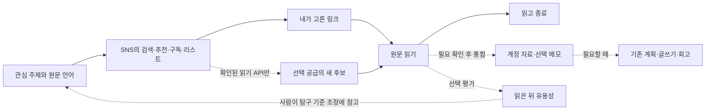

# 탐구 자료를 추천받는 SNS 계정: 공식 기능·API 조사

확인일: **2026-10-29 UTC**. 공개 공식 문서만 읽었다. 실제 SNS 계정 접속·생성·팔로우·저장·게시·결제·앱 권한 신청은 하지 않았다.
사용자 확정 출발점은 **내가 읽을 탐구 자료를 추천받는 SNS 계정**이다. 큐레이션 발행 계정이나 개인 페이지 공개는 후속 선택이다.
현재 관심 근거는 외국어 학습·독서·집중력·Grit 등이며, 한국어·영어·일본어·중국어·프랑스어 등 복수 원문 언어를 원한다.
아래 `공식 확인`은 문서의 기능·제약, `설계 판단`은 해도 적용 제안이다. 실제 계정의 권한·가격·기능 노출을 확인했다는 뜻이 아니다.

## 1. 먼저 구분할 세 가지

| 구분 | 실제 하는 일 | 해도와 연결하는 범위 |
| --- | --- | --- |
| SNS 안에서 발견 | SNS 자체 추천·검색·팔로우·리스트로 읽을 자료를 만남 | 처음에는 SNS에서 직접 사용. 개인화 추천을 해도가 대신 수행한다고 약속하지 않음 |
| 선택 자료를 가져옴 | 사용자가 링크를 고르거나 허용된 구독·리스트 API로 새 후보를 수집 | 기존 뉴스 후보 → 원문 → 계정 자료·메모 흐름에 연결 |
| SNS에 발행 | 내 글·영상·큐레이션 사본을 외부 계정에 게시 | 별도 목적·권한·발행 검토. 읽을 자료를 받기 위한 선행 조건으로 만들지 않음 |

**게시 API가 있다는 사실은 개인 홈 추천 피드·저장 목록을 가져올 권한이 있다는 뜻이 아니다.**
SNS의 ‘좋아요/저장’과 해도의 ‘관심/담기/읽은 뒤 유용성’도 별도 신호다. 해도에서 한 행동을 SNS에 자동 대행하지 않는다.

## 2. 다섯 후보의 소비 경험과 자동 인입 현실성

논문·자료의 깊이와 언어별 공급량은 계정·주제에 따라 달라진다. 아래 적합성은 형식·통제 수단에 근거한 **가설**이며 실제 추천 품질 순위가 아니다.

| 후보 | 탐구 자료를 받는 방식·깊이 가설 | 추천 통제·저장·링크 | 공식 API로 확인한 인입 범위 | 비용·선택 제약 |
| --- | --- | --- | --- | --- |
| **X** | 연구자·기관·저널의 원문 링크를 모으는 첫 후보. 짧은 주장 자체보다 연결된 논문 확인이 중요 | For You/Following 분리, 주제별 Lists, Bookmarks [N1][N2] | 역시간순 Home·선택 List·본인 Bookmarks 읽기 [X1–X3]. **For You와 같은 개인화 결과가 아님** | API는 현재 사용량 과금 [X4]. 초기에는 앱에서 발견 후 선택 링크만 가져오면 API 연동 불필요 |
| **Threads** | 질문·경험·독서 대화에서 자료와 사람을 발견하는 후보. 원문 출처를 잇는 비율은 표본 확인 필요 | 사용자 정의 피드·피드 공유 [N3]. Your Algo는 발표 지역 제한 [N4] | 공개 글 키워드 검색 예시 확인 [T2]. 홈 추천·사용자 정의 피드·저장 목록 전체 읽기는 확인하지 못함 | 게시 권한으로 홈 수집을 가정할 수 없음. 앱 심사·기능별 접근 조건 재확인 필요 |
| **YouTube** | 강의·연구 설명·언어 학습 영상이 주된 자료라면 첫 후보. 논문 원문을 읽는 흐름에는 외부 출처 연결 필요 | 구독·재생목록, 관심 없음·채널 추천 안 함·시청 기록 제어 [N5] | 내 구독, 채널 uploads/일반 재생목록, 본인 좋아요 목록 [Y1–Y4]. Home 추천 API로 취급하지 않음 | 공개 채널/목록은 사용자 전체 계정 연결 없이도 설계 가능. API 프로젝트·할당량은 필요 |
| **LinkedIn** | 실무 연구·직업 전문성·기관 발표 탐구에 조건부 적합. 관심 분야와 인맥의 교집합을 확인할 것 | 팔로우·피드 Top/Recent·글/기사 저장 [N6][N7]. 지역별 피드 동작 예외 있음 | 개인 추천 피드·저장 목록 인입 근거 없음. `r_member_social` 신청도 현재 닫힘 [L2] | 외부 웹에 회사 피드를 표시하는 용도도 승인 use case가 아니라고 명시 [L2]. 초기 자동 인입 후보에서 제외 |
| **Instagram** | 시각 자료·짧은 설명·학습 사례 발견에 조건부 적합. 논문 링크 추적에 필요한 추가 이동을 표본에서 평가 | Following/Favorites·관심 없음·추천 초기화 관련 공식 안내 [N8]. 발표·계정별 노출을 구분 | 확인한 API는 professional 계정 운영 중심 [I1]. 개인 Home/Explore·일반 사용자 저장 목록 전체 읽기 근거 없음 | 일반 소비 계정과 professional 게시 API를 혼동하지 않음. 초기에는 선택 링크 인입 |

### 다국어는 두 층으로 관리

- SNS 자체의 언어·번역 설정과 해도의 `원문 허용 언어 여러 개` / `번역해서 열 언어 한 개`를 분리한다. 해도 설정으로 SNS 전체 추천 언어를 강제할 수 있다고 표시하지 않는다.
- 첫 계정의 공급을 평가할 때 다섯 언어별 원문 링크·저자/기관을 확인한다. 특정 SNS에 다섯 언어 자료가 충분하다고 이번 조사만으로 보증하지 않는다.
- 번역 표시만 있는 자료도 원문 언어와 원문 URL을 유지한다. 언어를 못 판정한 후보는 ‘미확인’이지 한국어나 영어로 임의 분류한 자료가 아니다.
- 영상은 자막·음성·설명문 언어가 다를 수 있다. YouTube의 지역화 제목·설명 [Y4]을 영상 원문/전체 자막 번역으로 해석하지 않는다.

## 3. 첫 SNS 선택 제안

**논문과 읽을거리의 원문 링크를 중심에 두면 X를 첫 검증 후보로 제안한다.** Lists로 출처 묶음을 통제할 수 있고, 이후 필요한 경우 선택 List/Bookmarks만 API로 가져오는 경로가 확인된다.
이는 X의 추천 품질이 가장 높다는 결론이 아니다. 실제 원하는 분야에서 믿을 만한 출처와 읽을 만한 원문이 확보되는지 먼저 확인해야 한다.
API 결제를 시작 조건으로 삼지 않는다. SNS에서 읽고 고른 링크를 해도에 넣는 사용으로 출발한다.

| 우선순위가 달라지는 조건 | 첫 후보 변경 |
| --- | --- |
| 원문 논문·기사 링크, 출처별 묶음 통제를 우선 | X: List로 지속 공급, For You로 추가 발견; API는 후속 |
| 한국어 대화·독서 경험·질문에서 자료를 찾는 사용이 더 자연스러움 | Threads: 사용자 정의 피드와 직접 선택 링크; 자동 Home 수집은 제외 |
| 강의·영상 설명을 실제로 많이 소비하고 구독 공급을 자동화하고 싶음 | YouTube: 선택 채널/재생목록 → 새 영상 후보로 첫 자동 인입 완결 |
| 실무·직업 연구 또는 시각 학습이 주목적 | LinkedIn 또는 Instagram을 표본으로 확인하되 수동 링크 인입부터 |

첫 비교는 같은 주제 두세 개, 같은 시간 예산으로 **원문에 도달한 수·실제로 읽은 수·읽은 뒤 도움 된 자료·다시 찾을 수 있음·관리 부담**을 확인한다.
조회수·팔로워 수·스크롤 시간이나 제목만 보고 누른 관심을 ‘유용한 연구 자료’로 간주하지 않는다. 작은 비교를 통계적 우월성 주장으로 확대하지 않는다.
사용자가 특정 SNS를 아직 선택하지 않았으므로 계정 생성·연동과 플랫폼별 구현은 확정되지 않았다.

## 4. 한 채널에서 끝까지 이어지는 작업 단위

1. **발견부터 읽기까지:** 첫 시범은 SNS의 출처 묶음 → 새 자료 발견 → 원문 읽기 → 종료만으로 완결된다. 해도 보관이 필요한 장면을 확인한 뒤 통합 구현에서 선택 링크 → 기존 원문/자료 화면 → 명시 저장의 계정 ACK·다른 기기 재열기를 검수한다. 현재 코드의 미완료 저장 기능을 구현 완료로 간주하거나 첫 SNS 사용의 필수 조건으로 삼지 않는다.
2. **반복 수신 부담이 확인될 때 자동 공급 하나:** 선택 링크로 충분하면 그대로 유지한다. 자동 수신이 필요할 때만 YouTube 선택 채널/일반 재생목록 또는 X 선택 List/Bookmarks 중 하나를 연결한다. 읽기 전용 최소 권한, 공급 선택, 수집 on/off, 마지막 성공 시점, 실패·토큰 만료·할당량 중지와 재개를 같은 묶음으로 완결한다.
3. **읽은 뒤 개선:** 명시한 도움 여부와 선택 이유는 현재 사용자가 탐구 기준을 조정할 때 참고하는 기록이며 자동 학습이나 다음 후보 순위 반영을 뜻하지 않는다. 향후 추천 학습에 쓰려면 별도 사용 선택·버전·철회 계약과 모형/API 검증을 먼저 갖춘다. 읽지 않음·나중에 읽기·관심 없음·제외를 하나의 dislike로 합치지 않는다. 외부 SNS 추천 알고리즘 변경이나 추천 효과가 확인됐다는 표시도 하지 않는다.
4. **확장 판단:** 첫 공급의 실제 유용성과 유지 비용이 확인된 뒤 두 번째 채널을 추가한다. 글쓰기·SNS 발행 없이 읽고 활용하는 것만으로도 흐름은 완결된다.

선택 링크 입력은 서버가 해당 글의 본문·사진·댓글까지 수집할 권한을 부여하지 않는다. 접근 불가면 원래 URL과 확인 가능한 메타데이터만 보존하고, 본문을 가져온 척하지 않는다.
인입은 `플랫폼 + 외부 ID/정규 URL + 공급 ID + 수집 시점 + 제공된 수정 정보`로 중복과 출처를 추적한다. 원문 스냅샷이 없으면 정확 본문 버전·해시를 만들어 내지 않는다.
API 반환 누락·삭제·권한 상실·페이지 일부 실패를 ‘새 글 0개’나 자료 영구 삭제로 오인하지 않는다. 이미 저장한 개인 메모를 외부 원문 삭제와 함께 자동 삭제하지 않는다.
SNS에서 저장한 전체 목록을 무조건 계정 자료로 복사하는 기능도 첫 기본값이 아니다. 선택 공급의 후보와 사용자가 해도에 저장한 자료를 구분한다.

## 5. 공식 인입 API 계약에서 확인한 경계

### X

- 개발자 앱과 사용자 인증을 통한 역시간순 Home 읽기 [X1], List 글 읽기 [X2], 본인 Bookmarks 읽기 [X3]를 확인했다. 보호된 글은 인증/공개 범위의 영향을 받는다.
- List는 출처 기반 공급이다. For You의 개인화 순서, 노출 이유, 모든 사용 행동을 재현하는 공식 경로로 확대하지 않는다.
- 현재 공개 가격표는 읽은 Post당 **$0.005**, 선불 크레딧 기반 사용량 과금이다 [X4]. 실제 과금·변경 요율은 개발자 콘솔 확인이 필요하며 중복 조회·수집 주기·상한 예산부터 설계한다.
- 입력만 필요한 경우 게시·좋아요 쓰기 권한을 추가하지 않는다. 북마크 읽기 권한으로 SNS 활동 대행까지 허용되었다고 보지 않는다.

### YouTube

- `subscriptions.list(mine=true)`는 인증된 내 구독 목록 [Y1]. 채널 `relatedPlaylists.uploads` → `playlistItems.list`로 선택 채널의 업로드를 받는다 [Y2][Y3].
- 일반 재생목록은 접근 권한 범위에서 읽을 수 있으나 **Watch Later·시청 기록은 API로 가져올 수 없다고 명시**한다 [Y3].
- `videos.list(myRating=like)`는 사용자 인증이 필요한 좋아요 목록이며 현재 최근 **최대 1,000개**다 [Y4]. `mostPopular`는 개인 추천이 아니다.
- 페이지 순회·호출 할당량·삭제/비공개 영상을 처리한다. 내 구독 전체 동기화를 강제하지 않고 직접 고른 채널/목록부터 시작할 수 있다.

### Threads / Instagram / LinkedIn

- Threads 공식 예시는 `keyword_search?q=...&search_type=TOP` 공개 글 검색을 제공한다 [T2]. `TOP`은 사용자의 홈 추천 피드와 동일하다는 근거가 없다. 키워드 검색 권한/심사는 별도로 확인한다.
- Threads 사용자 정의 피드·Instagram Following/Favorites·각 앱의 저장 기능이 있다는 것과 그 목록을 외부 API로 받을 수 있다는 것은 다르다. 이번 확인 범위에서는 해당 전체 인입을 제품 약속에 넣지 않는다.
- Instagram의 확인된 컬렉션은 professional 계정의 미디어 운영 예시 [I1][I2]다. 일반 소비 계정에 그대로 적용하지 않는다. 로그인 방식별 최신 권한표는 본문 접근 제한 때문에 재확인 항목으로 남긴다.
- LinkedIn은 `w_member_social` self-service 게시와 제한된 읽기 권한을 구분한다 [L1]. FAQ는 `r_member_social` 신규 요청 중단 및 외부 회사 피드 표시의 비승인 용도를 명시한다 [L2]. 게시 권한으로 수집을 우회하는 설계는 채택하지 않는다.

## 6. 후속 선택: 발행·예약·분석의 실제 경계

다음 표는 **현재 소비 계정 작업의 구현 범위가 아니다.** 콘텐츠 초안 생성/복사/파일 내보내기는 API 계정 연결과 독립적으로 제공할 수 있다.

| 플랫폼 | 실제 게시·미디어 | 예약 담당 | 정정·삭제·분석 및 조건 |
| --- | --- | --- | --- |
| Instagram | professional 계정과 적절한 앱/권한 필요. 확인한 Reels 예시는 공개 접근 가능한 영상 URL → container → `FINISHED` → publish → 게시 ID [I2] | 이번에 읽은 예시에는 예약 실행 계약 없음. 연결 시 별도 예약 큐 또는 앱 직접 예약 중 실제 지원 방식을 결정 | insights 계열 제공 [I1]. 최신 수정·삭제 API, 전체 미디어 제한, App Review 표와 실제 할당량은 미확인; 수동 앱 관리 fallback 유지 |
| Threads | OAuth 앱·게시 권한. 텍스트/이미지/영상 container와 publish. 이미지 URL은 서버가 읽을 수 있어야 함 [T1] | 확인된 API의 예약 시각 위임 근거 없음. 별도 큐가 시각에 실행하는 설계가 필요하면 후속 검증 | container 상태·게시 할당량 조회·삭제 예시 확인 [T3–T5]. insight 권한은 별도. 게시 본문 수정의 최신 계약은 미확인 |
| YouTube | OAuth 업로드 권한, 영상 실제 업로드/처리, 동영상 ID. 현재 `videos.insert` 문서는 최대 256GB·별도 Video Uploads bucket 100 calls/day, 1 unit/call [Y5] | `status.publishAt`으로 **YouTube가 예약**. private이고 한 번도 공개되지 않은 영상만 가능 [Y6] | 메타데이터 update/delete 제공 [Y6]. Analytics는 허용된 채널/보고서이며 누락·임계값 존재 [Y8]. 감사·증액·OAuth 검증은 실제 프로젝트에 별도 확인 |
| LinkedIn | 개인 `w_member_social`, 조직은 별도 권한과 역할. 이미지/영상 업로드와 Post 생성 분리. 201 + `x-restli-id`가 게시 식별자 [L1][L3] | 읽은 Posts API에서 예약 시각 계약을 확인하지 못함. 앱의 native 예약과 API 예약을 동일시하지 않음 | Posts update/delete 존재. 읽기·조직 운영·분석은 별도 접근 조건; 게시 권한만으로 수신 확인/분석 전체를 약속하지 않음 |
| X | 사용자 인증 게시·미디어 처리. create의 `edit_options` 존재, 삭제 endpoint 제공 [X5][X6] | 확인된 create 스키마에 예약 위임 필드 없음. 후속 연동 시 자체 큐 또는 수동 게시 | 일반 Post 생성과 URL 포함 생성의 공개 가격이 다름: 현재 $0.015 / $0.200 [X4]. 비공개/organic/promoted 지표는 사용자 인증 및 최근 30일 제한 [X7] |

- **Threads 즉시 게시 주의:** 공식 예시의 `auto_publish_text=true`는 container 생성만으로 게시한다 [T1]. 초안 생성용으로 그대로 재사용하지 않는다.
- **YouTube 오래된 자료 주의:** 현재 insert 문서는 미검증 API 프로젝트 업로드가 private로 강제되지 않는다고 명시한다 [Y5]. 과거 1,600-unit/미검증 private 강제 설명을 현재 사실로 복사하지 않는다. 의도한 공개 상태를 명시하고 프로젝트 상태를 확인한다.
- 업로드 완료·container 생성·게시 접수·예약 등록·실제 공개를 각각 구분한다. 여러 채널 중 한 곳 성공은 전체 성공이 아니며, 나머지 실패를 이유로 성공 게시물을 자동 삭제하지 않는다.
- 플랫폼별 필드/지표 누락·권한 거부·지연은 `0`이 아니다. 조회수·반응 수를 독자의 실제 학습 효과나 해도 사용자에게 유용한 자료라는 증거로 치환하지 않는다.

### unknown 결과와 재시도

발행 후 응답을 잃으면 ‘실패했으니 다시 게시’하지 않는다. 로컬 작업 ID, 목적 계정, 승인한 콘텐츠 버전, 요청 지문, 받은 외부 ID와 상태를 보존한다.
외부 ID가 있으면 가능한 조회 권한으로 대조하고, 없다면 플랫폼이 지원하는 업로드 세션/목록 확인을 사용한다. 동일 문구·가까운 시각만으로 단 하나의 게시임을 증명하지 않는다.
YouTube resumable upload는 동일 세션 상태 조회로 완료 응답을 다시 받거나 308과 받은 바이트 범위를 확인할 수 있다 [Y7]. 그 밖의 플랫폼에 같은 보장을 자동 적용하지 않는다.
확인할 수 없으면 `게시 여부 확인 필요`로 멈추고 원래 플랫폼에서 확인한다. **unknown 상태의 무조건 재게시 및 exactly-once 보장은 하지 않는다.**
독립적으로 실패가 확인된 단계만 재시도한다. 미디어 일부 성공·게시 성공/조회 실패·예약 변경·토큰 만료를 구분하며, 재시도 전 현재 권한·콘텐츠 버전·예약 의도를 확인한다.
API 조건을 충족하지 못하면 승인한 원고·출처·미디어를 내보내 수동 게시한다. 내보냈다는 사실만으로 게시 완료를 기록하지 않는다.

## 7. 직접 확인한 공식 출처

모두 2026-10-29에 공개 본문을 열어 확인했다. 아래 중 Meta Postman은 **Meta 공식 워크스페이스**이며, 개발자 본문 접근 실패를 보완한 예시 자료다. 최신 모든 기능/심사를 포괄한다고 보지 않는다.

- [N1: X For You/Following](https://help.x.com/en/using-x/x-timeline) · [N2: Lists](https://help.x.com/en/using-x/x-lists?version=published)
- [N3: Threads 사용자 정의 피드](https://about.fb.com/news/2025/02/share-custom-feeds-on-threads/) · [N4: 2026-06 Your Algo](https://about.fb.com/news/2026/06/meta-launching-new-features-500-million-monthly-threads-users/)
- [N5: YouTube 추천 관리](https://support.google.com/youtube/answer/6342839?hl=en)
- [N6: LinkedIn 피드 정렬](https://www.linkedin.com/help/linkedin/answer/a9586529) · [N7: 글·기사 저장](https://www.linkedin.com/help/linkedin/answer/a527126/save-content-in-your-feed?lang=en)
- [N8: Instagram 추천·Following/Favorites](https://about.fb.com/news/2024/11/introducing-recommendations-reset-instagram/)
- [X1: 역시간순 Home](https://docs.x.com/x-api/posts/timelines/quickstart/reverse-chron-quickstart) · [X2: List 글](https://docs.x.com/x-api/lists/list-tweets/introduction) · [X3: Bookmarks](https://docs.x.com/x-api/posts/bookmarks/introduction)
- [X4: 현재 가격](https://docs.x.com/x-api/getting-started/pricing) · [X5: 생성·edit_options](https://docs.x.com/x-api/posts/create-post) · [X6: 삭제](https://docs.x.com/x-api/posts/delete-post) · [X7: 지표](https://docs.x.com/x-api/fundamentals/metrics)
- [Y1: 구독](https://developers.google.com/youtube/data/reference/rest/v3/subscriptions/list) · [Y2: 채널](https://developers.google.com/youtube/data/reference/rest/v3/channels) · [Y3: 재생목록 항목·접근 불가 오류](https://developers.google.com/youtube/data/reference/rest/v3/playlistItems/list)
- [Y4: videos.list](https://developers.google.com/youtube/data/reference/rest/v3/videos/list) · [Y5: videos.insert](https://developers.google.com/youtube/data/reference/rest/v3/videos/insert) · [Y6: video 상태·예약·수정/삭제](https://developers.google.com/youtube/data/reference/rest/v3/videos)
- [Y7: resumable protocol](https://developers.google.com/youtube/data/guides/using_resumable_upload_protocol) · [Y8: Analytics data model](https://developers.google.com/youtube/analytics/data_model)
- [L1: LinkedIn 접근 권한](https://learn.microsoft.com/en-us/linkedin/shared/authentication/getting-access) · [L2: Marketing API FAQ](https://learn.microsoft.com/en-us/linkedin/marketing/lms-faq?view=li-lms-2026-06) · [L3: Posts API](https://learn.microsoft.com/en-us/linkedin/marketing/community-management/shares/posts-api?view=li-lms-2026-06)
- [I1: Instagram 공식 컬렉션](https://www.postman.com/meta/instagram/collection/6yqw8pt/instagram-api) · [I2: Reels container/status/publish 예시](https://www.postman.com/meta/instagram/documentation/6yqw8pt/instagram-api?entity=request-23987686-3fe78620-2258-44b6-893f-42d76c7200d7)
- [T1: Threads 공식 문서·즉시 게시·미디어](https://www.postman.com/meta/threads/documentation/dht3nzz/threads-api) · [T2: 공개 키워드 검색](https://www.postman.com/meta/threads/request/34203612-b3b2c12a-7ce6-4d86-a3c6-6d31e3b66ea1)
- [T3: container 상태](https://www.postman.com/meta/threads/request/34203612-72c20362-5b0c-4f14-b9cd-4315ff91cd85) · [T4: 게시 할당량 조회](https://www.postman.com/meta/threads/request/34203612-f4590341-9bee-44f5-901b-606078a03c96) · [T5: 삭제](https://www.postman.com/meta/threads/request/34203612-0a51cfc6-6407-4aec-974f-5bcbfbbf9da3)

### 미열람·미검증을 남긴 범위

- Meta [Instagram 개발자 게시 문서](https://developers.facebook.com/docs/instagram-platform/instagram-api-with-instagram-login/content-publishing/)는 접근 실패, [Threads 개발자 posts 문서](https://developers.facebook.com/docs/threads/posts/)는 429였다. 최신 App Review·권한별 승인·Instagram 정정/삭제·모든 미디어/요금/할당량은 확인 완료로 표시하지 않는다.
- LinkedIn Learn은 상단에 로그인 안내가 있었으나 인용한 공개 본문은 읽혔다. 실제 개발자 콘솔의 제품 승인·회원/조직 역할·요청 한도는 확인하지 않았다.
- Threads Your Algo의 읽은 발표는 미국·캐나다·영국·호주·뉴질랜드 출시다. 한국 계정에서도 제공된다고 가정하지 않는다. Instagram 추천 초기화도 발표 시점과 개별 계정 적용을 구분한다.
- 다섯 SNS의 실제 관심 주제 추천 결과, 언어별 자료 품질, 자막/번역 품질, 사용자 계정의 현재 화면은 관찰하지 않았다. 후보 비교와 권한 확인은 첫 채널을 고르는 후속 작업이다.

## 8. 이번 조사 완료 기준과 인계

- 완료: 소비 목적 확정 반영, 다섯 후보의 native 발견/공식 인입/후속 발행 구분, 공식 출처·확인일·미열람 범위, 조건부 첫 후보와 한 채널 완결 순서 기록.
- 미완료: 특정 SNS 선택, 실제 주제 표본 비교, 계정/앱 권한 확인, API 연동·계정 저장·다른 기기 동작의 제품 검수. 공개 문서 조사로 실제 기능 완료를 대체하지 않는다.
- 다음 설계 묶음: **첫 SNS의 탐구 출처 구성 → 읽을 후보의 실제 품질 확인 → 선택 링크부터 기존 자료·메모에 연결 → 그 한 흐름의 계정 연속성 검수**. 유용성이 확인되면 동일 공급의 자동 수집/중지/실패 복구를 묶어서 구현한다.
