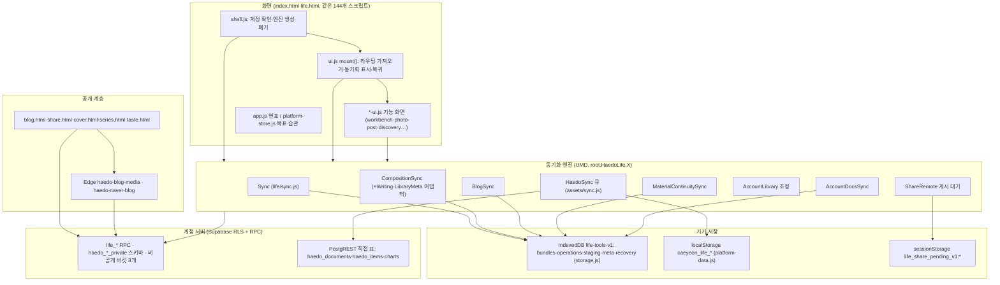

# 구조·작업 흐름 점검 (2026-11-02)

- 기준: `origin/main` `a8d4a65`. 읽기 전용 분석이며 앱 코드·마이그레이션·운영 DB는 건드리지 않았다.
- 구성: 1·2·4·5절은 이 문서. 3절 상세는 [사용 흐름 6개 점검](structure-workflow-review-20261102-flows.md), CI 밖 검사와 계약 판정은 [B3](structure-workflow-review-20261102-b3.md)·[B4](structure-workflow-review-20261102-b4.md)에 있다. 6절은 문서 정합 정리, 7절은 결함 후보 처리 현황이다.
- 작업 방식: 총괄 세션의 작업 지시서에 따라 작업자 세션이 조사했다(AGENTS.md 운영 체계). 결함 수정 담당과 착수는 총괄이 정한다.
- 근거 표기: `파일:줄`, 커밋 SHA, 또는 이 문서 안의 명령 결과. 확인하지 못한 것은 "미확인"과 확인 방법을 적었다.
- 이전 점검 [structure-review-2026-11.md](structure-review-2026-11.md)(`c3b60aa` 기준)의 숫자는 다시 셌다. 달라진 값은 그 자리에 표시했다.

## 1. 구조 지도

### 계층과 의존 방향



근거:
- 페이지 스크립트: `index.html`·`life.html` 모두 `<script src>` 144개이고 목록이 같다(`grep -c '<script[^>]*src=' index.html` → 144, 두 파일 `src` 목록 `diff` 결과 동일).
- 모듈 형식: `root.HaedoLife.Sync = api` 등 전역 등록(`assets/life/sync.js:1-6`, `assets/life/composition-sync.js:3-6`). `ui.js`만 `global.HaedoLife.UI = Object.freeze({ mount })`(`assets/life/ui.js:5332-5333`).
- 엔진 생성: `shell.js`가 Sync·CompositionSync·LibraryMetaSync·WritingSync·AccountLibrary·AccountDocsSync를 만든다(`assets/life/shell.js:153-161,191`). BlogSync는 `ui.js`가 만든다(`assets/life/ui.js:144`). MaterialContinuitySync 자동 관리자는 WritingSync가 시작한다(`assets/life/writing-sync.js:211`). 같은 엔진을 `workbench-ui.js`가 따로 만들 수도 있다(`assets/life/workbench-ui.js:1074-1075`).
- 기기 저장: IDB 이름과 저장소 5개(`assets/life/storage.js:5,296-303`). 연표 localStorage 키(`assets/platform-data.js:3-8`). 게시 대기(`assets/life/share-remote.js:10,110,133`).
- 직접 표 쓰기: `haedo_items`·`haedo_documents`(`assets/platform-store.js:52,197`), `charts`(`assets/app.js:2905`).
- 공개 Edge: `supabase/functions/haedo-blog-media/index.ts`, `supabase/functions/haedo-naver-blog/index.ts`.

### 모듈 묶음과 의존 방향

| 묶음 | 대표 파일 | 의존 방향 | 근거 |
|---|---|---|---|
| 공통 기반 | `vendor/idb`, `vendor/supabase`, `platform-auth.js`, `life/core.js` | 아무것도 부르지 않음 | `index.html:84-90` 순서 |
| 도메인 모델 | `writing.js`, `blog.js`, `collection.js`, `discovery*.js` 등 | 기반만 참조 | `index.html:91-134` |
| 기기 저장 | `life/storage.js` (5,122줄) | 모델을 호출 시점에 찾음 (`core()`, `workbench()` 등) | `storage.js:85-110` |
| 원격·동기화 | `*-remote.js`, `*-sync.js`, `account-library.js` | 저장·모델·Auth 참조 | `index.html:136-148,177-186,217-226` |
| 화면 | `*-ui.js`, `ui.js` (5,334줄), `home.js` | 모든 하위 묶음 참조 | `index.html:163-222` |
| 조립 | `shell.js` | 위 전부를 만들고 폐기 | `index.html:227`, `shell.js:89-104,137-200` |

- 이전 점검의 크기는 `storage.js` 4,407줄이었다. 지금은 5,122줄이다(`grep -c "" assets/life/storage.js`). `ui.js`는 5,334줄이다.

### 로드 순서 위험

| 유형 | 위치 | 결과 |
|---|---|---|
| 없어도 조용히 기능 생략 (`?.`) | `ui.js:144` BlogSync, `:168` ReadingPosition, `:193` InterestUI, `:211` AnnualPlanUI, `:213` DiscoveryUI, `:227` CollectionUI 등 `ui.js` 안 14곳 | 파일이 빠지면 오류 없이 기능이 사라진다 |
| 없으면 바로 실패 | `ui.js:228` `UnifiedSearchUI.create`, `ui.js:1940-1943` `NaverBlogSync`·`NaverCaptureSync`·`NaverBlogUI`, `ui.js:2044` `AccountBlogUI`, `ui.js:2345` `FullBackupUI` | 228은 mount 전체가 실패한다. 나머지는 해당 화면을 열 때 실패한다 |
| 조립 단계 확인 | `shell.js:148`은 Storage·UI·Legacy·PlatformRemote·Sync가 없으면 오류 문구를 띄운다. 그러나 `shell.js:154,158`의 CompositionSync·WritingSync는 확인 없이 호출하고 `:157,191`은 `?.`로 생략한다 | 같은 함수 안에서도 세 방식이 섞여 있다 |
| 로드 시점에 다른 모듈을 잡음 | `collection-picker.js:4`, `collection-ui.js:4`가 `root.HaedoLife.Collection` 등을 파일 실행 때 상수로 잡는다 | HTML에서 `collection.js`(116)·`collection-metadata.js`(171)·`collection-media.js`(172)보다 앞으로 옮기면 깨진다. 다른 모듈은 대부분 호출 시점에 찾는다(예: `annual-plan-ui.js:21`) |
| 순서가 뒤집혀도 동작 | `annual-plan-ui.js`(133)가 `annual-plan.js`(134)보다 먼저, `library-meta-sync.js`·`account-library.js`(224,226)가 `ui.js`(222) 뒤 | 호출 시점 조회라 지금은 문제없다. `check.mjs`는 순서를 보지 않는다 |

### 손으로 관리하는 모듈 목록

| 목록 | 위치 | 항목 수 | 자동 대조 |
|---|---|---|---|
| 페이지 스크립트 | `index.html:84-227`, `life.html` | 각 144 | 두 페이지끼리 대조하는 검사 없음 |
| 오프라인 셸 | `sw.js:3-43` `SHELL` | 196 | `check.mjs:63-66` 파일 존재, `:80-93` 페이지 → SHELL 포함 |
| 배포 허용 목록 | `scripts/prepare-site.mjs:43-61` | 231 | `check.mjs:74-89` 페이지 → 허용 목록 포함 |
| SW 검사 | `tests/service-worker.test.cjs:29,67,94,157` | 일부만 나열 | 없음 (검사용 부분 목록) |

- 페이지 → SHELL·허용 목록 대조는 `bf5009c`에서 들어왔다(`git log -- scripts/check.mjs`). 이전 점검의 "존재만 본다"는 지금은 맞지 않는다.
- 남은 공백: 페이지끼리 같은지, 스크립트 순서, 허용 목록에만 있는 JS(9개: `app.js`, `sync.js`, `workspace.js`, `platform-store.js`, `platform-ui.js`, `timeline-entry.js`, `share-page.js`, `public-cover-return.js`, `interest-model-worker.js`)가 다른 페이지에서 실제로 쓰이는지는 대조하지 않는다. 허용 목록 JS 중 SHELL에 없는 것은 `share-page.js` 하나다(아래 명령 결과).

```text
$ node -e "...sw.js SHELL, prepare-site 허용 목록, index.html src 비교..."
shell 196 allow 231 pageScripts 144
allow js not in shell: [ 'assets/life/share-page.js' ]
```

## 2. 동기화 경로 비교표

대상 7개다. 7번 `AccountDocsSync`는 2026-11-01 소유자 지시로 추가된 범용 계정 문서 동기화다(`assets/life/account-docs-sync.js:1-8`, `assets/life/shell.js:188-192`).

### 2-1. 대상·저장·서버·충돌

| # | 경로 | 대상 데이터 | 기기 저장 (DB/저장소/키) | 서버 표·RPC | 충돌 규칙 |
|---|---|---|---|---|---|
| 1 | 원문 outbox `life/sync.js` | 작업공간 원문 묶음(정확 원문 버전) | IDB `life-tools-v1` `bundles`·`operations`·`staging`, `meta` `sync:${ws}`, `recovery` (`storage.js:296-303,513`) | `life_workspaces`, `life_sync_receipts` (`20261003085426:7,20`); 읽기는 표 직접 select, 쓰기 `life_sync_put` (`life/remote.js:199-238`) | revision CAS. 충돌은 자동 해결하지 않고 비교 후 사용자가 고른다. 고르지 않은 쪽은 새 사본 공간으로 남는다 (`sync.js:481-497`, `storage.js:3418-3425`) |
| 2 | `CompositionSync` (+ 글쓰기 초안·library-meta 어댑터) | 묶음·내 페이지·회고 구성 / 글쓰기 초안 / 폴더·컬렉션·9칸 메타 | `meta` `workbench:${ws}`·`workbenchEditedAt:`·`compositionSync:`·`compositionHead:`·`compositionRecovery:` (`storage.js:724,2683,3545,3581,3787`); 초안 `writingSync:${ws}:${id}` (`:4249`); 메타 `libraryMetaSync:`·`libraryMetaHead:`·`libraryMetaRecovery:`·`libraryMetaEditedAt:` (`:3839,3979,4003,4189`) | `life_compositions`·`_receipts` + `life_composition_get/put` (`composition-remote.js:61,78`); `life_writing_drafts`·`_receipts` + `life_writing_draft_get/put/list` (`writing-remote.js:77-97`); `life_library_metadata`·`life_library_meta_receipts` + `life_library_meta_get/put` (`library-remote.js:121,136`) | revision CAS. 구성·메타는 편집 시각 최신 우선, 진 쪽은 복구 사본 (`composition-sync.js:29-33`, `library-meta-sync.js:1-2`). 초안은 최신 우선이고 저장 완료 기록끼리는 진 쪽을 새 미연결 초안으로 분리 (`writing-sync.js:12-18`). 동률은 서버 쪽 |
| 3 | `BlogSync` | 블로그 글·초안·원본 사진·HEIC 보기용 JPEG | `meta` `blog-sync:${ws}:${post}`·`blog-received:`·`blog-delete:`·`photo-post:` (`storage.js:2556,2451,2498,1385`) | `haedo_blog_private.posts/assets/receipts/profiles/publications` (`20261017144744:8-34`), 버킷 `haedo-blog-originals`; `life_blog_save/read/list/sync_list/prepare_asset/delete/publish/unpublish` (`blog-remote.js:97-208`) | revision CAS + operationId. 두 기기에서 바뀌면 이전 쪽을 "충돌로 보관한 이전 내용 · " 제목의 별도 로컬 초안으로 남긴다 (`blog-sync.js:1-6,12`) |
| 4 | `MaterialContinuitySync` | 자료 준비(plan)와 완성 글 연결 | `meta` `material-continuity:${ws}:${plan}`, `material-continuity-install:${account}:${remote}` (`storage.js:1655-1656`) | `haedo_material_private.heads/receipts` (`20261019005829:6,12`), tombstone (`20261101130000:1`); `life_material_get/put/delete/list/capabilities` (`material-continuity-remote.js:69-105`) | revision CAS + 지문(fingerprint) 비교. `plan.updatedAt` 최신 우선, 동률은 서버 쪽, 진 쪽은 비공개 복구 공간 (`material-continuity-sync.js:27-33,293-298`) |
| 5 | 연표 `assets/sync.js` (+ 목표·습관 `platform-store.js`) | 연표 문서, 목표·습관 항목 | localStorage `caeyeon_life_account_${uid}_registry`·`_doc_${id}`·`_items` (`platform-data.js:3-8`), 이전 키 `caeyeon_life_registry`·`caeyeon_life_doc_`·`caeyeon_life_v2` (`platform-data.js:44-84`) | `haedo_documents`·`haedo_items` (`20261002061709:2,9`), 이전 `charts` (`app.js:2905`, 마이그레이션 없음). RPC 없이 PostgREST PATCH/POST | `updated_at` 전제 조건 PATCH(`sync.js:25-46`). 충돌이면 `conflict` 상태로 멈추고 자동 해결·복구 사본 없음. 원격 삭제는 되살리지 않는다 (`sync.js:32`, `platform-store.js:98`) |
| 6 | 공개 게시 대기 (Share) | 공개 페이지 게시·철회 요청 | **sessionStorage** 기본(`share-remote.js:110`), 키 `life_share_pending_v1:` + `[url,uid,ws]` (`share-remote.js:10,133`). 호출부가 저장소를 넘기지 않는다 (`workbench-ui.js:21`) | `life_public_pages`·`life_public_page_receipts` (`20261005120000:130,145`); `life_public_page_put/get/list/read` (`share-remote.js:173-203`) | expectedRevision CAS + operationId. 대기 중 요청과 다른 요청은 거부 (`share-remote.js:146`) |
| 7 | `AccountDocsSync` (11-01 신규) | 읽기 위치·관심·연간 계획·뉴스 설정/반응/읽기·공개 표지 설정·페이지 초안·글 근거 | `meta`의 원래 키(`readingPosition:` 등, `storage.js:4791-4805`)에 더해 `accountDoc:`·`accountDocBase:`·`accountDocCursor:`·`accountDocRecovery:` (`storage.js:4857-4861,4943`) | `life_account_documents`·`_receipts` (`20261101090000:29,43`); `life_account_document_put/changes` (`account-docs-remote.js:77,94`) | 서버 revision CAS + 로컬 CAS. 목록형 문서는 공통 기준 대비 항목별 병합, 나머지는 `client_updated_at` 최신 우선, 동률은 내용 해시로 결정. 진 쪽은 복구 사본 최대 5개 (`account-docs-sync.js:24-37,130-172`, `storage.js:4859`) |

### 2-2. 재시도·전환·오프라인·검사

| # | 재시도와 영수증 | 계정·작업공간 전환 | 오프라인 | 검사 파일 |
|---|---|---|---|---|
| 1 | 서버 `life_sync_receipts`에 operationId. 변경 후 300ms 예약, 60초 간격(화면 보일 때), `online` (`sync.js:131-138,178-185`). 계정 자료함 모드에서는 자동을 끄고 AccountLibrary가 30초 조정 (`shell.js:153`, `account-library.js:207-210`) | epoch·작업공간 epoch·연결 정보(projectUrl·userId·remoteId) 대조 (`sync.js:78-92`). 폐기는 `shell.js:101` | 공개 설정만으로 시작하고, 실패는 "전송 대기 작업은 보존" 오류로 남긴다 (`sync.js:27,235`) | `life-sync.test.cjs`, `life-remote.test.cjs`, `life-storage.test.cjs`, `account-library.test.cjs`, `library-cloud.test.cjs`, `life-sync-browser.cjs`(CI 미포함) |
| 2 | 각 표의 `_receipts`. 30초 간격, `online`·`focus`, 뒤로가기 캐시 동안 정지 (`composition-sync.js:52-53,267-270`). 글쓰기는 엔진을 초안마다 두고 30초 (`writing-sync.js:1-3,204-206`) | 작업공간 generation + `auth.epoch` + 같은 계정 확인 (`composition-sync.js:55-59`). 폐기는 `shell.js:97-99`, `ui.js:5282-5283` | 오류 상태를 저장하고 전송 대기를 유지, 원문 동기화 전이면 `composition_source_pending` (`composition-sync.js:10,176`) | `composition-sync.test.cjs`, `composition-remote.test.cjs`, `writing-sync.test.cjs`, `writing-remote.test.cjs`, `library-meta-sync.test.cjs`, `library-remote.test.cjs`, `composition-sync-browser.cjs`, `writing-sync-browser.cjs`, `writing-sync-incoming-browser.cjs`, `writing-sync-storage-browser.cjs` |
| 3 | 서버 `receipts` + operationId. 실패 시 30초×2ⁿ, 최대 15분 (`blog-sync.js:13,227-228`). `online`은 즉시, 초안 저장 5초 지연, 탭 간 `navigator.locks` (`blog-sync.js:466-468,527-531`) | 글별 generation, `storage.account` 고정. 폐기는 `ui.js:5284` (shell 아님) | 대기열에 남기고 재시도. 화면을 숨기면 올리기만 한 번 (`blog-sync.js:480,529`) | `blog-sync.test.cjs`, `blog-sync-review.test.cjs`, `blog-remote.test.cjs`, `account-wide-blog.test.cjs`, `account-blog-storage.test.cjs`, `account-blog-continuity-browser.cjs`, `account-blog-receipt-browser.cjs` |
| 4 | 서버 `receipts`. 자동 관리자 60초 간격(`material-continuity-sync.js:392`), `online`·`focus`·`visibilitychange`, 2초 예약 (`:478-485`) | 계정·`auth.epoch`·준비별 generation (`material-continuity-sync.js:56-59`). 열린 편집기는 `watch()`로 덮어쓰기 차단 (`:34-44`) | 오류를 상태에 남기고 다음 회차에 재시도 (`:112`) | `material-continuity-sync.test.cjs`, `material-continuity-remote.test.cjs`, `material-continuity-storage.test.cjs`, `material-continuity.test.cjs`, `material-continuity-browser.cjs`, `material-continuity-backend.cjs` |
| 5 | 영수증 없음. 문서별 1.5초 지연 큐, 실행 중 수정은 한 번 더 (`assets/sync.js:3-13`). 60초 pull (`app.js:3044`), `online` pull (`platform-store.js:221`) | uid·epoch·project·authEpoch 캡처 비교 (`platform-store.js:11-21`), 연표는 `cloudEpoch` (`app.js:2972-2973`) | localStorage에 먼저 저장, 서버 실패는 `err` 상태 (`app.js:2978`) | `sync.test.cjs`, `platform-store.test.cjs`, `platform.test.cjs`, `life-backup-boundary.test.cjs`, `platform-recovery-browser.cjs` |
| 6 | 서버 `life_public_page_receipts`. 자동 재시도 없음, 사용자가 "다시" 선택 (`share-remote.js:220-222`, `workbench-ui.js:696,882`) | 계정 변경 시 요청 취소·중단 (`share-remote.js:113-119`) | 대기 요청은 탭 안에만 남는다(sessionStorage). 확실한 실패만 지운다 (`share-remote.js:205-210`) | `life-share-remote.test.cjs`, `life-share.test.cjs`, `life-share-browser.cjs`, 보조 `life-share-contract.cjs` |
| 7 | 서버 `_receipts`. 800ms 지연, 30초(보일 때), `online`·`focus`·`visibilitychange`, 탭 간 `navigator.locks` (`account-docs-sync.js:99-100,330,364-369`) | 매 단계 같은 계정 확인 (`account-docs-sync.js:121`). 폐기는 `shell.js:100` | `navigator.onLine`이 거짓이면 `offline`만 알리고 건너뜀 (`account-docs-sync.js:309`) | `account-docs-sync.test.cjs`, `run-account-docs-postgres.cjs`(CI `pages.yml:49`), 보조 `account-docs-sql.cjs` |

### 2-3. 겹치는 것

| 항목 | 다시 센 결과 | 근거 |
|---|---|---|
| PostgREST 오류 변환 `clean()` | 12개 파일이 같은 `PGRST202/PGRST205/42P01/42883 → schema_missing` 판정을 따로 가진다 (이전 "10개") | `account-materials.js:107`, `composition-remote.js:28`, `naver-blog-sync.js:27`, `share-remote.js:93`, `library-originals-remote.js:15`, `writing-remote.js:36`, `library-remote.js:34`, `account-docs-remote.js:31`, `material-continuity-remote.js:34`, `naver-capture-sync.js:25`, `remote.js:65`, `blog-remote.js:29` |
| UUID 정규식 | 25개 파일 26곳, 5가지 형태 (이전 "15곳") | `grep -rhoE` 결과: `[a-f\d]…/i` 15, `[a-f0-9]…/i` 4, `[a-f0-9]…`(대소문자 구분) 3, `haedo:writing:` v4 2, `[0-9a-f]…/i` 2 |
| 정렬 JSON `canonical()` | 키 정렬 구현 20곳 (이전 "3곳") | `data.js:63`, `core.js:100`, `interest-profile.js:115`, `naver-capture.js:106`, `material-continuity.js:107`, `material-continuity-sync.js:46`, `blog-sync.js:36`, `account-docs-sync.js:38`, `account-materials.js:13`, `original-attachments.js:12`, `preservation.js:11`, `preservation-references.js:29`, `unified-search.js:9`, `public-cover-remote.js:22`, `nine-board.js:11`, `nine-public-remote.js:14`, `blog-series-package.js:13`, `source-edit.js:12`, `obsidian-decisions.js:15`, `storage.js:46` |
| 포커스 가두기 | 손으로 짠 Tab 순환 3곳, 기본 `<dialog>.showModal()` 11곳(8파일) (이전 "8곳") | Tab: `workspace.js:185-188`, `page-media.js:188-192`, `collection-picker.js:208-210`. showModal: `platform-ui.js:227,468,568,620`, `page-media.js:201`, `photo-post-ui.js:905`, `original-attachments-ui.js:179`, `nine-public-sharing.js:140`, `blog-series-sharing.js:59`, `collection-picker.js:218`, `page-composer.js:357` |
| 생명주기 리스너 | `online`/`focus`/`visibilitychange` 등록과 주기 타이머가 7개 엔진에 따로 있다 | `sync.js:182-184`, `composition-sync.js:267-270`, `writing-sync.js:204-206`, `material-continuity-sync.js:484-485`, `account-docs-sync.js:364-369`, `account-library.js:207-210`, `blog-sync.js:527-528` |
| 뒤로가기 캐시 정지 | `pagehide/pageshow` `persisted` 처리 5곳 | `composition-sync.js:52-53`, `writing-sync.js:172-173`, `material-continuity-sync.js:473-474`, `account-docs-sync.js:355-356`, `blog-sync.js:529-531` |
| 탭 안 직렬화 `serial()` | 같은 Promise 사슬 패턴 2곳 이상 | `sync.js:119-123`, `composition-sync.js:67-72` |
| 최신 우선 `latest()`·`time()` | 4개 엔진이 따로 구현 | `composition-sync.js:24-33`, `writing-sync.js:9-18`, `material-continuity-sync.js:26-33`, `account-docs-sync.js:22,130-172` |
| 저장소 도메인 3중 복제 | 구성·라이브러리 메타·글쓰기가 같은 동사 묶음(get/bind/pause/prepareUpload/ack/applyRemote/adopt/setConflict/setError/resolve/listRecoveries/readRecovery)을 따로 구현 | `storage.js:3460-3832`, `3833-4235`, `4236-4530`; 노출 `storage.js:5104-5111` |

### 2-4. 실제로 다른 것 (합치면 안 되는 차이)

- **정렬 JSON의 의미가 다르다.** `data.js:63-66`은 파생 키를 뺀 객체를 돌려준다. `account-docs-sync.js:38-44`는 `undefined` 키를 빼고 `undefined`를 `null`로 바꾼다. `storage.js:46-60`은 순환·비유한 숫자를 거부한다. 지문·영수증 해시에 쓰이므로(예: `storage.js:4823-4836`) 하나로 바꾸면 기존 저장 해시와 달라질 수 있다.
- **UUID 대소문자 처리가 다르다.** 대소문자 구분 3곳(`naver-capture.js:14`, `storage.js:2813,2838`)과 v4 고정 2곳(`writing.js:13`, `source-edit.js:55`)이 있다. 대소문자 무시로 통일하면 지금 거부하는 값을 받아들이게 된다.
- **동률 규칙이 다르다.** 구성·초안·준비는 동률이면 서버 쪽(`composition-sync.js:32`, `writing-sync.js:17`, `material-continuity-sync.js:31`), 계정 문서는 내용 해시로 결정(`account-docs-sync.js:131-132,168`).
- **복구 사본의 형태가 다르다.** 원문은 새 사본 공간, 구성·메타는 `*Recovery` 행, 초안은 새 미연결 초안, 블로그는 별도 로컬 초안, 준비는 비공개 복구 공간, 계정 문서는 최대 5개 행, 연표와 게시 대기는 복구 사본이 없다(2-1 표 근거).
- **원문은 자동 해결하지 않는다.** 정확 원문 버전은 사용자 비교가 기본이다(`sync.js:481-497`). 다른 경로의 최신 우선 규칙을 원문에 적용하면 안 된다.
- **탭 간 배타가 다르다.** `navigator.locks`는 BlogSync(`blog-sync.js:468`)와 AccountDocsSync(`account-docs-sync.js:330`)만 쓴다. 나머지는 탭 안 직렬화만 한다.
- **전송 방식이 다르다.** 연표는 RPC가 아닌 PostgREST 표 쓰기이고 영수증이 없다(`assets/sync.js:25-46`). 게시 대기는 동기화가 아니라 공개 요청이다.
- **엔진 수명 소유자가 흩어져 있다.** shell(6개), ui(BlogSync), WritingSync(준비 자동 관리자), workbench-ui(준비 보조 인스턴스). 계정 전환 때 한 곳에서 모두 폐기된다는 보장이 코드 구조로 드러나지 않는다(`shell.js:89-104`, `ui.js:5282-5284`, `writing-sync.js:211`, `workbench-ui.js:1075`).

### 2-5. 표에서 드러난 확인 필요 사항

- **게시 대기가 sessionStorage다.** 비교 대상 이름은 "Share localStorage"였지만 실제 기본값은 `root.sessionStorage`이고(`share-remote.js:110`) 호출부는 저장소를 넘기지 않는다(`workbench-ui.js:21`). 탭을 닫으면 결과를 모르는 게시 요청 기록이 사라진다. 서버 영수증이 같은 operationId 재전송을 막지만, 기록이 사라지면 재전송 자체가 일어나지 않는다. 의도인지 미확인이다. 확인 방법: `docs/design-review/page-publication.md`의 결정 기록과 `git log -S "sessionStorage" -- assets/life/share-remote.js`.
- **CI에서 돌지 않는 브라우저 검사 14개.** `tests/*-browser.cjs` 151개 중 `pages.yml`이 부르지 않는 것: `life-sync-browser.cjs`, `life-writing-sync-browser.cjs`, `platform-life-browser.cjs`, `workbench-storage-browser.cjs`, `life-browser.cjs`, `life-batch-browser.cjs`, `life-collections-browser.cjs`, `life-rediscovery-browser.cjs`, `life-search-browser.cjs`, `life-workbench-browser.cjs`, `life-writing-browser.cjs`, `platform-import-browser.cjs`, `record-arrange-browser.cjs`, `app-feel-browser.cjs`. 실행 결과와 판정은 [B3](structure-workflow-review-20261102-b3.md)·[B4](structure-workflow-review-20261102-b4.md)에 있다. 요약: `platform-life`는 `scripts/verify-prepared-site.mjs:59`가 간접 실행하므로 실제 미실행은 13개다. 7개는 그대로 통과하고, 실패 6개 중 5개는 바뀐 계약을 반영하지 않은 낡은 검사로 판정해 이 PR에서 갱신했으며 1개(`life-collections`)는 제품 회귀다.

## 3. 사용 흐름 6개 점검 (요약)

상세 재현 순서·근거·캡처는 [사용 흐름 6개 점검](structure-workflow-review-20261102-flows.md)에 있다. 가짜 서버와 익명 합성 데이터, Chromium 390/1440 모사로 확인했고 실제 Apple 기기 확인이 아니다. 6개 흐름 모두 pageerror 0건, 블로커 없음.

| ID | 심각도 | 내용 | 근거 |
|---|---|---|---|
| M1 | 메이저 | 글쓰기·글 읽기 화면 새로고침 시 자료실 `선택 자료 페이지`로 간다 | `assets/life/ui.js:1491`, `:1501` |
| M2 | 메이저 | 앱 안 이동이 기록을 덮어써 브라우저 뒤로 가기가 직전 화면이 아닌 곳으로 간다 | `assets/life/ui.js:1355` (`replaceState`) |
| M3 | 메이저 | 자료 읽기 → `이 자료로 글쓰기` → `돌아가기`가 읽던 자료로 돌아가지 않는다 | `ui.js:3441`, `workbench-ui.js:1128` |
| M4 | 메이저 | 같은 계정에 백업을 복원하면 홈 `내 글`에 글이 두 번 보이고 공간 이름이 같다 | `f5-home-duplicates-390.jpg` |
| m1~m7 | 마이너 | 자료 새로고침 위치 유실, 저장 위치 문구, 네이버 켜기 문구·상태, 복원 미리보기 유실 등 | 흐름 문서 |

## 3-1. 네이버 자동 수집과 공개 요청 보관 판정 (B3)

- **네이버 `자동 수집 켜기`(m3):** 실제 클라이언트의 구형 RSS 경로가 계약을 어긴다. `naver-blog-sync.js:94-106`은 구독이 켜지면 `life_naver_items`의 `new` 항목을 기준선 확인 없이 현재 공간에 반영한다. 서버 수집 파이프라인(observed_set 기준선 + 검증 scan의 새 글만 `auto_eligible`)은 계약대로다(`20261029112456_…sql:188-223`). 운영 `life_naver_items`는 0행이고(총괄 조회, 11-02 17:00 KST) RSS는 robots로 막혀 있어 당장 노출은 없다. RSS를 다시 켜는 경우의 선행 수정으로 기록한다.
- **공개 요청 보관(sessionStorage):** 탭을 닫으면 요청 기록만 사라지고 게시는 고아·중복이 되지 않는다(공간당 1행, operation_id 영수증, revision CAS). 재현: `evidence/structure-workflow-20261102/repro/share-pending.cjs`. 남는 위험은 응답 전 탭을 닫으면 공개 사실을 늦게 알 수 있다는 것이다.

## 4. 큰 정리 설계안

### 4-0. 시작 조건

1. 로드맵 묶음 1 "실제 기기 완주"가 끝나고, 소유자가 보고한 문제를 총괄이 재현·수정했다(`docs/life-tools-design/roadmap.md:17-19`).
2. 로드맵 묶음 2 "네이버 기록 수집 운영 완주"의 완료 기준을 채웠다(`roadmap.md:20-27`).
3. 5절의 운영 재현 공백 중 1~4번을 총괄이 확인했다. 리팩터링 뒤 회귀 원인을 운영 차이와 구분하기 위해서다.
4. 디자인 세션과 작업 창을 나눴다(4-4 참고).
5. 위 2-5의 CI 밖 브라우저 검사 14개를 한 번 돌려 기준 결과를 남겼다. 통과하지 않는 것은 수정 대상이 아니라 기준선으로 기록한다.

### 4-1. 동기화 통합

| 대안 | 내용 | 장점 | 단점 |
|---|---|---|---|
| A. 단일 엔진 | 7개 경로를 `CompositionSync` 상태 기계 하나로 옮긴다 | 코드가 가장 줄어든다 | 원문 수동 해결·블로그 사진 업로드·계정 문서 항목 병합·연표 REST·게시 대기는 규칙이 달라(2-4) 분기가 엔진 안으로 들어온다. 저장 형식 변경이 필요해 되돌리기 어렵다 |
| B. 공통 기반만 추출 (추천) | 상태 기계와 저장 형식은 그대로 두고 생명주기·오류 변환·식별자 검사·직렬화·엔진 등록만 공통 모듈로 옮긴다. 구성·메타·초안의 저장 3중 복제는 저장소 분할 단계에서 하나의 팩토리로 합친다 | 저장 형식·서버 계약이 바뀌지 않아 커밋 되돌리기로 복구된다. 2-3의 중복 대부분을 없앤다 | 엔진 수는 그대로다 |
| C. 문서화만 | 비교표만 유지 | 위험 없음 | 중복 버그 수정이 계속 여러 곳에 필요하다 |

추천은 B다. 연표(5)와 게시 대기(6)는 B에서도 제외한다. 저장 위치와 서버 방식이 달라 공통화 이득이 작다. 게시 대기의 sessionStorage 여부는 리팩터링이 아니라 제품 결정으로 따로 올린다(2-5).

### 4-2. `storage.js` 분할 (5,122줄)

| 대안 | 내용 | 장점 | 단점 |
|---|---|---|---|
| A. 도메인 파일 + 공용 문맥 (추천) | `createStorage()`가 공용 문맥(`transaction`, `meta` 도우미, `fault`, `accountKey`, 알림)을 만들고 도메인 파일(`storage-sync`, `storage-replica`, `storage-blog`, `storage-material`, `storage-profiles`, `storage-naver`, `storage-account-docs`)이 함수를 붙인다. 공개 API 키 목록(`storage.js:5082-5113`)은 그대로 | IDB 이름·저장소·키가 그대로다. 한 트랜잭션이 여러 저장소를 쓰는 곳(`storage.js:548,3102,3425`)도 유지된다 | 스크립트 7개가 늘어 페이지·SHELL·허용 목록 3곳을 고쳐야 한다 |
| B. 한 파일 안 재배치 | 파일은 하나로 두고 절 순서 정리와 복제 3벌만 합친다 | 목록 수정이 없다 | 파일 크기와 병합 충돌 빈도는 거의 그대로다 |
| C. 도메인별 별도 IDB | 저장소를 DB로 나눈다 | 독립성 최대 | 여러 저장소를 묶는 트랜잭션이 깨지고 기존 데이터 이전이 필요하다. 채택하지 않는다 |

### 4-3. `ui.js` 분할 (5,334줄, `mount()` 93-5331)

| 대안 | 내용 | 장점 | 단점 |
|---|---|---|---|
| A. 기능별 제어기 + 문맥 객체 (추천) | `mount()`는 라우팅·상태·렌더 진입만 남기고 아래 덩어리를 `ctx`(state, navigate, guarded, node, 세대 카운터)를 받는 파일로 옮긴다: 가져오기·묶음(`ui.js:583-990`, `3909-4346`), 동기화 표시(`991-1197`, `4650-5011`), 하위 화면 복귀(`1867-2390`), 원문·검색·읽기(`2391-3888`), 백업·사본 이동(`4347-4626`) | 덩어리별로 따로 옮기고 되돌릴 수 있다 | `mount()` 안 `let` 상태 약 80개(`ui.js:93-392`)를 문맥으로 넘겨야 한다. 세대 카운터를 잘못 넘기면 늦은 응답 방지가 깨진다 |
| B. 가장 독립된 두 덩어리만 | 동기화 표시와 백업·사본 이동만 뺀다 | 위험이 작다 | 라우팅·복귀의 복잡도는 그대로다 |
| C. 프레임워크·상태 저장소 도입 | 다시 작성 | 구조가 가장 깔끔하다 | 빌드·프레임워크 추가 금지(`AGENTS.md` 작업 방식)와 충돌한다. 채택하지 않는다 |

### 4-4. 파일 담당과 충돌 위험

- 2026-11-02 총괄 결정: 이 저장소에 활성 디자인 세션이 없어 파일 담당은 총괄이 정한다. 아래 "디자인 세션" 대목은 작성 당시 전제이며, 지금은 "그 파일을 맡은 작업자"로 읽는다.

- 디자인 세션은 `*-ui.js`, CSS, HTML을 맡는다. 이 설계의 모든 분할 단계는 새 `<script>` 줄을 `index.html`·`life.html`에 넣어야 한다. HTML은 디자인 세션 담당이다.
- `ui.js`는 이름이 `*-ui.js`와 맞지 않지만 화면 코드다. 10-26 이후 `ui.js` 11개, `storage.js` 20개, `index.html`·`life.html` 4개, `sw.js` 10개 커밋이 있었다(`git log --since=2026-10-26 --oneline -- <파일> | wc -l`). 줄 이동이 큰 분할 커밋은 이 파일들과 거의 확실히 충돌한다.
- 대응: 각 단계 시작 전에 디자인 세션에 `ui.js`·HTML 동결 창을 요청한다. 새 파일 이름은 `*-ui.js` 패턴을 피한다(예: `ui-sync-panel.js`). HTML·`sw.js`·`prepare-site.mjs` 줄 추가는 총괄이 통합 커밋에서 한 번에 한다. `sw.js` 캐시 이름 변경은 마지막 통합 때 한 번만 한다.

### 4-5. 단계

모든 단계에 공통으로 지킬 보존 조건:
- `caeyeon_life_*` localStorage 키와 형식(`platform-data.js:3-84`)
- IDB `life-tools-v1` 이름·버전·저장소 5개와 `meta` 키 형식(`storage.js:5-6,296-303`, 2-1 표의 키)
- 정확 원문 버전 불변과 출처 위치
- CAS의 expectedRevision·operationId와 서버 영수증 재사용
- 미저장 입력·한글 조합을 원격 반영으로 덮지 않음(`ui.js:219-223`, `material-continuity-sync.js:34-44`)
- 계정 전환 시 이전 계정 요청 취소와 엔진 폐기(`shell.js:89-104`)

모든 단계에 공통인 되돌리기: 저장 형식과 서버를 바꾸지 않으므로 단계 커밋 하나를 되돌리고 `sw.js` 캐시 이름을 한 단계 올려 재배포한다. 운영 DB 작업은 없다.

| 단계 | 범위 | 단계별 보존 조건 | 회귀 검사 | 위험 |
|---|---|---|---|---|
| S0 기준선 | 코드 변경 없음. 공개 API 키 목록 고정 검사 1개(`storage.js` api 키, `HaedoLife.*` 전역 이름 목록)와 정렬 JSON 20곳의 현재 출력 고정 사례 | 기존 검사 단언을 약화하지 않는다 | `npm test`, `npm run check`, CI 밖 브라우저 14개 기준 결과 | 기준 사례가 기존 동작을 잘못 고정할 수 있다 |
| S1 순수 도우미 | 새 `assets/life/sync-common.js`: PostgREST 기본 판정, UUID 상수(형태별 이름 유지), 출력이 같은 정렬 JSON 묶음만 공유. 12개 `clean()`은 도메인 고유 판정을 남기고 기본 판정만 위임 | 오류 코드·문구가 바뀌지 않는다. 대소문자 구분 UUID는 그대로. 의미가 다른 `canonical`(2-4)은 바꾸지 않는다 | `composition-remote.test.cjs`, `writing-remote.test.cjs`, `library-remote.test.cjs`, `material-continuity-remote.test.cjs`, `blog-remote.test.cjs`, `life-remote.test.cjs`, `life-share-remote.test.cjs`, `library-originals-remote.test.cjs`, `naver-blog-sync.test.cjs`, `account-materials.test.cjs`, S0 고정 사례 | 로드 순서: 새 파일이 모든 원격 모듈보다 먼저 와야 한다. 빠지면 12개 원격이 실패한다 |
| S2 생명주기 공통화 | `sync-lifecycle.js` 하나가 `online`·`focus`·`visibilitychange`·`pagehide/pageshow`·주기 타이머를 관리하고 엔진은 등록만 한다. 대상: life/sync, composition, writing, material, account-docs, account-library, blog | 각 엔진의 간격(30초·60초)·지연(300ms·800ms·5초)·백오프(최대 15분)·뒤로가기 캐시 정지를 같은 값으로 유지 | `life-sync.test.cjs`, `composition-sync.test.cjs`, `writing-sync.test.cjs`, `material-continuity-sync.test.cjs`, `account-docs-sync.test.cjs`, `account-library.test.cjs`, `blog-sync.test.cjs`, `blog-sync-review.test.cjs`, CI `composition-sync-browser.cjs`·`writing-sync-browser.cjs`·`account-blog-continuity-browser.cjs`·`material-continuity-browser.cjs` | 타이머 순서가 바뀌어 기존 경쟁 상태 검사(로드맵 11-01 "간헐 실패 2건")가 다시 드러날 수 있다 |
| S3 엔진 등록부 | `shell.js`가 BlogSync·준비 자동 관리자까지 만들고 한 곳에서 폐기. `ui.js:144`, `writing-sync.js:211`, `workbench-ui.js:1075`는 등록부에서 받기만 | 계정 전환 때 모든 엔진이 같은 순서로 폐기된다. 새 탭·뒤로가기 복귀 동작 유지 | `account-wide-blog.test.cjs`, `account-docs-sync.test.cjs`, CI `account-wide-home-browser.cjs`, `blog-platform-home-browser.cjs`, `integrated-release-entry-browser.cjs`, `platform-recovery-browser.cjs` | `ui.js`와 `workbench-ui.js`를 건드려 디자인 세션과 충돌 가능 |
| S4 저장소 분할 (이동만) | 4-2 A안으로 함수만 옮긴다. 논리 변경 없음 | 공개 API 키 목록 동일(S0 검사), 트랜잭션 범위 동일 | `life-storage.test.cjs`, `account-blog-storage.test.cjs`, `account-materials-storage.test.cjs`, `account-library-storage.test.cjs`, `material-continuity-storage.test.cjs`, `material-writing-storage.test.cjs`, `source-folders-storage.test.cjs`, `life-*-storage.test.cjs`(annual-plan·discovery 5종·interest), `naver-media-receipt-storage.test.cjs`, `public-cover-storage.test.cjs`, `full-backup.test.cjs`, CI `composition-storage-browser.cjs`, `writing-sync-storage-browser.cjs`, `reading-position-storage-browser.cjs`, `full-backup-browser.cjs` | 줄 이동이 커서 `storage.js` 병합 충돌이 가장 크다(10-26 이후 20커밋) |
| S5 복제 3벌 합치기 | 구성·메타·초안의 같은 동사 묶음을 `storage-replica.js` 팩토리 하나로. 키 접두사(`compositionSync:` 등)는 매개변수로 그대로 | 키·상태 객체 형식 동일, 복구 사본 형식 동일, 초안 fork 규칙 유지 | S4 검사 + `composition-sync.test.cjs`, `writing-sync.test.cjs`, `library-meta-sync.test.cjs`, CI `writing-sync-incoming-browser.cjs`, `page-draft-conflict-browser.cjs` | 세 도메인의 작은 차이(초안 `applied` 종결, 메타 자식 설치 `storage.js:3872-3886`)를 놓치면 데이터 손실 |
| S6 `ui.js` 분할 | 4-3 A안. 덩어리 하나씩 별도 커밋: 백업·사본 이동 → 동기화 표시 → 가져오기 → 원문·검색 → 복귀 | 세대 카운터(`navigationGeneration`, `workspaceGeneration`, `inputGeneration`)를 같은 객체로 공유. 읽던 정확 판·검색 초점·한글 조합 보존 | `npm test` 전체(특히 `haedo-navigation.test.cjs`, `full-backup.test.cjs`), CI `core-experience-browser.cjs`, `feature-flow-browser.cjs`, `purpose-workflow-browser.cjs`, `integrated-release-browser.cjs`, `unified-search-browser.cjs`, `life-search-browser.cjs`(CI 밖), `writing-sync-browser.cjs` | 디자인 세션 충돌이 가장 크다. 세대 카운터 누락은 검사로 잡기 어렵다 |

### 4-6. 단계별 작업 지시서 초안

공통: 기준 커밋은 착수 시점 `origin/main`. 작업자 금지 사항은 `AGENTS.md` 운영 체계 그대로(main 푸시·병합·배포·운영 DB·`AGENTS.md`/`CLAUDE.md`/`.agents/`/`.github/workflows` 변경 금지). 보고: 커밋 SHA, 실행한 검사와 결과 수, 미검증 항목.

- **S0**
  - 담당 파일: `tests/structure-baseline.test.cjs`(신규) 하나.
  - 금지: 앱 코드 변경, 기존 검사 수정.
  - 검사: `npm test`, `npm run check`, CI 밖 브라우저 14개 실행 결과 표.
  - 완료: 공개 API 키·전역 이름·정렬 JSON 출력이 고정되고 전부 통과.
- **S1**
  - 담당 파일: `assets/life/sync-common.js`(신규), S1 표의 원격 모듈 12개. HTML·`sw.js`·`prepare-site.mjs` 줄 추가는 총괄.
  - 금지: 오류 코드·문구 변경, UUID 수용 범위 변경, 의미가 다른 `canonical` 교체.
  - 검사: S1 표의 검사, `npm run check`.
  - 완료: `PGRST202` 판정 위치 12 → 1, 오류 코드 스냅샷 동일.
- **S2**
  - 담당 파일: `assets/life/sync-lifecycle.js`(신규), S2 대상 엔진 7개.
  - 금지: 간격·지연·백오프 값 변경, 엔진 상태 기계 변경.
  - 검사: S2 표의 검사. CI 녹색 2회 연속(경쟁 상태 확인).
  - 완료: 엔진별 `addEventListener('online'…)` 직접 등록 0.
- **S3**
  - 담당 파일: `assets/life/shell.js`, `writing-sync.js`, `blog-sync.js`. `ui.js:144,5282-5284`와 `workbench-ui.js:1073-1075` 수정은 디자인 세션 동결 창 안에서만.
  - 금지: 엔진 생성 조건(`automatic` 판정 `shell.js:152`) 변경.
  - 검사: S3 표의 검사.
  - 완료: 엔진 생성·폐기가 `shell.js` 한 곳. 계정 전환 브라우저 검사 통과.
- **S4·S5**
  - 담당 파일: `assets/life/storage.js`와 신규 `assets/life/storage-*.js`.
  - 금지: 키 형식·IDB 버전·트랜잭션 범위 변경, 검사 단언 약화.
  - 검사: S4·S5 표의 검사, S0 API 키 검사.
  - 완료: `storage.js` 1,000줄 이하, API 키 목록 동일, 복제 3벌 → 1.
- **S6**
  - 담당 파일: `assets/life/ui.js`와 신규 `assets/life/ui-*.js`. 디자인 세션 동결 창 필수.
  - 금지: 화면 문구·DOM 구조·CSS 클래스 변경(디자인 세션 담당), 라우팅 결과 변경.
  - 검사: S6 표의 검사, 데스크톱·모바일 폭 수동 확인과 콘솔 오류 수집.
  - 완료: `mount()` 1,500줄 이하, 화면 회귀 0, 덩어리마다 별도 커밋.

독립 검수: 각 단계는 구현자와 다른 에이전트가 데이터 손실·계정 전환·늦은 응답·단언 약화를 기준으로 검수한다. S2·S5·S6은 저장·동기화 경로이므로 크기와 관계없이 필수다.

## 5. 운영 재현 공백 목록

운영에는 있거나 운영에서만 만든 것으로, 저장소만으로 다시 만들 수 없는 항목이다. 이 작업은 운영을 조회하지 않았다. 각 항목에 총괄이 운영에서 확인할 것만 적었다.

아래 표의 오른쪽 열은 모두 **총괄 확인 필요** 항목이다(작업자는 운영을 조회하지 않는다). 11-02 총괄 결정·확인은 1·3행에 따로 표시했다.

| # | 항목 | 저장소 쪽 근거 | 총괄이 운영에서 확인할 것 (총괄 확인 필요) |
|---|---|---|---|
| 1 | Edge `haedo-discovery-private` (v1, 10-29 17:50 배포) | 11-02에는 원본을 찾지 못했다. **11-05 정정:** [PR145](https://github.com/wonchance-art/life-haedo/pull/145) `0b7f632`의 `supabase/functions/haedo-discovery-private/`에 원본이 있다. main에는 아직 없고 호출 경로도 없다 | **11-02 총괄 결정:** 운영 정의 회수 후 정리 묶음에 넣기. 원본 소재가 확인됐으므로 현재 운영 소스·`verify_jwt`·비밀값 이름과 이 원본을 대조한 뒤 통합 판단. 오늘 운영 동일성은 미조회. [원본·계약 인계](news-reader-orchestration-handoff-20261105.md#운영-소스-소재-정정) |
| 2 | 마이그레이션 이력 `20261029084926_discovery_private_reader` | **11-05 정정:** PR145 원본은 `20261029084145_discovery_private_reader.sql`이고, 당시 설치 기록이 운영 번호 `20261029084926`과 대응시킨다. main에는 아직 없음 | 운영 이력의 SQL·객체·권한과 고정 원본/해시 대조. 파일 번호 차이만 보고 재설치하거나 이력 행을 수정하지 않음 |
| 3 | 이력 번호와 파일 이름 불일치 | 파일 `20261102100000_naver_enable_schedules_first_inventory.sql`, 운영 이력 `20261102063845_…`(`roadmap.md:23`). 이전에는 파일 이름을 운영 번호에 맞췄다(`docs/life-tools-design/blog-installation.md:7-8`, `docs/design-review/account-materials.md:55`). 총괄 설명(11-02): 총괄이 MCP `apply_migration`으로 적용해 이력 버전이 적용 시각 `20261102063845`로 기록됐고, 내용은 저장소 파일 `20261102100000_naver_enable_schedules_first_inventory.sql`과 같다. 대응: `20261102063845` ↔ `20261102100000` | **확인됨(총괄, 11-02).** 운영 저장 함수 본문 md5(`b2c5bd17…`)가 저장소 파일과 같다. 남은 일: 운영 이력 전체 목록과 저장소 파일 이름을 1:1 대조해 다른 불일치가 있는지 본다 |
| 4 | 11-01 마이그레이션 6개를 SQL Editor DO 블록으로 설치 | `supabase/operations/20261101-account-sync-install.sql:1-16`, `docs/design-review/account-sync-everywhere.md:71-88` | 이 6개 버전(`20261101090000`~`20261101160000`)이 운영 이력에 있는지. 없으면 이력 행 추가 여부를 소유자에게 묻는다 |
| 5 | `pg_cron`·`pg_net` 확장과 예약 `haedo-naver-capture-poll`, `haedo-naver-blog-poll` | 마이그레이션이 아니라 운영 SQL이 만든다(`supabase/operations/naver-collection-activation.sql:76-96`) | `cron.job`의 이름·주기·활성·명령 본문이 이 파일과 같은지, 확장 버전 |
| 6 | Vault 비밀값 `haedo_naver_project_url`, `haedo_naver_service_role_key` | 수동 준비 전제(`naver-collection-activation.sql:8-10,66-71`) | 두 이름이 있는지(값은 꺼내지 않는다) |
| 7 | Edge 환경 변수 `HAEDO_NAVER_INGESTION_ENABLED` | `supabase/functions/haedo-naver-blog/handler.mjs:90`. 실제 값 미확인 기록(`docs/design-review/naver-operational-readiness.md:134`) | 비밀값 이름 목록에 있는지(값 제외) |
| 8 | Edge 배포 설정 `verify_jwt=false` 두 함수, `supabase/config.toml` 없음 | `blog-installation.md:11`, `naver-operational-readiness.md:133`, `ls supabase/config.toml` → 없음 | 두 함수의 `verify_jwt`·배포 버전·번들 해시를 저장소 소스와 대조(`haedo-naver-blog` v9, `roadmap.md:7`) |
| 9 | 수집 가동 관문 `haedo_naver_private.runtime.ready` | 운영 SQL이 켠다(`naver-collection-activation.sql` 머리말) | 값과 마지막 변경 시각 |
| 10 | 비공개 버킷 3개 설정 | 마이그레이션이 만든다: `haedo-blog-originals`(`20261017144744:161`, 형식 추가 `20261101091500:19`), `haedo-naver-originals`(`20261021113658:370`), `life-library-originals`(`20261023160149:435`) | `storage.buckets`의 공개 여부·크기 한도·허용 형식이 마지막 마이그레이션 상태와 같은지, 마이그레이션 밖 버킷이 있는지 |
| 11 | Auth 설정(Google 로그인, Site URL, Redirect URLs) | 대시보드 설정만 문서에 있다(`docs/platform.md:26-27`, `docs/supabase-integration.md:59`) | 현재 값이 문서와 같은지 |
| 12 | API 노출 스키마 | `haedo_*_private`은 클라이언트 직접 접근이 없어야 한다(`blog-installation.md:9`). 노출 스키마 목록은 대시보드 설정 | 노출 스키마에 `haedo_*_private`이 없는지 |
| 13 | 이전 연표 표 `charts` | 앱이 쓰지만(`app.js:2905`) 마이그레이션은 만들지 않는다(`20261002061709:1` 주석) | 해도 프로젝트에 `charts`가 있는지. 없으면 이 경로가 이전 프로젝트 전용인지 확인 |
| 14 | `life_composition_valid` 정의 6번 | `20261006010000`, `20261008010000`, `20261008020000`, `20261008030000`, `20261012010000`, `20261101140000` | 운영 함수 본문 해시가 마지막 정의(`20261101140000`)와 같은지 |
| 15 | 일회성 운영 삭제 SQL (#157에서 `supabase/operations/archive/`로 이동, "다시 실행 금지" 표시) | `supabase/operations/archive/cleanup-cloud-http-20261003.sql` | 실행 여부(해당 ID 행 개수만). 실행됐으면 `operations/` 기록으로 옮길지 결정 |
| 16 | 배포 비밀값 `HAEDO_SUPABASE_URL`·`HAEDO_SUPABASE_KEY` | GitHub 저장소 비밀값(`.github/workflows/pages.yml:868-869`) | 공개 키(`sb_publishable_`)인지(`scripts/prepare-site.mjs:10`) |

- 마이그레이션·Edge 배포는 CI가 하지 않는다. `pages.yml`은 격리 PostgreSQL 검사만 돌린다(`pages.yml:41-51`). 그래서 위 항목은 모두 수동 적용 기록에 의존한다.
- 운영 읽기 감사에 쓸 수 있는 저장소 SQL: `supabase/tests/*-installation.sql`(예: `blog-installation.sql`, `account-library-installation.sql`), `supabase/operations/naver-status-check.sql`.

## 6. 문서 정합 정리 (총괄 지시 5건)

| # | 항목 | 확인 | 처리 |
|---|---|---|---|
| 1 | 로드맵 10-27·10-29 절 제목이 "출시 관문" 상태로 남음 | PR139 `ab6aef5`, PR141 `30e94f0` 모두 main 조상(`git merge-base --is-ancestor`) | **고침.** 원문은 두고 제목 끝에 "→ 병합 완료(PR…)"만 덧붙임. 10-27은 `roadmap-archive.md`, 10-29는 `roadmap.md`에 있다. 이 제목을 가리키는 링크는 없다 |
| 2 | PRODUCT.md 네이버 "수집 gate 비활성", 자료 흐름 "자동 계정 연결은 후속" | 운영 ready=true, PC 전용 15분 예약 1개, RSS 예약 0(`roadmap.md` 11-02 절) | **고침.** 현재 운영 상태와 네이버 자동 보관 운영 중으로 바꾸고, 다른 서비스는 후속으로 남김 |
| 3 | "이 브라우저 보관"과 옛 메뉴 "기록·도구·관리" | 9칸·컬렉션·폴더는 `library-meta.js:43-57`로 자료 분류 메타와 함께 동기화(`account-sync-everywhere.md:20`), 글쓰기 초안은 `writing-sync.js`, 다시 찾기 제외는 구성 동기화 | **고침.** PRODUCT.md 직접 글쓰기·다시 찾기·9칸(날짜 이력은 보존하고 현재 상태 덧붙임)·컬렉션, `lifestyle-blog.md`, `life-tools-design/README.md` |
| 4 | 도식의 "연간 계획 로컬 보관"·"단일 백업 아님", v8 "Local 담당" | 11-01 계정 자동 연동, 11-01 백업·복원 한 화면, 11-02 운영 체계 | **고침(안내만).** 도식은 이력이라 그대로 두고 `docs/diagrams/README.md` 머리에 최신 기준 안내 한 줄 |
| 5 | 시각 기준이 문서마다 다름 | `AGENTS.md:136` "흰색/차콜", `DESIGN.md:5` primary `#145b50`, `core-experience.md` "옅은 라벤더·민트" | `core-experience.md`에 "시각 기준은 DESIGN.md" 안내 **고침**. `AGENTS.md`는 작업자 금지 범위라 **수정안만** PR 본문에 적음 |

추가로 찾은 불일치: 로드맵 "사용 뒤 결정할 새 기능 후보"의 "9칸 동기화"는 이미 구현돼 있다(9칸은 자료 분류 메타와 함께 동기화). 후보 문구를 "9칸 공개·배치" 등으로 다시 정하는 것은 총괄의 로드맵 갱신 때 판단한다.

## 7. 결함 후보 처리 현황 (2026-11-02 총괄 결정 기준)

| 후보 | 판정 | 담당·상태 |
|---|---|---|
| M1·M2·M3 (새로고침·뒤로 가기·돌아가기) | 재현됨 | 총괄 쪽 작업자. 소유자 결정: 뒤로 가기는 앱 안 직전 화면 |
| M4 (같은 계정 복원 중복) | 재현됨 | 총괄 쪽 작업자. 소유자 결정: 사본 공간 이름에 복원 날짜, 홈 계정 전체 목록에서 사본 제외 |
| m2 (작성 준비 저장 위치 문구), 공개 요청 보관 | 재현됨/확인됨 | 총괄 쪽 작업자 |
| 숨긴 페이지 rerun이 서버 목록을 받음 (`blog-sync.js` rerun 병합식) | 결정적 재현 | #161로 수정·병합. 부하 18회 0 fail로 해소 확인 |
| blob URL 조기 해제(`photo-post-ui.js` `cleanup()`, 표지가 빈 이미지로 보일 수 있음) | CI 로그 근거, 로컬 미재현 | 총괄 쪽 작업자. 수정 뒤 photo-post·blog-writing-completion에 탭 앞 가져오기 재적용 |
| life-collections 검토 화면의 네이버 연결 버튼(Tab 순서) | 제품 회귀(마이너, `c65aa4b`) | 탐색 묶음 병합 뒤 총괄. 소유자 결정: 검토 단계에서 버튼을 폼과 함께 숨김 |
| record-arrange "selected page entry" 1회 실패 | 테스트 타이밍(H1). 저장 고정 실험 10/10 되돌림 0 | 이 PR에서 검사를 수정했다 |
| record-arrange 저장 중 상태 문구 때문에 체크박스가 100~200px 움직인다 | 결함 후보(UX 마이너). 저장 고정 실험(`repro/record-arrange-revert.cjs`)에서 관찰 | 11-02 총괄 결정: 실기기 확인 뒤 화면 개편 범위에서 처리 |
| 네이버 구형 RSS 경로의 기준선 미확인 | 계약 위반, 운영 노출 0 | RSS 재가동 전 선행 수정(로드맵 후속, 총괄) |

