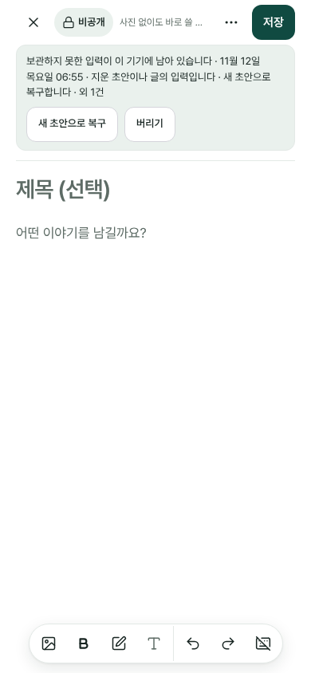
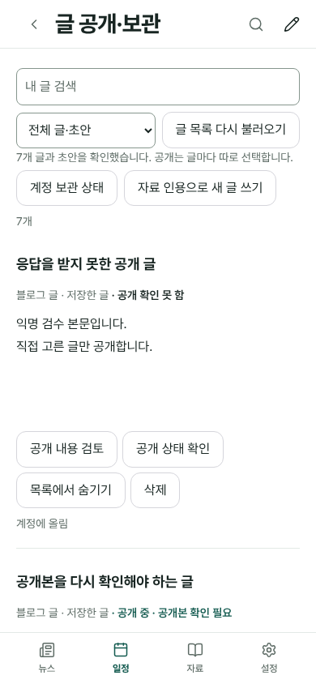
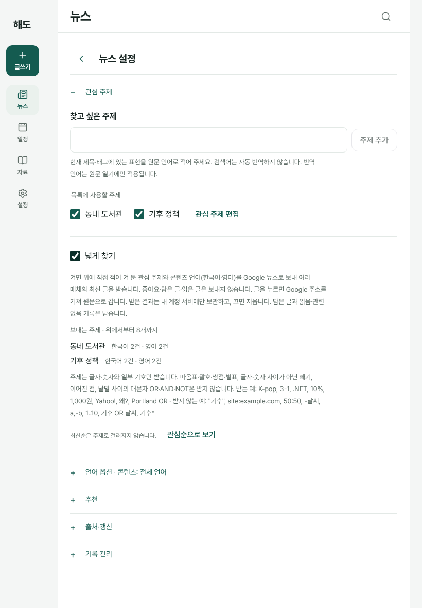

# v218 화면 디자인 점검 (2026-11-12)

## 기준과 방법

- **기준:** main `800bd79`(#249), 캐시 판 `haedo-v218`.
- **범위:** 점검과 보고만 했다. 앱 코드는 바꾸지 않았다. 화면 코드 변경이 필요한 항목은 끝의 작업 지시서 초안으로 총괄에 올린다.
- **방법:**
  - Chromium headless 1440·820·390px(배율 1), 익명 샘플(검사용 가짜 클라우드).
  - 글 공개 쪽만 임시 PostgreSQL 16(UTF8)을 썼다.
  - 눈으로 본 판단은 **관찰**, 계산된 값은 **측정**으로 적었다.
- **검사:** 실제 종료 코드 0으로 끝났다.
  - news-card-feed 20/20, news-wide-search 23/23
  - records-reader-small 20/20, reader-markdown-excerpt 13/13, source-reader-compose 3폭
  - schedule-day-change, schedule-entries, life-annual-plan-sync
- **콘솔·페이지 오류:** 일부러 넣은 실패 응답 외 0건. 외부 요청은 0건이다.
- **기존 근거:** [뉴스 카드 피드 근거 캡처](evidence/news-card-feed/) 16장은 새로 찍은 화면과 같았다. 8장은 바이트까지 같고, 8장은 경과 시간 글자만 다르다.
- **이전 점검:** v217에서 한 [unslop 점검](unslop-audit-2026-11.md) 가운데 "수정 중"이던 항목도 이 판에서 다시 봤다(아래 3절).

## 1. 총괄이 물은 세 가지

### A. 기기 복구 사본 띠의 문구 길이 (390)

**측정:**
- 문장은 86자이고 13px/19.5에서 **3줄**로 꺾인다. 날짜가 `11월 12일 / 목요일`로 갈린다.
- 버튼(`새 초안으로 복구` 115×44, `버리기` 64×44)은 다음 줄에 한 줄로 놓인다.
- 띠 높이는 133px에 아래 여백 12px다.
- 띠가 `.photo-editor-tools`(sticky) 안에 있어 입력하며 스크롤해도 붙어 있다. 그래서 위 고정 영역이 57px에서 202px로 커진다. 화면 높이 844px의 23.9%이고, 편집할 수 있는 높이는 725px에서 581px로 준다.
- 종류와 건수에 따라 79~95자인데 모두 3줄이다. 820·1440에서는 2줄, 66px다.
- 편집기는 잠기지 않는다(`isEnabled` true).

**판단:**
- **다듬기 권고:** 종류 문장과 첫 문장을 합치고 `· 새 초안으로 복구합니다`를 뺀다. 같은 사실을 버튼 이름이 말하고, 버튼이 `aria-describedby`로 문장을 읽어 준다. 390에서 2줄, 113px가 된다(실측). 지시서 WO-1.
- **소유자 판단 필요:** 띠를 입력 중에도 위에 고정할지. 고정 영역에서 빼면 스크롤한 뒤 145px가 돌아오지만, 띠를 다시 보려면 위로 올라가야 한다.

### B. 글 공개·보관 목록의 짧은 안내 4종

**측정:**
- 안내가 붙은 사실 줄(14px)은 세 폭 모두 **1줄**이다. 가장 긴 `…공개 중 · 앞서 보낸 갱신 미반영`도 294px라 360px 폭에서 1줄이다.
- 말줄임·잘림·버튼과의 겹침은 0건이다.
- 행이 높아지는 원인은 버튼이다. 390에서 `공개 철회`·`공개 상태 확인`이 붙은 4버튼 행이 2줄로 꺾여 행이 260px에서 310px가 된다. 820·1440에서는 한 줄이다.
- 모든 버튼이 44px이고, 접근 이름은 `<제목> 공개 철회`·`<제목> 공개 상태 확인`이다.

**판단:** 넘침은 **문제없다**. 다만 의미 표시가 틀렸다(다듬기 권고).
- 안내가 상태와 같은 span(`[data-public-label]`)이라, `공개 확인 못 함`·`미반영`이 성공 상태 `공개 중`과 같은 틸 600으로 칠해진다.
- 안내를 별도 span으로 나눠 `--ink-soft`·500으로 둔다. 지시서 WO-4.

### C. 넓게 찾기 설명의 길이

**측정:**
- 13px, 줄높이 1.8, 최대 65ch(503px)다.
- 설명은 1440·820에서 4줄 94px, 390에서 5줄 117px이고 184자다. 켜면 규칙 문단(228자)이 더해진다.
- 같은 화면의 `기사 이미지 보기` 설명(93자, 2줄)의 두 배이고, "켜면… 켜 둔"과 "Google"이 두 번씩 나온다.
- 확인란 위에서 주제 목록까지 173px(390은 196px)다.
- 이 설명은 뉴스 설정 > 관심 주제 안에만 있고, 켜기 전에 보여야 하는 외부 전송 고지다. 그래서 상시 보조 패널로 보지 않는다.

**판단:** **다듬기 권고(낮음)**. 고지할 사실은 그대로 두고 한 줄을 줄인다.
- 다음 사실 6개를 모두 남긴다: 보내는 것, 수신처, 보내지 않는 것, Google 주소 경유, 계정 서버 보관, 끄면 지움과 기록 유지.
- 같은 블록의 정렬 두 곳도 고친다:
  - `지금 다시 지우기` 버튼이 칸 폭으로 늘어 글자가 가운데에 온다.
  - `최신순은 주제로 걸리지 않습니다` 줄이 넓게 찾기 블록 아래에 붙어 그 설명처럼 읽힌다.
- 지시서 WO-2.

## 2. v218 화면에서 새로 본 것

| 화면·폭 | 신호 | 위치 | 근거 | 분류 |
| --- | --- | --- | --- | --- |
| 일정 D 보류된 날·전 폭 | 상태가 사실과 다름 | 저장 상태 줄(`schedule-entries.js:146` `STATE_TEXT.ok`). 보류 안내(`:443`)와 `저장이 중단되었습니다…`가 함께 보임 | 관찰: 값 3을 저장하지 못했다는 빨간 상자 둘 사이에 `저장됨 · 계정에 올림`이 불투명도 1로 남음 ([캡처](v218-design-check/schedule-held-day-1440.png)). 빨간 상자 둘이 같은 실패를 두 번 말함 | **총괄 판단**(WO-3, 저장 상태 표시 조건) |
| 뉴스 목록·3폭 | 동작이 DESIGN과 다름 | `discovery-ui.js:930`이 머리줄 톱니 누름까지 "첫 사용"으로 셈 | 관찰: 설정에서 넓게 찾기를 켜고 ‹로 돌아온 뒤 결과가 늦게 오면, 스크롤하지 않은 목록에도 `새 글 4건`이 뜸. DESIGN은 "스크롤·더 보기·카드 누름" | 총괄 판단 |
| 뉴스 목록 | 동작 | `새 글 n건`은 목록 맨 위에만 있음 | 측정: 나타날 때 스크롤 1018–1381px라 화면 밖 | 소유자 판단 |
| 뉴스 목록 | 배지 모양 세 가지 | 넓게 찾은 카드 메타 줄의 `EN`(글자)·`넓게`(테두리)·주제(채움) | 관찰. DESIGN에 정해 둔 모양 | 소유자 판단 |
| 글 정보 시트·전 폭 | 한글 단어 중간 줄바꿈 | `.photo-info-note`(`photo-post.css:913`) | 관찰: `먼/저`, `(사진 2/장)` | 다듬기 권고: `word-break: keep-all` |
| 글 정보 시트·전 폭 | 오류가 회색 | `.photo-public-error`(`role=alert`, 스타일 없음) | 측정 #5d6b65 | 다듬기 권고: `color: var(--color-error)`(흰 면 7.3:1) |
| 공개 검토 패널·전 폭 | 줄 간격 불균일 | `.blog-manager-current > a`(inline-flex 44px) | 측정 줄 간격 33px와 23px, `공/개` 꺾임 | 다듬기 권고: 링크를 줄 끝 별도 줄로, `keep-all` |
| 글 공개·보관·전 폭 | 사진 글 발췌의 빈 줄 | `.blog-manager-excerpt`(pre-wrap) | 측정 사진 2장 행 344px와 262px(+82px). v217에도 있음 | 다듬기 권고: 사진 자리 빈 줄 접기 |
| 숨기기 질문·전 폭 | 조사 고정 | `blog-manager.js:238` `”은` | 관찰 `메모”은` | 다듬기 권고: `“…”: 공개 중인 글입니다.` |
| 홈 목록·390 | 메타 꺾임 | `.home-post-visibility` | 측정 181px 칸에서 21→42px(`공개 확인 못 함 ·` / `원본은 비공개`) | 다듬기 권고: `white-space: nowrap` |
| 로그인 확인 화면·390/1440 | 한글 단어 중간 줄바꿈 | `#lifeStartup p`(`ui.css:74`) | 관찰 `오/래`, `있/습니다` | 다듬기 권고: `word-break: keep-all` |
| 연간 계획 충돌 안내 | 아이콘·숫자·정렬 | 네이티브 ▼, `2026-03-01`, `닫기` 시작 x478(시작선 468) | 측정 | 다듬기 권고: chevron 16px, 날짜 `2026.03.01`, 시작선 맞춤 |
| 자료 출처 정보 | 이름 없는 아이콘 조작 | 글자 버튼 사이의 폴더 아이콘 44px | 관찰(접근 이름은 있음) | 다듬기 권고: 글자 버튼 `폴더 옮기기` |
| 편집기 빈 상태·390 | 잘림 | 저장 상태 칸 114px에 `사진 없이도 바로 쓸 …` | 측정 글자 140px | 소유자 판단(v217 O-13과 같음) |

## 3. v217 unslop 점검의 "수정 중" 항목 재확인

| 항목 | v217 | v218 | 판정 |
| --- | --- | --- | --- |
| 자료 출처 정보 `가져온 시각` | ISO `…T05:08:46Z` | `2026. 11. 11. 오후 9:57` | **해소**(목록은 `11.11 21:57` 형식으로 다름) |
| 출처 정보 버튼 간격 | 0px | 8px | **해소** |
| 담기 패널 둘째 줄 간격 | 가로·세로 0px | 8px | **해소** |
| 자료 읽기 위 떠 있는 가는 선 | `ui.css:497` | 같은 규칙이 `:508` | 남음 |
| ≤760 도구 줄과 연필 | 13px 어긋남 | 맨 위 13px, 스크롤 뒤 5px | 남음 |
| 담기 아이콘 개념 | link·book-open·bookmark | 그대로 | 남음(O-14) |
| 설정 `#lifeSettingsRow2Sub` | `…각각 연결합니다.` | 그대로(`ui.js:3270`) | 남음 |
| 동기화 수동 비교 화면 | 미확인 | 가짜 클라우드로 재현 못 함 | 미확인 |
| 연간 계획 충돌 안내 | 미확인 | `▼ 복구 사본 1개` + 13px 한 줄. 수동 `최신 계획 확인`·`내 입력 다시 적용`은 세 폭 모두 없음 | 바뀜(위 2절 다듬기) |
| 글 공개·보관 `p.life-meta` 간격 | 도구 줄과 0px, x478 | 같음. 긴 상태 문장이 이 줄에 붙음 | 남음 |
| 글 공개·보관 검색·필터 반지름 | 8px | 8px | 남음 |
| 글 공개·보관 행 버튼 | 3개 | 3~4개(390에서 2줄) | 바뀜(O-10) |
| 글 공개·보관 `계정에 올림` | 있음 | 그대로(글 정보는 `저장됨 · 계정에 올림`) | 남음(O-11) |
| 편집기 더 보기 빈 띠 | 약 28px | `초안 삭제` 아래 20px, 메뉴가 넘쳐 36px 스크롤 | 바뀜 |
| 편집기 더 보기 네이티브 ▶ | 있음 | 있음, 요약이 다른 항목보다 12px 왼쪽 | 남음 |
| 빈 편집기 안내 위치 | 저장 상태 자리 | 그대로, 390에서 잘림 | 남음(O-13) |
| 뉴스 작은 글자 음수 자간 | `discovery.css:297·404` | 카드(17px)는 해당 없음. 분할 목록 `:404` 15px −0.15px, ≤760 읽기 제목 `:433` 13px 남음 | 남음(줄 이동) |
| 뉴스 8px 반지름 | `:207` | 담기·`⋯`(`:217`) 8px, 머리줄 12px | 남음 |
| 뉴스 1440 읽기 칸 제목 | 약 175px | 172px | 남음 |

자료 읽기의 출처 정보·담기 층은 도구 줄 아래 붙는 층(sticky)으로 바뀌었다([캡처](v218-design-check/records-info-dock-1440.png)). 버튼 간격 결함은 이 개편에서 풀렸다.

## 4. 작업 지시서 초안 (총괄 판단용)

### WO-1 복구 띠 문구 (A)

- **목표:** 390에서 복구 띠를 2줄로 줄인다. 사실은 빼지 않는다.
- **기준 커밋:** `800bd79`
- **담당:** `assets/life/photo-post-ui.js`의 `STRAY_KINDS`(:279)와 `drawStrays`(:296-297).
  - **겹침:** B2 편집기 작업과 같은 파일이므로 순서를 정해야 한다.
- **문구:** `종류 문장 · 시각 (· 외 N건)`
  - gone: `지운 초안이나 글에서 보관하지 못한 입력이 이 기기에 있습니다`
  - saved: `저장한 글이 된 초안에서 보관하지 못한 입력이 이 기기에 있습니다`
  - hidden: `숨긴 초안에서 보관하지 못한 입력이 이 기기에 있습니다`
  - new: `보관된 적 없는 새 글의 입력이 이 기기에 있습니다`
  - `· 새 초안으로 복구합니다`는 뺀다.
- **보존:**
  - 버튼 이름 `새 초안으로 복구`·`버리기`와 44px
  - `role=group`·`role=status`·`aria-labelledby`·`aria-describedby`, 첫 초점
  - 편집기를 잠그지 않음
  - 그 자리 복구 띠는 그대로
- **금지:** 13px 미만 글자, 말줄임, 문장 숨기기, 건수·시각 삭제, `sw.js` CACHE 판올림.
- **검사:**
  - `writing-recovery-browser`: 문구 단언을 새 문구로 바꾼다. 규칙 변경이며 단언 약화가 아니다.
  - `writing-input-browser`, `writing-minor-browser`, `npm run check`
- **완료 기준:** 390에서 2줄·113px이고, 820·1440은 지금과 같다.
- **별도 결정:** 띠를 입력 중에도 고정할지는 소유자 판단이다.

### WO-2 넓게 찾기 설명 (C)

- **목표:** 고지할 사실은 그대로 두고 설명을 한 줄 줄인다. 같은 블록의 정렬 두 곳을 고친다.
- **기준 커밋:** `800bd79`
- **담당:**
  - `assets/life/discovery-ui.js` `wideSettings()`의 `#discoveryWideHelp` 문자열(:1099 부근)과 재시도 버튼
  - `assets/life/discovery.css`
  - `tests/news-wide-search-browser.cjs` 문구 단언
  - [news-card-feed.md](news-card-feed.md) 문구 표
- **문구:** 수신처 이름은 지금의 수신처 템플릿을 쓴다.

  > 직접 적어 켠 관심 주제와 콘텐츠 언어(한국어·영어)만 Google 뉴스로 보내 여러 매체의 글을 받습니다. 좋아요·담은 글·읽은 글은 보내지 않습니다. 글은 Google 주소를 거쳐 원문이 열립니다. 결과는 내 계정 서버에만 두며 끄면 지웁니다(담은 글·읽음·관련 없음 기록은 남음).

  - 실측: 160자, 1440·820 3줄, 390 4줄.
- **값:**
  - `.discovery-news .discovery-wide-settings > button { justify-self: start; }`
  - `.discovery-limitation` 줄(관심순으로 보기 포함)을 넓게 찾기 블록 앞으로 옮긴다.
- **보존:**
  - 위 6개 사실
  - 끈 상태에서도 설명 표시, `aria-describedby`
  - 규칙 문단과 예 16개, 13px/65ch
  - 요청·저장 경로
- **금지:** 설명을 접기·툴팁 뒤로 숨기기, 단언 약화, 다른 설정 문구 수정, CACHE 판올림.
- **검사:** `news-wide-search-browser`, `news-card-feed-browser`, `npm run check`, 링크 검사, 세 폭 캡처.
- **완료 기준:**
  - 설명 줄 수가 3/3/4다.
  - 재시도 버튼 x가 블록 왼쪽과 같다.
  - 검사가 종료 코드 0으로 끝난다.

### WO-3 보류된 날의 저장 상태 (상태가 사실과 다름)

- **목표:** 저장에 실패해 보류된 날에는 `저장됨 · 계정에 올림`을 보이지 않는다. 같은 실패를 두 번 말하지 않는다.
- **기준 커밋:** `800bd79`
- **담당:** `assets/life/schedule-entries.js`의 저장 상태 줄(`STATE_TEXT` :146)과 보류 안내(:443) 표시 조건.
- **바꿀 것:**
  - 보류 중에는 상태 줄을 비우거나 `저장하지 못함`으로 둔다. 계획 화면의 저장 상태 규칙(`저장하지 못함 · [다시 시도]`)과 맞춘다.
  - `저장이 중단되었습니다…` 상자와 보류 안내 가운데 하나만 남긴다.
- **보존:** 보류 안내의 `다시 저장`·`선택 취소`, 흐린 입력(0.5), 입력값, 계정 문서 쓰기 경로.
- **금지:** 저장·동기화 경로 변경, 단언 약화.
- **검사:** `schedule-day-change-browser`, `schedule-entries-browser`, 세 폭 캡처.
- **완료 기준:** 보류된 날에 성공 문구 0건, 같은 실패 문구 1회.

### WO-4 작은 시각 다듬기 묶음

이 묶음은 CSS·문구만 바꾸며 저장·공개 경로는 건드리지 않는다.

- **바꿀 것:**
  - `.photo-info-note`·`#lifeStartup p`에 `word-break: keep-all`
  - `.photo-public-error`에 `color: var(--color-error)`
  - 글 공개·보관 상태 줄의 안내를 별도 span으로 나누고 `--ink-soft`·500
  - `.home-post-visibility { white-space: nowrap }`
  - 숨기기 질문 문구 `“…”: 공개 중인 글입니다.`
  - 연간 계획 충돌 안내: chevron 16px, 날짜 `2026.03.01`, 시작선 468에 맞춤
- **겹침:** `photo-post.css`는 B2 작업과 같은 파일이다.
- **검사:** `publish-recovery-browser`(PostgreSQL), `writing-*-browser`, `schedule-*-browser`, `npm run check`, 세 폭 캡처.

## 확인하지 않은 것

- 실제 iPhone(키보드를 올린 상태에서 띠가 차지하는 비중), iPad, Mac Safari, VoiceOver.
- 1101–1439px 폭, PostgreSQL 17(CI 판).
- 동기화 수동 비교 화면.
- 실제 흐름으로 만들지 못한 상태: `공개본 확인 필요`는 로컬 상태를 넣어 만들었다.
- 네이티브 확인창(`수정 취소`·`초안 삭제`·`버리기`)은 문구만 기록했다:
  - `수정한 내용을 버릴까요? …`
  - `이 초안을 삭제할까요? 로그인한 모든 기기에서 함께 삭제됩니다.`
