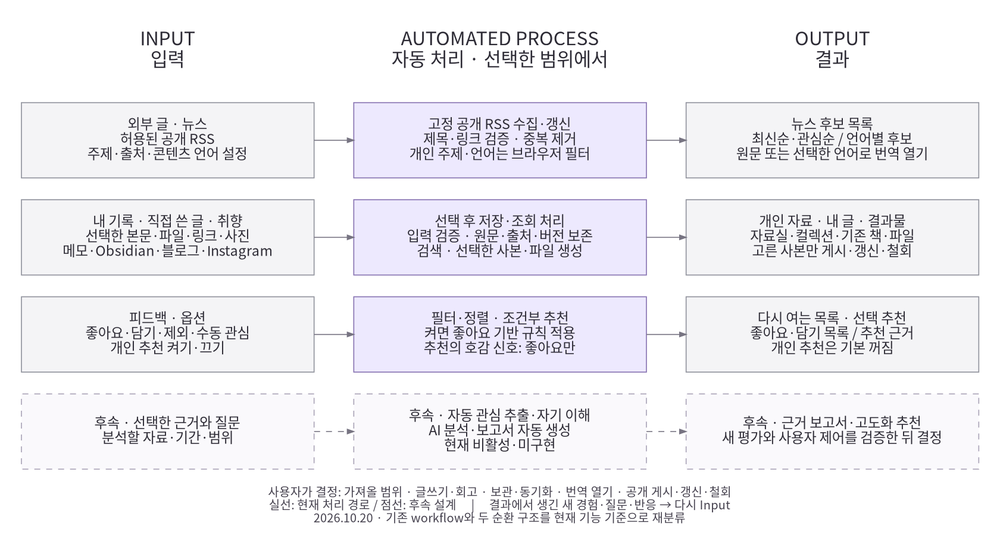

# Input → Automated Process → Output

2026-10-20. 사용자 요청에 따라 기존 workflow와 두 순환을 입력·자동 처리·결과로 다시 분류한다. 화면 메뉴 구성이 아니라 자료와 처리의 흐름이다.

뉴스의 첫 화면 기사 노출과 주제·출처 펼치기, 동일 언어 비교를 출시했다. [바로 사용·검수](../design-review/news-ready.md)를 따른다. 도식의 입력→조건부 처리→결과 관계와 점선 후속 AI는 동일하다.

| Input | Automated Process | Output |
| --- | --- | --- |
| 허용된 공개 RSS, 주제·출처·콘텐츠 언어 | 정기 후보 수집, 링크·제목 메타데이터 검증·중복 제거, 마지막 성공 공급 유지, 필터·정렬 | 뉴스 후보, 최신순·관심순 목록, 원문·번역 열기 |
| 선택한 본문·파일·링크·사진, 직접 쓴 글과 취향 | 사용자가 선택한 뒤 입력 검증·저장, 원문·정확 버전·출처 보존, 검색, 사본·파일 생성 | 개인 기록·내 글·컬렉션·기존 책·파일, 고른 사본의 명시 공개 |
| 좋아요·담기·제외·수동 관심, 추천 옵션 | 상태 보관·목록 갱신, 조건부 필터·정렬, 켠 경우에만 좋아요 기반 규칙 추천 | 좋아요·담기 목록, 추천 목록과 근거, 해제·복구 |
| **후속:** 선택 분석 자료·질문·기간 | **후속:** 자동 관심 추출·AI 자기 이해·보고서 생성 | **후속:** 근거 보고서·고도화 추천. 새 평가 후 채택 판단 |

## 자동 처리와 사용자 결정

- 자동 수집은 고정된 허용 공개 RSS의 후보 메타데이터다. 개인 주제·출처·언어 선택은 브라우저에서 후보를 거르는 조건이며 수집 서버에 전송하는 설정이 아니다. Apple 메모·Obsidian·SNS 전체 계정 수집이나 기사 본문 복사가 아니다. 정기 실행 설정과 실제 첫 schedule 검증은 구분하며 최신 상태는 [로드맵](../life-tools-design/roadmap.md)을 따른다.
- 가져올 범위, 글쓰기·회고·관심 교정, 자료 보관·동기화, 번역 링크 열기, 공개 게시·갱신·철회는 사용자가 결정한다. 가운데 열의 저장·출력은 선택 뒤 코드가 수행하는 처리다.
- 개인 추천은 기본 꺼짐이며 좋아요의 제목·태그를 활용하는 로컬 규칙이다. 담기·클릭·읽음을 긍정 학습 신호로 쓰지 않는다. 읽음에 따른 후보 제외는 호감 추정과 별개다. SNS식 학습 모델이 구현됐다는 뜻이 아니다.
- 직접 쓰는 회고와 기존 책·PDF는 현재 기능이다. 자동 관심 추출은 비활성이며 AI 보고서는 미구현이다. 책 기능의 추가 확장 보류를 기존 기능의 제거로 표시하지 않는다.
- 결과에서 생긴 새 경험·질문·반응은 다시 입력이 된다. 실제 사용의 불편·유용성은 비교→개선→보존 검증의 별도 개발 순환으로 이어지며 앱이 스스로 코드를 수정·배포하는 기능은 아니다.

## 이전에 만든 workflow

- [platform workflow v3 이미지](rendered/platform_workflow_v3.svg) · [Mermaid 원본](platform_workflow_v3.mmd): 2026-10-05 당시 현재 기반과 후속 기능을 구분한 상세 workflow. 현재 구현된 글쓰기·뉴스·공개가 당시에는 후속으로 표시되어 있어 과거 이력으로 보존한다.
- [두 순환 workflow 원본](life_two_cycles_20261013.mmd): 자료→읽기·회고→개인 활용/선택 공개→새 질문, 실제 사용→개선→검증→재사용의 두 순환. 해당 이름의 렌더 이미지는 현재 저장소에서 찾지 못했다.
- [최근 단순 구조도](rendered/product-structure-20261020.png): 메뉴와 제품 구성의 연결을 보여주는 직전 도식.

[확대 SVG](rendered/product-workflow-20261020.svg) · [PDF](rendered/product-workflow-20261020.pdf) · [Graphviz 원본](product-workflow-20261020.dot). 시스템 Graphviz·Noto CJK 글꼴로 렌더하며 앱 의존성은 추가하지 않는다. 생성 명령은 DOT 원본 상단에 있다.

[도식 검사](rendered/product-workflow-20261020.report.json): 본문 상자 12개·가시 연결 8개, 4행의 열 정렬·한글 표시를 확인했고 본문 잘림·외부 리소스는 0개다. 독립 검토의 개인 필터/수집 경계와 읽음/긍정 신호 구분 의견을 반영했다. 문서 그림의 내용·배치 검수이며 앱 기능·실제 기기·추천 유용성 검수 결과는 아니다.
