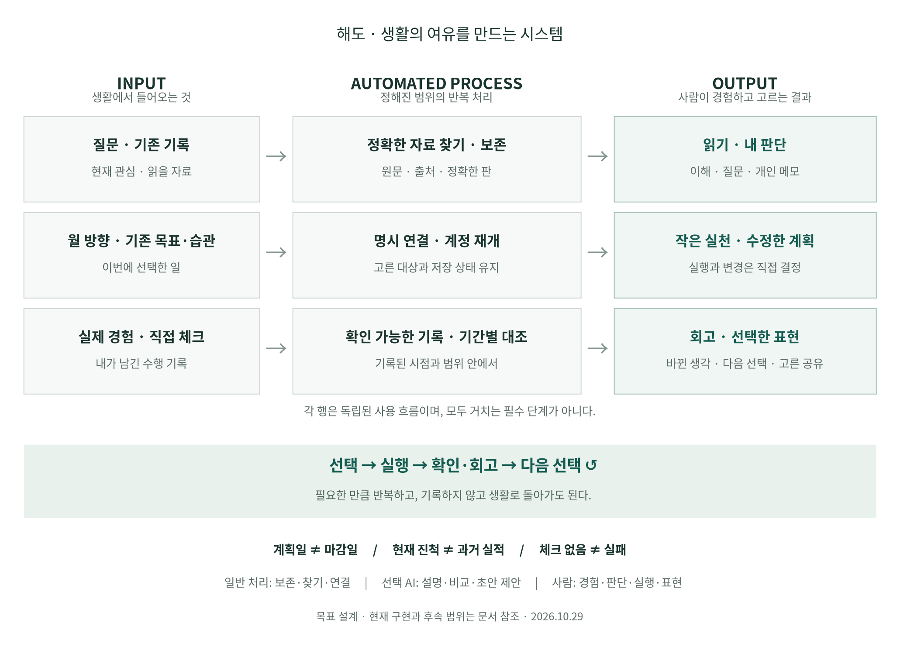

# 생활의 선택을 이어 주는 시스템 계약

2026-10-29. [제품 목적](product-purpose.md)을 **이해·선택·실행·확인·다음 선택**까지 연결한 설계다. 현재 main `30e94f0`과 PR140 실행 인계·PR142 읽기 명세를 대조했다. 새 연결·계정 계획·기간 회고는 구현 전이며, 이 문서의 개념은 범용 플랫폼/단일 DB 도입 지시가 아니다.

## 전체 프레임

**반복 관리와 재입력을 줄이고, 직접 경험·깊은 생각·원하는 실천과 표현에 쓸 여유를 남긴다.** 생활의 필요로 시작해 충분하면 종료한다. 어느 단계에서든 직접 들어오거나 나갈 수 있다. 읽은 자료가 없어도 계획하고, 월 계획이 없어도 습관을 체크하며, 회고를 저장하지 않고 다음 생활로 넘어갈 수 있다.

[SVG](../diagrams/rendered/life-system-20261029.svg) · [PDF](../diagrams/rendered/life-system-20261029.pdf) · [원본](../diagrams/life-system-20261029.dot)

[계획·체크·불변 회고 클릭 시연](../prototypes/planning-practice-review.html)으로 아래 연결을 예시 데이터에서 확인할 수 있다. 실제 계정 기능을 사용하지 않는 설계 시연이며 실행 방법은 [상세 명세](../design-review/planning-practice-review.md#클릭-가능한-설계-시연)에 있다.

| 사용자 일 | 입력 | 시스템이 줄일 반복 처리 | 사람이 고르는 결과 |
| --- | --- | --- | --- |
| 이해하기 | 질문·관심·이미 남긴 기록 | 필요한 원문/판 찾기, 출처·확보 범위 보존 | 읽고 종료, 내 생각, 다음 질문 |
| 선택하기 | 직접 고른 문장·월 방향 | 현재 문맥에서 기존 목표/습관 찾기, 확인한 의도와 근거 연결 | 작은 실천 의도 또는 연결 없이 종료 |
| 실행하기 | 기존 목표·습관 | 같은 항목 재개, 체크·상태 보관, 중복/충돌 복구 | 직접 수행, 필요한 체크/진척 수정 |
| 확인하기 | 선택한 기간·대상 | 현재 확인값·날짜별 체크·선택 당시 계획 대조 | 내 판단, 수정/유지/연결 해제 |
| 표현하기 | 선택한 생각·경험·회고 | 기존 글쓰기·정확 인용·명시 저장·공개 사본 | 개인 글 또는 고른 내용의 공개 |

이 표는 의무 순서가 아니다. 사용자가 계획이나 메모를 열었다고 읽음·실행·이해·호감·공개를 생성하지 않는다. 자동화는 보존·찾기·계정 연속성과 복구를 맡고, AI는 필요한 경우 선택 자료의 설명·비교를 돕는다. 실천·채택·공유는 사용자의 선택이다.

## 화면과 책임

| 현재 영역 | 주된 일 | 다른 영역으로 넘기는 것 |
| --- | --- | --- |
| 홈 | 내 글 읽기·쓰기·선택 표현 | 명시 선택한 근거/회고의 문장만 기존 작성기에 채택 |
| 뉴스 | 새 정보 발견·원문 열기·반응 | 링크 확보 범위를 유지한 자료 보관, 선택 의도의 계획 진입 |
| 자료실 | 정확 원문·메모·비교·기존 자료 회고 | 정확 참조와 사용자가 확인한 짧은 의도 사본 |
| 계획 | 연간 방향·목표·습관·기간 확인 | 확인한 기록과 직접 쓴 판단, 다음 계획의 명시 편집 |
| 설정 | 계정·공간·보관·복구 | 정상 읽기/체크 중 설정 방문을 요구하지 않는 자동 처리 |

기간 수행 회고의 대표 위치는 **계획 안의 문맥 화면**이다. 자료실의 작성연도 기반 회고와 다른 모델을 가지며, 자료실에서 연결할 때도 같은 기간 회고 ID를 연다. 메뉴별로 회고 사본을 만들지 않는다. 상시 통계판·단계 진행 표시·의무 평가를 추가하지 않는다.

## 저장 책임과 연결의 최소 단위

| 도메인 | 현재/설계 소유 범위 | 확정된 경계 |
| --- | --- | --- |
| 원문·발췌·자료 메모 | 현재 계정+자료공간 | 정확 source/version/hash·구절, 기본 자료 계정 보관 |
| 작성 준비·초안 | 현재 계정+자료공간 | 로컬 준비와 선택 준비 전송, saved 글의 별도 계정 보관 |
| 뉴스 반응·읽기 비교 | 현재 계정+자료공간의 로컬 메타 | PR140 계정 연속성 실행 대상; 반응/평가 의미는 독립 |
| 연간 계획 | 현재 계정+자료공간 로컬 CAS | 같은 범위의 계정 연속성을 추가; 계획 내용을 계정 전체 하나로 합치지 않음 |
| 목표·습관 | 현재 계정 전체 | 기존 도구·저장·체크 재사용; 연결 공간이 대상의 소유 공간이 되지 않음 |
| 선택 연결·기간 회고 | 새 설계: 계정+자료공간 | 독립 관계와 불변 회고 판. 원문/목표 형식에 필드나 기계용 JSON을 숨기지 않음 |

공통으로 전달하는 문맥은 **프로젝트·확인된 계정, 자료공간, 대상 종류/정확 ID·판, 현재 의도, 돌아갈 위치**다. 필요한 값만 전달한다. 이를 하나의 만능 저장 객체로 만들지 않는다. 다른 기기에 세션 스크롤·초점을 추정 복원하지 않고 유효한 정확 대상으로 재개한다.

작은 행동은 메모를 먼저 만들지 않고 직접 계획에 연결할 수 있다. 명시 선택한 문장·근거를 검토해 기존 목표 **또는** 습관에 연결한다. 월 항목 연결은 선택이다. 이 직접 경로와 이전 [간결 메모 명세](../design-review/reading-decision-journey.md)를 비교해 준비 선택·한도·전송 관리가 늘면 직접 연결을 우선한다.

## 충분한 전체 틀에서 상세 설계로 넘어가는 기준

다음 질문에 답하면 전체 구조를 다시 넓히기보다 그 여정을 구현 가능한 수준으로 구체화한다.

1. 사용자가 시작할 필요와 종료 결과가 분명한가? 기록 없이 종료할 수 있는가?
2. 기존 기능의 책임·저장 위치와 새로 필요한 관계가 분명한가?
3. 날짜·현재 상태·역사적 사실·개인 해석을 구분하는가?
4. 실패·중복·다른 계정·삭제/복원 후에도 같은 대상과 입력을 보존하는가?
5. 대표 장면 하나를 처음부터 끝까지 검수할 수 있는가?

이번에 이 기준을 통과시킨 범위는 [계획·실행·기간 회고 상세 계약](../design-review/planning-practice-review.md)이다. 내부 구현은 계정 보관 → 관계 → 회고/복원 → 통합으로 나누지만 사용자가 화면별로 다음 지시를 내리게 하지 않는다. 하나의 목표에 필요한 변경을 같은 실행 묶음에서 마무리한다.

## 확장과 중단 판단

| 실제 필요가 확인될 때 | 다음 확장 | 먼저 유지할 한계 |
| --- | --- | --- |
| 현재 진행률만으로 계획 조정이 어려움 | 앞으로 직접 남기는 목표 수행 사건/정정 이력 | 과거 진행률·완료일을 역산하지 않음 |
| 습관의 과거 예정 대비 비교가 필요함 | 앞으로의 반복 규칙 효력 구간·체크 정정 이력 | 현재 요일을 과거 전체에 적용하지 않음 |
| 직접 연결 후 다시 찾는 부담이 큼 | 이번 직접 연결 경로의 검색/복귀 보강 | 모든 자료에 작성 준비를 만들지 않음 |
| 설명·비교가 실제 판단에 도움됨 | 선택 범위의 AI 보조 실험 | 기본 읽기·계획·저장은 AI 없이 완주 |
| 회고/관계 관리가 생활보다 커짐 | 기록 항목·중간 화면 축소, 현재 값/체크만 확인 | 생산량·연속 기록 점수로 유지 강요하지 않음 |

효과는 재입력·재선택·찾기와 재개 부담, 사용자의 실제 판단 도움으로 확인한다. 클릭·수집량·체류·자동 검수 통과는 생활 효과의 대체 지표가 아니다. 실제 사용 → 막힘/도움 → 작은 가설 → 비교·구현·검수 → 다시 사용의 제품 개선 순환을 개인 생활 순환과 별도로 유지한다.
