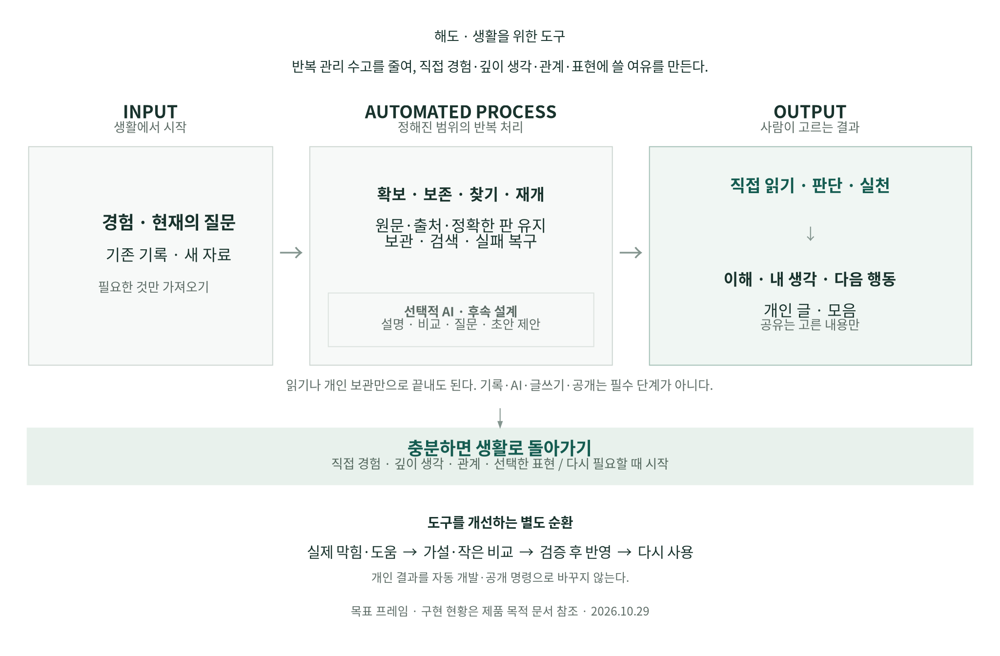

# 해도의 목적과 전체 작업 흐름

2026-10-29 KST. 초기 구상·현재 사용자 요청·배포 기능을 대조한 **제품 설계 기준**이다. 아래의 목적 문장은 근거를 종합한 표현이며 사용자 발언의 축어 인용이 아니다. 구체적 후속 기능의 구현 완료나 개인 자료의 분석·공개를 뜻하지 않는다.

## 1. 왜 만드는가

**흩어진 기록과 반복 관리의 부담을 줄여, 직접 경험하고 깊이 생각하며 원하는 실천·관계·표현에 쓸 시간과 주의력을 남긴다.**

해도에서 더 오래 머무는 것보다 필요한 맥락을 되찾고 자기 판단을 한 뒤 생활로 돌아갈 수 있는 것이 중요하다. 일상 관리 자체도 유용해야 하며, 모든 경험을 기록하거나 글로 만들거나 공개할 의무는 없다. 이미 남긴 기록을 다시 입력하지 않고, 새로 달라진 생각·상태·선택을 적은 수고로 남기는 방향이다.

목적·수단·화면을 다음처럼 구분한다.

| 층위 | 기준 | 설계에 미치는 영향 |
| --- | --- | --- |
| **목적** | 경험의 여유, 깊은 이해·판단, 실천, 선택적 관계·자기표현 | 실제 생활에 도움이 되는지 판단한다. 기록·발행·클릭 개수를 대체 목표로 두지 않는다. |
| **수단** | 기존 기록 재사용, 근거 있는 발견·비교, 계획·수행 확인, 중단 후 재개 | 반복 입력·재선택·맥락 재설명을 줄인다. AI와 공개는 필요한 경우 선택한다. |
| **현재 화면** | 홈·뉴스·자료실·계획·설정 | 블로그 중심의 간결한 진입을 유지한다. 기능별 목적지는 하나로 정하고 관련 자료에서 바로 이어갈 수 있게 한다. |
| **신뢰 기반** | 계정 격리·정확한 원문/판·동기화·속도·복구 | 잘못된 판, 유실, 기기별 단절 때문에 목적이 무너지지 않게 한다. 기반 완성을 생활 효과 입증으로 표시하지 않는다. |

블로그를 전면에 둔 최신 결정은 유지한다. 홈은 내 글을 읽고 쓰는 명확한 입구이고, 그 뒤의 자료·발견·계획은 개인적으로도 완결되는 도구다. ‘한 페이지’의 핵심은 모든 기능을 한 화면에 펼치는 것이 아니라 대상·질문·읽던 위치를 잃지 않고 오가는 연속성이다.

## 2. 무엇을 근거로 복원했는가

이번에는 저장소 요약만 반복하지 않고, 사용자가 제공했던 `life_haedo_final_backup.zip`에서 관련 사용자 메시지와 후기 수정 기록을 선택 대조했다. 공개 저장소에는 개인 대화·그림·ZIP을 복제하지 않고 기존 공개 기획 수준의 목적·판단 변화만 남긴다. 자세한 범위와 한계는 [맥락 재검토](context-review.md#2026-10-29-목적-복원과-선택-원문-대조)를 따른다.

| 근거 | 확인한 뜻 | 현재 적용 |
| --- | --- | --- |
| 백업 사용자 003·005 | 직접 경험과 체화, 사회적 소통, 시간을 확보하는 자동화, 자연스러운 선택 표현 | 경험·관계·표현이 목적이고 자동화는 환경을 준비하는 수단이다. 네 항목을 강제 단계나 새 메뉴 네 개로 만들지 않는다. |
| 사용자 018·020·042·044 | 깊은 대화, 뒤에서 작동하는 자동화, 생활 관리 자체의 유용성, 준비된 도구에서 적은 입력 | 범용 채팅이나 자료 등록을 모든 작업의 필수 입구로 두지 않는다. 질문과 현재 상태를 반복 설명하지 않게 한다. |
| 사용자 024·030·046·048 | 다른 사람/분야로의 재사용 가능성, 나눌 소재, 나의 서재를 만나는 표현 | 개인의 구체적 유용성부터 확인한다. 관계 보조·방문형 표현의 구체적 구현은 후속 후보로 둔다. |
| 사용자 064와 후기 보충 기록의 수정 | 플랫폼 선행 구상 이후 개인 생활의 필요와 가까운 확장 우선으로 수정 | 플랫폼·운영센터·전 분야 완성을 선행 조건으로 삼지 않는다. |
| [기존 자료 중심 설계](README.md), [라이프스타일 블로그](lifestyle-blog.md) | 기존 메모·글·경험을 출처와 함께 재사용하고 선택한 내용으로 자신을 표현 | 원래 기록 앱을 바꾸거나 모든 내용을 다시 쓰게 하지 않는다. |
| [10월17일 블로그 방향](blog-platform-direction.md), [현재 제품 기준](../../PRODUCT.md) | 첫 화면에서 무엇을 하는지 알 수 있는 글쓰기·읽기 중심 | 목적 복원을 이유로 현재 홈·다섯 메뉴를 다시 뒤집지 않는다. |
| [두 순환의 기존 설계](../diagrams/life_two_cycles_20261013.mmd), [Cloud 인계](two-cycles-cloud-handoff.md) | 개인의 인풋·아웃풋 순환과 시스템 개선 순환을 구분 | 개인의 생각/회고가 자동 개발·자동 공개 명령이 되지 않는다. |

백업은 공식 계정 내보내기나 완전한 대화 전사가 아니다. manifest 15개 파일의 해시 일치는 무결성 확인이며 발언의 완전성·진위 증명이 아니다. 사용자 요청과 어시스턴트의 구체적 모듈·대화 기법 제안은 같은 강도의 요구가 아니다. 과거 서비스 설명은 최신 기술 사실로 재사용하지 않는다.

## 3. 전체 workflow: 생활에서 시작해 생활로 돌아오기

[Mermaid](../diagrams/purpose-workflow-20261029.mmd) · [SVG](../diagrams/rendered/purpose-workflow-20261029.svg) · [PDF](../diagrams/rendered/purpose-workflow-20261029.pdf). 목표 흐름이며 아래 현재 구현표가 출시 여부의 기준이다. 화살표는 가능한 연결이고 필수 순서가 아니다.

1. **생활과 현재 필요에서 시작한다.** 궁금한 질문, 읽던 책, 할 일, 이미 다른 곳에 남긴 글·사진, 쓰고 싶은 생각 중 하나로 들어온다. 바로 글을 쓰거나 계획을 체크할 수도 있다.
2. **필요한 맥락만 준비한다.** 기존 원문·출처·과거 생각·현재 선택을 찾는다. 새 자료가 필요하면 지원 출처의 후보를 더한다. 확보하지 않은 본문·첨부·실적은 모름으로 둔다.
3. **사용자가 읽고 판단하고 경험한다.** 원문을 읽고 다른 설명을 비교하거나, 계획을 실행하거나, 자기 생각을 쓴다. AI가 필요하면 선택한 범위의 설명·질문·다른 해석을 요청한다.
4. **필요한 결과만 남긴다.** 한 가지 이해, 다시 볼 구절, 바뀐 생각, 다음 행동, 개인 글, 나눌 소재 또는 선택 공개로 끝낸다. 아무것도 저장하지 않고 끝내는 경우도 허용한다.
5. **생활로 돌아가고 필요할 때 이어간다.** 실제 경험과 반응에서 생긴 변화만 다음 맥락에 반영한다. 사용자가 기록하지 않은 이해·성장·만족을 시스템이 추정해 채우지 않는다.

### Input : Automated process : Output

| Input | Automated process — 일반 처리와 선택적 보조 | 사용자 직접 선택·활동 | Output |
| --- | --- | --- | --- |
| 기존 메모·문서·사진·링크 | 형식/확보 범위 확인, 원문·출처·판 보존, 검색·필요 원본 수신·계정 보관 | 가져올 범위, 연결 이유, 읽을 대상 선택 | 다시 찾고 재사용할 맥락 |
| 현재 질문·관심·읽을 언어 | 기존 자료 탐색, 지원 공급 수집·중복/언어 필터, 관련 근거 제시 | 실제 읽기·비교·도움 판단 | 이해·다음 질문·읽을 후보 |
| 선택 구절·내 반응·새 생각 | 정확 인용과 시점 보존, 저장·재개, 선택한 설명/반례 후보 | 내 주장·인용·생각 변화 구분 | 메모·글·관점 또는 저장 없이 종료 |
| 월 방향·실행 의도 | 선택 관계 보존, 확인 가능한 수행 대조, 변경·실패 복구 | 목표/습관 연결, 실제 수행, 회고 | 다음 행동·수정한 계획 |
| 보여주고 싶은 글·모음 | 선택한 판·포함 범위의 미리보기, 승인한 사본의 게시·갱신·철회 | 내용·대상·공개 여부 선택 | 개인 결과물 또는 선택한 표현 |
| 알려진 관심과 함께 나눌 소재 | 허용 자료에서 연결 이유·인용·말 걸기 후보 준비 | 누구에게 무엇을 건넬지 판단하고 직접 교류 | 대화 소재·새 경험·새 질문 |

질문 중심 AI 탐구, 계획의 실행 연결, 친구별 소재 보조는 **후속 설계**다. 이 표가 모든 처리의 구현·자동화 완료를 뜻하지 않는다. 시스템은 사람의 읽기·감상·판단·실천을 대신 완료 처리하지 않는다.

## 4. 내부 구조: 화면을 넘어 맥락과 책임을 연결하기

### 사용자 맥락

공통으로 보존할 것은 **현재 계정·자료공간, 정확 대상과 판, 지금 선택한 질문/의도, 진행 상태, 원래 화면으로 돌아갈 위치**다. 모든 값이 항상 필요한 것은 아니다. 기존 `returnContext`, 원문 참조, 작성 준비, 저장 영수증을 먼저 재사용한다. 이 개념 설명을 새 범용 데이터 객체·단일 테이블·새 채팅 화면의 도입 지시로 해석하지 않는다.

원문·타인의 주장, 내 생각, AI의 제안, 계획, 실제 수행을 구분한다. 읽기 위치를 이해도로, 월 구간 시작일을 마감일로, 현재 목표 진행률을 과거 실적으로 바꾸지 않는다. 연결은 같은 원문을 복사·병합하는 명령이 아니며 해제해도 원본을 지우지 않는다.

### 세 가지 책임

| 주체 | 맡을 일 | 넘겨받지 않을 판단 |
| --- | --- | --- |
| 일반 코드·서비스 | 보존·검색·권한·중복 방지·동기화·원자 저장·검증·복구 | 취향·현재 신념·이해·실행 완료의 임의 확정 |
| 선택적 AI | 선택 자료의 설명·비교·질문·다른 해석·초안 후보 | 사용자 대신 원문 변경·공개·타인 전송·사실 또는 경험 생성 |
| 사용자 | 직접 읽고 경험하기, 판단·채택·실천, 보관·공유 선택 | 반복된 파일 관리·같은 맥락의 재입력·실패 상태 추적 부담 |

기본 읽기·쓰기·계획·저장·복구는 AI 가용성이나 비용과 독립적으로 작동해야 한다. 의미 판단이 필요하지 않은 일을 매번 모델에 보내지 않는다. AI 없이도 목적 여정을 끝낼 수 있어야 하며, AI가 확신 없는 해석을 반환하면 근거·불확실성을 표시하고 적용을 선택하게 한다.

### 화면과 보관

홈은 내 글, 뉴스는 새 정보, 자료실은 원문 활용, 계획은 생활·실천, 설정은 계정·보관·복구를 담당한다. 현재 자료에서 다음 행동을 바로 시작하고 같은 맥락으로 돌아오게 한다. 상시 보조 패널과 새 총괄 대시보드로 기능을 다시 나열하지 않는다.

확정 자료·사용자 설정의 계정 연속성을 높이되 원문·큰 파일·글·뉴스·계획의 저장 계약은 유지한다. 상태 표시는 각 영역의 실제 서버 반영 근거를 읽는다. 브라우저 캐시는 빠른 표시·오프라인·전송 대기·복구를 담당하고, 공개 사본은 비공개 계정 자료와 따로 검토한다. 작성 중 초안의 전송 정책은 조용히 바꾸지 않는다.

## 5. 현재 구현은 목적에 어디까지 닿아 있는가

상태 기준: 배포 main `ab6aef5`·[PR139](https://github.com/wonchance-art/life-haedo/pull/139), 실행 인계 [PR140](https://github.com/wonchance-art/life-haedo/pull/140), 사진 복구 후속 실행 [PR141](https://github.com/wonchance-art/life-haedo/pull/141). 2026-10-29 조회한 PR141 `8abb956`은 미병합 Draft이며 CI가 진행 중이었다. [실행 세션의 고정 검수 기록](https://github.com/wonchance-art/life-haedo/blob/8abb956a7bfac7def0496932627cc352dfd6bb5f/docs/design-review/naver-media-continuity.md)은 A/B 8개 여정 등 로컬 검증 결과를 보고한다. 이 세션에서 그 검사를 재실행한 것은 아니다. PR140의 당시 실패는 인계 이력으로 보존하며 후속 PR의 현재 실패로 표시하지 않는다. 원격 상태가 바뀌면 기능·검수·배포 근거부터 대조한다.

| 목적을 돕는 현재 기반 | 이미 가능한 일 | 남은 단절·효과 확인 |
| --- | --- | --- |
| 재입력과 관리 부담 줄이기 | 가져오기, 폴더/검색, 정확 원문, 자료·원본 첨부의 계정 보관, 첫 표시 개선 | 뉴스 상태·연간 계획은 로컬. 네이버 정확 사진 복구는 PR141에서 후속 검증 중이며 조회 시 CI·출시 미완료 |
| 내 판단과 근거를 다시 보기 | 발췌·관련 기록·회고/글쓰기, 정확 판 복귀, 선택 근거 파일 | 일반 계정 글 재개와 구조화 근거의 이동 범위가 다름. 명시 작성 준비 이어쓰기는 기존 근거 이동 경로로 재사용 가능 |
| 실제 생활을 계획하고 조정하기 | 연간 계획, 목표, 습관, 연표 | 도구 사이 이동은 있으나 계획→실적→기간 회고의 내용 관계는 후속 |
| 자신을 표현하기 | 내 글·사진·선택 페이지/모음·공개 표지·파일 출력 | 실제 표현 만족과 반복 사용의 부담은 사용자 경험으로 확인할 부분 |
| 관심과 이해 넓히기 | 관심·복수 언어·번역·좋아요/담기, 규칙 추천·읽기 비교 | 수집 정의는 ko/en 중심. 질문 중심 탐구·언어별 충분한 공급·실독 후 도움 개선은 확인 필요 |
| 사람과 나눌 소재 만들기 | 선택 공개와 파일 출력 | 친구/모임별 관심 연결·전달은 구현 완료가 아닌 후속 후보 |

기능 보존과 배포의 검증을 실제 생활 효과로 확대하지 않는다. 초기 연표의 자기 기록 방식도 서비스 전체의 성격·성장 점수로 확대하지 않는다.

## 6. 대표 여정으로 구현을 이끈다

### 여정 A — 관심 있는 글 하나를 내 판단과 다음 선택으로

**질문/관심 → 기존 자료 또는 새 후보 → 원문 읽기 → 다른 설명/내 생각 비교 → 한 줄 판단 또는 작은 행동 → 다른 기기에서 이어가기 → 필요하면 정확 근거 재열기.**

외국어 학습·독서·집중력 같은 현재 관심에서 시작한다. 읽기·판단·글쓰기 기반을 재사용하고, 사진/근거·뉴스 설정의 기기 간 단절을 PR140 인계·PR141 사진 복구 실행과 연결한다. 새 AI 탐구 모델을 이 여정의 선행 조건으로 두지 않는다. 확인할 것은 무엇을 다시 선택·입력했는지, 근거를 찾는 데 막혔는지, 실제 읽은 뒤 도움이 있었는지다.

### 여정 B — 이미 남긴 경험을 다시 읽고 선택적으로 표현하기

**다른 앱의 메모·사진·글 → 필요한 것만 보관 → 정확 원문을 유지한 연결 → 개인적으로 다시 읽기/내 글/나눌 소재 중 선택 → 저장·재열기 → 생활 복귀.**

현재 가져오기·자료 선택·사진 글·모음·선택 공개를 활용한다. 새 콘텐츠 생산을 위해 경험을 더 기록하게 하지 않는다. 친구별 소재 추천은 이후 실제 필요가 확인될 때 검토하고, 자동 메시지 전송을 추가하지 않는다.

### 여정 C — 월 방향을 실천하고 다음 계획 조정하기

**월 계획 → 기존 목표/습관에 선택 연결 → 실제 수행 → 기간별 계획/확인 가능한 수행/내 판단 대조 → 다음 계획 조정.**

연간 계획의 계정 연속성이 먼저다. 월 방향·마감일·수행일을 구분하고 기존 목표의 현재 진행률에서 과거 실적을 만들어내지 않는다. 관련 실행 명세는 [PR140의 계획 인계](https://github.com/wonchance-art/life-haedo/blob/dc1bef8f65b995fe72d472f0cccbaa83938287d3/docs/handoff/planning-execution.md)를 따른다.

## 7. 별도의 시스템 개선 순환

**실제 사용 → 막힌 지점/도움의 근거 → 가까운 개선 가설 → 작은 비교·선택 → 구현·보존 검수 → 다시 사용**을 유지한다. 사용자의 개인 회고·AI 제안·새 자료 도착은 자동 개발·분석·공개를 연쇄 실행하는 신호가 아니다. 현재 문제에서 한 가지를 바꾸면 다른 분야에도 도움이 되는지 살피되, 가능한 확장을 모두 먼저 만들지 않는다.

| 판단 | 남길 근거 | 그 근거만으로 주장하지 않을 것 |
| --- | --- | --- |
| 기능이 보존되는가 | 정확 원문/사진/파일, 계정 격리, 실패·충돌·복구 검사 | 실제 생활이 편해졌음 |
| 작업이 이어지는가 | 같은 대표 작업의 재입력·재선택·중단 후 재개·근거 복귀 관찰 | 모든 사용자·기기에서 같음 |
| 시간과 주의력을 아끼는가 | 같은 조건의 찾기/재개 부담 비교와 사용자의 판단 | 체류 감소만으로 삶의 질 개선 |
| 이해·표현·실천에 도움되는가 | 읽은 범위와 도움 판단, 원하는 결과를 얻었는지, 확인 가능한 수행 | 클릭=읽음, 저장=호감, 진행률=과거 실적 |
| 확장할 가치가 있는가 | 구체적 필요, 기존 기능 재사용, 추가 부담, 단순한 대안 | 범용 플랫폼·관계 기능·유료 서비스의 자동 채택 |

측정은 선택한 대표 여정의 최소 관찰로 시작한다. 아직 확인하지 않은 효과의 수치를 만들거나 이를 위해 상시 추적·새 개인정보 수집을 기본 도입하지 않는다. 기본 자동 검사·사용성 관찰·실제 기기 체험·사용자의 도움 평가는 서로 다른 근거다.

## 8. 현재 실행과 다음 설계의 연결

1. **실행 세션 — PR140의 계정 연속성 묶음 유지.** PR141의 사진 복구 CI·출시 근거를 먼저 확인하고, 일반 글의 정확 근거와 뉴스·연간 계획의 계정 상태를 인계 계약에 따라 각각 완주한다. 이유는 기술 통합 자체가 아니라 같은 맥락을 다시 설명하고 찾는 부담 감소다. 기존 인계를 중복 구현하거나 진행 중인 브랜치를 이 설계 브랜치로 교체하지 않는다.
2. **설계 세션 — 대표 여정 A를 화면·상태·데이터 계약으로 구체화.** 현재 질문, 정확 원문, 내 판단, 다음 행동, 출발 위치 중 무엇을 기존 구조가 이미 보존하는지 조사한다. 선행은 이 목적 기준과 현재 구현 지도다. 완료 기준은 정상·중단·오류·기기 이동·아무 결과도 저장하지 않는 종료까지 실행 가능한 설계와 확인 항목을 갖추는 것이다.
3. **후속 설계 — 여정 C와 질문 중심 탐구의 가치 검증.** 계획의 사실/날짜와 읽기 도움을 먼저 확인한 뒤 필요한 연결·AI 보조만 좁혀 비교한다. 계정 연속성과 선택된 대표 장면이 선행이다. 완료 기준은 실제 도움·추가 부담·단순한 대안을 대조해 채택/보류를 결정하는 것이며 기능 수를 늘리는 것이 아니다.

이 문서의 목적 기준을 이후 기능 명세의 맨 위에 연결한다. 각 변경은 **어떤 사용자 일을 끝내는가 → 어떤 반복 부담을 줄이는가 → 어떤 판단은 사람에게 남기는가 → 무엇을 보존하는가 → 어떤 근거로 완료를 판단하는가**를 답해야 한다.
