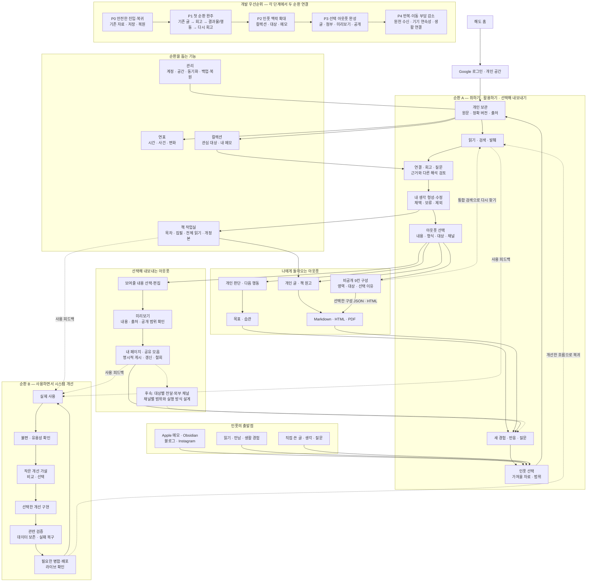
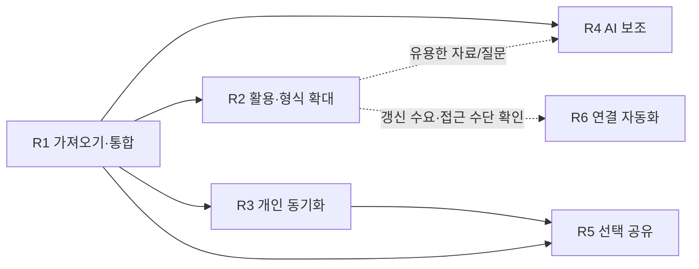

# 구현 로드맵과 에이전트 작업 배치

## 이번 실행 묶음 — 2026-10-14 KST

**목표:** 보관한 결과물을 다시 찾아 실제 활용하는 순환을 완결한다. 원문·저장한 글·컬렉션에 더해 **저장한 9칸 구성 → 정확한 영역·항목 미리보기 → 검색 결과 복귀**를 연결한다. 자유롭게 이름 붙인 영역마다 최대 9개를 담는 현재 구조를 유지한다. 고정 만다라·새 제공자·자동 수집·AI는 이 묶음의 범위가 아니다.

| 순서 | 할 일 | 완료 기준·현재 상태 |
| --- | --- | --- |
| 1 | 선행 PR #88의 CI 실패 정리 | 재시작 직후 원문 인증 준비와 구성 재전송의 순서를 구분했다. 수정 HEAD `4672bd6`에서 동일 전송 ID·중복 서버 버전 방지를 포함한 구성 이어쓰기 9/9를 통과했다. 실제 GitHub 전체 CI는 진행 중이다. |
| 2 | 9칸 구성의 통합 검색·왕복 | 제목·소개·영역 설명·항목·선택 이유·출처를 저장본에서 찾는다. [정확 목적지·변경 결과·부분 실패·두 탭·계정/공간 경계](../design-review/nine-board-search.md) 7/7, 기존 통합 검색 9/9·파일 복구 6/6·핵심 경험 5/5·PWA 9/9·Node 470/470 통과. 운영 적용은 별도다. |
| 3 | 선행 변경 일괄 통합과 실기 확인 | Local 담당. 최종 통합 HEAD의 CI·Mac/iPad/iPhone에서 입력 보호·파일 복구·검색 왕복을 확인한 뒤 기존 절차로 적용한다. Cloud 검사를 운영 배포로 표시하지 않는다. |
| 4 | 실제 사용의 다음 공백 선택 | 찾기·읽기·구성 활용 중 실제로 막힌 장면을 기준으로 고른다. 9칸 이미지 내보내기·고정 만다라는 사용 근거를 얻은 뒤 비교할 후보로 남긴다. |

**현재 구현 상태:** 작품 메타데이터 검색은 #82에서 연결했고 `api.artic.edu`·`www.artic.edu`의 공식 API·출처 접근을 확인했다. #86은 페이지 초안 충돌 복구, #87은 비공개 9칸 구성·선택 이유·JSON/HTML, #88은 현재 구성/전체 백업 구분·파일 선택 복구다. 구현·브라우저 검수·각 PR의 실제 CI·Local 통합·운영 배포는 각각 별도 상태다. 새 SQL 설치가 필요한 변경은 없다. 아래 서두의 작업 목록과 PR 표는 이전 단계의 의존성 이력이다.

[초안 충돌 → 새 사본](../design-review/page-draft-conflict.md)은 #84 수정 HEAD 위에서 현재 입력/최신 초안 비교·모든 변경 보관·활성 커서 복귀·실패 파일 대안을 연결했다. #84 CI의 늦은 읽기 위치 복원과 저장 완료 대기도 따로 보완했다. 선행 통합/실기 확인은 Local 담당이며 새 제공자 연결과 구분한다.

[초안 선택 복구 묶음](../design-review/page-draft-recovery.md)은 #83 위에서 초안 구분·파일 내용/중복 검토·원자적 선택 복원·다른 공간의 파일 재사용을 연결했다. 기존 형식·원문·글·비공개 기본을 보존하고 실패/두 탭/늦은 응답을 검수했다. 다음 적용은 Local의 선행 통합·실기 확인이며 인물/영화 제공자·자동 수집을 새로 연결한 것은 아니다.

[첨부 편집·입력 보호 후속](../design-review/attachment-edit-preservation.md)은 작품 검색을 연결한 #82 위에서 삭제/재첨부 없이 대상 정보를 고치고 미반영 입력·저장 실패·두 탭 충돌을 보호했다. 선행 CI의 안내 문구·초안 닫기 대기 검사도 #82에 별도 보완했다. 확인한 편집 공백을 먼저 완결한 품질 후속이며 인물/영화 실연결·운영 배포를 뜻하지 않는다.

[작품 링크 검토 후속](../design-review/artwork-reference.md)은 #79 위에서 잘못된 기본 유형과 조회 안내를 고치고 원출처 확인·수동 첨부·보관을 검증했다. 당시 미확인했던 자동 작품 검색은 #82의 공식 API/약관 검증과 메타데이터 연결로 이어졌다. 수동 흐름과 제공자 연결 완료를 구분한다.

[책 검색·한국어판 후속](../design-review/book-search-navigation.md)은 #78 위에서 검색 다음 결과·한국어판 대표 후보·실패 복구를 연결했다. 실제 공개 검색의 한글/원어 차이를 기록했으며 당시 차단됐던 작품 API/약관은 #82에서 접근·검증했다. 새 SQL은 없고 병합·배포는 Local 담당이다.

[판본 선택 → 컬렉션 보관](../design-review/edition-collection.md)을 #77 후속으로 연결했다. 다음은 실제 책 검색 품질 → 예술 작품 제공자 검증 → 인물/영화 제공자 검토 순이다. [제공자 비교](../design-review/taste-provider-expansion.md)의 확인/미확인 경계를 따른다.

[취향 찾기·작성 후속](../design-review/taste-writing.md)은 이름 검색 → 후보 검토 → 글 첨부 → 소개/미리보기까지 연결했다. 원문·컬렉션 개인 메모·공개 계약은 보존하며, 실제 취향 자료의 검색 품질 확인 → 명시적 컬렉션 보관 역방향 → 영화/작품/인물 제공자 검토 순으로 이어간다. #76 이후 후속이며 운영 배포와 구분한다.

## 현재 실행 기준 — 두 순환 · 2026-10-14 KST

사용자 요청: 초기 설계의 **인풋·아웃풋 순환**과 **시스템 개선 순환**을 로드맵의 중심으로 복원한다. 개발 순서는 기능 수나 PR 수보다 사용자가 한 순환을 끝까지 돌릴 수 있는지를 기준으로 정한다. 이 절은 최신 실행 계획이며, 아래의 이전 실행 계획과 R1~R6 설명은 당시 설계·구현 이력으로 보존한다.

**Cloud 통합 후속:** P0~P3의 선행 구현을 `codex/two-cycle-integration`에서 한 사용 흐름으로 검증했다. 회고 → 내 페이지의 수동 복사 공백을 비공개 초안 연결로 메웠다. [직접 체험·검증·Local 실행 순서](../design-review/two-cycle-integration.md)를 따른다. 아래 PR별 표는 병합 전 의존성 이력이다. 통합 PR에 포함된 선행 PR을 다시 순차 병합할 필요는 없으며, 운영 완료로 해석하지 않는다. P4 자동 입력·AI·외부 배포 채널은 이번 통합에 포함하지 않았다.

**다음 입구 연결:** `codex/unified-private-search`에서 원문·저장한 페이지 글·컬렉션의 통합 검색과 정확 항목 왕복을 구현했다. [검증·제약·Local 순서](../design-review/unified-search.md). #74 → 검색 후속 PR 순서로 적용하며 새 SQL은 없다. 다음 우선순위는 Local 일괄 적용/실기 확인 → 실제 찾기·읽기에서 막힌 지점 개선 → 출력 선택의 발견성이다. P4와 책 확장은 자동으로 착수하지 않는다.

**입력·활용 품질 후속:** #75 위에서 활용 경로·실패 파일 재선택·검색 성능·공통 시각 검수·체험 양식을 묶었다. [완료 범위와 검증](../design-review/input-output-quality.md). Local은 #74 → #75 → 해당 후속 PR 순서로 적용한다. 다음 구현의 근거는 실제 사용의 막힌 지점이며 자동 수집/AI/책 확장과 구분한다.

### 순환 A — 내가 취하고, 활용하고, 선택해 내보내기

**외부 자료·생활 경험 → 인풋 선택 → 개인 보관 → 읽기·연결·질문·해석 → 아웃풋 선택 → 개인 활용/결과물/선택 배포 → 새 경험·반응·질문 → 다음 인풋**.

- **인풋 선택:** Apple 메모·Obsidian·블로그·Instagram과 직접 쓴 글에서 필요한 자료와 범위를 고른다. 원문·정확 버전·출처·포함 범위를 보존하며, URL만 받은 자료는 본문 미확보로 남긴다.
- **개인적 소화:** 검색·발췌·컬렉션·회고로 자료를 연결하고 근거와 다른 해석을 검토한다. 내가 받아들인 생각, 보류한 질문, 제외한 자료를 구분한다. AI는 선택 보조이며 필수 입구가 아니다.
- **아웃풋 선택:** 다음 행동에 적용할 내용, 개인 글·책·파일로 정리할 내용, 외부에 전달할 내용을 각각 고른다. 내용·형식·대상·채널·공개 범위를 구분하며 개인 자료 전체를 배포 대상으로 삼지 않는다.
- **다시 인풋:** 실제 경험과 내가 확인한 반응·새 질문을 다음 읽기·회고에 연결한다. 모든 경험의 기록이나 모든 기록의 공개를 요구하지 않는다. 읽고 보관하거나 개인적으로 활용한 뒤 종료해도 된다.

연표는 시간과 변화를, 컬렉션은 관심 대상과 메모를, 회고는 생각과 근거를, 책은 긴 결과물을, 내 페이지는 선택한 표현을 담당한다. 각각 독립해서 쓸 수 있으면서 필요한 자료·질문·결과 사이를 왕복할 수 있어야 한다.

### 순환 B — 실제 사용으로 시스템 개선하기

**실제 사용 → 불편·유용성 피드백 → 가까운 개선 가설 → 작은 비교·선택 → 구현 → 관련 검증·필요한 배포 → 다시 사용**.

- 기능마다 시작 조건·입력·얻을 결과를 정하고, 막힌 위치와 실패 후 복구를 남긴다. 사용자 체험과 에이전트의 익명 브라우저 검사는 구분한다.
- 같은 장면에서 현행 방식과 작은 대안을 비교한다. 채택/기각 이유, 미검증 부분, 선택을 바꿀 조건을 기록한다. 새 근거 없는 반복 리뷰나 플랫폼 확대를 선행 조건으로 두지 않는다.
- 구현 후 관련 데이터 보존·저장·복원·출력 회귀를 확인한다. 공개 변경은 통합 커밋의 필요한 CI와 라이브 확인까지 마친다. 문서 변경은 링크·경로·diff 확인으로 끝낼 수 있다.
- 결과를 실제 사용에 돌려주고 다음 개선을 고른다. 순환 A의 회고·추천·보고서가 생겼다는 이유만으로 개발이나 외부 공개를 자동 실행하지 않는다.

### 종합 맵 — 두 순환과 기능·우선순위

[편집 가능한 Mermaid 원본](../diagrams/life_two_cycles_20261013.mmd). 실선은 자료·사용 흐름, 점선은 피드백 또는 명시한 후속 경로다. P0~P4의 화살표는 개발 우선순위이며 PR 의존성은 아래 표와 통합 상태를 따른다. 이 맵은 구조·계획이고 기능별 구현·배포 완료의 증거가 아니다.

### 실행 순서 — 순환 B는 모든 단계에 적용

| 우선순위 | 순환 A에서 완성할 연결 | 관련 작업 | 완료 판단 |
| --- | --- | --- | --- |
| **P0 안전한 진입·복귀** | 기존 자료를 찾고 작업을 이어감 | 연표 복구 #58, 홈 #59 → 하위 화면 #60 → 관리 #61 | 기존 자료·초안 보존, 현재 위치·복귀, 저장 실패 재시도, 백업 범위와 새 사본 복원 확인 |
| **P1 첫 인풋·아웃풋 순환** | 기존 글 → 근거를 읽는 회고 → 내 생각 → 장/글/파일 또는 다음 행동 → 다시 회고 | 기존 가져오기·원문·책 흐름에 #56 회고/목차 왕복과 #64 근거 읽기 통합 | 익명 글 하나의 정확 출처를 유지하며 읽기·수정·저장·재열기·출력/복원까지 확인. 다음 행동·새 질문의 왕복은 체험 결과로 확인하고 단순한 연결부터 설계; 구조화 저장 완료로 추정하지 않음 |
| **P2 인풋의 대상·맥락 확대** | 관심 대상을 보관하고 고른 대상에 내 생각 연결 | #66 보관 → #67 지원 URL 정보 → #68 표지 → #69 대상 선택 | 자료 정보와 내 메모 구분, 출처 재확인, 충돌·계정 분리·전용 백업/복원. 컬렉션은 현재 PR의 브라우저 저장 범위이며 자동 동기화로 표시하지 않음 |
| **P3 선택 아웃풋 완성** | 글·첨부 → 비공개 미리보기 → 범위 검토 → 내 페이지 게시 → 결과 확인 | #71 글 작성·첨부·저장 → #72 피드·미디어 | 원문·초안·개인 메모 보존, 출력 포함 범위·방문자 접근·게시/갱신/철회 확인. 특정인 전달과 외부 채널 자동 배포는 별도 후속 |
| **P4 순환의 마찰 줄이기** | 반복 인풋과 기기 이동 부담 감소, 다음 선택을 돕는 연결 | 필요가 확인된 원천 수신·기기 연속성·목표/습관 연결·발견/분석의 작은 실험 | 실제 막힌 장면의 전후 부담과 복구 비교. 외부 AI·자동 수집·채널 배포는 제공처/접근·전송 범위·비용·중지/결과 대조를 정한 후 별도 구현 |

P1의 첫 체험은 **이미 남긴 글 한 편 선택 → 원문 확인·발췌 → 현재 생각 작성 → 책의 한 장 또는 개인 파일로 정리 → 저장 후 재열기 → 다음 질문/행동을 선택 → 체험 뒤 같은 근거로 돌아오기**다. 배포하지 않는 경로도 먼저 완결한다. P3은 실제 공개 아웃풋을 별도 검증하며, 책·파일 출력과 웹 공개를 같은 성공으로 처리하지 않는다.

### 현재 통합 상태와 운영 전제

2026-10-14 GitHub와 `Life-haedo cloud` 세션 조회 기준 `main`은 `29a325b8e90702eb0f56e64732440cbe2e8c616e`로 유지되며 #73~#77은 열린 초안 PR이다. Cloud는 #74 통합본과 #75~#77 후속 구현을 만들었고, 다음 묶음 요청의 턴은 진행 중이다. 구현·CI와 main 병합·운영 SQL·배포·라이브 확인은 별개다. 아래는 조회 시점의 기록이며 착수/병합 직전에 다시 확인한다.

| PR | 실제 통합 범위 | 조회한 HEAD | 최종 HEAD CI |
| --- | --- | --- | --- |
| [#74](https://github.com/wonchance-art/life-haedo/pull/74) | #56·#58~#61·#64·#66~#69·#71~#73 통합, 회고 → 비공개 페이지 초안 → 저장 → 회고 복귀 | `45cc9c42f50f4277f9fa70e7df2b7cb9ab564614` | [38354880479](https://github.com/wonchance-art/life-haedo/actions/runs/38354880479): check/browser SUCCESS |
| [#75](https://github.com/wonchance-art/life-haedo/pull/75) | 원문·페이지 글·컬렉션의 통합 검색과 정확 항목 왕복 | `a2879bb4e9208eb4b36669f98ed27af377ae73e2` | [38358175335](https://github.com/wonchance-art/life-haedo/actions/runs/38358175335): check/browser SUCCESS |
| [#76](https://github.com/wonchance-art/life-haedo/pull/76) | 실패 파일만 재선택, 회고 활용 진입, 검색 반복 연산 개선 | `f2e52f82e76a4bd4468c2206dce0779377d1a6dd` | [38371761354](https://github.com/wonchance-art/life-haedo/actions/runs/38371761354): check/browser SUCCESS |
| [#77](https://github.com/wonchance-art/life-haedo/pull/77) | 책·공개 GitHub 프로젝트 이름 검색, 컬렉션 주제/메모 재사용, 작성·미리보기 | `7351a9fb7d282a16f2861274df152e6c54f391d0` | [38417925106](https://github.com/wonchance-art/life-haedo/actions/runs/38417925106): check/browser SUCCESS |

4개 CI 모두 GitHub에서 `headSha` 일치와 check/browser 성공을 조회했다. build/deploy는 모두 SKIPPED이며 운영 배포 완료가 아니다. 이 갱신에서 로컬 앱/브라우저·개인 자료·운영 인증·RLS·SQL 설치를 재검증한 것은 아니다.

- **실제 통합 경로는 #74 → #75 → #76 → #77 → 현재 Cloud 후속 작업**이다. #74에 이미 포함된 선행 PR들을 별도로 다시 병합하거나 P0/P1 구현을 처음부터 반복하지 않는다. 현재 main과 최종 통합 HEAD의 실제 차이를 확인하며, 선행 squash 이후에는 base와 잔여 diff를 다시 대조한다.
- 표의 P0~P4는 흐름별 목표다. P0 진입/복귀·P1 회고 활용·P2 컬렉션·P3 작성이 #74에 함께 포함됐으므로 단계를 각각 별도 신규 구현으로 취급하지 않는다. 남은 운영 확인과 실제 불편의 개선을 구분한다. 책 기능 확장은 현재 Cloud 묶음에서 보류하며 기존 저장·읽기·복구·출력 회귀는 보존한다.
- #70은 #71로 대체된 방향이라 제외했다. #63·#65는 시안으로 분리한다. 다른 과거 PR은 자동 정리하지 않는다.
- #71 배포 전 해당 신규 운영 SQL의 설치 여부를 확인하고, 미설치일 때 정확한 마이그레이션을 적용한 뒤 읽기 전용 설치 점검 **8조건**을 확인한다. 기존 설치·SQL·Auth를 중복 변경하지 않는다. #72에는 별도 신규 SQL이 없다.
- **수집, 분석에 사용할 범위, 공개 권한, 화면 배치**는 독립된 설정이다. 수집 허용은 분석/외부 전송/공개 허용이 아니며, 화면에서 숨기는 것은 공개 철회가 아니다. 원문·개인 작업·공유 사본을 분리한다.
- 초기 외부 블로그·SNS·메시지 출력 구상은 보존하되, 이후 확정한 SNS 수신 전용 범위도 유지한다. 이번 업데이트는 외부 SNS 게시·수정·삭제나 메시지 전송의 신규 구현·실행 승인이 아니다. 채널별 출력 확대는 별도 설계·검증 대상으로 둔다.
- 구현·PR 통합·회귀 검증은 Cloud에서 이어간다. 운영 설치·병합·배포·라이브 확인은 기존 승인 범위와 실제 접근 가능한 실행 환경에서 설치·통합 상태를 확인하고 이어간다. 서비스워커 번호는 최종 병합 코드를 기준으로 정한다. 접근 가능한 브라우저의 화면 크기 모사는 Apple 실기 통과로 표시하지 않는다.

초기 의도와 이후 경계의 근거: [구상 대조](context-review.md), [최신 main의 순환 구분](https://github.com/wonchance-art/life-haedo/blob/29a325b8e90702eb0f56e64732440cbe2e8c616e/docs/life-tools-design/context-review.md#2026-10-05-전체-백업-재검토와-v3), [입력·선택 출력·설정 경계](https://github.com/wonchance-art/life-haedo/blob/29a325b8e90702eb0f56e64732440cbe2e8c616e/docs/life-tools-design/lifestyle-blog.md).

현재 후속은 [#78](https://github.com/wonchance-art/life-haedo/pull/78)의 판본 선택·명시적 컬렉션 보관이다. [구현·검증·Local 인계](../design-review/edition-collection.md)에 실제 결과와 제약을 기록했다. Local의 `97a06e5` 문서 갱신을 대조 반영했으며 승인된 Mermaid 종합 맵은 변경하지 않았다. #78의 최종 HEAD CI는 해당 PR에서 확인한다.

### Cloud 실행 인계

[갱신된 Cloud 실행 인계](two-cycles-cloud-handoff.md)를 따른다. 이미 #74에 포함된 P0 기반을 보존하고 #77 이후 진행 중인 묶음을 이어간다. 진행 중인 세션에 갱신 요청을 전달하되 새 세션/동일 구현을 중복 시작하지 않는다. 문서 갱신, 메시지 전달, 실제 코드 실행·CI·운영 적용의 증거는 각각 구분한다.

## 이전 실행 계획·구현 이력

## 현재 우선순위 — 2026-10-09 KST

사용자가 책 관련 작업을 보류하고 **홈·탐색·전체 사용성**을 선택했다. 아래 10월 8일의 책 우선순위와 팀 배치는 이력이며 이번 작업 지시가 아니다. 기존 책·회고·원고 데이터와 동작은 유지하고 확장하지 않는다.

1. **홈에서 실제 작업까지:** 최근 기록을 먼저 보고, 가져오기·글쓰기·연표로 바로 이동한다. 원문에서 홈의 정확한 초점으로 돌아오고 별도 연표 화면 왕복 뒤 저장한 검토/글쓰기 초안을 다시 연다. [이번 구현·검증·Local 인계](../design-review/home-navigation-focus.md).
2. **현재 위치와 작업 복귀 — 구현·로컬 검증:** [하위 탐색 개선](../design-review/subview-navigation.md)에서 실제 작업 이름, 진입 목록 복귀·초점, 선택된 기본 메뉴로 목록 이동을 연결했다. 가져오기/페이지 저장 실패 보호와 글쓰기 중복 복귀 제거를 검증했다. #59 이후 Local 적용 대상이며 실제 배포와 구분한다.
3. **관리의 명료성 — 구현·로컬 검증:** [보관 위치와 백업 범위](../design-review/management-clarity.md)에서 현재 공간·원문/발췌 동기화·구성 포함/자료 전용/연표 백업을 구분했다. 늦은 상태 응답과 복원 실패·복귀를 검증했다. #60 이후 Local 적용 대상이다. Mac·iPad·iPhone에서 실제 파일 보관·재선택과 상태 이해도 확인은 아직 남았다.
4. **수집·검색·정리:** 홈 동선 확인 뒤 기존 네이버·Instagram 가져오기와 많은 기록에서 찾는 부담을 개선한다. 자동 계정 수집·외부 AI·자동 공개는 별도다.

**별도 미완료:** 채연의 실제 연표 복구. [PR #58](https://github.com/wonchance-art/life-haedo/pull/58)은 복구 진입·재시도 개선이며 개인 자료 복구 완료가 아니다. 원본 기기/브라우저/사이트 또는 Local의 권한 있는 원본 확인이 필요하다. 이번 홈 변경은 #58과 독립적으로 main `d22ed42`에서 시작했다. 병합·배포·운영 SQL은 계속 Local 담당이다.

## 현재 실행 로드맵 — 2026-10-12

최신 사용자 방향은 **내 페이지에서 글을 쓰며 취향을 붙이고, 흩어진 기록을 돌아보며 선택한 모습으로 자신을 표현하는 것**이다. 컬렉션 선등록 → 글 작성 → 별도 페이지 추가를 기본 순서로 강제하지 않는다. 책 관련 확장은 사용자 요청으로 보류하며 기존 구현은 보존한다. 아래 2026-10-08의 책 우선 계획과 과거 에이전트 배치는 이력이다.

### 현재 위치와 남은 연결

- 기존 기반: 선택한 글/파일/링크 가져오기, 정확 원문·발췌, 검색·묶음·연표, 계정별 저장·백업·명시 동기화, 선택 사본 게시/갱신/철회. 기능별 운영 설치 상태와 구현 상태는 구분한다.
- 최근 개발: 컬렉션 분류·보관·선택, 지원 링크 정보 조회, 일부 출처의 선택적 표지 보기. 내 페이지 작성 → 대상 첨부 → 저장 → 같은 피드 흐름은 #71에 구현·로컬 검증했다. #70 텍스트 삽입 방향은 대체됐다. [상세 검증/Local 인계](../design-review/page-composer.md).
- 현재 빈틈: 페이지에 작성한 글은 기존 원문 목록 검색에 자동 포함되지 않는다. 컬렉션은 로컬 전용이며 저장한 페이지 글의 구성 이어쓰기와 범위가 다르다. 후속 브랜치에는 지원 출처의 선택적 책 표지·영상 썸네일과 클릭 재생을 연결했다. 실제 앨범/영화 포스터 이름 검색과 익명 공개 화면의 미디어는 아직 없다. [프로필·피드 검증/Local 인계](../design-review/profile-feed-media.md). 이 차이를 통합 완료로 표현하지 않는다.
- Local 운영 반영은 사용자의 지시에 따라 **다음 병합 시 한 번에** 한다. SQL 설치/읽기 전용 확인 → 선행 PR 검토/병합 → 배포 → 실제 기기 확인 순서다. Cloud 후속 설계·구현과 병렬이며 현재 사용자에게 즉시 실행을 요구하지 않는다.

### 다음 작업 묶음과 완료 기준

| 순서 | 사용자가 얻을 결과 | 핵심 범위와 완료 기준 |
| --- | --- | --- |
| 1 · Cloud 구현·검증, Local 반영 대기 | 내 글과 취향이 자연스럽게 보이는 프로필·피드 | 작성→첨부→피드 왕복을 다듬고 지원 출처의 선택적 표지/미디어를 연결. 음악·책·영화·도구·작품·인물의 형태, 이미지 없음/실패, 긴 한글을 함께 검토. 정보나 이미지를 얻지 못해도 작성·저장이 가능해야 함 |
| 2 | 어디에 썼거나 보관했든 다시 찾을 수 있는 탐색 | 페이지 글·기존 기록·컬렉션을 한 검색 입구에서 찾고 원래 항목을 열기. 저장소를 무조건 합치지 않고 종류·출처·수정/보관 차이를 유지. 제목/본문 검색 범위를 명시하고 사본 중복 표시를 검토 |
| 3 | 내 페이지의 보이는 모습을 간단히 고르기 | 대표 글/모음, 정렬, 목록·격자, 섹션 on/off를 소수의 일관된 선택으로 비교. 모바일에서는 본문 피드를 유지하고 이미지 중심 모음은 촘촘한 격자 후보. 화면 배치 변경이 자동 공개/철회로 이어지지 않음 |
| 4 | 이름을 고르고 정보 입력을 줄이기 | 한국어 음악·책·영화·장소 검색을 제공자별 공식 API·라이선스·요금·오인식 기준으로 비교. 검색→대상 확인→필드 선택 적용. 채널을 아티스트로 단정하거나 조회 실패가 글쓰기를 막지 않음 |
| 5 | 흩어진 활동을 적은 수고로 모으기 | Apple 메모·Obsidian·네이버 블로그·Instagram의 기존 수동 입력을 개선하고, 실제 가능한 원천부터 공식 수신 경로/갱신 확인을 검토. 중복·날짜·출처·미디어 누락을 보존. 원본 SNS 게시/수정/삭제 없음 |
| 6 | 내 관심과 변화, 다음 읽을거리를 이해하기 | 선택 기간/자료로 반복된 관심·변화·교차 주제를 근거와 함께 제시. 예: 오래 남은 취향, 최근 넓어진 관심, 서로 다른 분야의 공통 질문. 기존 자료 재발견부터 평가하고 외부 추천/AI는 별도 전송·비용 계약 뒤에 검토 |
| 보류 | 책·전문 출력 확장 | 기존 원고·개정·복원·PDF 기반 유지. 개인 원고 완주, 고급 조판, 책 기능 추가를 현재 우선순위로 되돌리지 않음 |

1번은 시각적 완성도, 2번은 현재 드러난 탐색 단절을 우선 해결한다. 새로운 외부 제공자를 늘리기 전에 이미 쓴 글을 쉽게 찾는 경험을 완결한다. 순서 3 이후는 방향 제안이며 기능/제공자/일정을 확정한 구현 완료가 아니다. 다음 작업의 실제 범위는 익명 한글 장면의 비교 시안 → 구현 → 기능 보존/시각 검수로 확정한다.

### 제품의 역할

홈은 이어보기·빠른 시작, 기록은 전체 탐색·컬렉션·연표, 내 페이지는 작성과 자기 표현, 도구는 개인 활용·보고서, 관리는 계정·공개 상태·동기화·백업을 맡는다. 내 페이지/컬렉션을 새 최상위 메뉴로 늘릴지는 확정하지 않았으며 기존 홈·기록·도구·관리 탐색을 유지한다.

[현재 제품 흐름 그림](../diagrams/rendered/product-roadmap-20261012.png) · [SVG](../diagrams/rendered/product-roadmap-20261012.svg) · [Mermaid 원본](../diagrams/product-roadmap-20261012.mmd). 전체 자료 통합·공개 경계의 [v8 도식](../diagrams/activity_hub_v8.mmd)도 계속 참고하되 단계 순서는 이 절의 최신 사용자 합의를 따른다.

---

## 현재 실행 로드맵 — 2026-10-08 KST

사용자 요청: **“로드맵 펼치고 넓게 넓게 적극적으로 진행”**. 제품 방향은 `모으기 → 읽고 찾기 → 연결하기 → 자신을 표현하기 → 관심과 변화 이해하기`다. 현재 구현된 영역의 품질 개선과 다음 영역의 비교·설계는 병렬로 진행한다. 전 영역의 구현을 한 PR에 섞거나 운영 전제를 생략하지 않는다. 최신 전체 도식은 [v8 Mermaid](../diagrams/activity_hub_v8.mmd)·[SVG](../diagrams/rendered/activity_hub_v8.svg)다.

### 최신 우선순위: 글을 돌아보고 책으로 엮기

2026-10-08 사용자 요청: 올해 20대의 마지막을 앞두고 **시간순 회고 → 주제별 정리 → 자기 이해 → 책 원고**를 우선한다. 20대는 첫 주제이며 다른 시기·주제로도 확장한다. 검색 고도화·자동 수집·외부 추천은 이 흐름에서 실제 막히는 경우를 제외하고 뒤로 둔다. [전체 설계](reflection-book.md)와 [첫 구현](../design-review/reflection-reading.md)을 따른다.

1. **구현:** 선택 글의 연도별·주제별 읽기와 회고 원고. 이어 [책 프로젝트·장별 원고](../design-review/book-projects.md)의 제목·기간·질문·목차 순서·정확 버전 연결·책별 Markdown과 백업 복원을 구현. 기존 단일 회고는 독립 복사로 보존하며 운영 SQL 확장·병합·배포는 Local 담당.
2. **구현:** [장별 생각과 근거](../design-review/book-insights.md)에 직접 쓴 해석·뒷받침/반례 원문·아직 모르는 점과 제외/복원을 연결. 이는 수동 검토 구조이며 자동 패턴 분석·AI 보고서가 아니다. 다음 자동 분석은 실제 충분한 글과 사례를 바탕으로 제공처·전송범위·비용·동의 계약부터 확정.
3. **구현:** [전체 원고 읽기·편집 복귀](../design-review/book-reading.md). 책 전체의 현재 원고·활성 해석·정확 출처를 읽고 장 편집 후 세션의 읽던 위치로 돌아온다. 공통 출력 모델로 Markdown과 포함 범위를 일치시키며 새 SQL은 없다. **구현:** [개정본·책/장 복구](../design-review/book-recovery-print.md). 최대 10개와 2 MiB 안에서 명시 보관·복원 전 자동 사본을 남기며 보관한 책/장을 복구한다. 신규 validator 운영 적용은 별도다.
4. **구현:** 같은 출력 범위의 한글 A4 인쇄·브라우저 PDF 저장. **다음:** 실제 개인 원고와 Apple 기기의 인쇄/Files 체험에서 문제를 확인한다. 양면 책자·running header·정밀 조판은 필요가 확인되면 확장하며 개인 출력과 공개 공유를 분리한다.

**이번 통합:** [첫 책 작업실](../design-review/book-workshop.md)에서 자료 선택 → 회고/묶음 → 목차 후보 → 장별 집필·개정 → 전체 점검·PDF를 연결한다. 새 저장 구조 없이 기존 기능 사이의 재선택과 혼동을 줄이며, 기능별 완료와 전체 익명 체험 증거를 구분한다. 다음은 실제 개인 원고·Apple 기기로 한 권을 완주해 반복 개정과 출력의 불편을 확인하는 것이다.

Local의 기존 PR 병합·배포·실기 검증은 병행하며, 위 구현이 운영 완료를 대신하지 않는다.

### 구현과 운영 상태

2026-10-07 GitHub 조회에서 PR #30–#34는 병합, #35–#38은 열린 상태다. 병합 여부만으로 라이브 배포·실제 사용 완료를 추정하지 않는다. #35 구성 이어쓰기, #36 선택 초안 이어쓰기, #37 읽기·글쓰기 품질, #38 이 브라우저 이어 읽기는 구현·각 PR CI 검증을 마쳤다. **운영 SQL 설치 확인·병합·배포·라이브 확인은 Local 담당**이며 Cloud가 중복 실행하지 않는다. 후속 PR #39의 제품 흐름 개선도 구현·CI 검증을 마쳤으며 아직 열린 상태다. 현재 검색 품질 작업은 #39 위에서 진행한다. 실제 기기 확인과 운영 상태는 [인계](continuity-batch-installation.md)로 구분한다.

### 우선순위와 실행 가능한 단위

| 순서·영역 | 얻을 결과 | 이번 실행 / 착수 조건 | 완료 판단 |
| --- | --- | --- | --- |
| **P0 모으기** | 가져온 자료의 저장 결과를 찾고 이어 읽음 | **이번 구현·검증 완료.** 본문·TXT/MD·SNS 링크의 기존 경로에서 재현된 막힘 수정 | 기존 검색 유지, 정확 원문 열기, 실패 후 입력/검토 복구 |
| **P0 표현하기** | 내 페이지 항목을 의도한 순서로 편집하고 미리보기 뒤 계속 작성 | **이번 구현·검증 완료.** 고정/순서·편집 복귀를 실제 UI로 검증 | 보이는 순서와 조작 일치, 편집 맥락 유지, 원문과 공개 사본 보존 |
| **P0 재발견** | 관련 기록을 제시하는 이유가 실제로 유용한지 판단 | **이번 평가·보존 검사 완료.** 상투어 제거는 반대 사례로 기각, 엔진 유지. 현실적 한글 관련/무관/버전/제외 사례 | 근거 문자열의 진실성과 추천 유용성을 따로 평가, 오탐·누락 공개 |
| **P1 많은 자료에서 찾기** | 수백~수천 개 중 기억나는 기록을 빠르게 찾음 | **첫 개선 구현.** 100/1,000개 화면과 10,000개 엔진 측정, 40개씩 더보기와 선택적 한글 공백 검색. [결과·한계](../design-review/search-quality.md). 조사/NFD/다중어·검색 인덱스는 후속 비교 | 동일기기 전후 지연/입력 막힘·오탐/누락 비교, 정확 버전·검색 복귀 유지. 인덱스/라이브러리는 측정 결과로 선택 |
| **P1 표현 페이지 다듬기** | 여러 자료를 한 사람의 활동 흐름으로 읽기 좋은 페이지에 구성 | **B 비공개·공개 UI 적용, Local 배포 대기.** [동일 자료 비교](../design-review/expression-page-comparison.md) 후 [내 페이지·미리보기 통합](../design-review/page-expression-integration.md). [공개 전 검토·방문 화면](../design-review/public-expression.md)까지 접힘·정확 원문 복귀·저장/백업/공개 경계를 검증하고 Local 병합·배포로 인계 | 긴 글·다양한 출처·숨긴 항목의 편집과 방문 화면이 명료함. 공개 전 검토·갱신·철회 유지 |
| **P0 회고·책 원고** | 선택 기간의 관심·질문·변화를 원문 근거와 함께 검토 | [첫 회고 원고](../design-review/reflection-reading.md)의 선택 글 읽기·현재 생각·Markdown을 구현. [책 프로젝트·장별 구성](../design-review/book-projects.md)을 이어 구현했고 [근거·반례에 연결한 수동 해석](../design-review/book-insights.md)을 추가했다. [전체 읽기·개정·PDF](../design-review/book-recovery-print.md)와 [첫 책 통합 흐름](../design-review/book-workshop.md)을 구현. 다음은 실제 한 권의 초고와 Apple 기기 체험. 외부 AI 도입은 제공처·전송범위·비용·동의 설계를 별도로 확정 | 내 글/타인 글/인용 구분, 불충분한 자료 명시, 근거 열기·정정·제외·저장/내보내기. 성격/성장 점수 추정 없음 |
| **P2 기기 연속성** | Mac·iPad·iPhone에서 같은 작업을 이어감 | Local 운영 적용과 실제 기기 체험을 병행. 읽기 위치의 원격 전송은 필요가 확인될 때 별도 명시 연결 설계 | 충돌 양쪽 보존, 오프라인 복귀, 계정 전환, IME/Files 실기 확인. 브라우저 모사와 구분 |
| **P3 원천 연결** | 반복 가져오기를 줄이고 새 글을 검토함 | [네이버·Instagram 공식 경로 비교](source-intake-next.md) 완료. [보관한 네이버 글의 본문 추가·재가져오기](../design-review/source-reimport.md)를 구현·검증하고 Local 인계. 자동 계정 연결은 미구현 | 원문ID·버전·누락·중복·재시도·중지/재개가 설명 가능. SNS 원본 쓰기·자동 공개 없음 |
| **P3 외부 콘텐츠 발견** | 관심을 넓힐 새 자료를 근거와 함께 제안 | 내부 재발견 평가 후 허용 제공처·비용·출처·제외 피드백 계약 비교 | 왜 제시됐는지와 원문 출처 확인, 과도한 반복·관심 고착 평가, 자동 분석/전송 없음 |

P1 표현 시안과 P3 공식 경로 조사는 P0 구현 전체를 기다릴 필요가 없다. 다만 각 실행 단위에 필요한 데이터·검증·운영 전제는 지킨다. 새 SQL/동기화 모델은 로컬 UI 보완과 별도 PR로 다룬다. LPE 병합은 계속 보류한다.

### 이번 병렬 팀과 파일 경계

| 담당 | 모델·effort | 이번 책임·독점 범위 |
| --- | --- | --- |
| root | 현재 모델 | 단일 디자인 책임, 로드맵/v8/통합/PWA/CI/PR |
| 가져오기 | GPT-6.1 Sol · high | `ui.js`, 입력·저장 결과·재열기 |
| 내 페이지 | GPT-6.1 Sol · high | `workbench-ui.js`, 순서와 편집 복귀 |
| 재발견 평가 | GPT-6 Astra · high | `rediscovery.js`, 한글 평가와 근거 계약 |
| 공통 화면 | GPT-6.1 Sol · high | 필요한 `ui.css`/`workbench.css`, 동일 캡처 시각 검토 |
| 독립 QA | GPT-6.1 Sol · high | 실제 가져오기부터 페이지 재열기까지 통합 회귀와 3폭 증거 |
| 보존 리뷰 | GPT-6 Astra · high | 비동기·계정/공간·불변 원문·선택 공개 경계 독립 검토 |

전체를 동시에 착수하되 각 담당은 재현한 문제를 먼저 공유한다. 동일 파일은 한 명만 수정하며, 스타일 수정이 필요 없으면 공통 스타일을 그대로 쓴다. 기능 회귀·시각 품질·관련성 평가·실기·배포는 별도로 보고한다. 자세한 이번 결과는 [제품 흐름 품질](../design-review/product-flow-quality.md)에 남긴다.

## 아래는 단계별 설계·구현 이력

이하의 “현재/다음”은 작성 당시 범위다. 현재 우선순위·운영 담당·구현 여부는 위 표를 우선한다.

2026-10-03 · 설계 v2. 사용자의 후속 요청으로 R1의 첫 로컬 구현을 마쳤다. [구현 기록](r1-implementation.md)에 실제 검증과 남은 범위를, [구현 계약](implementation-contract.md)에 API를 정리했다. 아래 전체 단계나 Apple 실기 검증이 완료됐다는 뜻은 아니다.
사용자가 처음 얻을 결과는 **여러 곳에 이미 남긴 기록을 가져와, 필요한 구절과 출처를 연결하고 다시 찾는 흐름**이다.
원천은 Apple 메모·Obsidian·네이버 블로그·인스타그램, 사용 환경은 Mac·iPad·iPhone이다. iPad Chrome은 기존 확인 환경이며 다른 기기의 브라우저·OS 버전은 실기 검증 때 기록한다.
R1은 직접 기록을 보완 역할로 두고 이전의 오늘/빠른 활동 기록 중심을 대체했다. 이후 직접 글쓰기는 아래 2026-10-05의 새 방향에 따라 주요 기능으로 확장한다.
전체 영역은 [통합 설계](README.md), 검증 ID는 [검증 기준](validation.md)을 따른다.

후속으로 공용 인증·개인 동기화를 [통합 브랜치](../supabase-integration.md)에 연결했고, R2의 [여러 TXT·Markdown 파일 검토](r2-implementation.md)와 [검색에서 일치한 원문 버전·구절을 열고 목록으로 복귀](r2-search.md)를 구현·검증했다. [PR #19](https://github.com/wonchance-art/life-haedo/pull/19)와 공용 인증 PR #17은 병합되었다. Google 제공자·콜백 설정과 Mac 실제 로그인은 인계로 확인했고 사용자가 정상 작동을 확인했다. 주제별 활용·서비스별 adapter 등 R2 전체와 Apple 기기의 자료 입력·선택·Files 검증은 별도 남은 범위다.

## 현재 구현 단위 — 직접 글쓰기

공개 사본(PR #30)과 앱 표면 개선(PR #31) 이후 [직접 글쓰기](../design-review/direct-writing.md)를 연결한다. 제목·본문 입력 → 로컬 초안 재개 → 명시적 저장 → 기록 검색·발췌 → 새 본문 버전으로 수정 → 기존 백업·선택 동기화의 작은 단위다. 저장 전 초안은 이 브라우저 전용이며 TXT로 내보낸다. 저장한 글과 이전 버전·발췌는 기존 자료 백업에 포함된다. 공개·외부 추천·AI·SNS 자동 연결은 글쓰기의 선행 조건이 아니다. 최신 구조는 [v6](../diagrams/activity_hub_v6.mmd), 현재 검증·미검증은 구현 기록을 따른다.

## 이전 구현 단위 — 선택 사본의 공개 페이지

2026-10-05. 개인 홈·통합 기록·묶음·내 페이지 편집/비공개 미리보기에서 **공개할 사본 확인 → 명시적 게시 → 로그인 없는 방문 → 갱신/철회**로 다음 단위를 확장했다. [v5 도식](../diagrams/activity_hub_v5.mmd)과 [공개 경계 설명](../diagrams/README.md), [공식 오픈소스 비교](open-source-review.md#선택한-사본의-공개-게시--기존-supabase와-별도-cms-비교)를 따른다. **구현·로컬 기능 검사, Local 운영 SQL 설치 12조건, Cloud 읽기 전용 운영 HTTP 5조건을 완료했다.** [검증 기록](../design-review/page-publication.md)에 증거와 범위를 구분한다. 실제 계정 게시·갱신·철회와 Apple 실기 체험은 별도이며, 최종 병합·배포 결과는 [PR #30](https://github.com/wonchance-art/life-haedo/pull/30)을 따른다.

- 기존 인증·Supabase SDK를 재사용하고 선택 사본 전용 테이블/RPC를 추가한다. 개인 원문·계정별 동기화 테이블을 익명 공개하지 않는다. 내 페이지에서 표시한 항목 중 실제 공개할 본문 전체/구절을 명시적으로 고르고, 제목·출처·페이지용 코멘트까지 전송 전에 확인한다.
- 로그인 없는 방문 페이지는 공개 식별자로 사본 하나만 읽는다. 특정인 권한·비밀 링크를 보장하지 않는다. `noindex/nofollow`는 검색 노출에 대한 요청이고 권한 제어가 아니다. 공개 데이터는 오프라인 캐시하지 않으며 공개 상태를 주기적으로 다시 확인한다.
- 새 기기나 로컬 구성 삭제 뒤에도 같은 계정의 소유자 전용 공개본 목록에서 철회할 수 있게 한다. 목록은 관리 메타데이터만 반환하며 공개 본문/개인 초안의 기기 간 동기화나 익명 페이지 목록을 제공하지 않는다.
- 공개 중 갱신은 같은 주소를 유지한다. 철회는 서버 snapshot을 비우고 이후 조회를 차단한다. 철회 뒤 재게시는 새 주소를 사용하여 이전 링크를 되살리지 않는다. 이미 외부에 저장된 사본은 회수할 수 없다.
- 완료 조건은 고정 사본/허용 필드 모델 회귀, 소유자·익명 역할과 동시 요청을 실제 SQL 엔진으로 확인, 모의 HTTP 브라우저 흐름, 운영 SQL 설치·실제 HTTP 계정 격리·철회 확인, 배포 후 공개 URL 확인으로 나눈다. 하나의 통과를 다른 단계 완료로 표시하지 않는다. 작업 에이전트 root는 UI·통합·상태 보고, home_surface는 사본/원격 계약, home_navigation은 SQL·권한/동시성, home_checks는 공식 OSS·독립 보안 리뷰·도식을 맡는다.

SNS 원본 쓰기·자동 게시·계정 자동 연결·AI 추천/보고서·직접 글쓰기는 이 단위의 완료 조건에 섞지 않는다. 기존 원문 버전·저장 문장·개인 메모·회고·백업·연표 값은 보존한다.

## 개인 기반을 정리할 때의 방향 — 분산 활동의 중심 페이지

2026-10-05 후속 사용자 승인에 따라 **분산된 자료 가져오기 → 같은 활동의 기록 연결 → 개인 활용 → 선택 편집 → 내 페이지·공유 모음**으로 흐름을 통합한다. 상세 기준은 [라이프스타일 블로그 설계](lifestyle-blog.md), 통합 관계는 [v4 도식](../diagrams/activity_hub_v4.mmd)과 [도식 안내](../diagrams/README.md)를 따른다. [독립 시각자료](../design-review/activity-hub.md) 이후 요청에 따라 영역별 실제 탐색과 로컬 저장을 [최소 동작 화면](working-sections.md)에 연결한다. 자동 계정 연동·공개 게시·AI 분석은 별도다.

| 순서 | 다음 완결 단위 |
| --- | --- |
| 1 | 기존 자료의 해제 가능한 활동 연결·선택 편집·방문자 미리보기·수정·재열기·백업/복원. 실제 공개는 별도 |
| 2 | 선택 사본의 접근 권한·게시·갱신·철회까지 검증한 해도 내 페이지·공유 모음 |
| 3 | 개인용 직접 글쓰기·초안·인용/코멘트 연결·재열기·동기화·백업/복원 |
| 4 | 기존 자료 재발견과 추천 이유·제외, 이후 허용 제공처의 새 콘텐츠 발견 |
| 5 | 기간·자료·근거를 확인하고 해석을 수정하는 비공개 자기 이해 보고서 |
| 6 | 실제 수요가 확인된 원천의 수신 전용 자동 연결·갱신·중단·복구 |

공개 기능 직전의 구현 단위는 **기존 자료의 활동 구성·선택 편집·비공개 미리보기·재열기·사본 복원**이었다. 도구에는 실제 저장 자료의 검색과 선택 자료를 세어 보고 직접 메모하는 회고를 연결한다. 자료 원문 동기화는 유지하며 새 구성은 이 브라우저에 저장하고 자료·구성 백업으로 이동한다. 다음 범위는 사용자가 직접 각 영역을 써보고 조정한다. 불변 원문·발췌 위치와 기존 백업 호환성은 보존하며, 새로운 기반 도입 전에 최신 공식 오픈소스를 비교한다.

SNS 원본의 게시·수정·삭제는 하지 않는다. 해도 공유 사본 편집·게시·갱신·철회와 구분한다. 수집·분석·공개·배치를 각각 다루고, 기본은 비공개 가져오기·선택 공개다. 원천별 기본값 → 모음 → 항목 예외를 제공하되 새 자료나 설정 상속으로 자동 공개하지 않는다. 명시적으로 고른 규칙의 자동 공개는 후속 후보이며 첫 운영 단위에 넣지 않는다.

1번 이후의 순서는 실제 체험에서 조정한다. 직접 글쓰기·추천·보고서와 원천 연결의 작은 비교는 병렬로 준비할 수 있고 공개 게시·모든 분야 도구 완성을 선행 조건으로 만들지 않는다. 개인 보관만으로 사용을 끝낼 수 있다. 실제 Apple 사용 검증, 연표 값·계산 보존, LPE 보류는 유지한다.

기존 R2의 모음·연결과 R5의 선택 표현을 첫 단위에 필요한 범위에서 함께 다룬다. R4는 대화·추출·추천·자기 이해, R5는 해도 내 페이지·공유 모음, R6는 수신 전용 연결을 맡는다. 단계 번호가 고정 착수 순서를 뜻하지 않으며 R4 완료나 R6 자동 연동은 R5의 선행 조건이 아니다. 이 개인 기반 단계에서는 모델·외부 제공처·공개 저장 방식을 확정하지 않았다. 현재 공개 사본 계약은 위의 최신 구현 단위와 v5 도식을 따른다.

## 완료된 기반 — 기록·도구·관리 통합 홈

2026-10-04 후속 요청으로 LPE 연결은 보류하고 해도 자체의 통합 홈을 먼저 구현했다. PR #20·#21·#22·#23은 병합·배포됐으며 아래의 과거 PR 대기 문구는 당시 기록이다. 전체 디자인은 [Life 기준 사이트 재구성](../design-review/life-design-site.md), 이번 관리 하위 흐름은 [보관·복원·동기화 기록](../design-review/life-management.md)을 따른다. 연표 값·계산은 유지한다.

1. **통합 홈:** 로그인 후 기록 피드를 바로 열고 자료·연표를 같은 기록 메뉴에 묶는다. 목표·습관은 도구, 계정·공간·동기화·백업은 관리에서 연다. 기존 인증·저장 계약과 URL은 유지한다. [이번 구현·검증](../design-review/unified-home.md).
2. **보관·복구의 안내 개선:** JSON 미리보기·취소·새 사본·이전 공간 복귀와 상태별 동기화 행동을 구현하고, 설치 후 조회 실패·낡은 충돌 비교·전환 중 초안 보존을 검증한다. [이번 결과](../design-review/life-management.md)에 기능·시각·실기 상태를 구분한다. 저장 스키마·백업 형식은 통합하지 않는다.
3. **Apple 실기:** 공개 화면에서 한글 IME·구절 선택·Files와 앱 전환 복귀를 실제 기기로 확인한다. 브라우저 폭 검사를 실기 통과로 대체하지 않는다.
4. **입력 편의·연결 확대:** 가장 번거로운 원천 하나부터 작은 단위로 진행한다. LPE 자료·코드·외부 DB는 이번 범위에 들이지 않는다.

디자인 책임은 root, 공통 HTML/탐색은 unified_shell, 인증·경계 리뷰는 management_plan, 기능/시각 검증은 sequence_review가 맡았다. 새 라이브러리·마이그레이션은 추가하지 않는다.

## 완료된 입력 개선 — 네이버 블로그·Instagram

2026-10-05 사용자가 다음 원천으로 네이버 블로그·Instagram을 선택했고 PR #24의 병합·공개 적용을 완료했다. [웹 글·출처 가져오기](../design-review/social-import.md)는 링크를 먼저 넣고 명시적으로 원천을 설정한 뒤 복사한 본문·포함 범위를 검토하는 작은 단위다. URL 원형, 본문·발췌 위치, 초안·백업 계약을 유지한다. 사진·영상이나 링크 대상 본문을 자동 수집하지 않는다. [공식 도구·오픈소스 검토](open-source-review.md#네이버-블로그instagram-글과-출처-입력-개선)의 확인 범위와 접근하지 못한 공식 문서를 구분한다.

root가 디자인·UI·통합을 책임지고 source_research는 공식 근거, import_contract는 자료 계약 독립 검토, social_tests는 입력·원문·복원 회귀, social_visual은 세 화면 폭의 시각 검토를 맡는다. 저장 엔진·연표 값·계산·SQL은 변경하지 않는다.

다음 실사용 확인은 iPad/iPhone에서 실제 게시물 한 건의 링크·선택 본문 전달 → 출처 대조 → 발췌 → 백업이다. 텍스트 복사가 막히거나 이미지 글자·원문 전체 가져오기가 필요한 사례를 확인하면 공식 내보내기/API/HTML 입력을 비교한다. 브라우저 폭 검사를 Apple 실기로 보고하지 않으며 실제 사례 없이 스크래퍼나 새 서버를 추가하지 않는다. LPE 연결은 계속 보류한다.

## 이전 우선순위 — 실제 자료 화면 디자인 통합

사용자의 2026-10-04 후속 승인으로 기능 확대에 앞서 아래 순서로 진행한다. 디자인 책임자 root가 한 열 본문·공통 아이콘·활자·간격을 통합하고 여섯 담당이 화면, 컴포넌트, 배포 구성, 기능 회귀, 시각 검토, 문서·독립 검토를 분담한다. 모델/effort를 별도로 변경하지 않고 현재 팀 설정을 상속한다.

1. **검색·원문 한 흐름**: 승인된 A 인용 아이콘과 본문 중심 한 열을 검색 → 일치한 원문 열기 → 발췌 저장 → 목록 복귀에 연결했다. 이번 단위의 로컬 검증을 완료했다. 공개 적용은 [PR #20](https://github.com/wonchance-art/life-haedo/pull/20)의 결과를 따른다. [구현·검증 기록](../design-review/integration.md).
2. **가져오기·발췌·주제 모음 — 로컬 완료**: 본문/파일/링크 구분과 검토·입력 수정, 인용/내 메모/원문 버전의 구분, 주제별 개수·미분류·조건 해제를 같은 규칙으로 정리하고 로컬 검증을 완료했다. [이번 범위·검증](../design-review/collections-integration.md). 시간 보기·동기화·백업/복원의 별도 정보 구성 개선은 포함하지 않는다.
3. **상태·접근성**: 긴 제목·많은 자료·빈/로딩/오류와 키보드·터치·대비·한글 줄바꿈을 확인한다. 첫 흐름의 해당 검사는 1번에 포함한다.
4. **기존 기능 보존**: 저장·로그인·동기화·백업·원문 참조를 확인한다. UI 통합마다 관련 회귀를 수행하며 마지막에만 미루지 않는다.
5. **실제 기기 확인·공개 적용**: Mac/iPad/iPhone의 선택·한글 입력·Files를 브라우저 크기 검사와 구분해 확인한다. 공개 적용 결과는 [피드 마감 기록](../design-review/feed-refinement.md)과 PR #20에서 확인한다.
6. **자료 통합 확대**: Apple 메모·Obsidian 입력 편의, 블로그·인스타그램의 출처 정리, 자료 간 연결을 실제 사용 결과에 맞춰 확장한다.

## 다음 작업 설계 — 보관 상태와 복구를 이해하는 첫 사용

2026-10-04 KST · 설계만 갱신. 기준 코드는 `e96fed5`이며, 이번 조회에서 PR #20은 CI 통과·초안·미병합 상태였다. 아래는 다음 실행 계획이며 앱 수정·배포·실기 검증을 수행했다는 뜻이 아니다.

목표는 **가져온 자료가 어디에 보관되어 있는지 이해하고, 다른 기기에서 이어 읽거나 백업으로 복구할 수 있게 하는 것**이다. 현재 읽기·가져오기 흐름의 실제 사용 확인과 후속 관리 화면 개선을 분리해 완성된 변경의 공개 적용을 계속 늦추지 않는다.

후속 시각 지시: 각 자료·발췌를 독립된 피드로 구분하고 SNS처럼 단순한 구성을 유지한다. 본문 밖의 반복 텍스트는 줄여 기존 문양과 동일한 선·크기·정렬의 아이콘으로 표시한다. 읽기 판단·실패 복구에 필요한 짧은 정보와 접근 가능한 이름은 유지한다. 이 피드 보정은 현재 디자인의 마감 범위이며 B의 관리 기능 확대와 구분한다.

### 순서와 작업 경계

| 순서 | 작업 | 종료 결과 |
| --- | --- | --- |
| A 현재 완성본 적용 | PR #20의 범위를 고정하고 발견된 차단 결함만 보완한다. 기존 배포 승인 범위에서 병합·Pages 적용 후 라이브 로그인·새 UI·기존 캐시 업데이트를 확인한다. | 사용자가 실제 기기에서 현재 디자인을 열고 체험할 수 있음. 배포와 실기 통과는 별도로 기록 |
| B 다음 개발 묶음 | 자료 관리 → JSON 백업/새 사본 복원 → 동기화 상태·다음 행동을 정리한다. 화면 설계와 익명 샘플 준비는 A와 병렬로 할 수 있으나 구현은 별도 변경 묶음/PR로 관리한다. | 현재 공간의 보관 범위를 이해하고 원문 포함 백업·복원·원본 재방문을 완료 |
| C 실제 입력 부담 줄이기 | Mac/iPad/iPhone 체험에서 가장 번거로운 원천 한 개를 고르고 실제 내보내기 샘플과 공식 도구를 비교한다. Apple 메모·Obsidian의 텍스트 전달 경로를 첫 후보로 둔다. | 지원 형식·포함/누락 범위·개선할 사용자 행동이 확인된 작은 입력 개선 |
| D 가치 확인 후 확장 | 원문 간 연결과 시간 탐색의 필요를 실제 자료로 확인한다. | 유용성이 확인된 기능만 별도 구현 단위로 착수 |

시간 보기 확대는 A/B의 완료 조건으로 두지 않는다. 현재 `renderTime()`은 계정별 기존 연표를 별도 화면으로 여는 목록이다. 새 자료의 시간축을 만들려면 원문 작성일·가져온 시각·경험일을 구분하는 별도 설계가 필요하다. 부분 날짜 `2023`을 1월 1일로 바꾸거나 작성일 미상을 가져온 날짜로 채우지 않는다. 처음 필요가 확인되면 최근 가져온 자료 정렬부터 검토한다.

### B의 화면 구성

1. **자료 관리:** 현재 작업공간과 자료·발췌 개수, 이 브라우저 보관 상태, 서버 동기화 상태를 짧게 표시한다. `백업·복원`과 `기기 간 동기화`를 주요 경로로 두고 기존 연표·빈 공간 생성·계정 연결 전 자료 가져오기는 추가 도구에 둔다. 기존 최소 아이콘 탐색과 A 인용 도형은 유지한다.
2. **백업·복원:** 복원 가능한 JSON 백업을 먼저, Markdown을 읽기용 문서로 구분한다. 현재 공간의 확정 원문·발췌·메모·출처를 포함하고, 미적용 검토 초안·미보관 첨부·기존 연표 등은 제외됨을 다운로드 전에 알린다. 복원은 파일 선택 → 제목·개수·범위 확인 → 새 사본 생성 → 원본 공간으로 돌아가기 순서다.
3. **동기화:** 현재 상태와 가능한 행동을 먼저 제시한다. 계정 상세·프로젝트·revision·SQL 도움말은 접는다. 미연결/중지/대기/전송/동기화됨/실패/계정 불일치/충돌을 구분하고, 로그인만으로 전송하지 않는 기존 동작을 유지한다. 서버와 동기화됨은 다른 기기에서도 최신 화면이 열렸다는 증거로 표현하지 않는다.
4. **충돌:** 내 변경과 서버 변경을 동등하게 비교하고 선택하지 않은 쪽의 사본 보존을 명시한다. 새 diff 엔진 없이 현재 원문·발췌·메모의 비교와 접기 구성부터 정리한다.

별도 백업 이력 DB나 새 저장 스키마는 필요하지 않다. 실제 제공되는 동기화 상태만 표시하고, 없는 마지막 성공 시각이나 다른 기기의 수신 여부를 만들어 표시하지 않는다. 파일 다운로드 요청과 사용자가 Files에 보관한 사실도 구분한다. 현재 DOM·CSS·네이티브 details와 Lucide를 재사용하며 새 라이브러리는 제안하지 않는다. C에서 adapter가 필요해질 때 기존 [오픈소스 검토](open-source-review.md)를 최신 공식 릴리스·라이선스·지원 플랫폼 기준으로 갱신한다.

### 완료 조건과 반대 검토

- 익명 원문 2개와 서로 다른 버전의 발췌를 JSON으로 내보내 새 공간에 복원하고, 정확한 원문 위치와 메모를 확인한다. 원래 공간은 그대로 남고 새 사본은 자동 동기화되지 않아야 한다.
- 잘못된 JSON·지원하지 않는 형식·저장 공간 부족·복원 실패 시 기존 자료를 보존한다. 연속 파일 선택의 기존 busy 보호를 검토하고 실제로 오래된 파일 결과가 노출되는 경우에만 재현 검사와 수정으로 이어간다. 코드 읽기만으로 경합 버그가 있다고 확정하지 않는다.
- 계정 전환·전송 재시도·오프라인·서버 자료 없음·충돌 중 재변경에서 상태와 가능한 행동을 대조한다. 검토 초안의 기기별 보관, 조건부 쓰기, 원문 버전·UTF-16 위치, 백업 형식은 기존 계약을 유지한다.
- 1440·820·390px의 긴 공간 이름·빈 목록·로딩·오류·복원 미리보기·충돌을 실제 브라우저에서 검토한다. 기존 회귀와 새 화면/초점 검사를 분리하고 변경에 해당하는 검사만 실행한다.
- 기능 회귀와 시각 검토는 통과 여부를 각각 남긴다. 새 결함이 없다면 추가 시안·전체 재검사를 반복하지 않는다.

핵심 반대 질문은 **관리 화면을 읽기 전에 배워야 하는가**, **다운로드나 서버 상태를 실제 보관/기기 수신으로 오해하는가**, **새 기능 때문에 완성본 체험이 늦어지는가**다. 관리와 JSON 복원만으로 충분하면 동기화는 문구·위계 보정으로 끝내고 상세 비교 확대를 분리한다.

### 실제 기기 체험

실기에 접근할 수 있는 실행 주소를 먼저 확보한다. Cloud localhost를 외부 체험 링크로 안내하지 않는다. Local의 Mac 실행을 활용할 수 있으면 먼저 확인하고, 그 주소로 열 수 없는 iPad/iPhone은 공개 적용 뒤 라이브에서 이어 확인한다. 실제 기기에 접근하지 못한 항목은 미검증으로 남기며 브라우저 폭 검사로 대체 완료하지 않는다.

1. iPad Chrome에서 익명 Apple 메모 본문과 Files의 TXT/MD를 가져오고 한글 입력·앱 전환 후 초안을 확인한다.
2. iPad의 세로·가로·분할 화면에서 터치로 구절을 선택하고 발췌한 원문 위치로 돌아간다.
3. Mac에서 한글 메모를 보완하고 검색·과거 버전·목록 복귀·새로고침·재방문을 확인한다.
4. 선택한 공간만 명시적으로 동기화해 iPhone에서 확정 자료를 연다. 다른 기기의 미확정 초안이 전송됐다고 표시하지 않는지 확인한다.
5. iPad Files에 JSON을 실제 보관하고 Mac에서 새 사본으로 복원해 원문·출처·발췌를 대조한다.

기기·OS·브라우저 버전, 완료/실패/미검증을 기록한다. 이 체험에서 관찰한 입력 부담과 읽기 중단 지점이 C의 우선순위를 결정한다.

### 다음 구현의 담당 배치

총괄 root가 공통 CSS·디자인 판단·통합 순서를 맡는다. 여섯 담당의 모델/effort는 현재 팀 설정을 상속한다. 같은 `ui.js`를 여러 명이 동시에 편집하지 않는다.

| 담당 | 독점 작업/검토 경계 |
| --- | --- |
| 제품 UI | `assets/life/ui.js`의 관리·백업·동기화 표시와 초점 |
| 저장·동기화 계약 | 기존 core/storage/sync 읽기 검토와 자료 보존·실패 사례. 엔진 수정은 재현된 결함에 한정 |
| 기능 회귀 | 새 관리 흐름 브라우저 검사와 영향받은 기존 회귀 |
| 시각·접근성 | 화면 상태별 캡처·폭/대비/한글/키보드/터치 검사 |
| 배포·업데이트 | 최종 산출물·SW 업데이트·PR/배포 증거 |
| 독립 검토·인계 | 실제 기기 시나리오·기능/시각/배포 상태 대조·문서 |

계약 확정 → UI/CSS 구현과 검사 준비 병렬 → 기능·시각 통합 확인 → 산출물·업데이트 확인 순서다. 담당 작업이 끝나면 발견된 실패나 다음 원천의 구체적인 불확실성을 맡기며, 인원을 채우기 위한 새 기능은 추가하지 않는다.

## 단계와 의존성

단계는 기간 추정이 아니라 유용한 동작과 검증의 묶음이다. 데이터 보존·실패 복구까지 확인해야 완료다.
각 단계에서 필요한 [오픈소스 비교](open-source-review.md)를 최신 공식 근거로 갱신하고 직접 도입·일부 재사용·설계 참고·자체 구현을 비교한다.
전체 플랫폼·모든 파일 형식·전 분야 입력 도구를 먼저 만들지 않는다.

| 단계 | 사용자에게 생기는 기능 | 주요 작업 | 완료 증거 |
| --- | --- | --- | --- |
| R1 기존 기록의 로컬 통합 | 선택 자료 가져오기 → 원문 확인 → 발췌/연결 → 모아보기 → 재열기·내보내기/복원 | 최소 입력 형식·원문 버전·출처 위치·검토 재개·중복 판정·원자 저장·기존 연표 읽기 | 가져오기 전용 V-18~27과 V-06/07/14/15 및 V-13/17의 해당 로컬 부분 |
| R2 주제·활동별 활용과 입력 확대 | 같은 활동의 자료를 연결하고 책·장소·질문·창작별로 다시 활용 | 해제 가능한 원문 연결·가치가 확인된 모음, 내보내기 adapter·내부 링크/첨부·선택 구조화 | DOM-01~09 해당 장면, 원천별 실제 샘플·원문 추적·연결 해제·분야별 오해/누락 검사 |
| R3 새 자료의 개인 동기화 | 다른 기기에서도 확정한 원문·발췌·모음을 이어봄 | 원격 소유권·수신 범위·조건부 쓰기·삭제 표식·충돌·계정 전환; 미적용 검토·첨부는 후속 | V-07/12/13/14의 새 원격 모델 검사, 두 계정 격리·응답 유실 대조 |
| R4 근거가 있는 AI 보조 | 선택 자료의 연결·추천과 자기 이해 보고서, 깊은 대화 | 출처 고정·인용·의미 추출 평가·후보 비교·되돌리기·전송 범위/비용 | V-08/09/12와 원문/화자/부분 수집 검증; AI 없이 기본 흐름 완료 |
| R5 자기표현과 선택적 공유 | 선택한 글·활동·모음의 내 페이지와 방문자용 사본 | 선택 편집·배치·미리보기, 후속 공유본·수신자 권한·게시/갱신/철회 | V-10~12/16/17, 미리보기·원문 보존·비수신자 직접 요청·검색·캐시·공개 범위 검사 |
| R6 수신 전용 연결 자동화 | 실제 필요가 확인된 원천에서 새 자료·변경 상태를 가져오기 | 공식 읽기 경로/권한·확인 시점·버전·중복 방지·중단·복구; 원본 SNS 쓰기 없음 | 재시도·부분 성공·원천 접근 불가·권한 철회·수집 중지와 보관/공개 상태 분리 검사 |

여러 기기 사용이 확인됐으므로 R1 뒤에는 R3 개인 동기화를 분야별 확장보다 우선한다. R1 백업 사본 이동은 임시 이동 수단이며 자동 동기화가 아니다.
R3의 실제 구현·서버 설치·검증 상태는 [개인 동기화 구현 기록](r3-implementation.md)을 따른다. 확정하지 않은 가져오기 검토는 첫 동기화 범위에서 제외해 기기마다 입력 중인 초안을 보존한다.
R2 전체 완료가 R3/R4의 조건은 아니다. R4의 의미 추출은 작은 별도 실험으로 일찍 비교할 수 있지만 R1 저장을 AI에 의존시키지 않는다.
R5는 R3의 서버 소유권·삭제 계약을 재사용하며 AI 완료는 요구하지 않는다.
R2의 분야별 깊이는 실제 가져온 자료에서 정한다. 책/교재 전용 진도 도구를 모든 사용자 흐름의 선행 조건으로 두지 않는다.
R6는 수신 전용이며 원본 SNS 게시·수정·삭제를 구현하지 않는다. R5의 해도 사본 게시·갱신·철회와 별도다. 특정인에게 실제 메시지를 보내는 일은 기존 관계 구상의 독립 후속 범위이며 이번 수집·미리보기에 포함하지 않는다.

## 첫 구현 묶음 R1

### 범위와 첫 사용 장면

최소 파일 입력은 **UTF-8 텍스트·Markdown**, 보조 입구는 **선택 본문 붙여넣기·링크 등록**으로 제안한다.
네 원천의 전용 내보내기·ZIP·PDF·사진 OCR은 기본 파서 지원으로 간주하지 않는다. URL만 있으면 본문 미확보 상태로 남긴다.
첫 작은 실험에서 익명 샘플과 iPad 파일/복사 경로를 확인해 지원 형식·크기 한도·누락 범위를 구체화한다.
첨부한 구상 대화 ZIP은 설계 참고 사례이며 네 원천을 대신하는 첫 수집 대상으로 정하지 않는다.

| 장면 | 시작과 입력 | 사용자가 얻는 결과 | 확인할 부담·실패 |
| --- | --- | --- | --- |
| 생각을 모으기 | Apple 메모에서 선택한 본문과 Obsidian Markdown에 같은 책에 대한 서로 다른 생각이 있음 | 필요한 구절을 한 모음에 연결하고 각각의 원문 버전·위치로 돌아감 | 재입력·무조건 같은 생각으로 병합·전체 글 검토 강요 |
| 경험과 관심 구분하기 | 네이버 블로그의 방문 글, 인스타그램의 관심 장소 링크·제공 캡션 | 같은 장소로 찾아보되 방문 경험과 관심 표시를 구분 | URL을 본문 확보로 오인·남의 글을 자기 경험으로 확정·미디어 누락 은폐 |
| 다시 가져오고 복구하기 | 같은 파일 재제출, 일부 수정된 원문, 검토 도중 종료, 백업 후 새 작업공간 복원 | 중복 적용 없이 변경을 비교하고 검토/모음을 다시 열며 받은 원문까지 복원 | 버전 덮어쓰기·절반만 적용·깨진 발췌 위치·백업에 링크만 남음 |

실제 사용 대상은 Mac·iPad·iPhone이다. iPad Chrome 외 브라우저·OS 버전과 평소 여는 경로는 실제 검증 때 기록한다.
실기 접근 전에는 에뮬레이션만으로 파일 선택·복사·백업 보관·재방문을 통과했다고 표시하지 않는다.

### 불확실한 선택을 확인하는 실험

| 질문 | 최소 실험 | 선택·변경 조건 |
| --- | --- | --- |
| 원천에서 필요한 내용을 실제 꺼낼 수 있는가 | 네 원천별 익명 글 하나씩 파일/선택 복사/링크 경로로 전달해 본문·출처·날짜·첨부 포함 범위를 비교 | 본문을 못 얻으면 링크만 처리하고 입력 지원을 축소·명시. 자동 연결을 해결됐다고 보고하지 않음 |
| 원문 대조와 검토가 편한가 | iPad 세로·가로·분할 화면에서 필요한 두 구절만 모으고 원문으로 복귀 | 화면 이동·복사 횟수·읽기 위치 손실을 줄임. 검토하지 않은 전체 내용까지 적용하지 않음 |
| 기존 검색보다 나은가 | 이미 흩어진 같은 샘플에서 기존 앱 검색/수동 모음과 R1으로 특정 질문의 근거를 찾고 며칠 뒤 다시 확인 | 탐색 시간·재설명·검토 비용을 비교. 이득이 없으면 구조화/후보 수를 줄이고 모음의 목적을 조정 |
| 저장·중복·버전 처리가 성립하는가 | idb 후보로 원문/항목/참조/영수증 원자 적용, 같은 입력 재시도, 새 버전, 두 탭·공간 부족·업그레이드 시험 | 부분 반영이 없어야 함. 복잡한 버전 이전 등 실제 요구가 나오면 Dexie와 비교 |
| 앱 밖에서도 자료를 보존하는가 | 원문 포함 백업→일반 도구로 읽기→격리 프로필 데이터 제거→새 사본 복원 | 발췌·원문·참조 복원, 포함하지 않은 첨부 표시. iPad에서 파일 보관·재선택도 실제 확인 |

공식 Obsidian Importer의 Apple Notes 이동은 macOS 전용이라는 확인 결과를 반영한다. 이를 iPad 연결 경로로 제안하지 않는다.
나머지 서비스별 내보내기의 기기/버전 제약과 조사 미확인 사항은 [오픈소스 검토](open-source-review.md)에 기록한다.
실험 결과는 질문·후보 버전·샘플/환경·관찰·결정·미검증·재검토 조건으로 짧게 남긴다. 아래 설계 실험의 실제 수행 범위는 구현 기록에서 따로 보고한다. 기기 화면 모사는 Apple 실기 검증이 아니다.
착수·통합 결과·새 피드백 때 [반대 관점 점검](validation.md#착수-전-가정과-반례)을 갱신하며 새 근거 없는 반복 검토로 진행을 막지 않는다.

### 구현과 인계

1. **작은 입력 계약과 샘플**: 원문 제목/식별 단서·제공 범위·본문·화자/저자·시각·링크·locator를 정의한다. 일부만 복사한 글, 같은 파일, 수정판, 타인 인용, 미디어만 있는 링크를 포함한다.
2. **받은 원문과 검토 보관**: Source/SourceVersion과 ImportSession을 분리한다. 파일 내용은 실행하지 않으며 크기·형식 오류와 누락을 명시한다. parser 출력과 AI 추론을 구분한다.
3. **최소 검토와 통합**: 자료만 보관하거나 구절을 선택해 모음에 연결한다. 자료만 먼저 확정했다면 후속 발췌·연결은 같은 원문 버전을 참조하는 새 작업이다. 검토 취소로 이미 보관한 원문을 삭제하지 않는다. 중복/새 버전/내용 겹침을 구별하고 동일 경험 여부는 사용자 확인 없이 확정하지 않는다.
4. **원자 저장과 복원**: 선택된 결과·근거 참조·성공 영수증을 `commitLocal`로 함께 저장한다. 충돌 시 검토 선택을 유지하며 백업 복원은 자료 가져오기와 별도 경로에서 사본으로 수행한다.
5. **다시 찾기와 원문 이동**: 모음·검색·시간 보기에서 받은 원문 위치와 원앱 링크를 구별해 연다. 자료 검토 재개를 Activity의 수행 재개와 섞지 않는다. 기존 연표는 읽기 연결부터 제공한다.
6. **iPad·PWA 통합**: 파일 앱·붙여넣기·긴 글 대조·보완 메모·앱 전환·재시작을 확인한다. 구버전 탭/DB 업그레이드·오프라인·저장 실패를 검사하고 데스크톱·390px로 보조 확인한다.

R1 백업은 새 생활 도구 데이터와 받은 원문을 대상으로 하며 기존 연표 백업과 범위를 구분한다.
내보내기는 JSON의 schemaVersion·포함 범위·첨부 누락을 명시한다. 모음을 읽을 수 있는 텍스트/Markdown 내보내기는 정식 복원 백업과 구분한다.
이 브라우저에 저장됨, 파일 다운로드 요청됨, 사용자가 별도 백업을 보관함은 서로 다른 상태다.
R1은 원격 전송·서지 API·AI·특정인 공유 없이 성립한다. 자동 수집 대신 수동 제공 경로부터 쓰되 이후 adapter를 붙일 수 있도록 원천 계약을 남긴다.

## 팀 구성과 모델/effort

이번 설계에는 총괄 1명과 전문 담당 6명을 배치했다. 모델/effort는 작업별 설정이며 저장소 전역 설정 변경을 뜻하지 않는다.
다음 구현에서도 같은 책임을 활용하되 독립 파일·계약이 준비된 작업만 병렬로 진행한다.

| 담당 | 모델 | effort | 이번 설계 산출물 | 구현 시 책임 |
| --- | --- | --- | --- | --- |
| 총괄·통합 | GPT-6 Astra | xhigh | README·로드맵·공통 결정 | 범위·인터페이스·충돌 조정·통합 결과 확인 |
| 분야 도구 | GPT-6.1 Sol | high | domains.md | 주제/경험의 연결 의미, 원천별 샘플·분야별 해석 규칙 |
| 화면·경험 | GPT-6.1 Sol | high | experience.md | 가져오기/출처 대조/모아보기, iPad·검토 재개·오류 표현 |
| 데이터·권한 | GPT-6 Astra | xhigh | data-model.md | 원문 버전·발췌 위치·중복·원자 적용·복원·원격 권한 |
| AI·자동화 | GPT-6 Astra | high | ai-workflows.md | 자료/제안 계약·출처·선택 전송·취소/실행 상태 |
| 기술 구조 | GPT-6.1 Sol | high | architecture.md | 원천별 도입/OSS 조사·parser 경계·legacy·PWA 통합 |
| 독립 검증 | GPT-6 Astra | high | validation.md | 반례·교차 검토·격리 브라우저·변경별 검증 증거 |

데이터·권한과 총괄은 저장/삭제/복원처럼 여러 경계를 함께 판단해야 해 xhigh를 배치했다.
범위가 분명한 분야·화면·구조 구현에는 Sol high, 출처·권한·예외 검토에는 Astra high를 배치했다.
모든 작업을 최고 effort로 올리기보다 계약·반례가 해결되지 않는 작업의 effort를 올린다. 속도·비용 우위는 실측 전 보장하지 않는다.
위 팀은 개발 작업 팀이며, 제품 안에서 일곱 모델을 상시 실행하는 설계가 아니다.

## R1 작업 배치와 통합 순서

| 묶음 | 주 담당 | 독점 수정 경계 예시 | 시작 조건과 인계 |
| --- | --- | --- | --- |
| A 원문·발췌·연결 계약 | 분야 + 총괄 | `core.js`는 분야 담당 한 명, 총괄은 리뷰 | 데이터·화면·parser 담당이 SourceVersion/locator/changes/검토 상태 합의 |
| B 로컬 원문·검토 저장·복원 | 데이터 | `storage.js`, 저장 회귀 | A 계약 후 시작; UI mock과 동일한 commitLocal 결과 |
| C 가져오기 검토·모아보기 | 경험 | `ui.js`, `ui.css` | A 이후 mock으로 병렬 진행, 원문 대조·부분 선택·재방문 구현 |
| D 입력 adapter·기존 앱·셸 | 기술 | parser/adapter, `shell.js`, `legacy.js`, `index.html`, `sw.js` | A의 원문/누락 계약에 맞춘 최소 형식; 전역 파일은 단독 담당 |
| E 실패·추적·보존 검증 | 검증 | 검사 파일·재현 기록 | A부터 반례 작성, B/C/D 통합 후 입력/참조/복원을 실제 대조 |
| F 해석과 근거 검토 | AI | 후속 계약·익명 샘플 | AI 코드 없이도 원문/추론/화자 오인 점검; 끝나면 후속 독립 작업까지 대기 가능 |

파일명은 [기술 구조](architecture.md)의 제안이다. 실제 생성 전 소유자를 고정하고 같은 파일을 동시에 수정하지 않는다.
이번 설계에서도 총괄은 통합 문서, 각 전문 담당은 담당 문서만 수정한다. 인원을 채우기 위해 AI·연동·프레임워크를 추가하지 않는다.
각 담당은 오픈소스 비교를 책임지고 기술 담당은 통합·배포·업데이트 비용을, 검증 담당은 근거·반례를 대조한다.
통합 순서는 원천 샘플/OSS 적합성 확인 → A 계약 → B/C/D 병렬 → 실제 저장 연결 → E 실패/회귀 → 전체 사용 흐름 확인이다.
화면·parser·저장 계층이 서로 다른 지원 범위나 성공 상태를 기대한 채 각각 완료로 처리하지 않는다.

## 검증과 완료 보고

설계 단계는 문서 간 상태·필드·단계·링크·diff를 확인한다. 앱·연결·DB 성공으로 보고하지 않는다.
구현에서는 변경에 맞는 `npm run check`, `npm test`, 격리 브라우저 검사를 수행하고 파싱·저장·중복·복원 실패에 회귀 사례를 추가한다.
원격 RLS·수신자 권한은 해당 단계의 새 모델로 실서버 검증한다. 기존 검사 22개·Supabase 검사 28개는 이전 기반의 증거다.

각 인계에 사용/참고한 OSS와 버전·선택 이유, 변경 파일, 작동 범위, 실제 검사·미검증·다음 의존성을 남긴다.
사용자에게는 실제 실행 주소/명령과 `자료 가져오기 → 발췌·연결 → 원문 확인 → 닫고 다시 열기 → 내보내기/복원` 체험 순서와 기대 결과를 제공한다.
정적 시안·로컬 저장 구현·실제 원천 연결·사용자 실기 평가를 구분한다. 이미 허용된 독립 작업은 피드백을 기다리는 동안 계속한다.
새 필요·실제 사용 결과·전제 변화는 [개발 제안 흐름](../development-proposal-workflow.md)과 [제안 목록](../proposals.md)에 따라 가까운 개선의 근거로 삼는다.
유망한 후보마다 추가 부담·단순한 대안·검증할 가설을 남기며 자료를 가져온 사실 자체를 더 많은 기능의 근거로 삼지 않는다.
방문형 공개 서재는 R5 후속 방향으로 유지한다. 자동 게시·메시지 전송·상시 감시는 현재 설계 작업으로 설치되지 않는다.
성공 기준은 재입력 없이 필요한 맥락을 되찾음, 원문을 추적함, 검토 부담이 효용보다 크지 않음, 실패 후 원문과 선택을 복구함이다.
