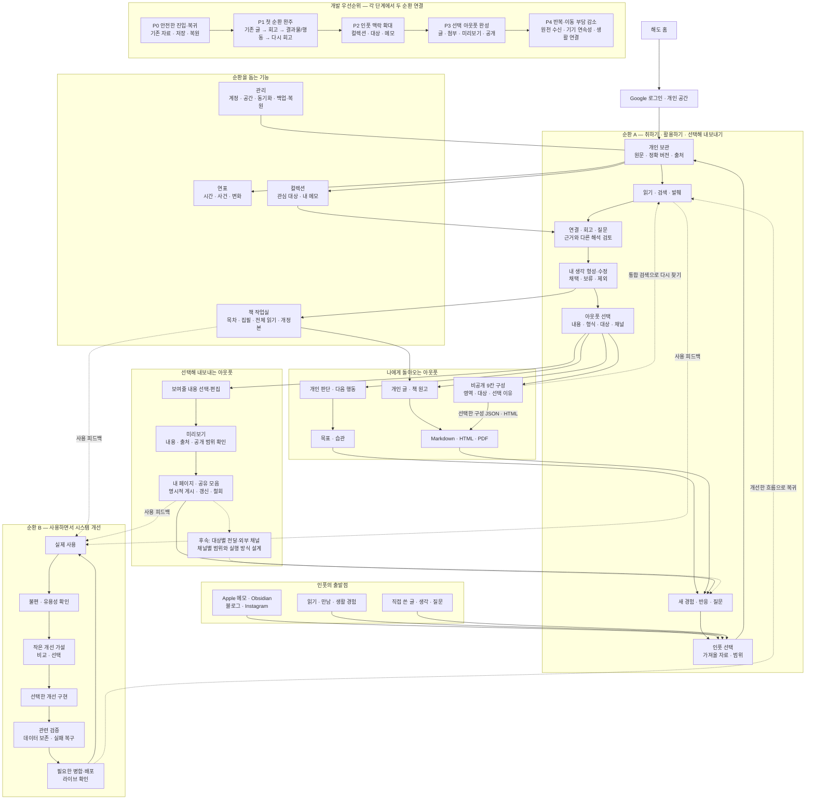
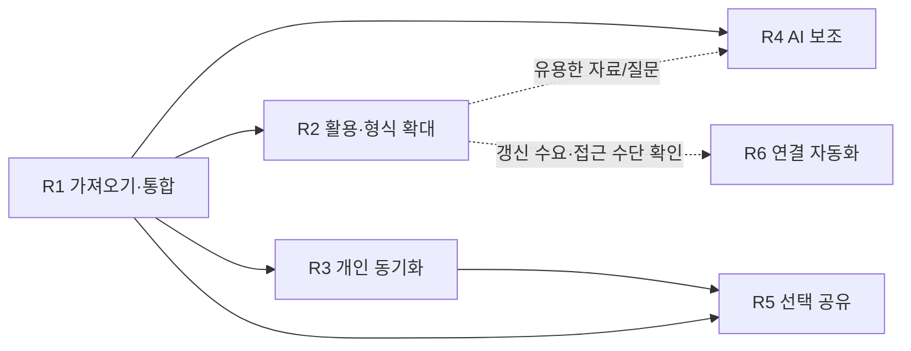

# 구현 로드맵과 에이전트 작업 배치

## 해도 내부 읽기·출처·이미지로 흐름 확정 — 2026-10-29 KST

2026-10-29 최신 사용자 요청으로 읽기 목적지를 **해도 내부**로 정했다. 뉴스 제목 → 확보한 본문/초록과 실제 그림 → 별도 원문 링크 → 직접 반응/필요한 자료 보관이 기본 흐름이다. SNS 계정·기관 게시물은 자료를 발견하는 선택 경로다. 외부 SNS에서 먼저 읽는 것을 필수 단계로 두지 않는다. 기존 Frontiers의 공식 XML·개별 CC BY 본문과 그림을 기존 예약 수집에 연결하는 구현·자동 검수를 [PR145](https://github.com/wonchance-art/life-haedo/pull/145)에 완료했다. 전문 3편·초록 16편·그림 6개와 실제 논문 표시, 전체 단위 1,609개·내부 읽기/기존 기능/PWA를 확인했으며 공개 배포 완료와 구분한다. 이 설계 PR142에는 런타임을 중복 포함하지 않는다.

내부 읽기·정확 본문 보관·목록 복귀의 구현·자동 검수와 Git 인계를 마쳤다. 다음은 **관심/다국어에 맞는 허용 출처 공급 확대**와 **계정별 뉴스 설정·반응의 기기 간 연속성**을 이어간다. 출처별 권리·본문/그림 정확성, 기존 PR140 계정 통합 계약을 선행하고 실제 읽기 범위·실패 복구와 A/B 설정·반응·삭제 보존으로 완료를 판단한다. 아래 SNS 우선 가설은 조사 이력이며 이 최신 흐름을 우선한다.

## SNS 탐구 출처·첫 읽기 비교 — 공개 조사·설계 검수 완료 (2026-10-29 KST)

[실제 비교와 운영안](../design-review/research-source-pilot.md) · [서지·접근·선정 근거](../design-review/evidence/research-source-pilot-20261029.json). 외국어 학습·독서·집중력·Grit의 읽기 자료10개(영어6, 한국어/일본어/중국어/프랑스어 각1)를 조사해 첫3개를 제안했다. 공식 출처8개의 SNS 연결과 실제 게시5개는 학술 검색 표본과 별도로 검토했다. **Bluesky의 OASIS 연구 요약·RetrievalPractice 실천 해설**을 먼저 시험하고 Learning Scientists를 보관 해설로 보완한다. OASIS의 정적404를 전체 접근 실패로 간주했던 판정은 공개API의 동일ID/서지와 Chromium 표시·첫 요약 PDF 텍스트를 확인해 교정했다. 두 번째 요약의 PDF 본문은 미검수이며 요약 접근·원논문 전문 확보·자동 수집을 구분한다.

현재 공개 feed는9출처120글(ko50/en70), LLT/Frontiers가 이미 포함되며3출처는error/stale다. 언어 옵션 미구현이 아니라 실제 공급의 편중이다. 새 임베딩/학습 랭커보다 출처·날짜·읽기 가능성·동일 근거를 먼저 검증한다. **이번 완료는 공개 출처 조사·읽기 준비·운영 제안**이다. 개인 SNS 추천 우위·실독 도움·계정 설정·자동수집 가동·앱/DB 구현·배포는 완료하지 않았다.

### 다음 큰 작업 묶음

1. **소비 출처 구성 보완과 실제 읽기 관찰.** 이유: 지속적으로 원하는 자료가 오는지 확인. 선행: 읽을 언어/형식·실제 사용하는SNS 경로이며 공개 링크 읽기는 독립 가능. 완료: 출처→정확한 요약/원문 접근, 반복/무관/접근 실패를 정리하고 사용자가 제공한 경우에만 도움 판단을 반영해 구성 유지/수정을 결정. 계정 조작·사용자 평가를 조사 결과로 꾸며 채우지 않는다.
2. **뉴스 설정·반응과 선택 자료 활용의 계정 통합.** 이유: 기기마다 관심·언어·반응을 다시 맞추는 부담 제거. 선행: PR140 실행 인계·기존 도메인 보존/충돌/삭제/구기기 계약·최신 구현 확인. 완료: 설정/반응 서버 보관→선택 링크/정확 원문→출발 맥락 복귀, 오프라인·계정전환·A/B 동기화를 같은 후보에서 검수. 자료실의 기존 계정 저장을 재구현하지 않으며 SNS 소비의 선행 조건으로 두지 않는다.

아래 구간은 당시 조사·설계 이력이며 현재 우선순위는 이 구간을 따른다. AI 제작·외부 발행은 가치 있는 근거와 채택한 관점 뒤의 선택 확장으로 유지한다.

## Supabase 조직 이전·관리 연결 재검증 완료 — 2026-10-29 KST

사용자 재연결 뒤 관리 API에서 기존 해도 프로젝트가 지정한 새 조직에 속하며 `ACTIVE_HEALTHY` 상태임을 확인했다. 관리 API의 프로젝트 URL·현재 배포 산출물·작업환경 URL이 일치해 앱 연결 설정을 교체할 필요가 없다. Auth health/settings를 다시 조회해 HTTP200·Google 제공자 활성을 확인했고, 읽기 전용 SQL과 테이블 조회가 성공했다. 조회된 public 테이블의 RLS와 Storage objects의 RLS가 활성 상태이며, 원본 보관 버킷 3개는 모두 비공개다. 이전 관리 연결의 권한 거절은 해소됐다.

이번 확인은 관리 접근·DB 조회·Storage 설정·Auth 서비스 응답 범위다. 실제 사용자 로그인·자료 저장/파일 업로드·기기 간 동기화·예약 수집의 종단 검수는 수행하지 않았으며, RLS 활성만으로 정책 전체의 적절성을 증명하지 않는다. 앱 URL·키·소유 binding·데이터·배포는 변경하지 않았다. 구체 대상 식별자와 확인 결과는 비공개 로컬 작업 기록에 두고 공개 저장소에 자격 증명/접속 값을 추가하지 않았다.

**이후:** 위 SNS 탐구 출처·표본 비교로 이어졌다. 기존 계정 기능의 실행 인계는 이 프로젝트를 계속 사용하며, 각 구현 후보에서 실제 계정 보관·실패 복구·동기화를 검수한다. 조직 이동만을 이유로 별도 데이터 이전이나 새 DB를 만들지 않는다.

## SNS에서 탐구 자료를 받는 출발점과 추천·콘텐츠 설계 — 2026-10-29 KST

사용자는 **‘내가 읽을 탐구 자료를 추천받는 계정부터 시작’**하기로 확정했다. [통합 명세](../design-review/research-output-system.md)에 추천 알고리즘·SNS 소비/편집 운영·공식 API·계정 구조·OSS 선택을 묶었다. [Mermaid](../diagrams/research-output-20261029.mmd) · [이미지](../diagrams/rendered/research-output-20261029.png). SNS 자체 추천/구독/리스트로 읽고 종료하는 것이 첫 완결이며, 해도 엄선/보관·AI 콘텐츠·외부 배포는 필요에 따라 기존 이해·내 생각·실천·표현 Output에 연결한다.

설계에서 연구 품질과 SNS 반응, 실제 확보 본문과 링크만 확보한 후보, 외부 홈 추천과 API 수신 가능 범위를 구분했다. 현재 경량 추천/정확 자료/계정 기능을 먼저 재사용하고 가중치·다양성·다국어 검색은 비교할 가설로 둔다. SNS 5개와 OSS 6개(기존 방식 포함)의 공식 자료를 조사했으며 실제 계정 추천 품질·사용자 읽기 도움·권한·운영 비용은 미검증이다. 계정 생성/접속·팔로우·수집/AI/게시 가동·앱/DB 변경은 수행하지 않았다.

### 다음 큰 작업 묶음

1. **탐구 소비의 첫 출처·표본 비교.** 이유: 좋은 입력이 실제로 오는지 확인. 선행: 현재 질문 하나·자료 언어·원하는 형식/시간, 첫 SNS 후보와 접근 가능한 공개 출처. 완료: 원문까지 추적되는 출처 묶음과 소수 후보를 비교해 실제 읽기 도움·무관/중복·찾기 부담을 확인하고 플랫폼/운영 기준을 결정. 계정 조작 없이 공개 출처 비교부터 가능하며 실제 읽기 평가는 사용자 경험과 구분한다.
2. **필요가 확인된 자료 엄선·탐구·계정 보관 통합 구현.** 이유: 반복 재입력/전송과 근거 단절 감소. 선행: 첫 운영의 실제 부족함·허용된 수신 경로·기존 뉴스/메모 계정 인계와 최신 구현 대조. 완료: 선택 후보→정확 근거/내 판단→자동 계정 보관·실패/중지/전환·파일 보존과 같은 후보의 품질 비교. 첫 SNS 소비에 이 구현을 선행시키지 않는다.
3. **선택한 탐구의 AI 제작·SNS 운영 확장.** 이유: 표현의 반복 작업 감소. 선행: 가치 있는 근거 묶음·채택한 관점·편집 목적·AI/채널/발행 범위. 완료: 기준 원고→필요한 파생물→근거/권리·수정 부담 검수·배포 패키지, 이후 선택한 한 채널의 실제 예약/게시 확인·중지/정정·반응 수집을 완주. 독자 반응을 개인 연구 순위에 자동 합산하지 않는다.

아래 ‘다음’은 당시 작업 이력이며, 현재 설계 우선순위는 이 구간을 따른다. 기존 계정 저장/메모·계획 실행 인계는 유지하되 SNS 소비 시범의 선행 조건으로 묶지 않는다.

## Workflow 통합·효율화·자동화 — 2026-10-29 KST

최신 [전체 workflow 이미지](../diagrams/rendered/workflow-overview-20261029.png) · [Mermaid](../diagrams/workflow-overview-20261029.mmd): 입력 → 뉴스·자료실·계획·홈 → 이해·실천·표현을 큰 기능 단위로 정리했다. 계정 서버 연동은 공통 기본 동작이며 ‘다른 기기에서 재개’는 별도 기능이 아닌 동기화 검수 조건이다. 아래 기기 전환 항목도 이 뜻으로 적용한다. 그림은 통합 설계이며 전체 구현 완료를 뜻하지 않는다.

사용자 지시로 이 세션의 책임을 **전체 시스템 설계 + workflow 통합 + 효율화 + 자동화**로 명시했다. [자동화 계약](workflow-automation.md)에 입력/트리거→자동 처리→결과, 화면/서버 실행 위치·활성 옵션·중지·중복/부분 성공·복구·효율 기준을 정리했다. 기존 자료 동기화·뉴스 갱신/수집·원천 worker를 재사용하고, 사람이 고르는 내용·실천·판단·공개와 자동 반복 처리를 구분한다. 이번 변경은 설계이며 새 예약·외부 수집·AI를 가동하지 않았다.

### 다음 큰 작업 묶음

1. **설계 세션 — 수집·계정 보관·활용의 자동화 상세화.** 이유: 수집·보관·활용 사이의 수동 전달/설정 방문 감소. 선행: 기존 뉴스/원천 자동화·계정 메모/계획 계약·실제 운영 준비 상태 대조. 완료: 트리거·옵션 수명·실행 위치·우선순위·부분 성공/중지/복구·효율 비교를 하나의 실행 명세로 연결. 구현 후보가 없어도 진행한다.
2. **실행 세션 — 계정 메모·직접 연결·계획/회고의 자동 보관 완주.** 이유: 사용자가 저장 뒤 보내기/받기를 반복하지 않게 한다. 선행: PR140/142·최신 main·담당 파일/원격 계약 대조. 완료: 정확 자료/메모→대상 연결→선택 회고→A/B 재개·파일·실패/구기기 검수와 실제 출시 근거.
3. **통합 검수 — 실제 후보와 자동화의 관리 부담 비교.** 이유: 자동화가 추가 관리나 지연을 만드는지 확인. 선행: 동일 합성 장면·구현/운영 후보. 완료: 재입력/재선택·수동 갱신·대기·실패 후 재작업 감소와 원본/입력 보존을 대조해 필요한 흐름을 교정. 앱 종료 중 예약은 실제 서버 실행 근거로 판정한다.

아래 구간의 ‘다음’은 당시 설계 이력이며 현재 우선순위는 이 구간을 따른다.

## 읽기·메모·계획의 통합 교정 — 2026-10-29 KST

[통합 동선·비교 기준](../design-review/reading-planning-integration.md)으로 **문장 직접 연결 / 개인 메모 후 연결 / 계획만 수정 / 조회만 또는 회고 저장**의 같은 시작·종료 조건을 고정했다. 새 메모를 로컬 작성 준비에 넣는 이전 가설은 기본 계정 보관 요구와 충돌해 [Core 주석 관계 재사용](../design-review/reading-decision-journey.md)으로 교정했다. 기존 원문 계정 Sync·JSON 백업을 재사용하고 별도 메모 서버·전체 준비 자동 전송을 추가하지 않는다. 순수 Core의 13개 관찰로 적합성과 미지원 삭제/Markdown 경계를 확인했으며 제품 계정 기능 통과로 합산하지 않는다.

코드 조사 기준은 `30e94f0`, 최종 통합 기준은 `55a74ae`다. [PR143](https://github.com/wonchance-art/life-haedo/pull/143)의 수집 중지·목록 복구가 main에 병합됐고 이번 Core/읽기/계획 조사 모듈은 바뀌지 않았다. 해당 작업은 새 메모/계획 구현 후보가 아니며 실제 상류 수집 가동 완료도 뜻하지 않는다. [단일 시연](../prototypes/planning-practice-review.html)은 원문·선택 메모·같은 목표 연결·정확 복귀와 선택 범위의 기간 확인을 통합한다. 새 제품 계정/파일/기기 왕복 검수는 실행 후보에서 진행한다. 아래 ‘생활 전체 시스템’과 이전 ‘다음’은 설계 이력이며 최신 순서는 이 구간이다.

[독립 시연 결과와 재현](../design-review/reading-planning-integration.md#시연과-검수-근거)에 실제 계약 실패·교정·정상/3폭 검수를 함께 보존한다. 같은 메모 복귀와 문맥 대상의 기간 선택을 수정했으며 현재 저장 모델의 적합성 관찰과 UI 시연을 제품 계정 왕복으로 확대하지 않는다.

### 다음 큰 작업 묶음

1. **실행 세션 — 계정 메모부터 계획·회고·재개까지 완주.** 이유: 생각과 작은 행동을 다시 입력·전송하지 않게 한다. 선행: 최신 main/PR140·이번 교정 명세·담당 파일 확정. 완료: Core 메모 생성/수정/휴지통/계정 A→B→A·파일 → 선택 문장 직접 연결·정확 왕복 → 계획 계정 보관·선택 회고·복원 → 실패/충돌/구기기·3폭/입력·출시를 같은 후보에서 검수.
2. **설계 세션 — 실제 후보와 동일 장면 통합 비교.** 이유: 시연의 간결함이 실제 저장·오류 복구에서도 유지되는지 확인한다. 선행: 해당 메모/계획 구현 후보와 이번 재현 가능한 시연 근거. 완료: 같은 문장·메모·기간의 재입력/재선택·복귀·부분 성공·기기 재개를 대조하고 차단 결함을 묶어 반영. 후보가 없는데 검수 완료로 표시하지 않는다.
3. **후속 확장 — 기본 흐름 이후 확인된 부족함만 실험.** 이유: 추가 기록·AI가 관리 부담보다 도움을 주는지 판단한다. 선행: 기본 여정 완주와 실제 부족한 사례. 완료: 앞으로의 이력 또는 선택 설명/비교를 대안과 비교해 채택/보류하고 과거 사실을 추정하지 않는다.

## 생활 전체 시스템과 상세 실행 계약 — 2026-10-29 KST

[생활 시스템 계약](life-system-contract.md)에서 **이해·선택·실행·확인·다음 선택**의 전체 책임을 고정하고, [계획·실행·기간 회고 명세](../design-review/planning-practice-review.md)로 화면·날짜·모델·계정/공간·관계/삭제·회고 판·파일 복원·담당/검수까지 확장했다. [전체 구조도](../diagrams/rendered/life-system-20261029.png). 각각만 사용하고 종료할 수 있으며 메모→목표 직접 연결은 월 계획·작성 준비를 필수로 하지 않는다.

현재 main 기준은 `30e94f0`이다. 계획 편집·목표/습관·자료 회고·PR141 사진 복구는 기존 구현이다. 계정 계획·선택 관계·기간 수행 회고와 새 파일은 이번 **설계/시연 단계**다. 현행 순수 모델로 과거 체크 정정·중복/미래 체크·v1 복원 ID 반례를 재현했으며 새 기능 통과로 합산하지 않는다. PR140 인계를 계승하고 PR142에 전체 설계와 상세 계약을 함께 보존한다. 아래 구간의 당시 다음 작업은 이 최신 순서로 갱신한다.

[클릭 시연](../prototypes/planning-practice-review.html)은 연결·체크 정정·기간 확인·저장한 회고와 현재 비교를 합성 자료에서 제공한다. [시연 검수](../design-review/evidence/planning-system/prototype-check.json): 16개 동작·3폭의 9개 화면 조합, 키보드·무저장 종료·메모리 초기화·추가 네트워크/저장소 접근 없음 확인. 원격 계정/파일 복원은 아래 실행 묶음의 검수 대상이다.

### 다음 큰 작업 묶음

1. **실행 세션 — 읽기/계획에서 생활 재개까지 연결.** 이유: 같은 문구·자료·계획을 다시 찾고 입력하는 부담 감소. 선행: PR140·이번 두 상세 명세·최신 배포/설치·담당 파일 대조. 완료: 계획 계정 보관→정확 대상 연결→기존 체크/과거 체크 정정→사실을 구분한 회고→다음 계획 선택→A/B 재개·파일 복원·실패/충돌·3폭/입력/출시를 한 여정으로 검수. 뉴스 계정 상태는 독립 도메인으로 병행하되 공급/AI를 선행하지 않는다.
2. **설계 세션 — 실행 결과의 통합 검수와 가치 비교.** 이유: 큰 설계가 실제 입력/재개 부담을 줄이는지 확인. 선행: 이번 시연과 후보 구현, 같은 합성 장면·기준 화면. 완료: 직접 연결/메모 경유, 계획 단독/연결, 조회만/회고 저장의 조작·본문·실패 복구를 비교해 불필요한 단계 제거와 남은 조건을 실행 인계에 반영. 실제 사용자 효과는 별도 근거로 남긴다.
3. **후속 확장 — 실제 부족한 이력 또는 AI 보조만 채택.** 이유: 현재 기록으로 답할 수 없는 필요 해결. 선행: 기본 여정 완주·대표 부족함. 완료: 앞으로의 수행 사건/반복 규칙 이력 또는 선택 설명/비교를 작은 실험으로 대조하고 근거 정확성·추가 입력/비용·도움에 따라 채택/보류. 과거 사실을 만들어 채우지 않는다.

## 목적에서 출발하는 전체 프레임 — 2026-10-29 KST

최상위 목표는 **흩어진 기록과 반복 관리의 부담을 줄여 직접 경험·깊은 생각·실천·선택적 관계와 표현에 쓸 시간과 주의력을 남기는 것**이다. 초기 구상과 후기 수정의 근거·현재 구현 지도·책임 분담·효과 판단을 [제품 목적·전체 workflow](product-purpose.md)에 정리했다. [입력→처리→결과와 두 순환 도식](../diagrams/rendered/purpose-workflow-20261029.png). 현재 블로그 중심 홈·뉴스·자료실·계획·설정은 유지한다.

개인 순환은 **생활/질문 → 필요한 맥락 → 직접 읽기·판단·실천 → 필요한 결과만 남김 → 생활로 복귀**다. 제품 개선은 **실제 막힘/도움 → 가까운 개선 가설 → 작은 비교 → 구현·보존 검수 → 다시 사용**으로 구분한다. 모든 경험을 기록·AI·공개로 통과시키지 않으며, 계정 연속성·사진 복구·속도는 이 순환의 기반이다.

현재 main은 `30e94f0`으로 PR141 사진 복구를 통합했다. [PR141 출시 기록](https://github.com/wonchance-art/life-haedo/pull/141)을 최종 재조회해 main CI·배포, 공개 shell 191파일 대조·익명 7경로 통과를 확인했다. 실행 세션의 검수 기록이며 이 설계 작업에서 라이브 검사를 재실행한 것은 아니다. 실제 Apple 기기·개인 자료·네이버/CDN 수집은 미검수다. [PR140 실행 인계](https://github.com/wonchance-art/life-haedo/pull/140)의 당시 실패를 현재 실패로 되풀이하지 않는다. 일반 글 근거·뉴스·계획의 나머지 인계 범위는 유지한다.

대표 여정 A의 [상세 명세](../design-review/reading-decision-journey.md)와 [도식](../diagrams/rendered/reading-decision-journey-20261029.png)을 작성했다. 기존 읽기·발췌 메모·작성 준비·선택 준비 이어쓰기를 재사용하고 간결한 메모 보기를 검증할 가설로 둔다. 화면/기존 코드/API·저장·무저장 종료·실패·다른 기기·정확 근거·통합 검수·담당 범위를 포함한다. **설계 완료이며 새 UI 구현·출시 완료가 아니다.** 아래 ‘다음’은 작성 당시 이력이며 현재 우선순위는 맨 위 생활 전체 시스템 구간을 따른다.

### 다음 큰 작업 묶음과 책임

1. **실행 세션: 읽기→내 판단→재개의 여정 A와 계정 연속성 완주.** 이유는 글을 만들지 않아도 판단을 남기고 다시 찾게 하기 위해서다. 선행은 이번 상세 명세·PR140 일반 근거/뉴스/계획 계약·PR141 출시 상태 대조다. 완료는 읽기만 종료/링크 메모/정확 구절·메모/선택 글쓰기/준비와 일반 글 각각의 A→B 재개·A 반영·실패/충돌·파일 복원과 본문 중심 UI를 같은 후보에서 확인하는 것이다. 기존 선택 준비 전송과 일반 계정 글 수신을 혼동하지 않는다.
2. **설계 세션: 월 방향→목표·습관→실제 수행→기간 회고를 연결.** 이유는 읽고 정한 작은 선택이 생활을 조정하는 데 도움이 되게 하기 위해서다. 선행은 현 연간 계획·목표·습관의 저장/날짜 계약, 이번 메모와 실제 행동의 의미 구분이다. 완료는 명시 연결·변경/해제·확인 가능한 수행·계획과 사실의 비교·계정/실패/재개까지 하나의 실행 명세로 정리하는 것이다. 메모를 자동 일정으로 만들지 않는다.
3. **후속 비교: 질문 중심 AI가 필요한 지점 결정.** 이유는 설명·비교가 실제 읽기와 판단에 도움이 되는지 확인하기 위해서다. 선행은 AI 없이 완주하는 여정과 대표 질문·자료다. 완료는 도움·추가 입력/비용·근거 오류·단순한 대안을 비교해 적용/보류를 정하는 것이다. 모델 도입을 먼저 확정하지 않는다.

## 네이버 실제 운영 검수 — 네트워크 적용 완료, robots 금지로 가동 보류 (2026-10-29 KST)

main `55a74ae`/PR143을 새 독립 worktree에서 확인했다. 새 환경은 공식 spec1/current/unrestricted/enforced와 로컬 unrestricted가 일치한다. Vault 두 항목 각각1개·프로젝트 URL 일치·서버 키 기본 형식 검사는 통과했다. 다시 설정할 항목으로 안내하지 않는다. 실제 RSS robots는 HTTP200이지만 현재 수집기에 적용되는 `User-agent: *` 그룹이 `Disallow: /`를 선언해 readiness probe는 robots1건 뒤 RSS/목록/본문/사진 요청0으로 중단됐다. 블로그 robots에도 AI training/RAG 금지 문구를 확인했다. 다른 경로로 우회하지 않으며 `ready=false`·예약/확장 미설치를 유지한다. 대상 서버 구독/항목/capture는0이지만 기존 브라우저나 다른 가져오기 자료의 부재를 뜻하지 않는다. 전체 목록·기수집 대조·확보 범위·실제 예약/복원과 신규 게시 탐지는 미검증이다. 환경 flag true·Vault 키 실제 권한도 미확인이며 진단을 위해 가동하지 않는다.

독립 검토에서 percent-encoded unreserved 경로가 robots 금지와 일치하지 않는 결함을 수정했다. 예약 문자·UTF-8·wildcard/끝 앵커·실패 시 요청 차단 회귀를 추가했고 collector16·worker/readiness25 및 정적 검사와 독립 CDN 경계 검수를 통과했다. Edge v5를 배포해 반환 소스8개 일치·실제 익명401 거절·DB 비활성 상태 보존을 확인했다. 기존 원문 판·사진·인용·계정 자료·미저장 입력의 저장 형식과 공개 셸은 바꾸지 않았다. 저장소 CI·통합 결과는 연결 PR에서 확정한다. [실제 관측·검수·가동 보류와 출시 기록](../design-review/naver-operational-readiness.md).

다음 큰 작업은 **허용된 자료 확보→정확 원문·사진 활용까지 완주**다. **이유:** 실제 사이트 robots가 현재 자동 수집 경로를 금지한다. **선행:** 해당 목적·경로에 대한 허용 근거 또는 사용자가 직접 제공한 내보내기/본문·사진 파일. **완료:** 자동 경로가 허용되면 공개 목록 대조→환경/인증→예약→재접속·정확 복원·중지/실패 복구를 실제로 검수한다. 정책이 유지되면 기존 수동 가져오기·불변 판·사진/파일 복원 경로를 재사용하되 이를 자동 수집 성공으로 표시하지 않는다. 새 게시 관측 전 신규 게시 탐지는 계속 미검증이다.

## 이전 세션: 네이버 실운영 준비와 중지·자동 재개 (2026-10-29 KST)

실제목록대조→예약수집→재접속반영을목표로, ready=false에서기존수집중지가막히는UI와목록총개수변경뒤자동scan이정체되는결함을교정했다. 목록을우선확인하고잔여45초초과때사진1작업을진행하도록worker공유기한을보존했다. 기존원본/사진/기준선/권한과중복·유실ACK를검수했고worker v3·rescan migration을운영에설치했다. DBready=false·예약미설치·Vault필요이름없음은유지한다. 공개검수CLI는공식현재정책+robots·bounded표본·프록시를지키며spec481에서네이버요청0으로차단된다. [운영관측·검수·지원설정·가동절차](../design-review/naver-operational-readiness.md).

다음은지원환경설정에서네이버/필요사진CDN접근검토와같은프로젝트Vault자격의비공개준비뒤,실제robots/RSS/목록/대표본문·사진→양gate검증→예약발화/앱종료중보관→재접속·정확사진활용·중지/실패복구를완주하는것이다. 현재관측·합성검수·부분설치를실제수집성공으로표시하지않고,새게시가없으면신규게시감지는미검증으로유지한다.

## 원문 판·사진의 기기 간 정확 복구 — 구현·통합 검수 완료·출시 관문 (2026-10-29 KST)

같은 계정 A의 정확한 네이버 원문 판·사진을 B에서 이어 읽는 흐름을 별도 불변 연결과 기존 원문 ACK·사진 보관 구조로 구현한다. 원문·sidecar·전송 대기는 원자 보관하고 다른 기기에서는 본문/판/옛 인용을 바꾸지 않은 채 현재 연 판의 사진만 검증 다운로드한다. 같은 본문·다른 사진을 해시나 최신 판으로 추정하지 않으며, 수집 화면에서 다시 받기도 기존 정확 판을 재사용한다. localOnly ZIP은 서버 영수증으로 승격하지 않는다. 기존 LibraryMeta v1과 구기기의 capabilities는 유지한다. 단위1,572개·독립 A/B8흐름·기존 정확복귀6흐름·실제 PostgreSQL17의21개와 동시2세션·v164→165 PWA9개를 통과했다. 비동기 초점복귀와 오류 버튼 겹침을 교정하고 정상/오류6캡처·키보드/스크롤개입 보호를 검수했다. 운영의 새 registry를 설치하고 기존98함수/ACL 불변과 익명거절을 확인했으며 최종CI·공개반영은 연결PR에서 확정한다. [설계·검수·운영 설치](../design-review/naver-media-continuity.md).

### 이후 큰 작업 묶음

1. **네이버 실제 목록·예약 수집부터 활용까지 운영 완주:** 이미 있는 수집/보관 기능이 실제 블로그에서 작동하는지 확인한다. **선행:** 허용된 네이버·사진 CDN 접근, 대상별 robots·대표 응답, 서버 자격·예약 준비. **완료:** 공개 목록·기수집 대조 → 대표 본문/사진의 확보 범위·픽셀 검증 → 앱 종료 중 예약 보관 → 같은 계정 재접속·정확 판 복구 → 선택 글쓰기·전용 파일·중지/실패 복구. 실제 새 글이 없으면 신규 게시 감지는 미확인으로 남긴다.
2. **실제 두 기기의 사진 기록 완주와 Apple 입력 보강:** 합성 Chromium 결과를 실제 Mac/iPad/iPhone 체험과 구분하고 사진 선택·앱 전환·긴 글 재개 부담을 줄인다. **선행:** 소유자 기기와 직접 고른 대표 사진·글, HEIC 원본/보기용 변환의 보관 범위 결정. **완료:** A 사진 글 작성·서버 보관 → B 정확 원문/원본·수정 → A 재개 → 파일 복원까지 관찰하고 재현된 문제를 묶어 개선한다. 현재 JPEG·PNG·WebP 원본 보존과 별도 공개 선택은 유지한다.

## 목적별 사용 흐름 통합 — 최신 main 통합 검수 완료·출시 관문 진행 (2026-10-27 KST)

홈·뉴스·자료실·계획·설정의 역할에 맞춰 대표 진입과 관련 작업을 함께 배치했다. 자료실의 모아 보기·활용·원본 관리는 접힌 자료 메뉴로, 뉴스 옵션은 관심·언어·추천·출처/갱신·기록 관리로, 기존 여섯 파일은 자료·글 / 계획·연표로 묶는다. 읽던 글의 정확 ID·판을 공개·보관/근거 파일에 전달하고 원래 읽기·목록으로 복귀한다. 다른 탭의 수정은 자동 대체하지 않고 명시적으로 현재 글을 확인한다. 계정 글의 대표 재개 목록과 별도 사본 받기, 저장 실패·충돌·입력·과거 주소·기본 계정 보관을 함께 보존한다. [구현·강화한 관문·실제 검수·출시](../design-review/purpose-workflow-implementation.md).

제품 동결 뒤 정상·실패·경합·계정/공간·정확 원문/사진·3폭·키보드·PWA를 검수했다. 목적 동선8·글/파일6·뉴스3·계획10과 기존 흐름, 실제 worker v162→v163 9개를 확인했다. 세 폭의 첫 본문은44px 위로 이동했고 전문 목록은 메뉴 열기 한 번이 추가된다. 정확 CI·실제 산출물·공개 배포 결과는 [PR139 출시 기록](https://github.com/wonchance-art/life-haedo/pull/139)으로 확정한다. 브라우저 자동 검수와 실제 사용자 기기·직접 읽기 효용을 구분한다. 아래 설계 완료 기록과 이전 출시 이력은 유지한다.

최신 main `6126123`의 [PR138](https://github.com/wonchance-art/life-haedo/pull/138) Obsidian 후보·정확 연결과 사진 보완을 함께 통합한다. 앞선 v162→v163 결과는 통합 전 검수로 보존하며 최종 후보 v164/SHELL191에서 단위1,537개·정적22/172/723과 목적 동선8/정확 글6/뉴스3/사진 글15/근거 파일8/Obsidian 연결6/사진 상태1을 확인했다. 최신 main v163과 당시 공개 v162에서 각각 최종 v164로 업데이트하는9개 조건도 통과했다. 실제 배포 관문은 PR139에 기록한다.

### 이후 큰 작업 묶음

1. **실제 두 기기의 자료 활용 완주:** 자동 연동·초기 속도·목적별 배치가 실제 작업 부담을 줄이는지 확인한다. **선행:** 소유자가 사용할 두 기기와 대표 자료·원본. **완료:** A 가져오기/분류 → B 첫 열기·재방문/정확 원문 → 회고 또는 글 저장 → A 반영·오프라인 복귀·파일 보관을 확인하고 재현된 불편을 묶어서 개선한다. 자동 검수로 사용자 체험을 대신하지 않는다.
2. **원문 판·사진 원본의 기기 간 정확한 복구:** 같은 본문에 서로 다른 사진 판이 있을 때 잘못된 사본을 연결하지 않기 위해서다. **선행:** source/version↔capture 해시 영수증과 원본 보관 범위. **완료:** 명시 선택한 정확 판·사진 수신 → 기존 인용 유지 → 오프라인/실패 복구 → 전용 파일 보관을 완주한다. PR138의 Obsidian 명시 연결·대상 왕복과 사진 포함 범위 안내를 다시 미구현으로 나열하지 않는다.

## 원문 연결 검토와 사진 보관 경계 (2026-10-26 UTC)

**Obsidian 링크 발생 위치 → 동명 노트·정확 판과 제목/블록 검토 → 명시 연결 → 대상 원문과 원래 위치 복귀**를 기존 Core 관계·CAS로 연결한다. 파일 이름만으로 보관함을 합치거나 첨부를 자동 다운로드하지 않는다. 네이버 원문 사진은 일반 JSON·근거 ZIP의 포함 범위를 분명히 밝히고, 현재 기기의 사본 미확인과 실제 오류를 구분한다. 빈 MIME의 JPEG·PNG·WebP도 원본 바이트 검증 뒤 글에 넣을 수 있다. [범위와 보존 조건](../design-review/obsidian-candidate-journey.md). 최종 검증과 출시는 해당 PR 기록을 따른다.

다음 큰 묶음은 **실제 두 기기의 정확 원문·사진 복구**다. 서로 다른 사진 판이 같은 본문을 가질 수 있으므로 신뢰 가능한 source/version↔capture 해시 영수증과 원본 보관 경계를 설계해야 한다. 완료 기준은 명시 선택한 정확 판·사진의 다른 기기 수신과 기존 인용 보존, 오프라인/실패 복구 및 파일 보관이다. 기존 영수증이 없는 자료는 추정하지 않고 후보 검토가 필요하다. 실제 네이버 목록·예약 수집 완주는 접근 허용·서버 자격과 일정 준비 이후 대표 응답 검증을 선행한다.

## 기능 목적·워크플로·효율적 배치 — 설계·독립 검토 완료 (2026-10-26 KST)

배포 main `c9c21ef`의 기능을 총괄·자료·뉴스·글쓰기·계획/설정·정보구조/시각·독립 검토 7개 역할로 조사했다. 목표는 **발견 → 개인 자료로 활용 → 필요한 결과를 남김 → 출발 맥락 복귀**이며 읽기·보관·실천만으로 끝내는 경로도 유지한다. [기능 목적표·화면별 배치·여섯 동선·보관 범위·완료 기준](../design-review/purpose-workflow.md), [현재 입력→처리→결과](../diagrams/rendered/product-workflow-20261026.png), [배치 구조도(최신 구현)](../diagrams/rendered/product-placement-20261026.png).

대표 메뉴는 **홈(내 글)·뉴스(발견)·자료실(원문 활용)·계획(현 도구)·설정(보관/복구)**으로 제안한다. 글 읽기에서 해당 글의 공개/파일 관리로, 자료 선택에서 회고/글쓰기로 이어지는 문맥 진입을 우선한다. 자료실 전문 구성은 접힌 메뉴, 설정 파일은 자료·글/계획·연표로 묶는다. 자료 작성과 홈 글쓰기, 담기와 자료 보관, 공개와 비공개 저장의 결과를 구분한다. **이번 산출물은 설계·도식이며 운영 UI 변경·배포 완료가 아니다.** 기존 PR136 메뉴 통합과 PR137 속도 개선, 계정 자료 보관을 새 미구현 기능으로 되돌리지 않는다.

### 다음 큰 작업 묶음

1. **목적에 맞는 메뉴와 결과물까지의 이동을 통합 적용:** 같은 이름의 다른 결과와 글 재선택을 줄이기 위해서다. **선행:** 이번 설계, 같은 익명 자료의 기준 화면, 전문 탭 접힘의 본문 가시성/진입 증가 비교. **완료:** 명칭·뉴스 설정·자료 선택/구성·정확 글 관리/계정 목록·파일 그룹을 함께 적용하고 시작→저장/재열기→복귀, 옛 주소, 3폭·키보드, 실패 입력·계정·원문/사진 보존을 검수한다. 구현·독립 검수·허용된 출시는 하나의 묶음으로 끝낸다.
2. **실제 두 기기의 자료 활용 완주:** 설계상 일치가 실제 체감으로 이어지는지 확인한다. **선행:** 소유자 계정·두 기기·대표 자료와 원본. **완료:** A 가져오기/분류 → B 찾기·정확 원문/원본 → 회고 또는 글 저장 → A 반영·출발 위치·오프라인/백업까지 확인하고 재현된 불편을 함께 개선한다.

기존 내부 문서·첨부의 정확 연결 목표는 그 다음 기능 목표로 유지한다. 뉴스 설정/반응·연간 계획은 현재 로컬 보관이며 자료 계정 연동과 같다고 표현하지 않는다. 전체 외부 자동 수집·AI 분석·계획 간 자동 변환은 이번 설계의 현재 기능이 아니다.

## 자료 첫 표시·재방문·검색 속도 개선 (2026-10-24 KST)

이번 목표는 **로그인 → 자료를 먼저 읽고 조작 → 최신 자료 수신 → 정확 원문·편집·목록 복귀**의 기다림을 줄이는 것이다. 전체 공간 동기화를 첫 화면의 선행 조건으로 두던 흐름을 선택 공간 우선으로 바꾸고, 같은 계정의 검증된 캐시를 먼저 표시한다. 겹친 Auth 요청만 공유하고 검색 계산·폴더 조회의 전체 원문 복사를 줄이며 오프라인 셸 설치는 화면 준비 뒤로 옮긴다. 서버 기본 보관·계정 격리·정확 판·미저장 입력·검색/폴더 초점·실패 복구는 유지한다. [측정 조건·구현·독립 검수·출시](../design-review/startup-performance.md).

고정 main과 후보의 합성 capability-1 HTTP/실제 SDK·계정별 IDB, 요청당 100ms·200+20+20개 원문·각3회에서 첫 조작 중앙값은 **새 기기14.76→6.02초(59.2% 감소), 재방문8.21→0.78초(90.5% 감소)**다. 재방문은 계정 IDB 캐시이며 HTTP 캐시는 꺼진 조건이다. 검색·복귀 후 전체 동기화 완료 확인은 오히려 늦어졌으므로 전체 전송 속도 개선이나 실제 사용자 기기의 수치로 확대하지 않는다. 최종 전체 단위1,498개·브라우저 보존5/기존 계정5흐름·PWA161→162 9흐름·3폭 시각·독립 검토를 통과했다. 조기 원본 메뉴의 공유 서비스 초기화 경합을 수정하고 기존 실패 단언을 그대로 재검증했으며, 최종 CI/배포·실제 산출물 결과는 이번 변경 PR 본문에 기록한다.

### 다음 큰 작업 묶음

1. **실제 두 기기의 빠른 자료 활용 완주:** 계정 보관·메뉴 통합·이번 속도 개선이 실제 입력/열기 부담을 줄였는지 확인한다. **선행:** 소유자 계정·두 기기·대표 자료와 원본. **완료:** A 가져오기/분류 → B 첫 열기/재방문·정확 원문/원본 → 회고 또는 글 저장 → A 반영·오프라인 복귀·백업을 확인하고 재현된 지연/불편을 함께 개선한다. 실제 기기 확인 전까지 자동 검수 결과와 구분한다.
2. **내부 문서·첨부의 정확 연결 활용:** 자료에서 원래 위키/파일 목적지까지 이어간다. **선행:** 명시 보관함 범위·정확 판 관계·사용자 연결 선택. **완료:** 동명 파일·헤더/블록·미확보 첨부를 구분하고 선택 연결 → 왕복 → 내보내기/복구를 확인한다. 기존 폴더·자동 파일 보관·메뉴 통합을 다시 미구현으로 나열하지 않는다.

## 기능 흐름·설정·도구 통합 (2026-10-24 KST)

기존 기능을 **홈의 글·공개 / 뉴스의 관심·언어·추천 / 자료실의 읽기·활용·원본 관리 / 도구의 연간 계획·목표·습관 / 설정의 계정 보관·파일 복원**으로 묶는다. 자료·블로그 메뉴에서 기존 기능을 열고 같은 목록·버튼·검색·폴더로 돌아오며, 계획 화면 사이 이동은 저장 성공 뒤 진행한다. 예전 tools/manage 주소와 로그인·새로고침의 정확 목적지는 유지한다. [설계·보존·검수·출시](../design-review/feature-flow-integration.md).

이번 묶음은 메뉴 이동만이 아니라 기존 기능의 진입·복귀·실패 저장·기본 계정 보관 갱신 중 초점까지 함께 다룬다. 원문/불변 판·발췌·계정 동기화와 각 백업 형식을 재사용하며 새 저장 모델이나 자동 계획 변환을 만들지 않는다. 기본 화면에는 접힌 메뉴만 두고 설명이나 기능 목록을 상시 펼치지 않는다. 로컬 정적22 HTML/169 JS/714참조·전체 단위1,477개, 집중10흐름과 최종 계획 보호2흐름, 원본12/관심13/하위 탐색12흐름을 확인했다. 앞선 후보의 계정5/PWA160→161 9흐름과 각 후속 교정의 검수 범위를 연결 문서에서 분리한다. 메뉴 갱신 중 초점 소실과 계획 이동 중 늦은 입력 경합을 교정했고 독립 검토의 남은 차단은 없다. 최종 전체CI·공개 배포는 [이번 릴리스 기록](https://github.com/wonchance-art/life-haedo/pull/136)으로 확정한다. 실제 사용자 기기 검증은 별도이며 아래의 기존 출시 기능을 미완료로 되돌리지 않는다.

### 다음 큰 작업 묶음

1. **실제 두 기기에서 자료→읽기·활용→글 완주:** 자동 연동과 이번 메뉴 통합이 실제 기기의 사용 부담을 줄였는지 확인한다. **선행:** 소유자 계정·두 기기·대표 자료/원본. **완료:** A 가져오기/분류→B 정확 원문/원본→회고 또는 글 저장→출발 목록·A 반영→오프라인 복귀·백업까지 확인하고 재현된 문제를 함께 개선한다.
2. **내부 문서·첨부의 정확 연결 활용:** 자료 탐색에서 원래 위키/파일 목적지까지 이어간다. **선행:** 명시 보관함 범위·정확 판 관계·사용자 연결 선택. **완료:** 동명 파일·헤더/블록·미확보 첨부를 구분하고 선택 연결→왕복→내보내기/복구를 확인한다. 자동 파일 보관이나 메뉴 통합을 링크 해석 완료로 확대하지 않는다.

## 자료실 기본 계정 보관 — 구현·자동 검수 완료 (2026-10-24 KST)

사용자 요청으로 자료실의 **브라우저별 독립 보관·명시 연결 원칙을 기본 비공개 계정 보관으로 변경**한다. 목표는 **A 가져오기/분류/발췌 → 독립 B 같은 계정 로그인·동일 원문/폴더/묶음 → B 수정 → A 이어 읽기**, 원본 파일은 재선택 없이 목록/열기로 이어지는 흐름이다. IndexedDB는 내부 캐시·영속 outbox·충돌 복구층이며 서버 ACK 전에는 계정 보관 완료가 아니다. [설계·이관·실패 복구·검수/출시](../design-review/account-library.md), [공식 대안과 선택 근거](open-source-review.md#자료실-기본-계정-보관과-기존-casoutbox-재사용--2026-10-24).

이번 묶음에 Core·저장한 Workbench·폴더/Collection/NineBoard와 OriginalAttachments를 함께 연결한다. 기존 두 CAS 엔진과 LibraryMeta adapter·source_revision/정확 참조를 재사용하고 기본 공간의 수신 우선/이관·복구 제외를 정의한다. 원본 ZIP은 private immutable 청크·영속 작업·전체 SHA/CRC 검증을 거쳐 자동 업로드/원격 목록/열 때 다운로드한다. 전체 영역의 원자 세대를 약속하지 않으며 미도착·충돌·일부 실패를 구분한다. 작성 중 초안·뉴스 판단·연간 계획·읽기 위치·공개 등은 기존 계약을 유지한다.

전체 단위**1,472/1,472**·정적**22 HTML/169 JS/714참조**·실제 SDK/IDB의 독립A/B 원형**5/5**·현재SW159→160 **PWA9/9(셸188/설치파일24)**를 통과했다. 자동 원본/정확 원문·오프라인/유실 ACK·충돌 양쪽 복구·실제 최초 expected0 경합까지 확인했고 분야별 집중 숫자는 중첩이라 합산하지 않는다. 정확한SQL3개를 운영에 설치/감사했고 기존 Core/Composition의7개 정의·grant를 유지했다. 실제 합성HTTP26개에서 Unicode·CAS/replay·private2,458바이트 SHA/manifest 왕복·다른 owner/익명 거절을 확인했다. 최초 Storage preflight400과 manifest42702·초기 빈 구성 경합을 각각 교정하고 실패 근거를 보존했다.

마지막 자료 화면의 불필요한 설명·거짓 미확보 경고 교정 뒤 focused 왕복1흐름과 새3폭을 통과했다. 검사 소스23파일이 동일하고 실제 확보된 대상의 경고는 숨김/빈 텍스트이며 최신 확인 뒤 정확 그래프도 유지했다. 진짜 미확보 안내/새 bundle 도착은 별도 읽기 전용 메모리 UI2사례·쓰기0으로 구분한다. 최초 PR CI의 조회 계측·설치 검사와 호환 경로 교정 근거를 보존했고, 교정 원본12/구성9/계정5흐름과 새3폭을 확인했다. 기존 감사10묶음 중9통과·언어16/17의 숨은 버튼 대기1건 및 관측1회 통과는 원인 미확정으로 구분하며, 교정 PR/main CI·공개 파일/실제 배포본의 확정 결과는 [PR135 출시 기록](https://github.com/wonchance-art/life-haedo/pull/135)을 따른다. 실제 사용자 기기·개인 보관함 전체는 확인하지 않았다. 아래의 과거 로컬 전용 설명은 당시 이력으로 보존하고 새 대상 영역에는 이번 정책을 적용한다.

### 다음 큰 작업 묶음

1. **실제 두 기기의 자료 활용 완주:** 자동 검수와 별도로 사용 기기의 입력·전환·원본 열기 부담을 확인한다. **선행:** 이번 릴리스·소유자의 계정/기기·대표 자료/원본. **완료:** A 분류/발췌→B 동일 정확 원문/원본→B 수정→A 반영→오프라인/앱 복귀·백업을 대조하고 필요한 개선만 채택한다.
2. **내부 문서·첨부의 정확 연결 활용:** 보관한 자료와 원래 위키/파일 목적지 왕복을 완결한다. **선행:** 명시 보관함 범위·정확 판 관계·사용자 연결 선택. **완료:** 동명 파일·헤더/블록·미확보 첨부를 구분하고 선택 연결→왕복→내보내기/복구를 확인한다. 자동 파일 보관을 링크 해석·플러그인 전체 호환으로 확대하지 않는다.

## 자료실 가상 폴더 — 구현·로컬 동작/보존 검수 완료 (2026-10-23 KST)

이번 목표는 **자료실 폴더 만들기/정리 → 자료 하나/선택 자료 이동 → 폴더/검색으로 찾기 → 정확 원문 읽기·수정·같은 목록 복귀 → 공통 백업·새 사본 복원**이다. 기존 주제는 발췌 분류, 묶음은 정확 버전 연결, 컬렉션은 별도 대상 메타데이터이므로 폴더와 구분한다. 최대5단계·자료당 기본 폴더 한 개·미분류·하위 포함 검색과 자식 없는 폴더 삭제를 연결하며 원래 Obsidian 경로·해시·버전·인용을 바꾸지 않는다. [설계·보존·완료 기준](../design-review/material-folders.md), [공식 후보 비교](open-source-review.md#자료실-가상-폴더와-기존-cas-재사용--2026-10-23).

기존 Core 목록/정확 판·Storage CAS·Workbench 백업 패턴과 네이티브 조작을 재사용하고 새 트리 프레임워크·원격 동기화를 추가하지 않는다. 분류는 별도 로컬 메타데이터이고 공통 자료·구성 백업의 분류 포함 외곽/원자 복원과 기존 자료 전용 백업의 제외 범위를 구분한다. 휴지통의 분류를 유지하며 누락 참조를 다른 제목/파일명에 붙이지 않는다. **정적22 HTML/164 JS/699참조·전체 단위1,367개·새 분류4흐름·기존 자료3/Obsidian4/공통 백업3흐름·정확 SW158→159 PWA9개를 통과했다.** 폴더/자료/검색의 왕복·백업 재매핑·실제 IDB 실패와 두 탭 CAS, 기존 원문/구성 보존을 확인했다. 첫 신규 검사2건의 focus/검색 조건과 기존 Workbench의 기준 배포본에서도 재현된 요청0 가정을 제품 결함과 구분해 수정·보존했고 단언/제한시간을 유지했다. 새1440/820/390px 캡처의 root 검토와 조작/초점/넘침 확인을 마쳤다. 최초 로컬 ship 뒤 PR134 최초 CI4그룹 실패에서 폴더 선택기14px의 제품 결함이 드러나16px로 한 줄 교정했다. 새 분류4흐름·새3폭에서 입력/선택기16px 이상을 실측했고 읽기12/SNS2/Book7·최종 정적/단위/PWA도 재통과했다. Book의 기존 설치 오류/지연 훅을 새 설치 경로에도 적용하되 단언·12초 제한은 유지했다. 독립 교정 재검토는 추가 폴더 차단이 없다고 확인했으며 검토자의 추가 브라우저/캡처는0이다. PhotoPost 원형 로컬14/14에서 CI 실패는 재현되지 않았다. 진입 요소의 실제 준비 대기만 보완한 최종14/14·15캡처도 원래 단언과15초/30초 제한을 유지해 통과했으며, 이는 검사 준비 대기의 교정이지 CI 원인의 확정이 아니다. 교정 소스·새3폭·최종 회귀 증거를 대조한 독립 최종 판단은 검토한 로컬 범위에서 ship·남은P0/P1 차단0이며 보고서9개/동결19파일의 최종 로컬 관문도 통과했다. 최초/중간 대기 기록은 보존하고 이 결과를 교정 CI·출시 성공으로 확대하지 않는다. 정확한 PR/main CI·공개 배포/실제 배포본 결과는 [PR134 출시 기록](https://github.com/wonchance-art/life-haedo/pull/134)을 따른다. 앞서 완료한 Obsidian 속성·읽기/수정 기반을 미구현으로 되돌리거나 폴더 추가를 실제 개인 보관함·위키/첨부 전체 확인으로 표시하지 않는다.

### 다음 큰 작업 묶음

1. **실제 자료 분류→읽기→수정·재사용 완주:** 다시 찾고 활용하는 부담을 실제 분류 장면에서 줄이기 위해서다. **선행:** 사용자가 고른 대표 자료/폴더·검색 장면과 주 기기. **완료:** 분류→검색/정확 원문→속성·본문 읽기/수정→저장·재열기→같은 폴더 복귀→공통 백업/복원을 끝내고 필요한 개선만 채택한다.
2. **내부 문서·첨부의 정확 연결 활용:** 폴더 위치와 원래 파일/위키 목적지가 함께 필요한 장면을 이어가기 위해서다. **선행:** 명시 보관함 범위·기존 정확 버전 관계·사용자 연결 선택. **완료:** 동명 파일·헤더/블록 목적지·미확보 첨부를 구분하고 명시 연결→왕복→파일 보관/복구를 확인한다. 폴더 추가로 원래 내부 링크나 미디어 확보가 완료됐다고 주장하지 않는다.

## Obsidian 속성과 본문 — 구현·로컬 검수 완료 (2026-10-23 KST)

사용자가 보고한 속성 표시 문제를 **가져온 문서 → 올바른 YAML 속성/본문 분리 → 서식·정확 원문/위치 → 내 사본 수정·미리보기 → 새 판 저장·재열기 → 기존 백업**으로 완결한다. 실제 제목·속성 값은 추적 샘플/문서에 쓰지 않는다. 일반 필드 줄을 속성으로 추정하거나 원문을 고쳐 저장하지 않고, 잘못된/미지원 YAML은 그대로 읽을 수 있게 둔다. [공식 문법 지원표·보존·완료 기준](../design-review/obsidian-markdown.md), [파서 비교](open-source-review.md#obsidian-yaml-속성과-원문-위치--2026-10-23).

공식 Obsidian Properties와 기본/고급 문법을 대조하고 유지되는 로컬 YAML 파서를 비교했다. 속성의 텍스트/목록은 읽기용이며 source 제목·날짜·태그·관심·연결을 자동 바꾸지 않는다. 경계·BOM/개행·원문 위치·기존 발췌/버전과 자료 수정/백업 계약을 유지하고 별도 저장·서버·플러그인 엔진을 추가하지 않는다. **정적22 HTML/162 JS/690참조·최종 전체 단위1,344개·새 브라우저4흐름/15반례·기존 자료3흐름·정확 SW157→158 PWA9개를 통과했다.** 첫 검사 통과 뒤 발견한 일반 Markdown의 머리말 오인을 보완해 정상 비매핑/구분선 문법과 명확한 오류 매핑을 구분했으며 첫 소스·결과를 보존했다. 최종 소스의 정상 투영·3폭 기하가 이전과 같고 재사용 이미지/원형 보고서/당시 소스의 SHA가 검사 전후 불변임을 확인해3장을 재사용했으며 새 캡처는0이다. 최종 소스·같은3장에 대한 독립 검토는 ship·검토 범위 새P0/P1 차단0이다. 정확한 PR/main CI·공개 파일/배포본의 확정 결과는 [출시 기록](https://github.com/wonchance-art/life-haedo/pulls?q=is%3Apr+head%3Acodex%2Fobsidian-markdown-20261023)을 따른다. 실제 기기·원래 개인 보관함 전체·플러그인 전체 호환은 별도다. 기존 기본 Markdown·연간 계획·뉴스 출시를 이 새 교정 때문에 미구현으로 되돌리지 않는다.

### 다음 큰 작업 묶음

1. **대표 Obsidian 문서의 읽기→수정→재사용 완주:** 실제 문법과 읽기 부담을 기준으로 개선하기 위해서다. **선행:** 사용자가 고른 대표 문서·지원표 밖의 문법·주 기기. **완료:** 속성/본문 읽기→정확 원문·근거→수정·저장·재열기→백업/복원과 필요한 정적 표현 개선을 함께 확인한다.
2. **내부 문서·첨부의 정확 연결 활용:** 원문에 남은 위키 문법과 실제 목적지 왕복이 필요할 때 이어간다. **선행:** 명시 보관함 범위·기존 정확 버전 관계·사용자 연결 선택. **완료:** 같은 파일명·헤더/블록 목적지·미확보 첨부를 구분하고 선택 연결→왕복→보관/복구를 확인한다. 자동 미디어 수집·플러그인 실행을 추가하지 않는다.

## 연간 계획 — 구현·로컬 동작/보존 검수 완료 (2026-10-23 KST)

최신 사용자 요청은 **생년월일/기준 → 연도·나이와 연간 문장 → 정렬된12개월/분기 계획 → 수정·자동 저장·재열기 → 전용 파일 보관·명시 복원**이다. 기존 해도의 도구 메뉴에 추가한다는 답변을 확인했다. 공유 대화의 극도로 절제된 화면 방향을 따르고, 연결된 기존 호스팅 화면은401로 보호돼 실제 화면/저장 형식을 확인하거나 데이터를 옮긴 것으로 표시하지 않는다. [실행 범위·날짜·보존·검수 기준](../design-review/annual-plan.md), [공식 OSS 비교](open-source-review.md#연간-계획의-날짜표와-로컬-저장--2026-10-23).

기존 인증·계정/작업공간별 Storage CAS·공통 탐색을 재사용하고 생일 기준의12구간은 실제 날짜로 투영한다. 표시 기준 변경은 월 계획의 날짜·ID·텍스트를 덮어쓰지 않는다. 생일 월말·윤년 보정, 나이 구분, 한글 조합 Enter, 저장 실패/동시 탭 충돌과 전용 백업의 복원 범위를 함께 검수한다. 연간 행 삭제와 월 계획 항목 삭제를 구분하며 일반 자료/구성 백업·서버 동기화·외부 캘린더 쓰기는 추가하지 않는다. **정적22 HTML/162 JS/687참조·전체 단위1,328개·실제 SDK/IDB 브라우저10개·정확 SW156→157 PWA9개를 통과했다.** 새 공개 파일 allowlist와 한도 근처 백업, 데스크톱 조작 겹침·모바일 넘침을 보완했으며 첫 실패와 합성 fixture의 갱신 누락을 별도 보존했다. 실제3폭의 표 정렬·포인터 도달과 제품/기존 자료 불변을 확인했다. 최종 소스·동일3폭 캡처의 독립 검토는 ship, 이름 붙인5개 보완은 해결·검토 범위의 새P0/P1 차단은0개다.390px에서 월 칸은 표 안의 가로 스크롤로 보며12개월 한 화면 표시로 보고하지 않는다. 정확한 PR/main CI·공개 배포 결과는 [출시 기록](https://github.com/wonchance-art/life-haedo/pulls?q=is%3Apr+head%3Acodex%2Fannual-plan-20261023)에 확정 후 갱신한다. 실제 기기·작성 효용·보호된 초안 사이트의 데이터 이전은 별도다. 기존 뉴스/자료 출시를 이 작업 때문에 미완료로 되돌리지 않는다.

### 다음 큰 작업 묶음

1. **실제 연간 계획 작성부터 월별 조정까지:** 새 도구가 실제로 계획을 세우고 비교하는 부담을 줄이는지 확인하기 위해서다. **선행:** 사용자가 직접 고른 연도·표시 기준·대표 계획과 주 기기. **완료:** 연간 방향→월 배치·분기 비교→수정→저장·재열기→전용 파일 이동·복원을 끝내고 필요한 개선만 채택한다.
2. **계획과 기존 목표·습관의 선택 연결:** 실사용에서 같은 내용의 반복 입력 문제가 확인될 때 이어간다. **선행:** 실제 연결 장면과 날짜/완료 의미·이동 범위 확인. **완료:** 직접 고른 항목의 연결·해제·수정·실패/충돌·백업 복구를 확인하고 각 원본을 유지한다. 자동 외부 일정 등록을 포함하지 않는다.

기존 다국어 공급·추천 실독 평가·네이버 운영의 남은 조건은 아래 이력에 보존한다. 이번 새 도구가 해당 검증을 끝낸 것으로 바꾸지 않는다.

## 다중 언어 선택·관련 표현·심리학 공급 — 구현·로컬 검수 완료 (2026-10-22 KST)

이번 목표는 **개별 주제 → 여러 콘텐츠 언어 선택 → 근거 있는 추천 후보 → 원문/명시 번역 → 같은 조건의 읽기 비교·재열기**다. 기존 다중 언어 저장·필터를 재사용하고 설정 안에서 현재 선택과 복수 선택 가능 여부를 명확히 한다. 번역 대상은 독립적으로 유지하며 현재 언어 공급 없음과 주제 불일치를 구분한다. [구현·보존·공식 공급·완료 기준](../design-review/discovery-multilingual.md).

좁은 동의 표현과 제목 전용 방향성 관련 표현을 구분해 연결하고, 관련 표현은 기존 근거 줄에서 설명한다. 명시 좋아요·최소 두 표현·기본 꺼짐 원칙은 유지하며 공유 별칭 변경은 새 v4 정책으로 구분한다. 실제 과거 v3와 기존 v2 읽기 판·판단·삭제를 보존한다. Frontiers 심리학 공식 RSS의 메타데이터만 기존 수집기에 연결하며 논문 유형을 주제 태그로 사용하지 않는다. 새 서버·AI·개인 데이터 전송·자동 opt-in은 추가하지 않는다.

정적22 HTML/160 JS/678참조·전체 단위1,298개·언어 브라우저17개·기존 읽기5영역·SW155→156의9개를 통과했다. 기존8출처→새9출처의 배포 seed 호환 누락을 전체 검사에서 발견해 정확 집합 검증을 유지하면서 보완했다. 실제 격리 수집은120글·9출처·8정상, 한국어50/영어70이며 다른 언어의 현재 공급과 실제 읽기 도움은 미확인이다. 정확한 최종 PR/main CI·실제 배포의 확정 결과는 [출시 기록](https://github.com/wonchance-art/life-haedo/pulls?q=is%3Apr+head%3Acodex%2Fdiscovery-multilingual-20261022)을 따른다. 아래 공급 진단은 구현 전 고정본의 이력이다.

### 다음 큰 작업 묶음

1. **실제 도움 판단부터 글 완주까지:** 표현 도달성을 실제 유용성과 연결하기 위해서다. **선행:** 소유자 기기/로그인과 직접 읽은 소수 글의 범위·도움. **완료:** 공급·표현·순위의 실패를 나누고 채택 대안과 정확 근거→글 저장·재열기→뉴스 복귀·끄기/복구를 확인한다. 기존 평가 UI나 저장 연결을 다시 만들지 않는다.
2. **다른 선택 언어와 부족한 분야의 공급 확대:** 선택 가능하지만 현재 공급이 없는 언어와 빈 주제를 채우기 위해서다. **선행:** 해당 언어의 적합한 공식 RSS·robots·재이용 조건·메타데이터 검증. **완료:** 실제 글의 언어·날짜·출처를 보존하고 선택/제외·부분 실패/오래된 목록 복구·공개 배포까지 확인한다. 언어 필터나 번역 링크를 실제 다국어 수집으로 표시하지 않는다.
3. **네이버 실제 수집부터 활용까지 운영 완주:** 기존 수집·보관 경로를 실제 조건에서 확인하기 위해서다. **선행:** 실제 대상별 허용 접근과 수집/예약 준비. **완료:** 목록·본문/사진 범위·한 번 보관·재접속 수신·선택 글쓰기/파일 복원·중지/실패 복구를 확인한다. 공개 robots 접근만으로 가동 완료를 주장하지 않는다.

## 실사용·추천 유용성 — 현재 공개 공급 진단 (2026-10-22 UTC)

자료 출시 뒤 기존 비교 도구와 실제 공개 feed 원본을 사용해 공급·표현·순위의 한계를 분리했다. 공개 feed는 `2026-10-22T04:28:28Z` 생성, 100글·8출처·6정상, 한국어/영어 각50개이며 모두 `link_only`다. 저장소에 동봉된 이전90글을 현재 운영 공급으로 대체하지 않았다. 같은 시각·출처·언어·빈 제외/반응 조건을 고정한 비교는 개인 화면의 실제 설정 재현이나 읽기 도움 평가가 아니다. 개별 주제 진단은 사용자 관심을 자동 치환하거나 앱에 저장하지 않으며, 의향과 실독 후 도움을 분리한다. 세부 관심·제목 의향과 재현 자료는 gitignored 로컬에만 보관한다.

기존 뉴스→자료→글 배포 검수는 링크 자료이고, Markdown 편집 검수는 별도 본문 샘플이다. 두 결과를 실제 기기에서 본문 자료를 읽고 수정해 글을 완성한 한 여정으로 합산하지 않는다. 새로운 제품 결함이나 실독 후 효용 근거 없이 추천 규칙·개인 추천 opt-in·서버를 바꾸지 않았다. 기존 주제별 입력/토글과 뉴스 설정의 읽기 비교를 재사용한다.

공급 대안은 PsyPost·Frontiers in Psychology·Association for Psychological Science의 공식 페이지·robots·권리·RSS를 제한 조사했다. 앞의 두 곳은 공식 RSS와 각20개 메타데이터를 확인했지만, 현재 관심 적합성·재이용 조건·날짜 호환성을 모두 확정한 것은 아니다. APS의 확인한 홈페이지에서는 공식 RSS 선언을 찾지 못했다. 원연구·연구 보도를 구분하고 기존 출처에 등록하지 않았다. 원문 기사·계정에 접근하지 않았으며 상세 공개 응답 근거는 비공개 실행 기록에 보존했다.

현재 클라우드 네트워크는 unrestricted/enforced로 확인했으며 과거 spec364의 접근 차단 기록과 구분한다. 네이버 RSS·PC·모바일의 공개 robots는 각각 HTTP200이지만, 수집기 UA로 표준 파서에서 확인한 RSS 예시 경로와 목록 대표 경로는 제한된다. 실제 블로그별 경로·예외, 본문·사진 CDN, 수집기 전체 실행과 현재 운영 DB/Cron 상태는 확인하지 않았다. 공개 robots 접근을 수집 운영 준비 완료로 표시하지 않으며 계정·DB·가동 설정은 변경하지 않았다.

다음은 **명시한 관심에 맞는 공급·표현 대안의 근거 확보와 소수 실독→글 완주**다. **선행:** 실제 읽을 글 선택과 직접 읽은 범위/도움, 해당 기기·계정. **완료:** 같은 조건에서 표현 실패·공급 부족·순위 문제를 구분하고, 적합한 대안만 채택한 뒤 정확 근거→저장·재열기→뉴스 복귀까지 확인한다. 별도 평가 화면이나 새 추천 서버를 다시 만들지 않는다. 네이버 운영 완주는 실제 대상별 허용 접근과 수집/예약 준비가 확인된 뒤 아래 기준으로 이어간다.

## 자료 마크다운 읽기·수정·휴지통 — 구현·배포 완료 (2026-10-22 KST)

최신 요청은 **자료실 → 마크다운 서식/정확 원문 읽기 → 내 사본 수정·미리보기 → 새 버전 저장·재열기 → 휴지통 이동·복원 → 같은 목록 복귀**다. 검색·발췌·이어 읽기·원본 파일/사진·기존 정확 근거·선택 동기화·백업/복원을 하나의 실행 묶음으로 구현했다. [화면·원문 위치·모델·사본/SQL·담당·완료 기준](../design-review/material-markdown-edit-delete.md), [공식 OSS 검토](open-source-review.md). **[PR130](https://github.com/wonchance-art/life-haedo/pull/130)을 main `a0eac63`에 병합했고 [main CI39719630002](https://github.com/wonchance-art/life-haedo/actions/runs/39719630002) attempt2의 최종 유효10작업·빌드/배포와 실제 배포 파일 대조를 완료했다. 개인 내용은 조회/변경하지 않았다.**

기준 main `ce9d0d6`/SW154에는 앞선 뉴스 주제·근거 PR129와 네이버 보관 PR128이 포함된다. 뉴스 PR129는 최종 단위1234·main CI10/10·공개28파일·배포본4흐름까지 완료했으며 기존 완료 기능을 다시 새 작업으로 나열하지 않는다. 자료의 현재 Markdown 저장과 불변 버전 엔진은 재사용하고, 단일 raw Text 노드의 정확 locator를 서식 DOM 위치로 대체하지 않는다.

### 완료와 남은 확인

자료실의 서식/원문 읽기·내 사본 편집·과거 판 복원·휴지통/같은 ID 복원을 연결했다. 원문 위치와 기존 인용·파일/사진, 전체 JSON과 선택 근거/준비 이동의 수정 표시를 보존한다. 운영에는 함수-only 보완을 설치했으며 개인 자료를 조회/변경하지 않았다. 최종 정적/단위·3폭 여정·격리 SQL·PWA·PR/main CI·실제 배포본의 확정 결과는 [출시 검수 기록](../design-review/material-markdown-edit-delete.md)의 구현 절과 연결 PR을 따른다. 실제 Apple 기기·Google 로그인·주관적인 읽기 도움 판단은 자동 검사와 별개다.

### 다음 큰 작업 묶음

1. **실제 자료 읽기부터 글 완주·추천 도움 판단까지:** 새 자료 읽기/편집과 기존 뉴스·자료로 글쓰기를 실제 사용에 맞춰 개선하기 위해서다. **선행:** 소유자 기기/로그인·직접 고른 소수의 글과 명시 읽기/도움/목록 선호. **완료:** 같은 공급·시각·언어·출처·제외 조건에서 발견→읽기/수정→정확 근거→글 저장·재열기→목록 복귀를 끝내고, 실패 원인·개선 채택/미채택·끄기/복구를 확인한다. 기존 평가 화면이나 새 추천 서버를 다시 만드는 작업으로 나누지 않는다.
2. **네이버 실제 수집부터 활용까지 운영 완주:** 이미 구현한 보관/사진 경로의 실제 응답·예약 동작을 확인하기 위해서다. **선행:** 네이버/필요 사진 CDN의 실제 접근 조건·대표 응답과 서버 수집/예약 준비. **완료:** 목록·본문/사진 범위·한 번 보관·재접속 반영·정확 원문/선택 사진 글쓰기·파일 복원·중지/실패 복구를 실제 조건에서 확인한다. 현재 자동 검수나 SQL 설치만으로 네이버 수집 운영 완료를 주장하지 않는다.

이하 구간은 이전 실행 근거다. 최신 자료 작업과 다음 우선순위는 위 구간을 따른다.

## 언어 주제 연결·당시 근거·글 완주 — 통합 품질 개선 (2026-10-21 KST)

최신 목표는 **공개 공급 진단 → 명확한 한영 표현 연결 → 기존 읽기 비교의 당시 근거 확인 → 원문/자료 → 글 저장·재열기 → 뉴스 복귀**를 관련 복구·검수·출시까지 한 묶음으로 완결하는 것이다. 언어 학습/교육의 좁은 직역만 연결하고 기존 주제 예시6개를 재사용한다. 당시 근거는 기존 비교조건 details 안에서만 보이며 기본 피드·읽기 카드의 줄을 늘리지 않는다. [구현·보존·완료 기준](../design-review/news-usefulness.md).

개인 추천 정책v3과 역사적v2를 구분하며 기존 세션·판단을 재계산하지 않는다. 실제 좋아요/평가 조회·클릭/담기/무응답의 취향 추정·자동 opt-in·모델/서버/새평가도구를 추가하지 않는다. 공급 회복·후보 수·문자열 일치를 실제 읽기 도움으로 표시하지 않는다. 정확한 검수·CI·운영 공급과 배포본 대조는 위 문서의 변경 PR 기록을 따른다.

### 다음 큰 작업 묶음

1. **직접 사용 근거로 공급·정렬·추천의 개선 채택 결정:** 더 도움이 되는 후보와 실제 글 완주 품질을 함께 확인하기 위해서다. **선행:** 소유자 기기/로그인·직접 고른 자료와 기존 비교에 명시 저장한 소수의 읽기/도움/목록 선호. **완료:** 같은 공급·시각·출처·언어·제외 조건에서 공급 부족·표현·순위·읽기/저장/복귀 문제를 분리하고 대안 채택/미채택과 끄기·복구를 확인한다. 현재 완결한 화면·비교·연결을 새 구현으로 다시 나열하지 않는다.
2. **네이버 실제 수집부터 활용까지 운영 완주:** PR126/PR128의 보관·사진 활용 구현을 재사용하는 운영 목표다. **선행:** 네이버/필요 사진 CDN의 실제 접근 조건·대표 응답과 서버 수집/예약 준비 확인. **완료:** 실제 목록·본문/사진 확보 범위·새 글 한 번만 보관·재접속 수신·정확 원문/선택 사진 글쓰기·파일 복원·중지/실패 복구를 실제 조건에서 확인한다.

병합 전 다른 세션의 PR128/main `b562ca2`를 통합해 네이버 본문·사진 보관 경로와 셸4개를 보존하고, 중복된 SW153을 최종 후보154로 올렸다. 앞선 단위1202/읽기5/PWA152→153 결과는 통합 전 근거이며 통합 후보의 회귀·CI·배포를 별도로 확인한다.

이하 구간은 이전 실행 근거다. 최신 상태와 다음 우선순위는 위 구간을 따른다.

## 네이버 공개 목록·본문·사진 보관과 활용 — 구현과 운영 경계 (2026-10-21 UTC)

**계정 연결 선택 → 공개 목록 대조 → 선택한 과거 글/기준 목록 뒤 새로 발견한 글 수집 → 불변 본문·사진의 비공개 서버 보관 → 목적 공간 받기·명시 보완 → 정확 원문·선택 사진 글쓰기·전용 파일 복원 → 목록 복귀**를 한 묶음으로 구현했다. 기존 RSS 행과 원문·인용·사진, 일반 JSON/PhotoPost ZIP/Preservation 형식은 보존한다. [구현·보존·검수 경계](../design-review/naver-capture-completion.md), [공식 추출기 비교](../design-review/naver-extraction-open-source.md).

계정의 기존 연결 발견, 목록·본문·사진 배치/재개, 엄격 수집 모델, Core 새 불변 버전과 사진 sidecar 원자 설치, 선택 사진의 새 비공개 초안, 계정 흔적을 제거한 localOnly 전용 ZIP 복원을 연결했다. 수집은 내 글·초안·공개본 자동 생성이나 원문 삭제를 하지 않는다. 현재 worker는 plain partial/link_only만 만들며 사진의 최초 업로드 원본 여부는 미확인이다. 모델·추출·Deno 합성 검수와 전체 UI/SQL 통합 결과, 최종 CI/배포는 해당 PR 기록으로 구분한다. 운영에는 추가 migration과 Edge v2를 설치했고 실제 수집 준비 상태와 Cron은 비활성으로 유지한다.

다음 큰 묶음은 **실제 네이버 목록 대조부터 예약 수집·재접속 반영·활용까지 운영 완주**다. **필요한 이유:** 구현한 추출/보존 경로의 실제 응답·접근 조건·예약 실행이 미검증이다. **선행:** 승인된 네이버/필요 사진 CDN 접근, 실제 robots·대표 응답 검증과 서버 자격/일정 준비. **완료:** 실제 목록의 누락·재개, 대표 글/사진 확보 범위와 SHA·픽셀, 같은 계정 새 저장소 받기, 보완 뒤 옛 인용, 선택 글쓰기·전용 파일 복원, 앱 종료 중 예약 저장·재접속 한 번 반영·중지/실패 복구를 확인한다. 현재 spec364 네이버 차단·runtime/DB 준비 비활성·Cron 미가동이며 이를 우회하지 않는다. 실제 새 게시물이 없으면 신규 게시 감지는 미확인으로 남긴다. 이미 구현한 보관/사진/글쓰기 연결을 다시 만드는 작업은 아니다.

## 뉴스 본문 집중·별도 설정 — 최신 UI 기준 (2026-10-21)

최신 요청에 따라 **한 줄 아이콘 탐색·정렬 → 출처/날짜·제목/실제 요약 → 아이콘 한 줄 조작 → 더보기의 기사 정보**, 그리고 **별도 뉴스 설정에서 관리 → 같은 뉴스 위치 복귀**를 한 작업으로 정리한다. 기본 피드의 설명·개수·좋아요/담기 문자·상시 기사 정보 행과 아래 관리 영역을 제거한다. 주제·언어·추천·읽기 비교·해제/제외 목록·출처 상태·사본/초기화는 톱니로 연다. 이전 문자 탭·짧은 설정 행을 유지할 기준으로 삼지 않는다. [구현·보존·검수](../design-review/news-minimal.md).

저장 형식·CAS·실패 입력·한글 조합·번역 끄기·정확한 원문/글쓰기 왕복과 다른 세션의 PR126 네이버 연결을 보존한다. 개인 추천은 설정의 명시 체크박스로만 켜며 정렬이 자동 opt-in하지 않는다. 정확한 최종 커밋의 통합 검사·독립 검토·CI·배포본 확인은 위 문서의 PR 기록을 따른다. 자동 검수와 실제 계정·Apple 기기·직접 읽기 효용은 구분한다.

### 다음 큰 작업 묶음

1. **실제 읽기와 글 한 편 완주로 개선 채택 결정:** 직접 도움이 되는 후보와 저장/복귀 품질을 함께 확인한다. **선행:** 소유자 기기·로그인·직접 고른 기사/사진과 사용자가 남긴 소수의 읽기·도움·목록 선호. **완료:** 발견→원문→반응/자료→글 저장·재열기·뉴스 복귀 및 실패 재시도를 확인하고, 동일 공급/시각/언어/출처/제외 조건에서 공급·표현·순위 실패를 분리해 대안의 채택/미채택과 끄기·복구를 결정한다. 이미 완성한 평가 UI나 연결을 다시 만들지 않는다.
2. **네이버 실제 수집부터 활용까지 운영 완주:** 아래 PR126 후속의 별도 목표다. **선행:** 실제 도메인 접근·공개 응답/접근 조건 검증과 서버 수집·예약 준비. **완료:** 첫 목록 대조·새 글 한 번만 보관·재접속 수신·기존 글쓰기 왕복·중지/실패 복구를 대조한다. 준비 상태만으로 실제 수집 완료라고 표시하지 않는다.

이하 구간은 이전 실행 근거다. 뉴스의 최신 UI 기준과 다음 우선순위는 위 구간을 따른다.

## 네이버 블로그 아이디 연결·수집 상태 대조 (2026-10-21 UTC)

사용자가 지정한 목표는 **아이디/블로그 주소 등록 → 확인한 공개 목록과 기존 원문 대조 → 미보관 글의 비공개 서버 수집 → 현재 공간 반영 → 중지·재시도**다. 도구와 가져오기에서 같은 연결 화면을 열고 아이디 뒤 주소를 미리 본다. PC·모바일·PostView 주소를 별도 식별로 대조하되 기존 URL/본문/인용/사진/원문 버전을 바꾸지 않는다. [설계·검수·설치 경계](../design-review/naver-blog-connection.md).

계정별 구독과 불변 서버 보관함, 수집기의 이중 준비 상태, 원자 임대·재시도 영수증, 명시 받기와 켠 연결의 새 자료 반영을 묶어 구현했다. RSS에서 얻은 본문은 부분 확보로만 보관하며 전체 과거 글·원본 사진·전체 본문 확보로 표시하지 않는다. 기존 부분/전체 본문은 RSS로 덮지 않는다. 화면/계정/공간 변경 및 같은 공간 재진입의 지연 응답도 쓰기를 취소한다.

현재 개발 환경은 `blog.naver.com`, `m.blog.naver.com`, `rss.blog.naver.com`, `developers.naver.com`이 허용되지 않았고 실제 프록시 403을 확인했다. 실제 네이버 응답·범위·robots 확인 전에는 DB와 수집기의 준비 상태를 false로 유지하며 자동 수집과 Cron은 가동하지 않는다. 연결 저장·합성 검수·운영 설치·실제 수집의 완료는 별도로 기록한다. 기존 글 한 편의 Apple 실기 완주는 아래의 별도 목표로 유지한다.

로컬 전체 단위1200, 신규 브라우저3묶음, PostgreSQL47/설치11/동시성2와 실제 테스트 계정 서버9흐름을 확인했다. 최종 PWA·정확한 PR/main CI·출시 주소의 바이트 대조 결과는 해당 릴리스 PR의 최종 기록을 따른다.

다음 큰 묶음은 **실제 네이버 연결의 수집부터 활용까지 운영 완주**다. 필요한 이유는 RSS의 실제 공개 범위와 본문 한계를 확인하고 새 글이 재시도에도 한 번만 보관되는지 증명하기 위해서다. 선행은 위 도메인 허용, 실제 공개 응답/접근 조건 검증과 서버 수집·예약 설정이다. 완료 기준은 첫 목록 대조·새 글 수집·앱 종료 중 서버 보관·재접속 시 같은 자료 수신·본문 보완·기존 글쓰기 왕복·중지/실패 복구를 하나의 흐름으로 대조하는 것이다. 승인되지 않은 사진 원본이나 전체 과거 글 수집을 포함하지 않는다.

## SNS·뉴스 앱형 뉴스 피드 — 통합 개편 (2026-10-21 KST)

사용자가 ‘취소한 글’의 뜻을 물으며 뉴스 UI·UX 대폭 개편을 요청했다. **피드/좋아요/담기 탐색 → 출처·제목 읽기 → 원문/명시 번역·독립 반응 → 글 옵션의 제외/자료 보관 → 글 저장·재열기·뉴스 복귀 → 설정·읽기 비교·해제 복구**를 한 목표로 묶었다. [사용·정확한 반응 의미·설계·검수](../design-review/news-social-redesign.md).

이전 ‘취소한 글’은 dislike가 아니라 좋아요와 담기를 모두 해제한 기존 반응 행이다. 새 **추천·기록 → 반응 해제 기록**으로 옮기고 부정 평가가 아님을 설명한다. **관련 없음**은 단일 canonical URL 제외이며 비슷한 글을 줄이는 학습이 아니다. 세 주 목록·짧은 설정 행·제목 우선 기사·가벼운 반응·native 더보기로 정보 구조를 교체했다. 읽기 비교는 피드 끝에서 추천·기록 안으로 옮기되 같은 DOM·불변 비교·미저장 입력·CAS·삭제 보호를 유지한다. 저장 형식·추천 정책·계정·번역 끄기·원문/글쓰기/공개 계약을 바꾸지 않았다.

이 작업 기준 main `b835454` / SW149에는 앞선 뉴스 품질 PR124와 기기 간 내 글 발견·원본 받기·수정·재보관 PR123이 모두 포함돼 있다. PR123의 [main CI39561819692](https://github.com/wonchance-art/life-haedo/actions/runs/39561819692) 전체10개·build/deploy 성공과 공개 SW149를 확인했다. 아래의 대기/예정 문구는 당시 이력이며 같은 구현을 새 다음 작업으로 제안하지 않는다.

같은 공개90글/7출처의 전후 비교에서 첫 기사 제목은390px y591.78→380.75,820·1440px y588.03→392.75다. 3폭·12상태의 조작44px/가로 넘침/대표 대비를 확인했고 단위1173·정적22HTML/150JS/636참조를 통과했다. 독립 최종 검토의 더보기 버튼 위치 보완·기능 회귀의 실행 구분·정확한 최종 PR/main CI·SW150 공개 파일·실제 운영 공급·배포본 여정은 위 문서의 [변경 PR 기록](https://github.com/wonchance-art/life-haedo/pulls?q=is%3Apr+head%3Acodex%2Fnews-social-redesign-20261021)을 따른다. 체크인90개와 운영100개를 섞지 않으며 합성 Auth/답변/팝업을 실제 계정·Apple 기기·사용자 실독 평가로 표시하지 않는다.

### 다음 큰 작업 묶음

1. **실제 한 글 완주와 읽기 판단으로 개선 채택 결정:** 새 화면에서의 발견→읽기→좋아요/담기 또는 자료→내 글 완주와 도움 판단을 한 번에 확인한다. **선행:** 소유자 주 기기·로그인·직접 고른 글/사진과 새 UI에 직접 남긴 읽기·도움·목록 선호. **완료:** 한글/터치/앱 전환·같은 글/원본·실패 재시도와 목록 복귀를 확인하고, 동일 공급·시각·언어·출처·제외 조건에서 공급/표현/순위 실패를 분리해 대안의 채택·미채택/비용/끄기·복구를 결정한다. 기존 구현이나 평가 도구를 새로 만들 작업으로 반복하지 않으며 클릭·담기·미독·무응답으로 취향을 추정하지 않는다.

이하 각 실행 구간은 이전 근거를 보존한 이력이다. 이번 뉴스 개편의 최신 상태와 다음 우선순위는 이 구간을 따른다.

## 홈에서 서버 글을 찾아 같은 글 이어쓰기 — 구현·로컬 검수 완료 (2026-10-21 KST)

홈의 **서버에 보관한 글**에서 계정 목록을 현재 공간의 연결과 대조하고, 기존 유효 사본은 같은 ID로 열며 연결이 없을 때만 선택한 정확 서버 판을 받는다. 문서·요약·연결·영수증의 원자 설치와 수정 ID 교체 이관으로 반복·동시 탭 중복을 막는다. 목록만으로 본문/사진을 받거나 업로드하지 않고 다른 공간 이동을 요구하지 않는다. 기존 수신·원본 검증·CAS·충돌 복구·선택 공개를 재사용하며 [구현·검수 범위](../design-review/account-blog-continuity.md)를 따른다.

앞선 런타임의 단위1142/1142와 실제 SDK/IDB·격리SQL 여정6/6을 통과했다. 당시 소스10개는 실행 전 디스크·실페이지·실행 후 HTTP/디스크가 같으며, 서버 새 판의 읽기 비교→명시 선택·양쪽 사본 보존과 비교 중 서버 쓰기0을 확인했다. 영수증5/5·기존 서버 저장8/8·v146→후보v147 PWA9/9를 포함한 증명 범위는 연결 문서에서 구분한다.

PR123 첫 CI39555949573는 기존 글 관리의 근거 원문 복귀 실패로 병합 전에 중단했다. 로컬 원형20초 실패 재현 뒤 렌더 완료 대기·선택 글 ID 복귀 문맥을 보완하고 원래 단언·제한 시간을 유지해 원형 1개·확장 focused 1개·전체 관리 6/6을 통과했다(Node22.23.3/Chromium151, 시각3개·콘솔/페이지 오류0). 수정 후 정적22HTML/148JS/630참조·독립 검토 차단0을 확인했고, 이후 `c2b7a86`의 [CI39557787139](https://github.com/wonchance-art/life-haedo/actions/runs/39557787139) 전체125단계가 통과했다. 병합 직전 갱신된 PR124/main `b5ddbfa`의 뉴스 읽기 비교를 추가 통합하며 두 뉴스 절을 그대로 보존한다. 통합 후보SW149는 실제 이전 출시SW148(`b5ddbfa`)을 업데이트 기준으로 삼고 뉴스 읽기 검사1개를 더한 CI126단계를 별도로 검수할 예정이며, 통합 단위1173/1173·정적22HTML/150JS/636참조를 통과했다. 새148→149 PWA 대기 실패는 원인을 확인 중이며 성공으로 확대하지 않는다. 최종 통합 CI·출시 결과는 [PR123](https://github.com/wonchance-art/life-haedo/pull/123)에 갱신한다. 실제 Google·Apple·개인 기기 확인은 별도이며 앞선 후속 목표는 이번 구현·로컬 검수로 진행 상태가 바뀌었다.

다음 큰 목표는 **Mac·iPad에서 여행 글 한 편의 실제 완주**다. 이번 릴리스·소유자 기기/로그인·직접 고른 사진이 선행 조건이며, 기존 초안·원본 보관·기기 재개·파일·선택 공개에서 한글/Photos·Files/앱 전환과 같은 글·원본 대조·실패 재시도를 확인하는 것이 완료 기준이다. 자동 검사나 화면 폭 모사를 이 실기 결과로 대신하지 않는다.

## 공급·추천 근거·직접 읽기 비교 — 통합 실행 (2026-10-21 KST)

앞선 뉴스→글 저장 출시(PR122/main `df0c126`) 뒤 사용자가 다음 큰 작업을 요청했다. **공식 언어교육 연구 공급 → 주제 연결·추천 근거 수정 → 뉴스 안에서 같은 조건 고정 → 직접 원문 읽기·판단 저장 → 비교 재열기·충돌 복구·삭제 → 기존 글쓰기 흐름 보존**을 한 번에 연결했다. [사용·선택·보존·검수](../design-review/discovery-quality.md). 이전처럼 평가 CLI 생성만 완료하고 사용자가 화면 연결을 다시 요청하게 하지 않는다.

`언어학↔linguistics`만 좁게 연결하고 보조 평면 문자의 단어 경계를 고쳤다. 개인 추천은 태그 한 개를 한 표현으로 세어 기관 태그의 여러 단어만으로 근거 수를 충족하지 않게 했다. Language Learning & Technology 공식 RSS의 링크 메타데이터10개를 추가했으며 날짜·저자·태그 미제공은 그대로 유지한다. Cambridge의 수집·저장 제한은 존중했고 D2를 우회하지 않았다. 실제 로컬 수집은100개/8출처/7성공이며 이 수치를 운영·효용 성공으로 바꾸지 않는다.

뉴스 아래 접힌 **읽기 비교**에서 현재 UI와 같은 조건으로 최신·관심 각2개, 기존 opt-in 때만 개인2개를 고정하고 중복은 한 번만 판단한다. 의향·직접 읽은 범위·해당 범위의 도움·목록 선호는 처음 null이며 명시 저장·재열기·수정·삭제까지 같은 브라우저에서 완료한다. 현재 비교는 한 개이고 공급/설정/정책이 바뀌어도 옛 답을 새 글로 옮기지 않는다. 좋아요·담기·읽음 제외·학습·서버/공개와 분리하며 번역 끄기도 즉시 반영한다.

전체 단위1153·정적22HTML/149JS/633참조·새모델13/저장10·수집/게시55·코어/평가59, 읽기비교 집중5영역·기존뉴스9/반응24·SW146→148 PWA9와390/1440px 시각 검토를 통과했다. 집중5영역의 실행 구분·실패 가정 수정과 정확한 최종 PR/main CI·실제 공개 공급·배포본 검수는 연결 문서의 고정 검수·출시 기록을 따른다. 실제 계정/Google/Apple 및 사용자 읽기 효용은 미확인이다. 판단을 받을 구현은 완결했으며 사용자 실독을 합성 응답으로 채우지 않는다.

### 다음 큰 작업 묶음

1. **실제 읽기 판단이 쌓이면 공급·정렬·추천 채택 결정:** 더 도움이 되는 후보를 늘리기 위한 판단 단계다. **선행:** 이번 화면에 사용자가 직접 남긴 소수의 읽기/도움·목록 선호와 같은 공급·시각·언어·출처·제외 조건. **완료:** 공급 부족·표현/태그·순위 실패를 분리하고 기존 규칙과 대안의 채택/미채택·비용·끄기/복구를 결정한다. 새 평가 UI나 별도 도구 작성을 다시 할 일로 남기지 않으며 미독·무응답·담기를 긍정 신호로 추정하지 않는다.

**다른 세션과의 대조:** 기기 간 내 글 발견·원본 받기·수정·재보관·선택 공개는 별도 [PR123](https://github.com/wonchance-art/life-haedo/pull/123)에서 이미 진행 중이다. 같은 구현을 다시 새 작업으로 제안하지 않는다. 병합 전 최신 main과 계정·원본·작성·캐시 변경을 대조해 두 기능을 보존하며, 정확한 통합 커밋의 CI·배포를 확인한다. 현재 뉴스 출시는 독립 캐시148을 사용하고 기기 전환 기능의 완료 근거는 해당 PR을 따른다. 이전 글 저장 구간의 후속 설명은 당시 이력이다.

아래 뉴스 실행의 이전 후속 목록은 당시 이력이다. 최신 구현·검수와 다음 우선순위는 이 구간을 따른다.

## 뉴스에서 내 글 완성·재열기까지 — 통합 실행 (2026-10-21 KST)

사용자의 재지시에 따라 관련 기능을 별도 다음 작업으로 나누지 않고 **뉴스 선택→원문/명시 번역·반응→링크 검토·보관→정확한 자료로 글쓰기→내 문단/출처 채택→미리보기·동의→기존 글 저장·재열기→같은 뉴스 복귀**를 한 제품 목표로 묶었다. 이전의 읽기 평가·기기 확인은 자동으로 끝낼 수 있는 연결 구현의 선행 차단 조건이 아니다. [바로 사용·연결·보존·검수](../design-review/news-to-writing.md).

이미 있는 수집·주제/출처/언어·좋아요/담기·기본 꺼짐 개인 추천·자료/작성기·저장 계약을 재사용했다. 보관한 링크에서 다시 자료를 검색하던 공백을 없애고, 같은 요청의 새 준비 중복 방지·정확 버전/해시 전달·명시 출처 URL 문단·읽음 행의 원문/보관 진입·글을 쓴 뒤 뉴스 위치 복귀를 연결했다. 본문 미확보는 null로 유지하며 메모/질문·인용을 글에 자동으로 넣지 않는다. 글 저장 뒤 비공개 서버 보관과 별도 공개 선택도 유지한다. 자동 임시저장 main `07c0df0`를 보존한 SW146의 검수·정확한 최종 커밋 CI/공개 배포는 연결 문서의 출시 근거를 따른다.

전체 단위1122/1122·정적22HTML/147JS/627참조, MWUI집중21/21·자료화면10/10·SW144→145 PWA9/9를 확인했다. 연속 흐름은 실제 공개90개 bytes와 합성 Auth/실제 SDK/IndexedDB에서 링크 자료·새 준비·새 글 각1개, 초안 전송0→명시 저장 후 모의 비공개 보관1회·공개0회, 같은 글 재열기·정확한 뉴스 목록/반응 복귀를 검수했다. 이후 main `07c0df0`의 로컬 자동 임시저장 구현·검수·workflow를 그대로 통합하고, SW 버전 중복을146으로 올려 정확한145→146 PWA9/9와 PhotoPost UI 포함17제품파일의 같은 연속 흐름3/3을 다시 통과했다. 초기145검수는 이전 영수증으로 보존한다. 실제 계정/Google/Apple·사용자 실독 효용은 별도 미확인이다. 구현 완료와 직접 체험의 미확인을 같은 대기 목록으로 묶지 않는다.

### 다음 큰 작업 묶음

1. **실사용 근거로 공급·정렬·추천을 함께 개선:** 지금 완결한 읽기/반응/보관/글쓰기에서 실제 도움이 되는 후보를 늘리기 위해서다. **선행:** 통합 출시와 사용자가 직접 남긴 소수의 읽기/도움 판단·명시 반응, 같은 공급/시각/언어/출처/제외 조건. **완료:** 공급 부족·넓은 태그·순위 실패를 분리하고 기존 규칙과 대안을 비교해 개선 채택/미채택·비용·끄기/복구를 한 번에 결정한다. 미독·무응답을 취향으로 추정하지 않으며 독립 근거 없이 자동 관심 추출·AI 보고서·서버 학습을 켜지 않는다. 실제 기기에서 발견되는 저장/복귀 문제도 이 목표의 회귀 검수로 함께 처리하고, 기사 열기·보관·글쓰기 화면마다 다음 지시를 요구하지 않는다.

아래 이전 뉴스 실행에서 두 개로 나뉜 후속 목록은 당시 이력이다. 뉴스→자료→글 연결은 이번 통합 목표로 대체했으며 추가 구현을 또 요구하는 목록이 아니다.

## 자동 임시저장과 같은 브라우저에서 이어쓰기 (2026-10-21 KST)

기본 PhotoPost 작성기의 로컬 초안 저장을 마지막 입력 뒤 300ms 유휴와 연속 입력 중 최대 2000ms 기준으로 예약한다. hidden/pagehide에서는 이미 받아들인 모델만 최선의 노력으로 저장하고, 실제 커밋한 초안은 같은 계정·브라우저·작업공간의 홈 → 초안에서 다시 연다. OS 강제 종료나 마지막 키 입력 보존의 보장은 아니며 명시 글 저장 후 비공개 서버 보관·공개 선택은 바꾸지 않는다. [현재 임시저장 계약](blog-completion.md)을 따른다.

기존 Quill·IndexedDB 스케줄러와 이탈·복귀·CAS·계정 보호를 재사용한다. 새 라이브러리·원격 초안 동기화는 추가하지 않는다. 구현·독립 검토·정적/단위 1,112개·신규 브라우저 4개·v144→v145 PWA 보존 9개 검사를 완료했고 신규/기존 브라우저와 최종 통합 CI·출시 결과는 변경 PR에 기록한다. 완료 기준은 유휴/연속 입력 저장→hidden/pagehide→실제 reload 후 홈 초안 재열기, 실패·IME·늦은 결과·기존 원본/명시 서버 저장 보존이다. 실제 Google·Apple·OS 종료 체험과 합성 검수는 구분한다. 다음 큰 묶음은 아래의 **다른 기기에서 서버 글 발견 → 정확한 원본 받기 → 수정·재보관 → 선택 공개·방문자 읽기**다. 기기 이동에서도 기본 서버 보관을 활용하려는 목표이며, 기존 CAS·원본 보존을 재사용하고 같은 글·원본 바이트의 재열기와 로컬 초안·충돌·공개 선택 보존을 완료 기준으로 둔다. 이 후속 목표는 아직 실행하지 않았다.

## 예약 뉴스 공급과 같은 조건의 읽기 비교 — 이전 실행 (2026-10-21 KST)

첫 실제 예약 수집의 실행·부분 실패·배포·공개 공급을 대조했다. 최신 main `2194de8` / SW144와 동일한 앱 및 공개90개로 원문/명시 번역 열기, 반응, 링크만 보관, 뉴스·홈 복귀, 새로고침·계정 분리의 자동 검수8/8과390/1440px 시각 검토를 마쳤다. 실제 계정·DB·Google·기사 본문에는 접근하지 않았다. [운영·검수 근거](../design-review/discovery-scheduled-operation.md).

비교 CLI에 명시 `--conditions-file`을 추가해 출처 끄기·기보관 URL·읽음/관련 없음과 언어 조건을 같은 네 비교군에 적용한다. 기존 필터·피드백 검증기를 재사용하며, 꺼진 출처의 좋아요 근거도 제외한다. 개인 저장소를 자동 읽거나 설정을 내보내지 않으며 실제 읽기 판단은 모두 null이다. 참고 `Linguistics` 목록은 넓은 공식 태그 일치로 특정 읽기 목적의 효용을 보장하지 않는다. 집중27/27·전체단위1116/1116·정적22HTML/147JS/627참조 통과. [실행·비공개 조건 계약](../design-review/discovery-field-languages.md). 이 변경은 로컬 평가 도구와 문서이며 앱 런타임·SW·추천 정책은 바꾸지 않는다.

### 다음 큰 작업 묶음

1. **P1 같은 조건의 직접 읽기 → 추천 개선 판단:** 자동 검수로 알 수 없는 실제 도움을 확인한다. **선행:** 사용자가 직접 고른 주제·언어·출처·제외 조건과 같은 공급/시각, 소수 원문의 직접 읽기 및 비공개 판단. 기존 평가 도구·세 정렬·좋아요 제거 진단을 재사용한다. **완료:** 읽기 전 의향·실독 후 도움/실패 이유·출처 다양성을 기록하고 공급 부족/넓은 태그/순위 문제를 나눠 개선 채택·미채택을 결정한다. 미독·무응답은 null이며 모델·서버를 근거 없이 켜지 않는다.
2. **P1 주 기기에서 뉴스 → 자료 보관 → 글 한 편 완주:** 저장과 복귀가 실제 기기에서도 이어지는지 확인하기 위해서다. **선행:** 소유자의 기기·로그인·선택 자료와 검증된 현재 앱. 기존 원문/번역·링크 보관·작성기·원본 보관/파일·선택 공개를 재사용한다. **완료:** 한글·터치·앱 전환·원문 복귀, 같은 글/반응·정확 버전/원본 보존, 실패/재시도와 공개 선택을 확인한다. 현 자동 검수8개를 Apple 실기나 실제 Google/서버 글 저장 검수로 대신하지 않는다.

이후 계정 글의 다른 기기 발견·정확 원본 받기·수정·재보관·선택 공개는 아래 글 저장 작업의 별도 큰 묶음과 통합하며, 완료 기능을 다시 신설하지 않는다. 정기 운영은 이번1회 성공으로 장기 신뢰도나 정시성을 확정하지 않는다.

## 글 저장에서 원본 비공개 서버 보관까지 — 구현·배포 완료 (2026-10-20 KST)

사용자 결정에 따라 기본 PhotoPost 작성기의 명시 **글 저장** 후 본문·모든 원본 사진의 계정 서버 비공개 보관을 기본으로 한다. 초안은 로컬이며 입력·첨부·복원·부팅·재열기로 전송하지 않는다. 기존 저장 글도 사용자가 다시 저장할 때만 해당 글을 처리하며, 과거 글 전체를 자동 전송하지 않는다. 공개 사진 선택과 게시 동의는 별도다. [현재 보관 계약](blog-completion.md)을 따른다.

기존 로컬 저장·BlogSync·원본 검증·영속 영수증·CAS를 재사용한다. 서버 실패 시 로컬 성공과 원격 실패를 구분하고 같은 글에서 재시도한다. 명시한 보관 중지는 수정 저장 뒤에도 유지하며, 새 ID 계승 경계는 구현·검수에서 확인한다. 구현·독립 검토와 새 저장 브라우저 8개 흐름·단위 1,112개·v143→v144 업데이트 검수를 통과했으며 작성 준비의 새 서버 ID 예약과 명시 중지를 구분하는 수정 후 실제 SQL 연계 8+10개 흐름을 통과했고 [PR120](https://github.com/wonchance-art/life-haedo/pull/120)의 최종 PR/main 각 122단계·v143→v144 PWA 9개를 통과하고 main `2194de8` 배포·공개 파일 158개 대조·익명 6화면 확인을 완료했다. 완료 기준은 초안 전송0→명시 저장·원본 보관→실패/중지·재시도→다른 기기 읽기의 상태·바이트 대조와 기존 계정/공개/입력 보존이며 실제 개인 글 전송·Google·Apple 체험과 합성 검수는 구분한다.

다음 큰 묶음은 **다른 기기에서 서버 글 발견 → 정확한 원본 받기 → 수정·재보관 → 선택 공개·방문자 읽기**의 한 흐름이다. 기본 서버 저장의 효용이 기기 이동에서도 이어져야 하므로 필요하며, 이번 배포와 기존 CAS·원본 보존을 선행 조건으로 한다. 별도 공간 이동을 강제하지 않고 기존 로컬 초안·충돌 사본·공개 선택을 보존한 채 같은 글의 정확한 서버 판과 사진 바이트를 재열기로 확인하는 것이 완료 기준이다. 이 후속 목표는 아직 실행하지 않았다.

## 계정 원문을 현재 자료실에 등록하기 — 구현·배포 완료, 사용자 브라우저 확인 남음 (2026-10-20 KST)

이미 계정 서버에 보관된 노트 3,479개를 일반 자료로 현재 활성 작업공간에 추가한다. 별도 작업공간 받기·새 공간 생성·활성 공간 전환을 요구하지 않는다. 보조 3,420개 중 YAML 3,400개는 별도 본문으로 중복 등록하지 않으며, 경로가 노트와 대응하는 3,358개와 미대응 42개 모두 원본 패키지·기존 서버 공간에 보존한다. [등록 계약·보존·검수 상태](../design-review/account-materials.md)를 따른다.

소유자별 비공개 `life_account_materials` 목록에는 기존 원문을 가리키는 manifest pointer만 둔다. 내 자료 부팅에서 목록 GET→정확 원문 pin/SHA 검증→같은 source/version/link ID의 additive CAS와 원자 marker로 등록한다. 기존 기본 자료·글·사진·개인 메모와 원본 두 서버 작업공간은 유지하며, 반복 등록은 중복을 만들지 않는다. 활성 동기화의 기존 선택·outbox·충돌 정책을 유지하고 새 동기화를 켜지 않는다. 검증·충돌·16 MiB 제한으로 안전하게 등록할 수 없으면 원자료를 보호한 채 중단한다.

정적 HTML22/JS147/참조627·단위1097/1097·실제 SDK/IndexedDB 합성 브라우저3/3과 v141→후보v142 PWA9/9를 통과했다. 기존 자료·발췌·정확 옛 버전·원본·CAS/abort·계정 전환과1440/390px를 확인했다. 실제 데이터의 오프라인 prepare는 기본6+노트3479를3485자료/3486버전/2568링크·14,763,809바이트로 검증했으며 개인 브라우저 저장을 실행한 결과는 아니다.

운영에는 소유자 RLS·pointer 목록을 설치하고 실제 계정의 등록 pointer1행을 추가했다. 기존 서버3공간·6905자료의 전체 snapshot SHA와 수정 revision을 보존했고 원본문 복사·업로드·공개0이다. rollback 합성 SQL의 소유자/타 계정·쓰기 권한·외래키 검수를 완료했으며 별도 로컬 PostgreSQL 설치·롤백·RLS·재설치와 기존 보존 5개 흐름도 통과했다. [PR118](https://github.com/wonchance-art/life-haedo/pull/118)의 최종 통합 단위 1,101개·v141/v142→v143 PWA10개·PR/main 121단계 검사와 main `3e3915af` 배포를 완료했고 공개 파일 158개·익명 6화면을 확인했다. 남은 완료 조건은 로그인 초기화의 실제 사용자 브라우저 등록 확인이며 Google·Apple 실기와 개인 브라우저 반영은 미확정이다. 개인 원문·메일·식별자·경로는 공개 기록에 남기지 않고 사용자 브라우저를 직접 조작하지 않는다. 아래 기존 범위는 확대하지 않는다.

## 전체 현황 요약 — 2026-10-21 KST

**직전 예약 운영 증거(이력):** main `2194de8` / SW144. [실제 schedule39415380050](https://github.com/wonchance-art/life-haedo/actions/runs/39415380050)의 10개 작업 성공과 공개 코드·공급을 대조했다. 수집 후보→설치→Pages artifact→공개 JSON의 동일 SHA는 [운영 검수](../design-review/discovery-scheduled-operation.md)를 따른다. 7출처/90개 중 이번 성공은5출처이며 실패·마지막 성공 표시를 유지한다. 10월20일15:15KST 예정에 실제20:30:03KST 시작·20:43:04KST 완료로 정시 실행 보장은 아니다. 계정 자료 등록·명시 글 저장 후 원본 비공개 서버 보관의 최신 코드도 보존했다. 실제 사용자 브라우저 등록·개인 글 전송·Apple 실기·직접 읽기 효용은 별도 미확인이다. 아래 이전 SHA/SW와 후보·대기 설명은 당시 이력이며 최신 후속 우선순위는 맨 위 실행 구간을 따른다.

**현재 전체 흐름:** [Input → Automated Process → Output 이미지](../diagrams/rendered/product-workflow-20261020.png) · [확대 SVG](../diagrams/rendered/product-workflow-20261020.svg) · [분류표](../diagrams/product-workflow-20261020.md). [단순 제품 구조도](../diagrams/rendered/product-structure-20261020.png)와 [이전 상세 현황](../diagrams/rendered/product-roadmap-20261020.png)도 보존한다. 남은 우선순위·선행·완료 기준은 아래 현재 실행의 다음 큰 작업 묶음을 따른다.

**단순 구조도 — 사용자 요청 반영:** [이미지](../diagrams/rendered/product-structure-20261020.png) · [확대 SVG](../diagrams/rendered/product-structure-20261020.svg) · [편집 원본](../diagrams/product-structure-20261020.dot). 10월12일 상자·화살표 형식을 따라 뉴스→읽기·반응→선택 링크 보관과 자료실→홈 글쓰기→개인 활용/선택 공개를 연결했다. 수동 관심·회고와 후속 AI 분석, 기존 책 기능과 추가 확장 보류를 구분한다. 기능 구조를 설명하는 자료이며 실제 기기·번역 품질·추천 유용성의 검증 완료를 뜻하지 않는다. 다음 큰 작업과 완료 조건은 위와 동일하다.

**Input → Automated Process → Output 재분류:** [workflow 이미지](../diagrams/rendered/product-workflow-20261020.png) · [확대 SVG](../diagrams/rendered/product-workflow-20261020.svg) · [분류표·이전 workflow](../diagrams/product-workflow-20261020.md). 공개 RSS/선택 기록/피드백을 입력으로, 수집·검증·보존·필터·조건부 규칙 추천을 처리로, 뉴스/개인 결과물/반응 목록을 출력으로 정리했다. 사용자의 글쓰기·회고·보관·번역 열기·공개 결정을 자동 실행으로 표시하지 않는다. 자동 관심 추출·AI 보고서는 점선 후속이다. 이전 platform workflow v3와 두 순환 원본은 보존한다. 문서 재분류로 앱 동작·운영 상태·다음 큰 작업의 선행 조건과 완료 기준은 바뀌지 않는다.

## 바로 읽는 뉴스와 동일 언어 비교 — 현재 실행 (2026-10-20 KST)

사용자가 다음 작업과 즉시 사용을 요청했다. 첫 진입은 설정 없이 최신 글을 보며, `주제·출처`를 열어 표현을 추가한 뒤 명시적으로 관심순으로 전환한다. 콘텐츠 언어/번역, 좋아요/담기와 기본 꺼짐 개인 추천은 기존 경로를 재사용한다. 390px 최초 스크롤0에서 기사 제목이 화면 밖 y935에서 y592~660으로 올라온 것을 확인했다. 접힌 입력의 미저장 보호·한글 조합·정확 원문·계정 경계를 보존한다. [사용·검수](../design-review/news-ready.md).

비교 CLI도 같은 콘텐츠 언어를 후보·좋아요 근거·신호 진단에 적용한다. 실제 고정 공개90개에서 전체90/영어40/선택없음0 후보를 확인했고 반응·독서·효용을 추정하지 않았다. [같은 언어의 읽기 비교](../design-review/discovery-field-languages.md). 이 보완은 추천 품질 개선이나 실제 사용자 만족의 증거가 아니다. 기존 workflow의 입력→조건부 자동 처리→결과 구조를 유지한다.

### 다음 큰 작업 묶음

1. **P1 첫 정기 운영과 주 기기에서 읽기·보관 완주:** 자동 공급이 실제 읽기·작성으로 이어지는지 확인한다. **선행:** 10월20일15:15KST 예정 이후 실제 schedule, 소유자의 기기·로그인·선택 자료. 기존 뉴스·번역·반응·자료/글쓰기·업데이트를 재사용한다. **완료:** 실제 schedule/배포 JSON 대조, 기기의 한글·터치·사진·탭 복귀, 같은 글/반응·원문 보존과 실패 시 마지막 성공 공급으로 복구. 자동 브라우저를 Apple 실기로 세지 않는다.
2. **P1 직접 읽기 근거로 추천 개선 결정:** 영문 표현 누락·공급 부족·순위 문제를 실제 도움과 나누기 위해서다. **선행:** 동일 feed/시각/언어/출처/제외 조건과 사용자의 소수 원문 실독·비공개 판단. 이번 언어 비교와 기존 세 정렬·좋아요 제거 진단을 재사용한다. **완료:** 읽기 전후 의향·도움/실패 이유에 따른 개선 전후 비교, 채택/미채택·비용·끄기/복구 결정. 미독·무응답은 null이며 독립 근거 없이 기각 모델/서버를 켜지 않는다.

## 누락 글의 실제 본문 찾기 — 현재 실행 (2026-10-20 UTC)

기존 홈·글 관리·초안·보관함에서 보이지 않는 글을 조사한다. 조사 착수 기준은 main `0c4270be` / SW v138이다. 아래 발견·언어 작업의 draft·미배포 설명은 당시 기록이며 이 기준에 이미 병합된 상태를 되돌리지 않는다.

저장 본문과 목록 색인을 독립 대조하는 읽기 전용 글 찾기, 소유권·계정 전환 보호, 선택 미리보기·파일 보관과 실제 IndexedDB 보존 검수를 한 묶음으로 진행한다. 실제 개인 브라우저의 글 발견·복구는 미확정이며, [설계와 검수](../design-review/local-post-finder.md)를 따른다. 다음 단계는 사용자 브라우저에서 후보 확인 → 선택 파일 보관 → 원인이 확인된 경우에만 최소 복구 설계다.

PR113의 119단계가 통과해 main에 병합했으나, 배포용 검사에서 기존 native 복귀의 확인창 전후 위치 경합이 발견됐다. 글 찾기 자체는 main에서 통과했다. [위치 보존 최소 보완](../design-review/travel-writing-resume.md)과 회귀 검수를 마치고 v141을 출시한 뒤 실제 브라우저 후보 확인으로 이어간다.

## 뉴스 메뉴와 전체 로드맵 시각화 — 최신 실행 (2026-10-20 KST)

사용자 요청에 따라 **홈 → 뉴스 → 자료실 → 도구 → 설정**으로 연결했다. 뉴스는 기존 외부 글·반응·언어 화면을 재사용하고 최초 최신순으로 실제 수집 글을 표시한다. 같은 공간의 정렬·저장 목록·선택 옵션, 기존 도구/주소, 미저장 입력과 URL 보존을 유지한다. SW139의 로컬 뉴스6·공통홈13·발견19/자동갱신23/반응24/언어14·PWA138→139의9개와 단위1078, 3폭 화면 검토를 확인했다. 뉴스 PR112와 검사 보완 PR114를 포함한 main `8284981` / [push39362798458](https://github.com/wonchance-art/life-haedo/actions/runs/39362798458) 총10개 성공, 실제 공개7파일의 main SHA 일치와 뉴스 주소200을 확인해 출시를 완료했다. 아래 SW138 기록은 이전 이력이다. [구현·검수·한계](../design-review/news-navigation.md).

첫 main900c7bd의 뉴스 history 검사 실패·보고서 보관 누락과400ms 경계 비교를 [보완 기록](../design-review/news-history-readiness.md)에 보존했다. 제품 파일을 바꾸거나 assertion/시간 상한을 완화하지 않았다. 별도 [글 목록 복구 PR113](https://github.com/wonchance-art/life-haedo/pull/113)은 별도 작업으로 병합됐으며 후속 main 배포는 대기/진행 중으로 구분한다.

**전체 시각 자료:** [PNG](../diagrams/rendered/product-roadmap-20261020.png) · [확대 SVG](../diagrams/rendered/product-roadmap-20261020.svg) · [PDF](../diagrams/rendered/product-roadmap-20261020.pdf). 두 순환과 입력/홈/결과물/보존/뉴스/평가의 여섯 영역, 완료·실제 사용 미확인을10월20일 기준으로 구분하고 뉴스 출시 완료와 별도 보완 검토를 반영했다. 오래된 계획의 미구현 항목을 현재 할 일로 되살리지 않는다.

### 다음 큰 작업 묶음

1. **P1 첫 정기 운영과 실제 기기 한 글 완주:** 자동 공급과 실제 읽기/글쓰기의 연결을 확인한다. 선행은 10월20일15:15KST 예정 이후 실제 schedule·소유자 기기/선택 자료다. 기존 수집·뉴스·원문/번역·글쓰기·보관 경로를 재사용하고 운영/기기 동선을 분담한다. 완료는 schedule/공개 JSON 영수증, 한글·사진·탭 복귀·반응과 정확 자료 보존이며 Linux 모사를 Apple 실기로 계산하지 않는다.
2. **P1 동일 언어 읽기 평가와 추천 개선:** 공급/표현/순위 실패와 실제 도움을 구분한다. 선행은 같은 feed/시각/언어/제외 조건과 소수 비공개 사용자 평가다. 비교 CLI에 UI 언어 조건을 연결하고 기존 세 정렬·좋아요 제거 진단을 재사용한다. 완료는 읽기 전후 평가와 같은 조건의 개선 비교·채택/미채택·끄기/복구 판단이다. 미독/무응답은 null이며 독립 근거 없이 기각 모델을 켜지 않는다.

## 발견·반응·언어 옵션의 운영 출시 — 최신 실행 (2026-10-19 KST)

사용자의 다음 진행 요청에 따라 검증된 발견·자동 후보 갱신·좋아요/담기·개인 추천·원문 언어/번역 옵션을 출시했다. 이전 절의 draft/미병합/미배포 설명은 당시 이력이다. 최신 실제 main·배포/수집 영수증·공개 파일·자동 검수 결과는 [운영 출시 검수](../design-review/discovery-release.md)와 [검수 증거](../design-review/evidence/discovery-release/verification.json)를 기준으로 한다.

최종 main `0c4270b` / SW v138을 [push39265349518](https://github.com/wonchance-art/life-haedo/actions/runs/39265349518)의 필수8개·수집/build/deploy 총10개 성공과 공개 파일로 확인했다. 실제 공급은7출처/90개·5출처 이번 수집 성공이며 부분 실패·마지막 성공 시각을 보존한다. 수집 candidate·설치/Pages artifact·공개 JSON SHA가 같고, 배포 파일 미러의 연결 검사10개와390/1440 화면 검토를 마쳤다. 정기 설정은 매일15:15KST이며 첫 예정10월20일 실제 schedule 실행은 아직 미확인이다.

첫 main 검사에서는 로컬 Python 서버의 동시 연결 대기열5 때문에 JavaScript 응답이 막혀 배포가 생략됐다. 실패 원본을 보존하고 대기열만128로 보완했다. 같은 조건의 재현 비교와 새 HEAD CI·새 main 검사를 구분하며, 제품 assertion/제한 시간·공개 앱175개 파일·기존 자료 형식은 바꾸지 않았다. [원인·수정·검수](../design-review/development-server-concurrency.md).

배포 코드/공개 후보를 고정해 localhost 모의 Auth·실제 SDK/IndexedDB로 언어 필터→명시 번역 링크→좋아요/담기·재열기→업데이트/오프라인 보존을 확인했다. 실제 운영 로그인·DB 쓰기·Google 번역 응답·Apple 기기·사용자 실독 평가는 실행하지 않았다. 번역 팝업은 명시 클릭 뒤 로컬 합성 응답으로 검수했으며, v134 worker→v138은 현재 shell을 사용한 old-worker-only 확인이다. 기존 전체 앱 업데이트 CI와 구분한다.

### 다음 큰 작업 묶음

1. **P1 첫 정기 운영→실제 기기에서 한 글 완주:** 자동 공급이 실제 사용으로 이어지는지 확인하기 위해서다. **선행:** 첫 예정10월20일15:15KST 이후 실제 schedule event, 사용자의 주 기기/로그인과 직접 고른 글. 기존7출처 수집·SW138·언어/번역·좋아요/담기·같은 목록 복귀를 재사용하고 운영 영수증/보존·기기 동선을 분담한다. **완료:** 실제 schedule 수집/install/배포와 공개 JSON SHA 일치, 실제 원문/번역 결과·한글/터치·탭 복귀, 기존 자료와 반응 보존. push 성공을 정기 실행으로 대신하지 않으며 실패 시 마지막 성공 공급·로컬 선택·호환 코드로 복구한다.
2. **P1 동일 언어 조건의 직접 읽기 평가→근거가 있는 추천 개선:** 공급 부족·표현 불일치·순위 실패를 실제 도움과 나누기 위해서다. **선행:** 같은 feed/시각/언어/제외 조건과 소수 글의 비공개 사용자 평가. 현재 전체 언어만 지원하는 비교 CLI에 UI와 같은 언어 조건을 연결하고 기존 세 정렬·좋아요 제거 진단·평가 양식을 재사용한다. 공급/평가·모델/보존을 분담한다. **완료:** 읽기 전 의향·실독 후 도움·선호/실패 근거를 기록하고 같은 조건의 개선 전후를 비교해 채택/미채택·비용·끄기/복구를 결정한다. 답 없음·미독은 null로 유지하며 새 독립 평가 없이 MODEL-02/03 기각이나 모델/서버 도입 결정을 뒤집지 않는다.

## 콘텐츠 언어 선택→원문 번역 열기 — 최신 실행 (2026-10-19 KST)

사용자가 추천 콘텐츠 언어/번역 언어 옵션과 **선택한 언어로 원문을 번역해 열기**를 선택했다. 콘텐츠 언어는 전체/복수 선택/선택 없음으로, 번역 대상은 독립된 8개 언어와 끄기로 제공한다. [설계·보존·외부 서비스 조건·자동 검수](../design-review/discovery-languages.md)를 따른다. 아래 앞선 공급/반응 단계는 보존 이력이며 현재 언어 옵션을 미구현으로 되돌리지 않는다.

새 글의 관심순·최신순·개인 추천과 좋아요 근거에 같은 원문 언어 필터를 적용하고, 좋아요/담기/취소 목록은 언어 필터와 독립적으로 재열기한다. 번역은 명시 Google 번역 새 탭 링크이며 원문 주소·저장 스냅샷·사용자 반응을 바꾸지 않는다. 기존 Settings v1과 별도 로컬 언어 CAS를 사용해 오래된 코드/탭과 호환한다. 기본 전체/번역 끄기, 늦은 결과·다른 탭·실패 복구, 입력/자료·SW137→138 보존은 자동 검수 결과와 함께 기록한다. 제목·관심 자동 번역·본문 복사·유료 API·모델/서버는 추가하지 않는다.

로컬 전체 단위1078·발견19/자동갱신23/반응24/언어14·PWA9/전체앱업데이트10이 통과했다. 현재 후보는 **SW v138 / draft PR103**이며 최종 코드·검사 범위는 [검수 증거](../design-review/evidence/discovery-languages/verification.json)와 [PR103 검사](https://github.com/wonchance-art/life-haedo/pull/103/checks)를 따른다. 이전 운영 확인은 main58e5cd5/SW134/feed404였고 이 작업에서 main 병합·배포·dispatch를 실행하지 않는다. 실제 Google 번역 결과·Apple 실기·원문 실독 유용성과 정기 수집 운영 실행은 미완료다.

### 다음 큰 작업 묶음

1. **P1 검증된 발견 흐름의 출시→운영·실기 완주:** 주제/언어 선택→자동 후보 갱신→원문 또는 번역 열기→좋아요/담기→같은 목록 복귀가 실제 앱에서 이어지게 하기 위해서다. **선행:** 허용된 릴리스 범위, 최종 HEAD CI·호환 복구 후보와 소유자의 주 기기/실제 로그인. 기존7출처 공급·언어 옵션·세 정렬·반응/보관·PWA를 재사용하고 운영/기기·입력/보존을 분담한다. **완료:** 운영 SHA/SW·배포 JSON/수집 영수증 대조, 실제 일정1회, 실제 기기/지역에서 원문/번역 결과와 한글/터치·탭 복귀, 기존 자료·반응 보존. 실패시 원문 열기·마지막 성공 공급·로컬 선택과 호환 코드로 복구한다.
2. **P1 직접 읽기 평가→추천 개선의 선택:** 언어별 후보 부족과 제목 단어 중첩의 한계를 실제 도움과 분리하기 위해서다. **선행:** 동일 feed/시각/언어/제외 조건, 사용자가 선택한 소수 원문 직접 읽기와 비공개 평가 범위. 기존 로컬 비교 CLI·세 방식·좋아요 제거 진단을 재사용하고 공급/평가·모델/보존을 분담한다. **완료:** 읽기 전 의향·실독 후 도움·선호/실패 이유 기록→실패 근거가 있는 개선만 같은 조건으로 비교→채택/미채택·비용·끄기/복구 판단. 답 없음·미독을 실패 레이블로 만들지 않고 새 독립 평가 없이 기각 모델/서버를 켜지 않는다.

## 공식 공급·동일 조건 비교·자동 검수 — 최신 실행 (2026-10-19 KST)

사용자가 다음 P1 진행 후 **지금은 자동 검수까지** 선택했다. 기존 주제→후보→원문→좋아요/담기·명시 보관→목록 복귀를 재사용하고 공식 공급·평가 준비·업데이트 보존·운영 차이를 함께 검수했다. [구현·실제 수집·검수](../design-review/discovery-field-validation.md), [소스/범위 증거](../design-review/evidence/discovery-field/verification.json)를 따른다.

공식 MIT News 언어학·arXiv cs.CL을 고정 추가해 7개 출처/90개 링크 메타데이터(6성공·D2실패0개)를 공급한다. arXiv는3초/단일 연결·사전공개/영문·RSS공지일을 표시하고, MIT는RSS신디케이션·출처명/원문링크를 유지한다. LanguageLog·BritishCouncil은 권리/피드 조건으로 보류했다. 기존5registry/호스트·사용자 자료/반응·정렬 정책은 보존하고 이전공개5seed→현재7candidate의 제한적 연속갱신을 검증했다. 원천 최신창에서 빠진6개와 계속있는44개의ID/주소불변을 구분한다. 영문 공급은 한국어 주제 자동 번역이나 언어 학습 조언 전체 확보가 아니다.

새 로컬 비교 CLI는 같은 feed/now/known 조건의 최신순·관심순·개인 추천 top2와 좋아요 제거 기준을 재현한다. 실제90개/주제·반응미지정 양식과 합성6문서/simulation을 분리했다. 실제선택·반응확인·읽기 의향·실독·효용·목록선호는null이며 공개 문서/Pages에 개인 평가 파일을 넣지 않는다. 신규 UI·추천 서버/모델/라이브러리는 추가하지 않았다. MODEL-02/03 기각·자동 관심 추출 off는 유지한다.

운영 공개GET/배포영수증은 main `58e5cd5`·SW v134·feed404와 일치했다. 현재 main에는 schedule이 없어 후보의15:15KST 정기 수집은 미운영이다. 최신 후보는 SW v137/draft PR103이며 정확한 최종 CI는 [PR검사](https://github.com/wonchance-art/life-haedo/pull/103/checks)를 따른다. 이번 범위에서 main병합·배포·dispatch·실제Google/Apple·사용자독서를 실행하지 않았다. 아래 이전50개/SW136 설명은 당시 구현 이력이다.

### 다음 큰 작업 묶음

1. **P1 검증된 후보 출시→운영·실기·직접 유용성 완주:** 실제 앱에서 새 후보와 자동 수집이 쓰이고 도움이 되는지 확인하기 위해서다. **선행:** 허용된 릴리스 범위, 직전 운영 SHA/SW·호환 복구 후보, 실제 주 기기와 직접 원문 읽기. 기존7출처 수집기/생성 사이트·세 정렬·반응/사본·평가 양식을 재사용하고 릴리스/운영·기기동선·공급/평가를 분담한다. **완료:** exactHEAD CI→수집/배포 JSON·SW 영수증 대조, 실제 일정 실행1회, 한 주제·한 글의 원문→반응/원할때만보관→복귀·입력/자료보존, 같은 공급의 세 방식 읽기 전 의향/실독 후 도움 기록. 기기별미확인·미독·응답없음은미완료로 유지한다. 실패시 마지막성공공급·로컬반응·호환코드로복구하고 사용자 판단을 추정하지 않는다.
2. **P2 실사용 실패에 근거한 추천·서버 선택:** 영문 공급/단어 중첩의 누락과 오탐을 실제 사용자 평가로 구분한 뒤 개선하기 위해서다. **선행:** 실패 가설·충분한 허용 상호작용/공유항목·새 독립 시간분리 평가·데이터전송/철회 범위. 기존내용기반/수동관심/최신순과 implicit/Gorse 조사 후보를 비교하고 평가/모델·개인정보/운영을 분담한다. **완료:** 같은 조건에서 검증 가능한 개선·비용·끄기/삭제/복구를 함께 확인하거나 미채택 근거 기록. 새 평가 없이 기각 모델을 켜거나 임의 번역/별칭으로 표본 수를 늘리지 않는다.

## 좋아요·담기에서 개인 추천으로 — 최신 구현·검수 (2026-10-19 KST)

사용자 목표인 **새 글 → 좋아요/담기 → 독립 목록과 원문 재열기 → 해제·복구 → 개인 추천 반영/끄기·근거 → 전용 사본 보관**을 구현했다. [SNS·오픈소스 조사](../design-review/recommendation-feedback-research.md)에 이어 [구현·독립 검수·한계](../design-review/discovery-reactions.md)를 기록했다. 기존 관심·읽음/제외·주제/출처·화면 자동 갱신·명시 링크 보관은 보존한다. 좋아요/담기는 더 이상 미구현 항목이 아니다.

개인 추천은 기본 꺼짐인 이 브라우저의 규칙 기반 정렬이다. 담기·읽음·클릭을 긍정 신호로 쓰지 않고, 과거 좋아요의 보관 제목·태그와 최소 두 단어가 겹친 다른 후보와 근거만 고른다. 개인 추천 끄기·신호 부족은 기준 순서로 복귀하며, 취소/근거 제외와 다른 탭의 늦은 저장 결과에서도 이전 근거를 되살리지 않는다. 전용 사본은 검토 후 새 URL만 추가하고 기존 취소행까지 유지하며 가져온 반응의 추천 제외·전체 추천 off를 적용한다. 기존 원문/구성/사진 백업·서버 동기화/공개 계약은 변경하지 않는다.

현재 후보는 main `58e5cd5`의 여행 글·탭 복귀를 보존한 **SW v136 / draft PR103**이다. 로컬 기능 검수 완료와 정확한 최종 HEAD의 CI는 [검수 기록](../design-review/discovery-reactions.md) 및 [PR103 검사](https://github.com/wonchance-art/life-haedo/pull/103/checks)를 따른다. main 병합·운영 배포·정기 수집의 실제 실행·Apple 실기·실제 Google 로그인·원문 실독 유용성은 별도 미완료다. 현재 50개 공급은 모두 link_only이며 단어 중첩은 의미 이해가 아니고 동음이의어 오탐도 남는다. MODEL-02/03 기각·자동 관심 추출 비활성은 유지한다.

### 다음 큰 작업 묶음

1. **P1 관심에 맞는 공급부터 실사용까지 완주:** 선택 분야의 권리 확인 출처 보완 → 허용된 릴리스/정기 수집 확인 → 실제 Mac/iPad/iPhone에서 주제·후보·원문·반응/명시 보관·같은 목록 복귀 → 같은 feed/시점의 최신순·관심순·개인 추천 비교를 한 묶음으로 진행한다. **이유:** 후보 부족·제목 정보 한계와 순위 문제를 분리하고 실제 도움을 확인하기 위해서다. **선행:** 릴리스 범위, 출처 권리/실패 검토, 실제 기기와 직접 읽기 평가. 기존 수집기·세 순서·반응/가져오기/복귀를 재사용하고 공급/운영·실기/사용성·독립 평가를 분담한다. **완료:** 운영 SHA/SW·수집 영수증·배포 JSON 대조, 기존 입력/자료 보존, 실제 Google·한글/터치·탭 복귀, 읽기 의향·실독 후 도움·판정률/출처 다양성 기록. 답 없음·미독은 싫어요나 개선으로 계산하지 않는다.
2. **P2 근거가 생긴 뒤 추천 방식과 서버 선택:** 내용 기반 규칙의 실제 실패와 충분한 상호작용/공유 항목이 생기면 implicit/Gorse 등 조사 후보를 작은 시간 분리 평가로 비교한다. **이유:** 인프라 크기가 아니라 추천 개선으로 도입을 결정하기 위해서다. **선행:** 데이터 사용/전송 범위, 실패 가설·새 독립 평가, 비용·철회/삭제·복구 설계. 기존 기준 순위와 전용 사본을 재사용하고 평가/모델·보존/운영을 분담한다. **완료:** 같은 조건의 기준 대비 개선과 비용·사용자 제어를 함께 확인하거나 미채택 근거 기록. 개선 가설·새 평가 없이 MODEL-02/03 기각을 뒤집지 않는다.

아래는 앞선 공급·자동 갱신 구현과 다른 제품 흐름의 보존 이력이다. 당시 SW/검사 결과는 현재 후보의 결과로 바꾸지 않는다.

## 관심 확인·외부 글 발견 — 현재 실행 기준 (2026-10-19 KST)

최신 통합 기준은 여행 글·탭 복귀 보완까지 포함한 main `58e5cd5` / 기준 SW v134다. 직접 확인한 운영 SW v133과 main 반영/배포 시점을 구분한다. 이 후보는 연재·공개 9칸·자료 준비/기기 이어쓰기·공개 표지를 보존해 통합하고 SW v135로 구분한다. 아래 다른 출시의 미병합/분리 설명은 당시 이력이다. 이번 발견·자동 갱신 후보의 main 병합·배포는 미실행이다.

최신 목표는 **내 자료의 관심·질문 확인 → 사용자 교정 → 아직 보관하지 않은 외부 글 발견 → 정확 원문 → 명시 보관·피드백**이다. 아래 블로그·보관 중심 기록은 기반과 이력으로 보존한다. 현재 제품 구현은 [새 글 찾기·통합 검수](../design-review/external-discovery.md), 공급은 [공식 출처·권리·갱신](../design-review/discovery-sources.md)을 따른다. 현재 자동화는 [주제·옵션·후보 자동 갱신](../design-review/discovery-automation.md), 실사용 평가는 [소수 글 비교·실사용 평가 상태](../design-review/discovery-pilot.md)를 따른다.

| 순서 | 단위 | 현재 확인·남은 완료 조건 |
| --- | --- | --- |
| 1 | 발견 기능 기준 소스 확보 | 확인된 main `88ccfe5`에서 새 구현을 조립했다. 원본 저장소와 MODEL-01 증거는 유지하고 이전 미커밋 기능의 정확 복원으로 부르지 않는다. |
| 2 | 한국어 관심 추출 방식 판정 | MODEL-02 48문서와 MODEL-03 새 60문서 모두 기각했다. MODEL-03 최종 제안 0개·주제/반복 질문 recall 0%이며 질문 구간 검출 18/18·문장형 9/9와 의미 검증 실패를 구분한다. 자동 분석은 비활성 유지한다. [전체 결과](../design-review/interest-extraction-model03.md). |
| 3 | 관심 확인·교정의 최소 흐름 | 도구 → 관심 확인의 직접 입력·명시 보관·입력 되돌리기·초기화와 계정/공간별 CAS를 구현했다. 분석 버튼은 품질 기각으로 비활성이다. |
| 4 · 구현/검수 완료 | 실제 외부 글 공급·갱신 | 최초 20개에서 서울시 문화 10·우아한 10·독서신문 최신 20·서울시 환경 10, 총 50개로 보완했다. 모두 link_only이며 본문/요약/이미지는 복사하지 않는다. D2 robots HTTP 이동은 차단·실패·0개를 유지한다. 기존20 ID 전부 보존, query 원표기·미래 날짜·이전 수집 시각 손상 보존을 보완했다. SW v135에 주제 입력·예시/저장 주제 선택, 주제·출처 on/off와 기본 off인 15분 화면 갱신을 연결했다. 공개 수집은 기본 브랜치 반영 후 매일 15:15 KST 실행하는 CI에 구성했다. 부분 실패 시 직전 공개 성공을 보존하고 전체 실패·손상·퇴행을 중단한다. 운영 배포·일정 실행은 미실행이다. |
| 5 · 구현/검수 완료 | 발견부터 읽기·보관·피드백까지 | 영문 관심 뒤 한글 조사(AI가/AI에게)의 정확 제목 근거를 복구했다. 실제 신간/공연 새 출처의 원문 새 탭·복귀·3단계 검토·명시 링크 보관·중복 제외·기존 피드백/원문 보존까지 최종 E2E19·v130→v131 PWA9·사이트2 검사 통과. 최초 기존 홈/핵심/가져오기21·관심PWA6 검수 이력은 유지한다. 모델 분석은 비활성이다. |
| 6 · 준비 완료/평가 미완료 | 공급 범위·추천 유용성 | 현재 AI7·전시3·공연1·책1·신간7개가 표현 일치한다(최대5표시). 독서/클라우드/기후변화/접근성은0. 공식 피드·권리/실패 대안을 조사하고 동일 raw feed/core SHA·시점으로 9표본 관심순/전체 공급 최신순 비교와 사용자 양식을 만들었다. 후보 수·교집합을 유용성 점수로 쓰지 않으며 59개 사용자 검토 행·9개 선호는 모두 null이다. 한 관심·목록별2개·최대4개로 축소한 공개 표본을 준비하고 정확 순위/근거를 대조했다. 주제 선택과 후보 목록 자동 수집·갱신 범위는 명시 확인했다. 개인 선택은 비공개로 유지하며 읽기 의향·실독·유용성 평가는 미완료다. |
| 7 · 다음 P1 릴리스/실기 | CI·통합·실제 기기·운영 확인 | 앞선 구현과 문서 HEAD의 전체 CI 성공 이력(각 8개성공/실패0, PR build·deploy생략)을 보존한다. 자동화 변경의 최종 CI·병합 가능 여부는 PR103의 현재 HEAD 결과로 확인한다. 릴리스 실행 전 직전 배포 SHA·캐시·origin과 호환 복구 후보를 고정하고 허용된 절차에서 라이브를 대조한다. Apple 실기·실제 Google 로그인·실제 원문 탭 복귀/한글/터치는 별도 미검증이다. 로컬 브라우저 검사와 프런트 배포를 구분한다. |

**현재 기능의 보존 조건:** 관심·발견 피드백은 이 계정·작업공간의 이 브라우저 전용 CAS 메타데이터이며 원문·구성·사진 백업/서버 동기화/공개 사본에 넣지 않는다. 초기화는 revision을 남겨 오래된 탭의 복구를 막는다. 수동 관심과 분석 후보·선택 확인을 구분하고 자료의 주제를 사용자 신념으로 바꾸지 않는다. 원문 열기만으로 읽음·보관을 기록하지 않으며 링크만 보관한 자료는 본문 미확보다.

### 다음 큰 작업 묶음과 완료 기준

1. **P1 자동 발견을 실제 앱에서 완주하기:** 주제 선택 → 자동 목록 갱신 → 원문 읽기 → 같은 목록 복귀 → 명시 보관·피드백을 운영과 실제 Mac/iPad/iPhone에서 한 번에 확인한다. 이유는 로컬 구현·폭 모사와 실제 사용/정기 실행의 차이를 닫기 위해서다. 선행 조건은 현재 PR의 필수 CI, 허용된 통합 릴리스와 실제 계정/기기 접근이다. 완료 기준은 운영 SHA·SW v135·정기 수집 영수증과 배포 JSON SHA 일치, 이전 자료 보존, 실제 Google·한글/터치·탭 복귀·켜기/중지 결과다. 로컬 dry run·합성 IME를 운영·실기 완료로 표시하지 않는다.
2. **P1 관심에 맞는 글을 실제로 얻는 공급·평가 묶음:** 선택한 관심에서 제목 읽기 의향 → 원문 실독 → 도움/이유 → 필요한 출처·검색 표현 보완 → 같은 조건의 전후 비교까지 연결한다. 이유는 후보 자동 수집만으로 추천 유용성이 확인되지 않기 때문이다. 선행은 직접 평가와 공식 메타데이터의 권리·날짜·실패 경로 확인이다. 공정한 관심순/최신순 비교는 같은 공급·조건의 목록별2개·중복제외최대4개로 수행한다. 별도 수동 조사 후보를 앱 추천이나 공정 비교 표본으로 부르지 않으며 읽지 않았거나 답이 없으면 해당 단계는 미완료다. 실제 관심을 공개 문서·수집 query에 넣거나 부분 문자열로 임의 확장하지 않는다.
3. **P2 자동 추출 연구를 검증 가능한 단위로 재개:** 현재 비활성인 후보 생성/검색/NLI의 실패 단계에 개선 가설·비용 상한·새 독립 평가를 먼저 마련한다. 이유는 수동 주제 입력과 자동 관심 추출의 품질을 혼동하지 않기 위해서다. 선행은 개선 근거와 독립 평가 세트이며, 완료 기준은 실패 원인별 전후 지표와 실제 근거 재검증이다. 임계값 변경만으로 MODEL-02/03 기각을 뒤집지 않는다.

앞선 자동화 이전의 전체 단위747/747·정적HTML19·JS118·리소스477 통과 이력은 유지하며, 이번 최종 검사 결과는 [자동화 검수](../design-review/discovery-automation.md)에 기록한다. 공개 비교 CLI는 기존 출력 폴더를 덮어쓰지 않고 개인 관심·자료·피드백을 읽거나 전송하지 않는다. 기능/시각 검사와 사용자 효용·실기·배포를 분리한다. 아래 과거 6묶음의 보관·블로그·9칸·Obsidian 작업은 기반으로 유지한다.

## 이번 실행 — 검증된 블로그 기능의 통합 출시 — 2026-10-19 KST

## 이번 실행 — 여행 글의 입력·사진·앱 전환·복귀 — 2026-10-19 KST

**목표와 이유:** 출시된 작성기로 사진 몇 장을 붙여 쓰다가 다른 앱/페이지를 보고 돌아와도 같은 글을 이어 쓴다. 읽기 감사 후 실제 앱·SDK·IndexedDB에서 자동 보관 전 본문/사진 설명의 끝 입력 유실과 목록 복귀를 재현했으므로 이 경계를 보완한다. 이미 완료한 글·연재·9칸·공개·복원이나 새 편집기를 다시 만들지 않는다.

**이번 범위와 보존:** 기존 로컬 저장 큐·CAS로 이미 받아들인 모델을 보관하고, 페이지가 캐시에 남으면 편집 DOM·원본 Blob·입력을 숨긴 채 유지한다. 새 복귀 인증이 같은 계정을 확인해야 같은 작성기·선택 위치를 연다. 실제 로그아웃·계정 변경은 기존 폐기 경계, 보관 실패는 입력과 재시도를 유지한다. 미확정 IME·검증 중 사진의 강제 반영, 저장 형식·서버 변경·개인 전송/게시 확대는 없다. 별도 #103의 홈/관심/외부 글 발견은 제외한다.

**병렬과 완료 기준:** 총괄은 인증/앱 수명·통합을, 사진/저장 담당은 기존 모델의 checkpoint를 맡는다. 독립 검수는 입력 직후 이탈·사진/저장 지연·한글 조합·실패 재시도·계정 교체를 한 글에서 확인하고, 별도 담당은 실제 Chromium 뒤로가기의 trusted persisted 전환을 확인한다. 사진 원본·기존 글·동일 문서·커서/스크롤·접근 경계를 대조하며 합성 이벤트를 실제 history나 Apple 실기로 표시하지 않는다. 최종 코드/CI·배포 범위는 해당 PR 기록을 따른다. [설계·재현·검수](../design-review/travel-writing-resume.md).

### 다음 큰 묶음 — 실제 Mac·iPad의 여행 글 한 편 완주

**필요한 이유:** 이번 코드 검수만으로 실제 Photos 전달, 네이티브 한글 키보드·앱 중단, Files 저장을 확인할 수 없다. 사용자가 선호한 iPad Chrome부터 실제 글쓰기 경험을 확인한다.

**선행:** 현재 보완의 검수 후보와 실제 실행 버전을 맞추고, 실제 기기/OS·브라우저와 소유자의 Google 접근, 사용자가 고른 사진·전송/공개 범위를 확보한다. 현재 클라우드 Linux에는 Apple 기기 접근이 없으며 그 제약을 기능 추가나 합성 검사로 대신하지 않는다.

**한 번에 마칠 결과:** 여행 글·사진 두 장·설명/대체 텍스트→입력 직후 앱 전환/분할 화면·탐색 뒤 같은 편집 재개→다른 기기에서 같은 저장 글 완성→선택 공개/표지 읽기·갱신/철회→실제 Files ZIP 새 사본 재열기와 전달받은 원본 해상도 대조. 사용 중 막힌 동선만 한 묶음으로 보완한다. 별도 장문의 점검표나 개인 파일 제출을 요구하지 않는다.

## 배포 완료 — 검증된 블로그 기능의 통합 출시 — 2026-10-19 KST

통합 PR #107·main `38b4559`·SW133의 [CI·Pages #199](https://github.com/wonchance-art/life-haedo/actions/runs/39185451679)가 성공했다. 단위 848/848, 기존 브라우저 88/blog 20단계와 실제 파일 50개·익명 읽기/접근 제한을 확인했고 포함 검토 6개를 정리했다. 아래 표는 이 출시의 실행 범위와 보존 계약이다.

**목표와 이유:** 운영 #99/SW126과 준비된 글 이어쓰기·연재·공개 9칸·자료 준비/기기 왕복·표지를 하나의 앱에서 연결한다. #100→101→102→104→105→106은 이미 선형으로 포함돼 있으므로 최종 후보를 한 번 검수하고 한 번 출시한다. 별도 #103 draft의 홈/관심/외부 글 발견 작업은 포함하지 않는다.

| 한 출시의 흐름 | 보존 조건·완료 기준 |
| --- | --- |
| 설치·복구 | 기존 운영 migration·RPC·사진 Edge를 먼저 대조하고 빠진 자료 준비 migration 한 개만 설치. 중간 실패 원자 롤백·재설치·영수증 보존, 기존 함수/권한·자료 집계를 확인 |
| 기존 앱 업데이트 | 실제 운영 SW126→후보 SW133, 전체 셸 해시·원문/검토 초안/9칸·원본 사진·입력 보존. 미저장 내용을 먼저 보관하고 열린 옛 앱 탭을 다시 연 뒤 새 준비를 사용 |
| 하나의 작성 결과 완주 | 정확 자료/개요 A→B 받기→원본 사진과 글 완성→A의 같은 글/정확 근거 재열기→연재·9칸·표지의 명시 선택 공개·익명 읽기/정확 복귀·철회→근거 파일 새 사본 복원 |
| 실제 반영 | 최종 후보의 전체 필수 CI와 산출물 확인→필요 설치/한 번의 main 연결·Pages 배포→라이브 커밋·자원 바이트·익명 읽기/개인 RPC 거절 확인. 개인 글/사진을 자동 전송·게시하지 않음 |

[최신 통합 출시 기록](../design-review/integrated-release-20261019.md)에 실제 수행한 결과와 미확인 범위를 기록한다. 새 준비를 사용한 뒤에는 영수증 이관이 없는 옛 앱으로 통째로 되돌리지 않고 현재 storage의 이관/CAS를 유지한 호환 수정으로 복구한다. 앱 채팅 조회 도구가 현재 호스트에서 제공되지 않아 다른 채팅의 새 메시지는 확인하지 못했으며, GitHub PR/브랜치와 분리된 worktree로 변경 범위를 대조했다. 최종 CI·운영 반영 상태는 이 출시의 통합 PR/Pages 실행 근거를 따른다.

### 다음 큰 목표 — 실제 Mac·iPad에서 여행 글 한 편 완성하기

**이유:** 블로그처럼 쓰기 편하고 사진이 선명해야 한다는 원래 요구를 실제 Google 로그인·Photos/Files·네이티브 한글 입력·앱 전환/분할 화면까지 확인한다. 합성 Auth와 Chromium 모사를 실제 기기 경험으로 대신하지 않는다.

**선행:** 이번 출시의 라이브 코드·설치를 확정하고 실제 Mac/iPad와 소유자의 Google 접근, 사용자가 고른 사진·전송/공개 범위를 확보한다. 접근할 수 없는 기기·조작을 완료로 표시하지 않는다.

**한 번에 마칠 결과:** 여행 글·사진 두 장·설명/대체 텍스트 작성→입력/앱 전환 뒤 같은 초안 재열기→다른 기기에서 같은 글 완성→선택 공개/표지 익명 읽기·갱신/철회→실제 Files의 근거 ZIP 새 사본 복원과 전달된 원본 해상도 대조. 실제 사용에서 막힌 동선만 묶어 보완하고 기존 편집기·연재·표지를 다시 만들지 않는다.

## 로컬 완료 — 대표 글·연재·9칸을 한 주소에서 읽기 — 2026-10-19 KST

**이유와 목표:** 시간순 공개 글 목록, 공개 연재, 9칸은 이미 있다. 직접 고른 대표 결과와 소개·순서를 한 주소에서 안내하고 원래 읽기 화면으로 오가는 흐름을 완결한다. 기존 공개 목록이나 글 작성기를 다시 만들지 않는다.

| 한 제품 목표 안의 흐름 | 보존 조건·완료 기준 |
| --- | --- |
| 선택·편집·재열기 | 이미 소유 계정이 공개한 글·연재·9칸 형식 페이지만 선택한다. 제목·소개·순서를 계정/공간별 별도 로컬 CAS로 보관하고 충돌 입력은 새 미게시 표지 사본으로 보존한다. 개인 제목·미공개 글·원본문·사진을 표지 wire에 복사하지 않는다 |
| 전체 검토·게시 | 방문자와 같은 표지 렌더러로 전체 미리보기, 기본 미선택 동의, 실제 대상 공개 버전·로컬 준비의 게시 직전 재확인. 기존 Share-v1의 CAS·영속 요청 영수증을 재사용하고 응답 유실 뒤에도 현재 서버 head를 확인한다 |
| 방문자 읽기·정확 복귀 | Auth/개인 저장소 없이 현재 공개 제목·소개·짧은 본문을 최대 3개 동시 조회한다. 연재의 하위 글·사진을 자동 조회하지 않는다. 기존 글·연재·9칸 읽기/출처와 표지의 정확한 항목을 왕복하고 일부 오류/철회 행에서 옛 제목·링크를 제거한다 |
| 갱신·철회·통합 검수 | 대상 갱신·철회는 현재 읽기에 반영하고 표지 갱신·철회와 독립적으로 유지한다. 실제 SDK/IndexedDB/격리 SQL, 3폭 입력·시각, 기존 원본 사진 바이트/픽셀·공개본 불변과 필수 최종 HEAD CI까지 확인한다 |

[계약·선택 근거·실제 검수](../design-review/public-cover.md)를 따른다. 전용 표지 모델/저장, 기존 공개 어댑터, 편집 UI, 익명 읽기, 통합·독립 시각 검수는 파일별로 분담하며 총괄은 공통 CSS·연결·최종 판단을 맡는다. 새 SQL·외부 서비스·라이브러리·운영 개인 게시를 추가하지 않는다. 최종 로컬 소스의 Node22 단위 848/848(실패·skip 0), 정적 22 HTML/133 JavaScript/581 참조·PWA132와 실제 SDK/독립 IndexedDB·격리 PostgreSQL 종합 9/9 단일 실행을 확인했다. 12개 화면·console/page/external 0, 익명 5문서 개인 저장소 접근 시도 0, 4032×3024 원본 SHA/디코딩 픽셀과 대상 snapshot 불변을 포함한다. 마지막 미적용 요청의 대상 철회/새 UUID 재공개 뒤 같은 승인 payload/op 재시도→옛 대상 missing/새 UUID 치환 0→표지 독립 철회까지 통과했다. 실행 중 12개 JS/5개 HTML의 served SHA가 현재 파일과 일치한다. 독립 시각/입력 5개는 3+2 분리 실행·3폭 9장면이며, 같은 최종 HEAD의 전체 종합 9개/시각 5개·필수 CI는 통합 PR에서 확정한다. 실제 Apple/Google/운영 서비스 검수와 로컬 Chromium 모사를 구분한다.

**다른 세션 대조:** 앱의 `Life-Haedo local` 최신 완료는 PR #99·main `88ccfe5`·SW126 원본 이동 배포다. `Continue model-01` 최신 완료는 MODEL-03 미채택·자동 분석 비활성 유지이며 후속은 외부 글 공급/수동 관심 발견이다. 해당 홈·관심·추천·모델 범위는 수정하지 않고 별도 worktree에서 진행한다. PR #103은 별도 main 기반 draft로 확인했으며 이번 표지 브랜치에 임의로 합치지 않는다.

### 다음 큰 목표 후보 — 검증한 블로그 기능을 실제 앱에 연결하는 통합 출시

**필요한 이유:** 현재 운영 main은 PR #99까지이며 글 이어쓰기·연재·공개 9칸·자료 준비·기기 왕복과 이번 공개 표지는 별도 검토 가능 브랜치에 있다. 방문자가 실제 한 앱에서 쓰려면 기능을 더 늘리기보다 의존 PR·운영 SQL·캐시·인증·읽기 경로를 같은 후보로 맞추는 큰 통합 단위가 필요하다.

**선행:** 공개 표지 최종 CI와 PR #100→101→102→104→105의 실제 상태·의존성을 다시 대조하고 다른 채팅의 최신 파일/운영 설치를 확인한다. 개인 자료를 쓰지 않는 운영 카탈로그 읽기와 설치 전후 보존·복구 계획을 먼저 구체화한다. 미채택 모델이나 미완성 PR #103을 자동 채택하지 않는다. 이 후속 설계는 현재 작업에 병합·운영 SQL 설치·배포 권한을 추가하지 않는다.

**한 번에 마칠 결과:** 승인된 통합 후보의 기존 자료/사진/공개본 보존 확인→필요한 기존 migration의 정확 설치 상태/순서·실패 복구 확인→전체 CI·기존 SW126 업데이트→허용된 운영 반영→로그인한 실제 계정의 글·사진·연재·9칸·자료 기기 왕복과 익명 표지 탐색/철회까지 한 출시로 확인한다. 실제 Apple/Google/Files 체험과 Chromium 모사를 구분하며, 이용 가능한 실제 기기·계정 범위만 완료로 보고한다.

## 로컬 완료 — 다른 기기에서 같은 자료 준비·글 완성 — 2026-10-19 KST

**이유와 목표:** 자료 비교·개요와 글 완성은 있지만 준비는 브라우저 전용이고 일반 글별 서버 보관은 구조화 근거를 옮기지 않는다. A에서 준비한 한 개를 명시 보관해 B에서 같은 정확 자료/내 입력으로 글·사진을 완성하고, A에서 같은 글·근거를 다시 연다. 충돌 보존·선택 공개/철회·근거 파일 복원까지 이번 큰 제품 목표에 포함한다. 기존 완료 기능을 재구현하거나 화면/어댑터마다 다음 지시를 요구하지 않는다.

| 목표 안의 단계 | 사용자 결과·완료 기준 |
| --- | --- |
| 준비 한 개 보관·받기 | 질문·자료 메모·개요와 선택 정확 원문 **전체 본문**을 검토·동의해 비공개 보관. 첫 받기는 최소 closure의 새 공간, 재받기는 같은 연결·같은 준비. 다른 준비·발췌/링크의 메모·전체 계정 자동 전송 없음 |
| 같은 글 완성·A 재열기 | 원격 CAS의 단일 writing claim→기존 작성기·원본 사진 완성→기존 BlogSync의 별도 원본 보관 동의→정확 saved revision과 근거 연결. 미완성 원격 글로 두 번째 output 생성 금지, 일반 BlogSync 형식은 보존 |
| 실패/충돌·공개·보관 완주 | 두 기기의 충돌 양쪽 보존·응답 유실의 같은 operation 재확인·계정 late·commit 뒤 조회 실패 복구. 같은 글 선택 사진만 공개/갱신/철회 후 근거 ZIP의 새 공간에서 본문·사진 SHA/픽셀·옛 원문/UTF-16 재검증 |
| 통합 검수 | 실제 UI/독립 IDB/격리 SQL과 1440·820·390px 시각/입력 검수, 기존 데이터·미선택 자료 보존, 문서·PR·같은 최종 HEAD의 필수 CI까지 연결 |

[확정 설계·보존·반대 검토·미검증](../design-review/material-continuity.md)을 따른다. 이번 준비 전송은 별도 선택 경로이며 아래 기존 글쓰기 작업의 ‘준비는 브라우저 전용’은 그때의 범위다. 나머지 준비·전체 자료·새 글 편집기·홈/검색/추천·MODEL-01로 확장하지 않는다. 총괄은 서비스/통합/공통 CSS, 모델·저장·원격/SQL·UI·종합 검사·독립 시각/문서는 파일별 담당이 맡는다. 로컬 구현과 범위별 검수를 마쳤다. 최후 현재 소스의 Node22 단위 807/807·정적 21 HTML/127 JavaScript/536 참조·PWA v131 manifest/shell·YAML/diff를 확인했다. 초기 실제 UI/독립 IDB·격리 SQL의 고유 10개 흐름은 8+2 분리 실행이었다. 부모 bundle 연결과 검사 순서 보완 뒤 최후 로컬 단일 실행 10/10·12개 화면·console/page/external 0을 별도 보존하고, 실행 중 런타임 7개 SHA가 현재 파일과 일치함을 단언했다. 독립 시각/입력은 5개 흐름·3폭 7장면을 확인했고, 마지막 부모 bundle 연결 수정 뒤 새 원문/버전의 같은 공간 재수신→정확 원문→같은 준비 복귀 1개를 별도 확인했다. 원격/SQL은 수송 단위 3개·격리 DB 8개 흐름을 확인했다. 고해상도 원본 2장·정확 근거·선택 공개/철회·근거 파일 복원과 별도 미완성 수정 초안의 보존을 포함하며, 세부 근거·검수 도구 정정·실제 수정은 위 설계 기록을 따른다. 이 결과를 최종 HEAD 전체의 연속 통과로 표시하지 않으며, 같은 최종 후보의 종합 10개/시각 6개·필수 CI는 통합 PR의 HEAD/검사 기록에서 확정한다. 운영 설치·개인 자료 전송/게시·main 병합·배포는 이 작업에 포함하지 않는다. 실제 Apple/Google/Files/네이티브 IME를 Chromium 모사와 구분한다.

### 다음 큰 제품 후보 — 글·연재·취향을 한 주소에서 읽는 공개 표지

**필요한 이유:** 공개 글 목록·연재·9칸이 각각 완성되어 있으나 주소가 나뉘어, 방문자가 대표 결과물을 한곳에서 고르는 표지는 별도 가치가 있다. 기존 시간순 글 목록이나 연재·9칸의 재구현이 아니다.

**선행:** 이번 완주와 통합 PR/최종 CI 뒤 다른 채팅의 최신 목표/파일과 대조한다. 마지막 확인 상대 범위는 홈/관심/추천·MODEL-01이며 추가 조회 도구가 없어 최신 상태는 더 확인하지 못했으므로 조건부 후속 후보다. 비공개 홈·검색·수집/추천을 건드리지 않고 기존 익명 블로그·Share-v1·이미 공개한 글/연재/9칸의 재사용부터 검증한다.

**완료 기준:** 대표 공개 글·연재·9칸 선택→표지 전체 미리보기/명시 게시→방문자의 목차·글·항목·출처 탐색/정확 복귀→각 대상의 갱신·철회/일부 오류와 표지 자체 갱신·철회까지 한 큰 흐름을 확인한다. 원글·사진 자동 게시나 개인 자료 유출 없이 기존 각 사본의 독립 공개 의미를 보존한다. 이번 선택 연결의 개별 보완을 별개 새 목표로 나누지 않는다. 이 제안은 새 목표 실행·운영 설치·개인 공개·병합·배포를 승인한 것으로 해석하지 않는다.

## 로컬 완료 — 자료에서 내 글 완성·공개·보관까지 — 2026-10-19 KST

**목표:** 정확한 자료 선택·비교 → 비공개 질문/자료 메모 → 내 문단·개요·명시 인용 → 기존 글 작성기에서 완성·저장·재열기 → 선택 공개·철회 → 완성 글의 근거 파일·새 공간 복원을 한 제품 흐름으로 완결한다. 기반은 PR102 `c5a5f93`이며 아래 공개 9칸·연재·단일 구절 인용·작성/공개·파일 보관은 이미 구현된 기능으로 재사용한다. 하위 과거 절에서 이 목표를 ‘다음 설계’로 적은 것은 착수 전 기록이다.

새 구현은 계정/공간별 로컬 글 준비, 여러 자료의 정확 버전 읽기·비교, 질문/자료 메모와 채택할 문단·인용의 구분, 기존 PhotoPost로의 원자적 단일 인계와 같은 글 재열기다. 자료 2~3개는 대표 검수 사례이지 고정 제한이 아니다. 새 글 편집기·AI·수집 서버·SQL·전역 홈/검색/추천을 만들지 않는다. 다른 채팅의 홈/관심/RSS 작업과 소유 파일을 분리한다.

| 한 제품 목표 안의 단계 | 완료 기준 |
| --- | --- |
| 선택·비교·생각과 개요 | 정확 버전·구절을 유지하고 개인 메모/질문과 실제 글 블록을 구분. 긴 원문·링크 전용 자료·한글 입력·순서 편집을 3폭에서 사용 |
| 글 완성·저장·재열기 | 기존 PhotoPost/근거 저장의 단일 트랜잭션 재사용. 같은 인계 재시도는 같은 글, 새 준비 사본만 독립 결과. 원문과 글 왕복·교체 ID·실패/충돌에서 입력과 원본 보존 |
| 명시 공개·파일 재사용 | 완성 글의 기존 공개 검토/사진 선택/갱신/철회와 근거 ZIP·새 공간 복원 연결. 비교만 한 자료·질문·자료 메모 자동 포함 없음. 채택 근거의 정확 버전 전체 본문 포함 가능성 안내 |
| 최종 통합 | 같은 후보의 기능·보존·시각/내용을 각각 확인하고 문서·PR·필수 CI까지 완료. 실기·운영 결과를 화면 모사와 분리 |

[확정 계약·제품/반대 검토·실제 검수](../design-review/material-writing.md)를 따른다. 로컬 구현과 범위별 검수를 마쳤다. Node22 단위 749/749·정적 21 HTML/123 JS/524 참조/PWA, 실제 UI·격리 SQL 8개 흐름/10화면, 독립 시각·입력 6개 흐름/11화면, 자료 비교 8개 흐름/3화면을 확인했다. 원본 사진 두 장의 SHA/실제 픽셀과 정확 옛 구절, 한 장만 선택 공개·철회, 근거 파일의 새 공간 복원, 실패/경합·같은 인계 재시도와 미완성 편집 재개를 포함한다. 검사 수를 제품 점수로 사용하지 않으며 실제 발견·수정과 근거·한계는 위 문서에 구분했다.

종합 실행 중 마지막 workbench 복귀 가드·자료 출처 단서가 반영되어 각 범위의 strict focused 검사와 최신 자료 비교 화면을 별도로 확인했다. 따라서 이 로컬 결과를 정확한 최종 HEAD 전체 통과로 선취하지 않는다. 같은 후보 전체의 원격 CI·최종 커밋은 통합 PR의 HEAD/검사 기록을 따른다. 현재 기반 PR102는 미병합이며 병합·배포는 이번 실행 범위가 아니다. 준비 상태는 브라우저 보관이고 기존 서버 동기화/사진 ZIP/근거 ZIP의 새 구성원이 아니다. 실제 Google/Apple·운영 개인 쓰기는 별도 접근·권한 범위이며 이번 화면 모사·격리 검사에 포함하지 않는다.

### 다음 큰 제품 목표 — Mac에서 준비해 iPad에서 같은 글 완성

| 필요한 이유 | 선행 조건·재사용 | 한 번에 완결할 결과 |
| --- | --- | --- |
| 완성 글의 기기 왕복은 있지만, 이번에 만든 자료·질문·개요 준비는 브라우저 전용이다. 자료를 비교한 기기와 실제 글을 완성하는 기기가 달라도 같은 문맥으로 이어가야 한다 | 현재 PR 통합/검수와 다른 채팅의 완료 범위 대조. 준비 한 개의 명시 연결·필요한 정확 원문/개인 입력의 전송 동의부터 확정하고 기존 원문·CAS·글 보관 재사용. 실제 Mac/iPad/계정 접근 조건은 모사와 구분 | 같은 계정 A에서 자료/개요 작성→B에서 정확 버전·내 입력으로 이어 완성→A 재열기, 충돌 양쪽 보존·응답 유실 재확인→원본 사진/같은 글 선택 공개·철회→근거 파일·새 공간 복원까지 확인 |

전체 계정 자동 백업·모든 준비 업로드·새 에디터로 넓히지 않는다. 다른 채팅의 홈/관심/RSS·MODEL-01 한국어 의미모델 검증은 총괄이 최신 상태를 대조했고 이번 후보와 소유 범위를 분리한다. 준비 화면의 개별 버튼·어댑터·오류 보완을 별도 다음 목표로 나누거나 이미 완료한 공개 9칸/모음/백업을 재제안하지 않는다. 이 설계는 새 목표의 서버 변경·개인 자료 전송·병합·배포를 실행하는 권한이 아니다.

## 로컬 완료 — 선택 영역의 공개 9칸 취향 페이지 — 2026-10-18 KST

**목표:** 이미 만든 9칸의 한 영역을 직접 골라 공개 내용을 검토하고, 방문자가 3×3 항목과 전체 제목·창작자·출처를 둘러보게 한다. 기존 PNG/JSON/HTML·비공개 글 초안 생성의 재구현이 아니다. [제품·보존·반대 검토·실제 검수](../design-review/nine-public.md)를 이번 기록으로 삼는다.

기반 [PR #101](https://github.com/wonchance-art/life-haedo/pull/101) `031c31d`의 CI #183은 성공했으며 착수 시점 미병합·미배포다. 새 공개 9칸 후보의 로컬 구현·검수를 마쳤다. 전체 단위 716/716·정적 21 HTML/120 JS/512 참조, 실제 owner→익명 9개 흐름·3폭 12개 화면, 독립 reader lifecycle 7개와 격리 SQL 4개 흐름을 확인했다. 빈 영역/삭제한 영역의 기존 공개 관리·철회, 정확한 공개 제목/소개 재개와 현재 입력 보호, 원본/기존 파일 보존을 포함한다. 근거·합성 HTTP·의도 오류와 실기/운영의 한계는 위 설계 문서를 따른다. 기반 검수를 새 기능의 성공으로 표시하지 않으며 최종 후보 커밋·원격 CI는 해당 PR의 HEAD/검사 기록을 따른다. 병합·배포·실제 Google/Apple·운영 개인 게시는 미실행이다.

| 실행 묶음 | 새 사용자 결과 | 완료 기준 |
| --- | --- | --- |
| 1 · 선택·공개 검토 | 한 영역의 항목과 전체 공개 필드를 보고 직접 소개를 적어 게시 | 소개 기본 빈 값, 제목/창작자/유형/출처 외의 개인 이유·인용 근거·ID·다른 영역 자동 제외. 원영역 변경 시 옛 검토/동의 폐기 |
| 2 · 방문자 탐색 | 3×3에서 항목 상세와 정확한 출처를 읽고 원래 칸으로 복귀 | 1~9항목·빈 칸·긴 한글/URL·키보드·3폭, 이미지/원문 외부 자동 요청 없음, 철회/실패 시 옛 내용 제거 |
| 3 · 명시 갱신·철회 | 별도 공개 사본을 안전하게 수정/종료 | 기존 Share-v1·CAS·영수증 재사용, 충돌 후 새 검토/동의, 응답 유실은 같은 요청 확인, 계정 late 차단·기존 9칸/글/파일/초안 기능 보존 |

새 공개 SQL·수집/추천·홈/검색/전역 탐색은 확장하지 않았다. 다른 채팅의 자료→관심→RSS 추천·교정 설계와 분리한다. 아래 과거 모음 절의 ‘공개 9칸 후보’는 이번에 구현한 범위이며 다시 미구현 할 일로 추가하지 않는다.

### 다음 큰 작업 설계 — 자료에서 내 글을 완성해 공개·보관까지 — 2026-10-19 KST

**이유:** 모은 자료를 비교하는 데서 끝내지 않고, 내 생각을 글로 완성해 다시 읽고 공유·보관하는 결과까지 연결한다. 사용자의 2026-10-19 지시에 따라 아래 흐름 전체를 하나의 제품 목표로 설계한다. 개별 인용·작성기·공개·백업은 기존 구현을 재사용하며, 이번 목표에서 실제로 끊기는 동선과 복구만 새로 구현한다.

| 한 번에 설계할 범위 | 사용자 결과와 통합 완료 기준 |
| --- | --- |
| 자료 선택·비교·생각 정리 | 정확한 원문 버전을 선택하고 필요한 구절·내 생각을 모아 개요로 전개한다. 자료 수 2~3개는 대표 검수 사례이며 제품의 고정 한도가 아니다. 미선택 원문이나 개인 메모를 자동 복사하지 않는다. |
| 개요에서 글 완성 | 기존 글 초안·작성기·사진/첨부·정확 인용을 연결해 직접 쓴 문단을 저장하고 재열며, 글과 원문을 왕복해도 선택·작성 위치와 입력을 보존한다. |
| 완성 글의 선택 공개·파일 보관 | 기존 공개 미리보기·동의·갱신/철회와 글별 파일/근거 보관 경로를 연결한다. 비공개 저장만으로 공개하지 않으며, 보관 파일을 새 사본으로 복원해 본문·선택 사진·정확 근거를 다시 읽는다. |
| 실패 복구와 최종 통합 | 취소·한글 조합·저장 실패·두 탭 충돌·계정 전환·응답 유실에서 입력과 원본을 보존한다. 같은 후보에서 자료 선택부터 작성·공개·철회·파일 복원까지 브라우저/저장 검수하고 문서·PR·필수 CI까지 끝낸다. |

**선행과 병렬 배치:** 먼저 현재 코드·PR와 다른 채팅의 최종 변경을 대조해 자료/작성/공개·보관 사이의 실제 공백과 파일별 담당을 확정한다. 총괄은 공통 계약·제품/시각 통합을 맡고, 독립 에이전트는 자료 비교·생각/개요, 작성 연속성, 공개/파일 연결, 저장/실패 복구, 독립 종합 검수를 의존성에 맞춰 나눈다. 기존 공개·백업 엔진을 새로 만들거나 다른 채팅의 홈/관심/RSS 추천·교정 기능을 중복 구현하지 않는다. 관련 공식 구현 비교와 새 저장 모델의 필요 여부를 설계 때 검증하고, 새 수집 서버·자동 요약·AI 호출을 전제하지 않는다.

내부 작업은 안전한 작은 단위로 나누지만 다음 제안과 완료 보고의 단위는 위 제품 목표 전체다. 실제 Google/Apple/운영 환경 검수는 접근 조건과 권한이 마련된 범위로 구분하며, 이 설계 기록 자체가 새 목표 실행·병합·배포·개인 자료 공개를 승인하지는 않는다.

## 로컬 완료 — 여행 글 연재·모음 — 2026-10-18 KST

**목표:** 여러 여행 글을 골라 모음의 목차·순서를 편집하고 이전/다음으로 읽으며, 방문자에게 공유하고 본문·사진을 파일로 다시 사용한다. 단순 품질 보완을 다음 제품 성과로 대신하지 않고 이 새 경험을 끝까지 연결한다. [설계·보존 범위·공식 참고·실제 검수](../design-review/blog-series.md)를 이번 기록으로 삼는다.

기반 [PR #100](https://github.com/wonchance-art/life-haedo/pull/100) `fa65c57`은 [CI #182](https://github.com/wonchance-art/life-haedo/actions/runs/39120139894)를 통과한 검토 가능 상태이며 착수 시점 main `88ccfe5`에는 미병합·미배포다. 기존 기기 왕복·9칸 초안·보관 안내를 새로 만드는 작업은 아니다. 새 연재 후보는 로컬 구현·검수를 마쳤다. 전체 단위 687/687·정적 20/116/486, 실제 owner UI 6개 흐름·3폭 9개 화면·4032px 원본 SHA/디코딩 픽셀, reader 6개 흐름, 공개 UI 4개 흐름·3폭 9개 화면과 격리 SQL 4개 흐름을 확인했다. 근거와 실제 발견/수정한 흐름은 위 설계 문서에 기록했다. 후보의 최종 커밋·원격 CI는 해당 PR의 HEAD/검사 기록을 따르며, 기반 CI를 새 기능의 성공으로 표시하지 않는다. 병합·배포·실제 Google/Apple·운영 개인 게시는 미실행이다.

| 실행 묶음 | 새 사용자 결과 | 완료 기준 |
| --- | --- | --- |
| 1 · 선택·목차·읽기 | 저장한 글을 고른 독립 사본으로 묶고 제목/소개/순서를 자동 보관해 한 편씩 읽기 | 글 3편 선택→순서 편집→재열기→목차/이전·다음, 원글 수정/삭제와 독립, 실패/경합/계정 경계에서 입력·원본 보존 |
| 2 · 파일 재사용 | 선택 모음의 본문·사진·목차를 원래 브라우저 없이 다시 사용 | 기존 패키지 검증·원자 사본 설치 재사용, 파일만으로 새 모음 복원, 사진 SHA/실제 픽셀·설명/대체 텍스트·순서 유지, 기존 글/모음·서버 연결/공개 불변 |
| 3 · 방문자 공유 | 이미 공개한 글을 직접 고른 순서 있는 목차로 안내 | 기존 ShareRemote/공개 페이지의 별도 목차 사본, 미리보기·명시 게시·갱신/철회, 미공개 글/사진 자동 게시 없음. 목차와 개별 글의 독립 철회 안내 |

### 기본 품질과 통합 조건

수신 연결·원본 파트의 저장 성공 후 조회 실패, 공개 사진 식별·정확 근거 왕복은 필요한 경로의 기본 품질 조건으로 다룬다. 합성 실제 저장 경계에서 먼저 재현하고 재현되지 않은 정적 후보는 변경 없이 제외한다. 같은 실패의 재시도는 최초 저장 ID를 복구하고, 별도로 명시한 새 사본 받기는 새 ID를 만드는 계약을 유지한다. 이를 이유로 모음의 제품 경험을 계속 미루거나 기존 전체 검사를 반복하지 않는다.

다른 세션의 홈 가져오기/검색·글 항목 간소화는 완료 SHA·파일 범위가 정해진 뒤 의미별로 통합한다. 같은 최종 후보에서 핵심 사용 흐름·필수 CI·이전 실제 배포 기준 캐시/저장 보존을 확인하며, 상대의 미완료 구현을 추정하거나 별도로 다시 만들지 않는다. 실제 Google·managed Storage/Edge·Apple 기기/IME/Files는 접근 조건과 실행 범위가 마련된 때 별도로 확인하고 독립 구현을 막지 않는다. 이번 문서 작성은 개인 자료 업로드/공개·main 병합·배포를 실행하는 권한이 아니다.

**완료 보고 규칙:** 완료 결과·검수·남는 한계와 다음 큰 작업 1~3개·필요 이유·선행 조건·완료 기준을 함께 제시한다. 현재 코드/PR/다른 세션을 대조해 완료 기능을 다시 미구현으로 나열하지 않으며 다음 설계를 새 목표의 자동 실행 권한으로 확대하지 않는다.

### 모음 이후의 큰 제품 후보

| 우선 후보 | 필요한 이유 | 선행 조건 | 완료 기준 |
| --- | --- | --- | --- |
| 1 · 선택한 9칸을 방문자가 둘러보는 취향 페이지 | 기존 PNG·JSON·HTML과 비공개 글 초안 만들기는 완료했다. 다음 차이는 이미지를 첨부하는 것에서 더 나아가 항목의 제목·창작자·출처를 직접 눌러 읽는 방문자 경험이다 | 현재 9칸의 선택 영역·허용 공개 필드와 기존 공유 형식을 먼저 대조하고, 미리보기·명시 게시·철회 범위를 확정한다. 개인 선택 이유·원문 인용·다른 영역은 자동 포함하지 않는다 | 한 영역을 검토해 공개→익명 방문자가 9칸과 정확한 출처 탐색→명시 갱신·철회. 기존 비공개 구성·검색·파일·초안 생성은 유지하고 자동 공개 없음 |
| 2 · 고른 자료에서 내 글 한 편으로 이어 쓰기 | 원문 읽기·정확 구절 인용·9칸 초안·일반 글쓰기는 이미 있다. 이제 선택한 재료와 직접 쓰는 생각을 오가며 완성한 글로 마치는 경험의 단절을 줄인다 | 기존 인용 삽입·정확 근거 복귀와 다른 세션의 홈 가져오기/검색을 실제로 대조해 새로 필요한 동선만 정한다. 자동 요약·AI·전체 원문 복사를 전제하지 않는다 | 자료 선택→필요한 인용만 삽입→내 생각 작성→비공개 저장→정확한 원문 버전 복귀→글 재열기까지 한 흐름. 취소·저장 실패·계정 변경 때 입력/원문/개인 메모 보존 |

두 후보 모두 이번 연재 구현의 추가 범위가 아니라 다음 제품 설계다. 실제 모음 사용에서 필요를 확인하고 하나씩 완결한다. 다른 세션의 완료 변경을 같은 후보로 합치는 작업과 실제 기기 검수는 기본 출시 조건으로 두며, 이를 별도 새 기능의 성과로 대신하지 않는다.

## 로컬 완료 — 글 이어쓰기·보관 안내·9칸 초안 — 2026-10-18 KST

기준 `88ccfe5`. 통합 PR #98 병합과 기존 9칸 PNG/JSON/HTML·Obsidian 선택 갱신·원본 첨부 파트 선택은 완료 항목으로 둔다. 아래 과거 ‘미병합/미구현’ 문장은 당시 기록이며 이번 작업을 새로 만드는 근거가 아니다. 이번 묶음의 로컬 구현·검수는 완료했다. 새 후보 PR은 문서 확정 시점 미생성이며 원격 CI·병합·배포는 미실행이다. 최종 커밋·검사와 배포 상태는 [설계·실제 검수 기록](../design-review/blog-continuity-usability.md) 및 해당 PR/배포 기록을 따른다.

| 우선순위 | 이번 큰 묶음 | 완료 기준 |
| --- | --- | --- |
| P0 | 글 A→B→A 이어쓰기와 충돌·공개 범위 | 기존 원본·본문/사진 설명과 실제 해시/픽셀을 보존하며 왕복하고, 충돌 양쪽 보존·전송/게시 응답 유실 재시도·명시 선택 공개를 실제 격리 흐름으로 확인 |
| P1 | 저장·파일·공개 안내 정리 | 현재 브라우저 저장/한 글 서버 보관/공개를 구분하고, 사진 ZIP·읽기 HTML·근거 ZIP·원본 파트의 포함 범위와 복원 메뉴를 명확히 연결. 원문 전체본문·EXIF/GPS와 다운로드/보관 완료 차이 유지 |
| P1 | 9칸 선택 영역→새 비공개 글 초안 | 기존 선택 영역 PNG1800×2100과 편집 가능한 제목·항목 정보·출처만 초안으로 연결. 개인 메모/이유/인용 근거 자동 복사·외부 이미지 조회·자동 공개 없이 기존 글/9칸·실패 시 입력 보존 |

실제 Google·Apple 기기/IME/Files·운영 개인 게시를 이번 자동 검수로 완료 표시하지 않는다. 새 전체 계정 백업·자동 sidecar 동기화·별도 9칸 공개 서버·자동 Git 수집은 이번 범위에 추가하지 않는다. 확인 근거는 전체 단위 652/652·정적 19/109/446, 격리 SQL 5개 흐름 안의 왕복 5단계, 9칸 초안 8개 흐름, 도움말 2개 흐름이다. 실제 Google/Apple 체험·개인 자료 설치/공개와 원격 CI는 이 로컬 결과와 구분한다.

## 밀린 작업 통합 후보 — 2026-10-18 KST

현재 후보는 #95 → #96에 #98의 정확 근거 사본/수신 사진 공개 수정과 #94의 완료된 모션 `8132500`까지 합친 코드다. 새 자산을 구분하는 서비스워커는 v125다. 아래 통합 기록의 ‘애니메이션 제외’는 #98 당시의 범위이며 현재 후보에는 포함한다. 아래 과거 ‘미병합/별도 세션’ 문장은 당시 기록이며, 최신 통합·검증은 [이번 릴리스 기록](../design-review/backlog-release-20261018.md)을 우선한다. 두 순환 맵과 원문→근거→결과물→다음 질문의 방향은 유지한다.

| 묶음 | 현재 반영 | 남는 실제 사용 확인 |
| --- | --- | --- |
| 1 통합 릴리스 | 중복 PR 포함 관계 확인, #94 충돌 해소, 이전 v90/v119 → v125 저장 보존 검증 | 최종 CI·병합·공개 주소 결과는 릴리스 PR/배포 기록에서 확인 |
| 2 보관 현황 | #96의 관리·8종 보관 범위 | 사용자가 파일을 실제 보관했는지는 다운로드 요청과 구분 |
| 3 정확 근거·계정 사본 | #96의 선택 원본/9칸/정확 버전 복원 + 원본 첨부 5파트 보관함 | 개인 원본의 실제 로그인 계정 설치는 별도 확인. 첨부는 계정별 브라우저 보관이며 서버 동기화 아님 |
| 4 기기 사용 | Chrome 1440/820/390px 및 익명 계정/저장/복원·실패 회귀 | 실제 Google·Apple IME·키보드·Files 검증은 대체하지 않음. 사용자가 실기 대기 없이 화면 모사를 지시함 |
| 5 9칸 결과물 | 선택 영역 PNG1800×2100 + 전체 설명·출처 JSON/HTML | 자동 게시·비공개 메모 자동 포함 없음. 기존 사진 글의 명시 첨부/공개 경로 사용 |
| 6 Obsidian 갱신 | 이전/새 사본 비교 → 선택 → 새 불변 원문·연결 → JSON/계정 새 공간 복원 | 자동 Git 수집·원본 수정·자동 삭제/경로 이동 확정 없음 |

## 통합 릴리스·여행 글 준비 — 2026-10-18 KST

추천 1번을 독립 통합 브랜치에서 진행한다. #94의 완료된 홈·작성 흐름과 시각 개편 `f3f5c52`, #95의 `70a15f6`, #96의 `8bab7c7`을 포함하며, 다른 세션에서 새로 진행하는 애니메이션은 다음 통합 대상으로 분리한다. 홈의 프로필·작성 동선을 유지하고 설정의 글 관리에서 비공개 서버 보관·선택 공개를 연다. 새 사본에 원문 근거도 함께 원자 저장하고 익명 읽기의 자체 글꼴을 실제 CSP 아래에서 검수한다. [통합 후보·결과·배포/호환 복구·실기 절차](blog-release-integration.md)를 이번 실행 기록으로 삼는다. main 병합·배포·실제 Google/Apple 체험은 별도 실행이다.

## 보관 현황·선택 근거 이동 구현 — 2026-10-18 KST

아래 추천 2·3번을 이어 관리의 8종 보관 범위, 선택 저장 글·원본 사진·9칸·필요한 정확 원문 버전의 전용 파일, 현재 계정의 새 작업공간 사본 복원을 연결했다. 계정 미연결 공간은 명시 선택한 자료만 새 사본으로 가져오며 원본·기존 형식·서버/공개 연결은 보존한다. [사용·정확 근거·실패 복구·실제 검수](../design-review/preservation-portability.md)를 최신 실행 기록으로 삼는다. 아래 6묶음은 착수 설계이며 1번의 다른 세션 통합·배포, 4번의 실제 Google/Apple 기기 체험, 5·6번은 이 구현의 완료 범위가 아니다.

## 다음 작업 6묶음 — 2026-10-18 KST

**목표:** 지금 완성된 블로그를 실제로 사용하고, 내 자료를 지정 계정에 모아 다른 기기에서도 정확한 근거와 함께 다시 활용한다. 아래는 다음 실행 설계이며 구현 완료 기록이 아니다.

기준은 통합 PR [#95](https://github.com/wonchance-art/life-haedo/pull/95)의 `70a15f6`이다. [최종 CI #165](https://github.com/wonchance-art/life-haedo/actions/runs/39046291504)는 전체 성공했고, 기존 브라우저 73개는 각 한 번 통과했다. PR은 검토 가능 상태, 서버 설치는 완료, main 병합·프런트 배포는 미실행이다. 현재 구현·제약은 [블로그 통합](blog-completion.md)과 [설치 기록](blog-installation.md)을 우선한다.

**다른 세션과 작업 경계:** 2026-10-18 확인 시 다른 세션이 홈 목록·작성기·기존 글/페이지 정리·공통 탐색을 진행 중이다. 해당 화면의 재설계를 별도로 시작하지 않는다. 완료 커밋과 변경 파일을 확인해 통합하고, 이 목록은 보관·복구·계정 귀속과 결과물 활용을 맡는다. 이 설계는 별도 작업트리에서 문서만 수정하며 기존 통합 PR과 다른 세션 브랜치는 변경하지 않는다.

| 순서·우선순위 | 작업 묶음 | 범위와 완료 기준 | 착수·의존성 |
| --- | --- | --- | --- |
| 1 · P0 | 통합 릴리스 준비 | 다른 세션의 최종 변경과 #95의 포함 관계를 확인하고 한 통합 후보로 정리한다. 현재 SHA의 필수 검사, 이전 서비스워커에서 기존 글·초안·원본 사진 보존, 배포·되돌림 절차를 확인한다. 배포를 실행할 때는 같은 후보의 라이브 주소·버전을 확인한다. | 다른 세션의 최종 커밋 확정. 이 계획 작성만으로 병합·배포하지 않는다. 전체 검사는 후보가 바뀌었을 때 필요한 범위로 수행한다. |
| 2 · P1 | 자료 보관·백업 현황을 한곳에서 확인 | 원문·검토 초안·구성·글/사진·컬렉션·9칸·인용 근거의 현재 공간, 로컬/서버/파일 보관 범위, 복구 경로를 표시한다. 일부 조회 실패와 자료 없음, 마지막 전송 성공과 현재 서버 상태를 구분한다. 다운로드 요청만으로 사용자의 파일 보관 완료를 단정하지 않는다. 기존 자료·구성 JSON을 전체 자료 백업으로 오인하지 않게 한다. | 릴리스 대기 중 독립 진행 가능. 기존 저장 어댑터와 관리 화면을 재사용하며 홈·작성기 소유 파일은 피한다. |
| 3 · P1 | 정확한 근거까지 복구하고 지정 계정에 모으기 | 선택 글·원본 사진·인용 근거·9칸 참조에 필요한 정확한 원문 버전을 비공개 파일로 함께 보관한다. 새 공간/계정 사본에서 ID를 재매핑하고 같은 옛 버전·구절을 연다. 기존 미귀속 자료의 계정 가져오기도 이 복원 엔진을 재사용한다. 해시·실제 픽셀·구절 검증, 두 탭 충돌, 누락 안내, 실패 시 부분 설치 방지와 기존 형식 호환을 완료 기준으로 삼는다. | 2번의 보관 범위 목록이 선행한다. 기존 글 ZIP·원문/구성·9칸 복구와 원자 저장을 재사용한다. 계정은 인증된 projectUrl/userId로 확인하며 이메일만으로 소유권을 추정하지 않는다. 원본은 보존하고 서버 전송은 해당 형식의 명시 경로를 따른다. |
| 4 · P0, 배포 후 | 실제 기기에서 여행 글 한 편 완주 | Mac·iPad Chrome·iPhone에서 한글 작성→비개인 시험 사진 2장/설명→앱 전환·회전→저장/재열기→Files ZIP 복원→서버 보관/다른 기기 받기→1장 선택 공개→익명 읽기/갱신/철회까지 확인한다. 실제 Google 인증·관리형 Storage·Edge를 거친 원본 해시/해상도, 미선택 사진 제외, 철회 후 새 접근 차단을 확인한다. | 실제 배포 주소와 실제 기기 접근이 필요하다. 개인정보 없는 합성 자료를 사용한다. 기기·OS·브라우저와 결과를 기록하고 실제 사용자 조작·동의 이해는 직접 체험 결과로 구분한다. Linux 화면 모사를 실기 통과로 표시하지 않는다. |
| 5 · P2 | 선택한 9칸을 블로그 결과물로 만들기 | 한 영역의 3×3 구성을 이미지와 편집 가능한 설명·출처로 내보내 기존 글 작성기에 넣는다. 한글·긴 제목·이미지 없는 항목·모바일 읽기·대체 텍스트·명시 공개까지 확인한다. 개인 메모/인용 근거를 자동 포함하지 않고 외부 이미지 요청은 기존 선택 범위를 따른다. | 1·4번의 실제 사용에서 막힌 문제가 우선이다. 기존 9칸 모델·사진 첨부·공개 경로를 재사용한다. 별도 공개 9칸 서버나 고정 만다라를 선행 조건으로 두지 않는다. |
| 6 · P2 | Obsidian 변경 비교 후 선택 갱신 | 이전·새 패키지의 추가·변경·삭제·경로 변경을 비교한다. 사용자가 고른 변경은 새 불변 원문 버전으로 반영하고 기존 메모·옛 링크·인용·9칸 참조를 보존한다. 파일 이름만으로 같은 자료라 단정하지 않고 모호한 이동/삭제는 보류한다. 중복 생성 방지·재시도·실패 복구까지 검증한다. | 3번의 정확 버전·ID 매핑 계약을 먼저 확정한다. 새 파일을 명시적으로 다시 받는 흐름이며 자동 Git 수집·원본 저장소 쓰기를 추가하지 않는다. |

### 첫 실행 단위와 병렬 배치

다음 구현은 **2→3번을 한 큰 묶음**으로 진행하는 것을 권한다. 자료 현황 확인→선택 범위 검토→근거 포함 파일 보관→지정 계정의 새 사본 복원→정확 근거 재열기→실패 복구→관련 검수·문서·PR까지 완결한다. 다른 세션 종료를 기다리는 동안 진행할 수 있고, 기존 사용자의 “내 계정에 자료 모으기” 요구와 기기 이동의 공백을 함께 해결한다. 1번 통합 준비는 독립해서 병행하며 4번 실기는 실제 접근 가능한 시점에 진행한다. 미검증을 문서로 닫거나 실기 대기 때문에 독립 구현을 멈추지 않는다.

최초 이동·복원 범위는 선택 글과 직접 고른 9칸, 그에 필요한 정확한 원문 근거다. 현황에 표시하는 모든 자료형의 복원 엔진을 동시에 새로 만들지 않으며, 검토 초안·컬렉션·계정 전체의 단일 통합 백업이나 자동 전송은 포함하지 않는다. 지정 계정으로 모으기에서 이 범위 밖의 자료는 누락으로 숨기지 않고 기존 이동 경로와 후속 필요를 표시한다.

| 담당 | 다음 구현의 책임 | 파일·계약 경계 |
| --- | --- | --- |
| 총괄 | 범위·사용 흐름·공통 계약·최종 통합 | 공유 저장 계약과 디자인의 최종 판단, 다른 세션 변경 대조 |
| atomic_storage | 계정·원자 복원·ID 매핑 | storage 계층의 단일 수정 담당. 기존 계정·공간과 원본 보존 |
| zip_validation | 비공개 이동 패키지·파일 검증 | 기존 ZIP 도구 재사용, 저장은 공통 원자 복원 API만 호출 |
| receive_experience | 보관 범위/복구 안내·선택 계정 진입 | 관리 화면 안에서 연결. 홈·작성기 재설계 파일은 수정하지 않음 |
| large_vault_reading | 원문/9칸의 정확 버전 참조·Obsidian 영향 | 참조 모델/어댑터 담당. 공통 storage 직접 동시 수정 금지 |
| review_integrity | 제품 적합성·시각/문구·문서 검토 | 과도한 전송·백업 오인·공개 범위 확대 여부 검토 |
| independent_verification | 독립 실패/보존·통합 검수 | 원본 손상·누락·충돌·타 계정·부분 실패와 실제 미검증 구분 |

실행 전에 실제 파일별 수정 담당과 패키지·복원 API를 고정한다. 새 형식/모듈이 필요하면 공식 오픈소스의 현재 유지보수·라이선스·보안 권고와 요구 적합성을 확인하고 기존 구현 재사용을 우선한다. 이미 통과한 자동검사를 근거 없이 반복하거나 테스트 수·기능 수를 목표로 삼지 않는다.

### 후순위와 실제 자료가 필요한 항목

- HEIC는 실제 Apple 사진 선택에서 실패가 확인될 때 입력 경로를 먼저 비교한다. 변환이 필요해도 원본 보존·방향·색·내보내기 계약을 정한 뒤 별도 단위로 다룬다.
- 검토 목록의 분류·후보 비교·선택 저장·재개는 이미 구현되어 있다. 후보가 없거나 원본 자체에 없는 첨부를 추측으로 연결해 검토 수를 줄이지 않는다. 필요한 파일 확보와 사용자 판단을 구분한다.
- 자동 수집·AI·추천망·댓글·팔로우·대량 사진 관리·새 CMS는 위 흐름의 선행 조건이 아니다. 실제 사용에서 확인한 필요와 유지 비용이 있을 때 다음 계획에 올린다.

## 블로그 작업 8묶음 통합 — 2026-10-17

기존 블로그·Obsidian·SNS UI 브랜치 통합, 글 관리, 새 글 공개/익명 읽기, 원본 서버 보관, 선택 사진 공개·철회, 글별 기기 전환/충돌 보존, 원문 인용, 원문·저장 글 9칸 활용을 구현했다. [구현·검수·범위](blog-completion.md)와 [서버 설치·프런트 배포 구분](blog-installation.md)을 현재 기준으로 삼는다. 아래의 미구현·순서는 당시 계획 이력이며 현재 기능 여부는 두 기록을 우선한다. 구조화된 인용 sidecar의 기기 이동, HEIC, 실제 Apple 기기/Google 로그인 실연결, 추천·댓글·자동 공개는 구현 완료로 표시하지 않는다.

## 블로그 플랫폼으로 정체 정리 — 2026-10-17 KST

사용자 결정: **블로그 플랫폼의 형태로 진행**한다. 기존 라이프스타일 블로그 목적을 전면에 두고 글의 재료인 기록·관심 대상은 비공개 자료실로 이어간다. [적합성·공개 후속 단위](blog-platform-direction.md)를 따른다.

이번 로컬 구현은 **내 블로그 메인 → 기존 기본 작성기 → 명시적 비공개 저장 → 홈에서 저장 글 읽기·재열기**다. [메인·실패 복구·시각 검수](../design-review/blog-platform-home.md)에 실제 확인 결과를 남긴다. 원문·기존 글·사진 원본·자료실·연표·책·백업과 계정 경계는 보존한다. 새 글·사진을 공개 사본에 자동 포함하지 않는다.

기존 자료의 통합·실사용 결함을 우선 해결하며, 다음 제품 확장은 기존 공개 가능한 내용의 글별 안정적인 링크와 블로그 소개·목록·상세·갱신·철회를 연결하는 것이다. 기본 새 글·사진의 공개 보관은 별도 후속이며 이번 메인 변경이나 CI 통과를 운영 배포·전체 공개 플랫폼 완료로 보고하지 않는다. 아래 Obsidian·사진 글·두 순환은 유지할 방향과 구현 이력이다.

## Obsidian 수신·읽기·보존 병렬 품질 묶음 — 2026-10-17 KST

사용자의 에이전트 병렬 가동 요청에 따라 여섯 담당이 ZIP 경계·원자 저장·서버 받기·연결 선택·대규모 읽기·독립 회귀를 나눠 진행했다. **미반영 메모 보관 → 서버 공간 받기 → 검색 → 정확 버전의 서로 다른 제목 위치 → 같은 검색 복귀**를 연결하고, ZIP 크기·공개 후보 변조·겹친 감사·동일 서버 버전의 내용 변경을 검증하도록 보완했다. 기존 자료·계정 서버 설치는 변경하지 않았다. [결함 재현·수정·검증·한계](../design-review/obsidian-hardening.md)를 따른다.

원자 저장은 추가 실패 주입에서도 기존 계약을 지켰으며 불필요한 런타임 변경은 하지 않았다. PR별 CI 대기를 분리하고 같은 PR의 이전 검수만 취소하도록 조정했다. 다음은 이 통합 HEAD의 CI 확인과 Local의 선행 통합·실기 체험에서 확인한 막힘 해결이며, 새로운 제공자·자동 Git 수집·AI·공개 배포를 자동 추가하지 않는다.

## Obsidian ZIP 통합 복원 묶음 — 2026-10-17 KST

사용자의 큰 단위 일괄 진행 요청에 따라 **선행 CI 타이밍 보완 → 변환기 ZIP 생성 → 검토 도구 ZIP 재열기 → 앱 검토/원자적 1~2공간 복원 → 읽기·검색·공간 이동·재백업 → 기존 JSON/관리/PWA 회귀 → 지정 계정 서버 반영/해시·RLS 검수 → 문서·PR**을 한 묶음으로 연결했다. [구현·보존·실패 복구·검수](../design-review/obsidian-package.md)를 따른다. 지정 계정에는 자료 6,899개를 두 새 공간으로 저장했고 기존 6개를 보존했다. 개인 연결 판단·사용자 브라우저의 자료 받기·실기·운영 배포는 구분한다.

다음 단위는 Local의 선행 통합·실제 Apple Files 대규모 복원 체험에서 드러난 막힘을 우선 해결한다. 자료가 없는 첨부 복구·자동 Git 동기화·원본 쓰기·AI 확장은 이 완료 범위에 섞지 않는다. 기존 계획 아래의 과거 상태/CI는 해당 HEAD의 기록이며 새 HEAD의 결과는 PR에서 확인한다.

## Obsidian 연결 선택 실행 묶음 — 2026-10-17 UTC

직전 Obsidian 전체 통합과 검토 보고서 갱신을 이어 **연결 선택 → 원문·후보 대조 → 변경 미리보기 → 새 비공개 사본 → 재열기**를 구현했다. [착수 계획·보존 계약](obsidian-next-steps.md), [실제 사용·실패 복구·검수](../design-review/obsidian-decisions.md)를 따른다. 후보 15묶음과 위치 확인 2묶음을 먼저 다루며 사용자 판단 없는 자동 연결은 하지 않는다. 실제 개인 연결 확정·계정 반영은 별도다.

착수 전 PR #93의 HEAD `043d146`에서 정적·전체 브라우저 CI 성공을 확인했다. 이번 후속의 로컬 검증은 위 구현 기록을 따르며, 새 HEAD의 CI 결과는 PR에서 구분한다. 선행 PR 병합·운영 배포·실제 Apple 기기 체험은 별도다. 아래 사진 글·두 순환 계획은 기존 방향과 이력으로 유지한다.

## 사진 글 실행 묶음 — 2026-10-15 KST

사용자 피드백: 대량 사진 관리보다 블로그처럼 글에 사진 몇 장을 붙여 편하게 쓰고 읽되 원본 해상도를 유지한다. [사진 글 편집·읽기·원본 ZIP 보관](../design-review/photo-post-editor.md)을 우선 구현했다. 새 여행 관리/지도/자동 분류를 확장하지 않고 기존 내 페이지 안에서 작은 사용 흐름을 완결한다.

1. **구현·Cloud 검수:** 제목·본문/사진 직접 편집 → 비공개 저장/원본 확대 → 사진 포함 ZIP → 내용 확인/새 초안 복원, 저장 글 검색/정확 복귀. Quill/fflate 공식 배포 재사용, 원본 바이트·4032×3024 해상도·SHA-256 대조, 실패/두 탭/기존 글 보존 검수. 상세 결과는 위 검수 문서를 따른다.
2. **Local 통합·실기:** #89의 실제 HEAD CI는 통과했다. 이 후속의 최종 CI와 Mac/iPad/iPhone에서 한글·파일 선택/사진 방향·원본 확대/다운로드·ZIP Files 왕복을 확인한 뒤 적용한다. 운영 SQL 추가 없음. 공개 배포 완료와 구분한다.
3. **실사용 다음 선택:** 편집 진입/사진 설명·읽기·백업 이동에서 확인된 부담을 먼저 개선한다. 사진 기기 간 동기화·명시 공개·HEIC·기존 글의 사진 글 전환은 호환성과 사용 근거를 확인할 별도 후속이다. 자동 수집/AI/사진 전체 라이브러리 관리는 이번 범위가 아니다.

아래 2026-10-14 실행 묶음은 이력이다. #88 수정 HEAD와 #89의 정적/전체 브라우저 CI 통과를 확인했으며, 선행 PR이 미병합인 상태와 운영 반영 여부는 구분한다.

## 이번 실행 묶음 — 2026-10-14 KST

**목표:** 보관한 결과물을 다시 찾아 실제 활용하는 순환을 완결한다. 원문·저장한 글·컬렉션에 더해 **저장한 9칸 구성 → 정확한 영역·항목 미리보기 → 검색 결과 복귀**를 연결한다. 자유롭게 이름 붙인 영역마다 최대 9개를 담는 현재 구조를 유지한다. 고정 만다라·새 제공자·자동 수집·AI는 이 묶음의 범위가 아니다.

| 순서 | 할 일 | 완료 기준·현재 상태 |
| --- | --- | --- |
| 1 | 선행 PR #88의 CI 실패 정리 | 재시작 직후 원문 인증 준비와 구성 재전송의 순서를 구분했다. 수정 HEAD `4672bd6`에서 동일 전송 ID·중복 서버 버전 방지를 포함한 구성 이어쓰기 9/9를 통과했다. 실제 GitHub 전체 CI는 진행 중이다. |
| 2 | 9칸 구성의 통합 검색·왕복 | 제목·소개·영역 설명·항목·선택 이유·출처를 저장본에서 찾는다. [정확 목적지·변경 결과·부분 실패·두 탭·계정/공간 경계](../design-review/nine-board-search.md) 7/7, 기존 통합 검색 9/9·파일 복구 6/6·핵심 경험 5/5·PWA 9/9·Node 470/470 통과. 운영 적용은 별도다. |
| 3 | 선행 변경 일괄 통합과 실기 확인 | Local 담당. 최종 통합 HEAD의 CI·Mac/iPad/iPhone에서 입력 보호·파일 복구·검색 왕복을 확인한 뒤 기존 절차로 적용한다. Cloud 검사를 운영 배포로 표시하지 않는다. |
| 4 | 실제 사용의 다음 공백 선택 | 찾기·읽기·구성 활용 중 실제로 막힌 장면을 기준으로 고른다. 9칸 이미지 내보내기·고정 만다라는 사용 근거를 얻은 뒤 비교할 후보로 남긴다. |

**현재 구현 상태:** 작품 메타데이터 검색은 #82에서 연결했고 `api.artic.edu`·`www.artic.edu`의 공식 API·출처 접근을 확인했다. #86은 페이지 초안 충돌 복구, #87은 비공개 9칸 구성·선택 이유·JSON/HTML, #88은 현재 구성/전체 백업 구분·파일 선택 복구다. 구현·브라우저 검수·각 PR의 실제 CI·Local 통합·운영 배포는 각각 별도 상태다. 새 SQL 설치가 필요한 변경은 없다. 아래 서두의 작업 목록과 PR 표는 이전 단계의 의존성 이력이다.

[초안 충돌 → 새 사본](../design-review/page-draft-conflict.md)은 #84 수정 HEAD 위에서 현재 입력/최신 초안 비교·모든 변경 보관·활성 커서 복귀·실패 파일 대안을 연결했다. #84 CI의 늦은 읽기 위치 복원과 저장 완료 대기도 따로 보완했다. 선행 통합/실기 확인은 Local 담당이며 새 제공자 연결과 구분한다.

[초안 선택 복구 묶음](../design-review/page-draft-recovery.md)은 #83 위에서 초안 구분·파일 내용/중복 검토·원자적 선택 복원·다른 공간의 파일 재사용을 연결했다. 기존 형식·원문·글·비공개 기본을 보존하고 실패/두 탭/늦은 응답을 검수했다. 다음 적용은 Local의 선행 통합·실기 확인이며 인물/영화 제공자·자동 수집을 새로 연결한 것은 아니다.

[첨부 편집·입력 보호 후속](../design-review/attachment-edit-preservation.md)은 작품 검색을 연결한 #82 위에서 삭제/재첨부 없이 대상 정보를 고치고 미반영 입력·저장 실패·두 탭 충돌을 보호했다. 선행 CI의 안내 문구·초안 닫기 대기 검사도 #82에 별도 보완했다. 확인한 편집 공백을 먼저 완결한 품질 후속이며 인물/영화 실연결·운영 배포를 뜻하지 않는다.

[작품 링크 검토 후속](../design-review/artwork-reference.md)은 #79 위에서 잘못된 기본 유형과 조회 안내를 고치고 원출처 확인·수동 첨부·보관을 검증했다. 당시 미확인했던 자동 작품 검색은 #82의 공식 API/약관 검증과 메타데이터 연결로 이어졌다. 수동 흐름과 제공자 연결 완료를 구분한다.

[책 검색·한국어판 후속](../design-review/book-search-navigation.md)은 #78 위에서 검색 다음 결과·한국어판 대표 후보·실패 복구를 연결했다. 실제 공개 검색의 한글/원어 차이를 기록했으며 당시 차단됐던 작품 API/약관은 #82에서 접근·검증했다. 새 SQL은 없고 병합·배포는 Local 담당이다.

[판본 선택 → 컬렉션 보관](../design-review/edition-collection.md)을 #77 후속으로 연결했다. 다음은 실제 책 검색 품질 → 예술 작품 제공자 검증 → 인물/영화 제공자 검토 순이다. [제공자 비교](../design-review/taste-provider-expansion.md)의 확인/미확인 경계를 따른다.

[취향 찾기·작성 후속](../design-review/taste-writing.md)은 이름 검색 → 후보 검토 → 글 첨부 → 소개/미리보기까지 연결했다. 원문·컬렉션 개인 메모·공개 계약은 보존하며, 실제 취향 자료의 검색 품질 확인 → 명시적 컬렉션 보관 역방향 → 영화/작품/인물 제공자 검토 순으로 이어간다. #76 이후 후속이며 운영 배포와 구분한다.

## 현재 실행 기준 — 두 순환 · 2026-10-14 KST

사용자 요청: 초기 설계의 **인풋·아웃풋 순환**과 **시스템 개선 순환**을 로드맵의 중심으로 복원한다. 개발 순서는 기능 수나 PR 수보다 사용자가 한 순환을 끝까지 돌릴 수 있는지를 기준으로 정한다. 이 절은 최신 실행 계획이며, 아래의 이전 실행 계획과 R1~R6 설명은 당시 설계·구현 이력으로 보존한다.

**Cloud 통합 후속:** P0~P3의 선행 구현을 `codex/two-cycle-integration`에서 한 사용 흐름으로 검증했다. 회고 → 내 페이지의 수동 복사 공백을 비공개 초안 연결로 메웠다. [직접 체험·검증·Local 실행 순서](../design-review/two-cycle-integration.md)를 따른다. 아래 PR별 표는 병합 전 의존성 이력이다. 통합 PR에 포함된 선행 PR을 다시 순차 병합할 필요는 없으며, 운영 완료로 해석하지 않는다. P4 자동 입력·AI·외부 배포 채널은 이번 통합에 포함하지 않았다.

**다음 입구 연결:** `codex/unified-private-search`에서 원문·저장한 페이지 글·컬렉션의 통합 검색과 정확 항목 왕복을 구현했다. [검증·제약·Local 순서](../design-review/unified-search.md). #74 → 검색 후속 PR 순서로 적용하며 새 SQL은 없다. 다음 우선순위는 Local 일괄 적용/실기 확인 → 실제 찾기·읽기에서 막힌 지점 개선 → 출력 선택의 발견성이다. P4와 책 확장은 자동으로 착수하지 않는다.

**입력·활용 품질 후속:** #75 위에서 활용 경로·실패 파일 재선택·검색 성능·공통 시각 검수·체험 양식을 묶었다. [완료 범위와 검증](../design-review/input-output-quality.md). Local은 #74 → #75 → 해당 후속 PR 순서로 적용한다. 다음 구현의 근거는 실제 사용의 막힌 지점이며 자동 수집/AI/책 확장과 구분한다.

### 순환 A — 내가 취하고, 활용하고, 선택해 내보내기

**외부 자료·생활 경험 → 인풋 선택 → 개인 보관 → 읽기·연결·질문·해석 → 아웃풋 선택 → 개인 활용/결과물/선택 배포 → 새 경험·반응·질문 → 다음 인풋**.

- **인풋 선택:** Apple 메모·Obsidian·블로그·Instagram과 직접 쓴 글에서 필요한 자료와 범위를 고른다. 원문·정확 버전·출처·포함 범위를 보존하며, URL만 받은 자료는 본문 미확보로 남긴다.
- **개인적 소화:** 검색·발췌·컬렉션·회고로 자료를 연결하고 근거와 다른 해석을 검토한다. 내가 받아들인 생각, 보류한 질문, 제외한 자료를 구분한다. AI는 선택 보조이며 필수 입구가 아니다.
- **아웃풋 선택:** 다음 행동에 적용할 내용, 개인 글·책·파일로 정리할 내용, 외부에 전달할 내용을 각각 고른다. 내용·형식·대상·채널·공개 범위를 구분하며 개인 자료 전체를 배포 대상으로 삼지 않는다.
- **다시 인풋:** 실제 경험과 내가 확인한 반응·새 질문을 다음 읽기·회고에 연결한다. 모든 경험의 기록이나 모든 기록의 공개를 요구하지 않는다. 읽고 보관하거나 개인적으로 활용한 뒤 종료해도 된다.

연표는 시간과 변화를, 컬렉션은 관심 대상과 메모를, 회고는 생각과 근거를, 책은 긴 결과물을, 내 페이지는 선택한 표현을 담당한다. 각각 독립해서 쓸 수 있으면서 필요한 자료·질문·결과 사이를 왕복할 수 있어야 한다.

### 순환 B — 실제 사용으로 시스템 개선하기

**실제 사용 → 불편·유용성 피드백 → 가까운 개선 가설 → 작은 비교·선택 → 구현 → 관련 검증·필요한 배포 → 다시 사용**.

- 기능마다 시작 조건·입력·얻을 결과를 정하고, 막힌 위치와 실패 후 복구를 남긴다. 사용자 체험과 에이전트의 익명 브라우저 검사는 구분한다.
- 같은 장면에서 현행 방식과 작은 대안을 비교한다. 채택/기각 이유, 미검증 부분, 선택을 바꿀 조건을 기록한다. 새 근거 없는 반복 리뷰나 플랫폼 확대를 선행 조건으로 두지 않는다.
- 구현 후 관련 데이터 보존·저장·복원·출력 회귀를 확인한다. 공개 변경은 통합 커밋의 필요한 CI와 라이브 확인까지 마친다. 문서 변경은 링크·경로·diff 확인으로 끝낼 수 있다.
- 결과를 실제 사용에 돌려주고 다음 개선을 고른다. 순환 A의 회고·추천·보고서가 생겼다는 이유만으로 개발이나 외부 공개를 자동 실행하지 않는다.

### 종합 맵 — 두 순환과 기능·우선순위

[편집 가능한 Mermaid 원본](../diagrams/life_two_cycles_20261013.mmd). 실선은 자료·사용 흐름, 점선은 피드백 또는 명시한 후속 경로다. P0~P4의 화살표는 개발 우선순위이며 PR 의존성은 아래 표와 통합 상태를 따른다. 이 맵은 구조·계획이고 기능별 구현·배포 완료의 증거가 아니다.

### 실행 순서 — 순환 B는 모든 단계에 적용

| 우선순위 | 순환 A에서 완성할 연결 | 관련 작업 | 완료 판단 |
| --- | --- | --- | --- |
| **P0 안전한 진입·복귀** | 기존 자료를 찾고 작업을 이어감 | 연표 복구 #58, 홈 #59 → 하위 화면 #60 → 관리 #61 | 기존 자료·초안 보존, 현재 위치·복귀, 저장 실패 재시도, 백업 범위와 새 사본 복원 확인 |
| **P1 첫 인풋·아웃풋 순환** | 기존 글 → 근거를 읽는 회고 → 내 생각 → 장/글/파일 또는 다음 행동 → 다시 회고 | 기존 가져오기·원문·책 흐름에 #56 회고/목차 왕복과 #64 근거 읽기 통합 | 익명 글 하나의 정확 출처를 유지하며 읽기·수정·저장·재열기·출력/복원까지 확인. 다음 행동·새 질문의 왕복은 체험 결과로 확인하고 단순한 연결부터 설계; 구조화 저장 완료로 추정하지 않음 |
| **P2 인풋의 대상·맥락 확대** | 관심 대상을 보관하고 고른 대상에 내 생각 연결 | #66 보관 → #67 지원 URL 정보 → #68 표지 → #69 대상 선택 | 자료 정보와 내 메모 구분, 출처 재확인, 충돌·계정 분리·전용 백업/복원. 컬렉션은 현재 PR의 브라우저 저장 범위이며 자동 동기화로 표시하지 않음 |
| **P3 선택 아웃풋 완성** | 글·첨부 → 비공개 미리보기 → 범위 검토 → 내 페이지 게시 → 결과 확인 | #71 글 작성·첨부·저장 → #72 피드·미디어 | 원문·초안·개인 메모 보존, 출력 포함 범위·방문자 접근·게시/갱신/철회 확인. 특정인 전달과 외부 채널 자동 배포는 별도 후속 |
| **P4 순환의 마찰 줄이기** | 반복 인풋과 기기 이동 부담 감소, 다음 선택을 돕는 연결 | 필요가 확인된 원천 수신·기기 연속성·목표/습관 연결·발견/분석의 작은 실험 | 실제 막힌 장면의 전후 부담과 복구 비교. 외부 AI·자동 수집·채널 배포는 제공처/접근·전송 범위·비용·중지/결과 대조를 정한 후 별도 구현 |

P1의 첫 체험은 **이미 남긴 글 한 편 선택 → 원문 확인·발췌 → 현재 생각 작성 → 책의 한 장 또는 개인 파일로 정리 → 저장 후 재열기 → 다음 질문/행동을 선택 → 체험 뒤 같은 근거로 돌아오기**다. 배포하지 않는 경로도 먼저 완결한다. P3은 실제 공개 아웃풋을 별도 검증하며, 책·파일 출력과 웹 공개를 같은 성공으로 처리하지 않는다.

### 현재 통합 상태와 운영 전제

2026-10-14 GitHub와 `Life-haedo cloud` 세션 조회 기준 `main`은 `29a325b8e90702eb0f56e64732440cbe2e8c616e`로 유지되며 #73~#77은 열린 초안 PR이다. Cloud는 #74 통합본과 #75~#77 후속 구현을 만들었고, 다음 묶음 요청의 턴은 진행 중이다. 구현·CI와 main 병합·운영 SQL·배포·라이브 확인은 별개다. 아래는 조회 시점의 기록이며 착수/병합 직전에 다시 확인한다.

| PR | 실제 통합 범위 | 조회한 HEAD | 최종 HEAD CI |
| --- | --- | --- | --- |
| [#74](https://github.com/wonchance-art/life-haedo/pull/74) | #56·#58~#61·#64·#66~#69·#71~#73 통합, 회고 → 비공개 페이지 초안 → 저장 → 회고 복귀 | `45cc9c42f50f4277f9fa70e7df2b7cb9ab564614` | [38354880479](https://github.com/wonchance-art/life-haedo/actions/runs/38354880479): check/browser SUCCESS |
| [#75](https://github.com/wonchance-art/life-haedo/pull/75) | 원문·페이지 글·컬렉션의 통합 검색과 정확 항목 왕복 | `a2879bb4e9208eb4b36669f98ed27af377ae73e2` | [38358175335](https://github.com/wonchance-art/life-haedo/actions/runs/38358175335): check/browser SUCCESS |
| [#76](https://github.com/wonchance-art/life-haedo/pull/76) | 실패 파일만 재선택, 회고 활용 진입, 검색 반복 연산 개선 | `f2e52f82e76a4bd4468c2206dce0779377d1a6dd` | [38371761354](https://github.com/wonchance-art/life-haedo/actions/runs/38371761354): check/browser SUCCESS |
| [#77](https://github.com/wonchance-art/life-haedo/pull/77) | 책·공개 GitHub 프로젝트 이름 검색, 컬렉션 주제/메모 재사용, 작성·미리보기 | `7351a9fb7d282a16f2861274df152e6c54f391d0` | [38417925106](https://github.com/wonchance-art/life-haedo/actions/runs/38417925106): check/browser SUCCESS |

4개 CI 모두 GitHub에서 `headSha` 일치와 check/browser 성공을 조회했다. build/deploy는 모두 SKIPPED이며 운영 배포 완료가 아니다. 이 갱신에서 로컬 앱/브라우저·개인 자료·운영 인증·RLS·SQL 설치를 재검증한 것은 아니다.

- **실제 통합 경로는 #74 → #75 → #76 → #77 → 현재 Cloud 후속 작업**이다. #74에 이미 포함된 선행 PR들을 별도로 다시 병합하거나 P0/P1 구현을 처음부터 반복하지 않는다. 현재 main과 최종 통합 HEAD의 실제 차이를 확인하며, 선행 squash 이후에는 base와 잔여 diff를 다시 대조한다.
- 표의 P0~P4는 흐름별 목표다. P0 진입/복귀·P1 회고 활용·P2 컬렉션·P3 작성이 #74에 함께 포함됐으므로 단계를 각각 별도 신규 구현으로 취급하지 않는다. 남은 운영 확인과 실제 불편의 개선을 구분한다. 책 기능 확장은 현재 Cloud 묶음에서 보류하며 기존 저장·읽기·복구·출력 회귀는 보존한다.
- #70은 #71로 대체된 방향이라 제외했다. #63·#65는 시안으로 분리한다. 다른 과거 PR은 자동 정리하지 않는다.
- #71 배포 전 해당 신규 운영 SQL의 설치 여부를 확인하고, 미설치일 때 정확한 마이그레이션을 적용한 뒤 읽기 전용 설치 점검 **8조건**을 확인한다. 기존 설치·SQL·Auth를 중복 변경하지 않는다. #72에는 별도 신규 SQL이 없다.
- **수집, 분석에 사용할 범위, 공개 권한, 화면 배치**는 독립된 설정이다. 수집 허용은 분석/외부 전송/공개 허용이 아니며, 화면에서 숨기는 것은 공개 철회가 아니다. 원문·개인 작업·공유 사본을 분리한다.
- 초기 외부 블로그·SNS·메시지 출력 구상은 보존하되, 이후 확정한 SNS 수신 전용 범위도 유지한다. 이번 업데이트는 외부 SNS 게시·수정·삭제나 메시지 전송의 신규 구현·실행 승인이 아니다. 채널별 출력 확대는 별도 설계·검증 대상으로 둔다.
- 구현·PR 통합·회귀 검증은 Cloud에서 이어간다. 운영 설치·병합·배포·라이브 확인은 기존 승인 범위와 실제 접근 가능한 실행 환경에서 설치·통합 상태를 확인하고 이어간다. 서비스워커 번호는 최종 병합 코드를 기준으로 정한다. 접근 가능한 브라우저의 화면 크기 모사는 Apple 실기 통과로 표시하지 않는다.

초기 의도와 이후 경계의 근거: [구상 대조](context-review.md), [최신 main의 순환 구분](https://github.com/wonchance-art/life-haedo/blob/29a325b8e90702eb0f56e64732440cbe2e8c616e/docs/life-tools-design/context-review.md#2026-10-05-전체-백업-재검토와-v3), [입력·선택 출력·설정 경계](https://github.com/wonchance-art/life-haedo/blob/29a325b8e90702eb0f56e64732440cbe2e8c616e/docs/life-tools-design/lifestyle-blog.md).

현재 후속은 [#78](https://github.com/wonchance-art/life-haedo/pull/78)의 판본 선택·명시적 컬렉션 보관이다. [구현·검증·Local 인계](../design-review/edition-collection.md)에 실제 결과와 제약을 기록했다. Local의 `97a06e5` 문서 갱신을 대조 반영했으며 승인된 Mermaid 종합 맵은 변경하지 않았다. #78의 최종 HEAD CI는 해당 PR에서 확인한다.

### Cloud 실행 인계

[갱신된 Cloud 실행 인계](two-cycles-cloud-handoff.md)를 따른다. 이미 #74에 포함된 P0 기반을 보존하고 #77 이후 진행 중인 묶음을 이어간다. 진행 중인 세션에 갱신 요청을 전달하되 새 세션/동일 구현을 중복 시작하지 않는다. 문서 갱신, 메시지 전달, 실제 코드 실행·CI·운영 적용의 증거는 각각 구분한다.

## 이전 실행 계획·구현 이력

## 현재 우선순위 — 2026-10-09 KST

사용자가 책 관련 작업을 보류하고 **홈·탐색·전체 사용성**을 선택했다. 아래 10월 8일의 책 우선순위와 팀 배치는 이력이며 이번 작업 지시가 아니다. 기존 책·회고·원고 데이터와 동작은 유지하고 확장하지 않는다.

1. **홈에서 실제 작업까지:** 최근 기록을 먼저 보고, 가져오기·글쓰기·연표로 바로 이동한다. 원문에서 홈의 정확한 초점으로 돌아오고 별도 연표 화면 왕복 뒤 저장한 검토/글쓰기 초안을 다시 연다. [이번 구현·검증·Local 인계](../design-review/home-navigation-focus.md).
2. **현재 위치와 작업 복귀 — 구현·로컬 검증:** [하위 탐색 개선](../design-review/subview-navigation.md)에서 실제 작업 이름, 진입 목록 복귀·초점, 선택된 기본 메뉴로 목록 이동을 연결했다. 가져오기/페이지 저장 실패 보호와 글쓰기 중복 복귀 제거를 검증했다. #59 이후 Local 적용 대상이며 실제 배포와 구분한다.
3. **관리의 명료성 — 구현·로컬 검증:** [보관 위치와 백업 범위](../design-review/management-clarity.md)에서 현재 공간·원문/발췌 동기화·구성 포함/자료 전용/연표 백업을 구분했다. 늦은 상태 응답과 복원 실패·복귀를 검증했다. #60 이후 Local 적용 대상이다. Mac·iPad·iPhone에서 실제 파일 보관·재선택과 상태 이해도 확인은 아직 남았다.
4. **수집·검색·정리:** 홈 동선 확인 뒤 기존 네이버·Instagram 가져오기와 많은 기록에서 찾는 부담을 개선한다. 자동 계정 수집·외부 AI·자동 공개는 별도다.

**별도 미완료:** 채연의 실제 연표 복구. [PR #58](https://github.com/wonchance-art/life-haedo/pull/58)은 복구 진입·재시도 개선이며 개인 자료 복구 완료가 아니다. 원본 기기/브라우저/사이트 또는 Local의 권한 있는 원본 확인이 필요하다. 이번 홈 변경은 #58과 독립적으로 main `d22ed42`에서 시작했다. 병합·배포·운영 SQL은 계속 Local 담당이다.

## 현재 실행 로드맵 — 2026-10-12

최신 사용자 방향은 **내 페이지에서 글을 쓰며 취향을 붙이고, 흩어진 기록을 돌아보며 선택한 모습으로 자신을 표현하는 것**이다. 컬렉션 선등록 → 글 작성 → 별도 페이지 추가를 기본 순서로 강제하지 않는다. 책 관련 확장은 사용자 요청으로 보류하며 기존 구현은 보존한다. 아래 2026-10-08의 책 우선 계획과 과거 에이전트 배치는 이력이다.

### 현재 위치와 남은 연결

- 기존 기반: 선택한 글/파일/링크 가져오기, 정확 원문·발췌, 검색·묶음·연표, 계정별 저장·백업·명시 동기화, 선택 사본 게시/갱신/철회. 기능별 운영 설치 상태와 구현 상태는 구분한다.
- 최근 개발: 컬렉션 분류·보관·선택, 지원 링크 정보 조회, 일부 출처의 선택적 표지 보기. 내 페이지 작성 → 대상 첨부 → 저장 → 같은 피드 흐름은 #71에 구현·로컬 검증했다. #70 텍스트 삽입 방향은 대체됐다. [상세 검증/Local 인계](../design-review/page-composer.md).
- 현재 빈틈: 페이지에 작성한 글은 기존 원문 목록 검색에 자동 포함되지 않는다. 컬렉션은 로컬 전용이며 저장한 페이지 글의 구성 이어쓰기와 범위가 다르다. 후속 브랜치에는 지원 출처의 선택적 책 표지·영상 썸네일과 클릭 재생을 연결했다. 실제 앨범/영화 포스터 이름 검색과 익명 공개 화면의 미디어는 아직 없다. [프로필·피드 검증/Local 인계](../design-review/profile-feed-media.md). 이 차이를 통합 완료로 표현하지 않는다.
- Local 운영 반영은 사용자의 지시에 따라 **다음 병합 시 한 번에** 한다. SQL 설치/읽기 전용 확인 → 선행 PR 검토/병합 → 배포 → 실제 기기 확인 순서다. Cloud 후속 설계·구현과 병렬이며 현재 사용자에게 즉시 실행을 요구하지 않는다.

### 다음 작업 묶음과 완료 기준

| 순서 | 사용자가 얻을 결과 | 핵심 범위와 완료 기준 |
| --- | --- | --- |
| 1 · Cloud 구현·검증, Local 반영 대기 | 내 글과 취향이 자연스럽게 보이는 프로필·피드 | 작성→첨부→피드 왕복을 다듬고 지원 출처의 선택적 표지/미디어를 연결. 음악·책·영화·도구·작품·인물의 형태, 이미지 없음/실패, 긴 한글을 함께 검토. 정보나 이미지를 얻지 못해도 작성·저장이 가능해야 함 |
| 2 | 어디에 썼거나 보관했든 다시 찾을 수 있는 탐색 | 페이지 글·기존 기록·컬렉션을 한 검색 입구에서 찾고 원래 항목을 열기. 저장소를 무조건 합치지 않고 종류·출처·수정/보관 차이를 유지. 제목/본문 검색 범위를 명시하고 사본 중복 표시를 검토 |
| 3 | 내 페이지의 보이는 모습을 간단히 고르기 | 대표 글/모음, 정렬, 목록·격자, 섹션 on/off를 소수의 일관된 선택으로 비교. 모바일에서는 본문 피드를 유지하고 이미지 중심 모음은 촘촘한 격자 후보. 화면 배치 변경이 자동 공개/철회로 이어지지 않음 |
| 4 | 이름을 고르고 정보 입력을 줄이기 | 한국어 음악·책·영화·장소 검색을 제공자별 공식 API·라이선스·요금·오인식 기준으로 비교. 검색→대상 확인→필드 선택 적용. 채널을 아티스트로 단정하거나 조회 실패가 글쓰기를 막지 않음 |
| 5 | 흩어진 활동을 적은 수고로 모으기 | Apple 메모·Obsidian·네이버 블로그·Instagram의 기존 수동 입력을 개선하고, 실제 가능한 원천부터 공식 수신 경로/갱신 확인을 검토. 중복·날짜·출처·미디어 누락을 보존. 원본 SNS 게시/수정/삭제 없음 |
| 6 | 내 관심과 변화, 다음 읽을거리를 이해하기 | 선택 기간/자료로 반복된 관심·변화·교차 주제를 근거와 함께 제시. 예: 오래 남은 취향, 최근 넓어진 관심, 서로 다른 분야의 공통 질문. 기존 자료 재발견부터 평가하고 외부 추천/AI는 별도 전송·비용 계약 뒤에 검토 |
| 보류 | 책·전문 출력 확장 | 기존 원고·개정·복원·PDF 기반 유지. 개인 원고 완주, 고급 조판, 책 기능 추가를 현재 우선순위로 되돌리지 않음 |

1번은 시각적 완성도, 2번은 현재 드러난 탐색 단절을 우선 해결한다. 새로운 외부 제공자를 늘리기 전에 이미 쓴 글을 쉽게 찾는 경험을 완결한다. 순서 3 이후는 방향 제안이며 기능/제공자/일정을 확정한 구현 완료가 아니다. 다음 작업의 실제 범위는 익명 한글 장면의 비교 시안 → 구현 → 기능 보존/시각 검수로 확정한다.

### 제품의 역할

홈은 이어보기·빠른 시작, 기록은 전체 탐색·컬렉션·연표, 내 페이지는 작성과 자기 표현, 도구는 개인 활용·보고서, 관리는 계정·공개 상태·동기화·백업을 맡는다. 내 페이지/컬렉션을 새 최상위 메뉴로 늘릴지는 확정하지 않았으며 기존 홈·기록·도구·관리 탐색을 유지한다.

[현재 제품 흐름 그림](../diagrams/rendered/product-roadmap-20261012.png) · [SVG](../diagrams/rendered/product-roadmap-20261012.svg) · [Mermaid 원본](../diagrams/product-roadmap-20261012.mmd). 전체 자료 통합·공개 경계의 [v8 도식](../diagrams/activity_hub_v8.mmd)도 계속 참고하되 단계 순서는 이 절의 최신 사용자 합의를 따른다.

---

## 현재 실행 로드맵 — 2026-10-08 KST

사용자 요청: **“로드맵 펼치고 넓게 넓게 적극적으로 진행”**. 제품 방향은 `모으기 → 읽고 찾기 → 연결하기 → 자신을 표현하기 → 관심과 변화 이해하기`다. 현재 구현된 영역의 품질 개선과 다음 영역의 비교·설계는 병렬로 진행한다. 전 영역의 구현을 한 PR에 섞거나 운영 전제를 생략하지 않는다. 최신 전체 도식은 [v8 Mermaid](../diagrams/activity_hub_v8.mmd)·[SVG](../diagrams/rendered/activity_hub_v8.svg)다.

### 최신 우선순위: 글을 돌아보고 책으로 엮기

2026-10-08 사용자 요청: 올해 20대의 마지막을 앞두고 **시간순 회고 → 주제별 정리 → 자기 이해 → 책 원고**를 우선한다. 20대는 첫 주제이며 다른 시기·주제로도 확장한다. 검색 고도화·자동 수집·외부 추천은 이 흐름에서 실제 막히는 경우를 제외하고 뒤로 둔다. [전체 설계](reflection-book.md)와 [첫 구현](../design-review/reflection-reading.md)을 따른다.

1. **구현:** 선택 글의 연도별·주제별 읽기와 회고 원고. 이어 [책 프로젝트·장별 원고](../design-review/book-projects.md)의 제목·기간·질문·목차 순서·정확 버전 연결·책별 Markdown과 백업 복원을 구현. 기존 단일 회고는 독립 복사로 보존하며 운영 SQL 확장·병합·배포는 Local 담당.
2. **구현:** [장별 생각과 근거](../design-review/book-insights.md)에 직접 쓴 해석·뒷받침/반례 원문·아직 모르는 점과 제외/복원을 연결. 이는 수동 검토 구조이며 자동 패턴 분석·AI 보고서가 아니다. 다음 자동 분석은 실제 충분한 글과 사례를 바탕으로 제공처·전송범위·비용·동의 계약부터 확정.
3. **구현:** [전체 원고 읽기·편집 복귀](../design-review/book-reading.md). 책 전체의 현재 원고·활성 해석·정확 출처를 읽고 장 편집 후 세션의 읽던 위치로 돌아온다. 공통 출력 모델로 Markdown과 포함 범위를 일치시키며 새 SQL은 없다. **구현:** [개정본·책/장 복구](../design-review/book-recovery-print.md). 최대 10개와 2 MiB 안에서 명시 보관·복원 전 자동 사본을 남기며 보관한 책/장을 복구한다. 신규 validator 운영 적용은 별도다.
4. **구현:** 같은 출력 범위의 한글 A4 인쇄·브라우저 PDF 저장. **다음:** 실제 개인 원고와 Apple 기기의 인쇄/Files 체험에서 문제를 확인한다. 양면 책자·running header·정밀 조판은 필요가 확인되면 확장하며 개인 출력과 공개 공유를 분리한다.

**이번 통합:** [첫 책 작업실](../design-review/book-workshop.md)에서 자료 선택 → 회고/묶음 → 목차 후보 → 장별 집필·개정 → 전체 점검·PDF를 연결한다. 새 저장 구조 없이 기존 기능 사이의 재선택과 혼동을 줄이며, 기능별 완료와 전체 익명 체험 증거를 구분한다. 다음은 실제 개인 원고·Apple 기기로 한 권을 완주해 반복 개정과 출력의 불편을 확인하는 것이다.

Local의 기존 PR 병합·배포·실기 검증은 병행하며, 위 구현이 운영 완료를 대신하지 않는다.

### 구현과 운영 상태

2026-10-07 GitHub 조회에서 PR #30–#34는 병합, #35–#38은 열린 상태다. 병합 여부만으로 라이브 배포·실제 사용 완료를 추정하지 않는다. #35 구성 이어쓰기, #36 선택 초안 이어쓰기, #37 읽기·글쓰기 품질, #38 이 브라우저 이어 읽기는 구현·각 PR CI 검증을 마쳤다. **운영 SQL 설치 확인·병합·배포·라이브 확인은 Local 담당**이며 Cloud가 중복 실행하지 않는다. 후속 PR #39의 제품 흐름 개선도 구현·CI 검증을 마쳤으며 아직 열린 상태다. 현재 검색 품질 작업은 #39 위에서 진행한다. 실제 기기 확인과 운영 상태는 [인계](continuity-batch-installation.md)로 구분한다.

### 우선순위와 실행 가능한 단위

| 순서·영역 | 얻을 결과 | 이번 실행 / 착수 조건 | 완료 판단 |
| --- | --- | --- | --- |
| **P0 모으기** | 가져온 자료의 저장 결과를 찾고 이어 읽음 | **이번 구현·검증 완료.** 본문·TXT/MD·SNS 링크의 기존 경로에서 재현된 막힘 수정 | 기존 검색 유지, 정확 원문 열기, 실패 후 입력/검토 복구 |
| **P0 표현하기** | 내 페이지 항목을 의도한 순서로 편집하고 미리보기 뒤 계속 작성 | **이번 구현·검증 완료.** 고정/순서·편집 복귀를 실제 UI로 검증 | 보이는 순서와 조작 일치, 편집 맥락 유지, 원문과 공개 사본 보존 |
| **P0 재발견** | 관련 기록을 제시하는 이유가 실제로 유용한지 판단 | **이번 평가·보존 검사 완료.** 상투어 제거는 반대 사례로 기각, 엔진 유지. 현실적 한글 관련/무관/버전/제외 사례 | 근거 문자열의 진실성과 추천 유용성을 따로 평가, 오탐·누락 공개 |
| **P1 많은 자료에서 찾기** | 수백~수천 개 중 기억나는 기록을 빠르게 찾음 | **첫 개선 구현.** 100/1,000개 화면과 10,000개 엔진 측정, 40개씩 더보기와 선택적 한글 공백 검색. [결과·한계](../design-review/search-quality.md). 조사/NFD/다중어·검색 인덱스는 후속 비교 | 동일기기 전후 지연/입력 막힘·오탐/누락 비교, 정확 버전·검색 복귀 유지. 인덱스/라이브러리는 측정 결과로 선택 |
| **P1 표현 페이지 다듬기** | 여러 자료를 한 사람의 활동 흐름으로 읽기 좋은 페이지에 구성 | **B 비공개·공개 UI 적용, Local 배포 대기.** [동일 자료 비교](../design-review/expression-page-comparison.md) 후 [내 페이지·미리보기 통합](../design-review/page-expression-integration.md). [공개 전 검토·방문 화면](../design-review/public-expression.md)까지 접힘·정확 원문 복귀·저장/백업/공개 경계를 검증하고 Local 병합·배포로 인계 | 긴 글·다양한 출처·숨긴 항목의 편집과 방문 화면이 명료함. 공개 전 검토·갱신·철회 유지 |
| **P0 회고·책 원고** | 선택 기간의 관심·질문·변화를 원문 근거와 함께 검토 | [첫 회고 원고](../design-review/reflection-reading.md)의 선택 글 읽기·현재 생각·Markdown을 구현. [책 프로젝트·장별 구성](../design-review/book-projects.md)을 이어 구현했고 [근거·반례에 연결한 수동 해석](../design-review/book-insights.md)을 추가했다. [전체 읽기·개정·PDF](../design-review/book-recovery-print.md)와 [첫 책 통합 흐름](../design-review/book-workshop.md)을 구현. 다음은 실제 한 권의 초고와 Apple 기기 체험. 외부 AI 도입은 제공처·전송범위·비용·동의 설계를 별도로 확정 | 내 글/타인 글/인용 구분, 불충분한 자료 명시, 근거 열기·정정·제외·저장/내보내기. 성격/성장 점수 추정 없음 |
| **P2 기기 연속성** | Mac·iPad·iPhone에서 같은 작업을 이어감 | Local 운영 적용과 실제 기기 체험을 병행. 읽기 위치의 원격 전송은 필요가 확인될 때 별도 명시 연결 설계 | 충돌 양쪽 보존, 오프라인 복귀, 계정 전환, IME/Files 실기 확인. 브라우저 모사와 구분 |
| **P3 원천 연결** | 반복 가져오기를 줄이고 새 글을 검토함 | [네이버·Instagram 공식 경로 비교](source-intake-next.md) 완료. [보관한 네이버 글의 본문 추가·재가져오기](../design-review/source-reimport.md)를 구현·검증하고 Local 인계. 자동 계정 연결은 미구현 | 원문ID·버전·누락·중복·재시도·중지/재개가 설명 가능. SNS 원본 쓰기·자동 공개 없음 |
| **P3 외부 콘텐츠 발견** | 관심을 넓힐 새 자료를 근거와 함께 제안 | 내부 재발견 평가 후 허용 제공처·비용·출처·제외 피드백 계약 비교 | 왜 제시됐는지와 원문 출처 확인, 과도한 반복·관심 고착 평가, 자동 분석/전송 없음 |

P1 표현 시안과 P3 공식 경로 조사는 P0 구현 전체를 기다릴 필요가 없다. 다만 각 실행 단위에 필요한 데이터·검증·운영 전제는 지킨다. 새 SQL/동기화 모델은 로컬 UI 보완과 별도 PR로 다룬다. LPE 병합은 계속 보류한다.

### 이번 병렬 팀과 파일 경계

| 담당 | 모델·effort | 이번 책임·독점 범위 |
| --- | --- | --- |
| root | 현재 모델 | 단일 디자인 책임, 로드맵/v8/통합/PWA/CI/PR |
| 가져오기 | GPT-6.1 Sol · high | `ui.js`, 입력·저장 결과·재열기 |
| 내 페이지 | GPT-6.1 Sol · high | `workbench-ui.js`, 순서와 편집 복귀 |
| 재발견 평가 | GPT-6 Astra · high | `rediscovery.js`, 한글 평가와 근거 계약 |
| 공통 화면 | GPT-6.1 Sol · high | 필요한 `ui.css`/`workbench.css`, 동일 캡처 시각 검토 |
| 독립 QA | GPT-6.1 Sol · high | 실제 가져오기부터 페이지 재열기까지 통합 회귀와 3폭 증거 |
| 보존 리뷰 | GPT-6 Astra · high | 비동기·계정/공간·불변 원문·선택 공개 경계 독립 검토 |

전체를 동시에 착수하되 각 담당은 재현한 문제를 먼저 공유한다. 동일 파일은 한 명만 수정하며, 스타일 수정이 필요 없으면 공통 스타일을 그대로 쓴다. 기능 회귀·시각 품질·관련성 평가·실기·배포는 별도로 보고한다. 자세한 이번 결과는 [제품 흐름 품질](../design-review/product-flow-quality.md)에 남긴다.

## 아래는 단계별 설계·구현 이력

이하의 “현재/다음”은 작성 당시 범위다. 현재 우선순위·운영 담당·구현 여부는 위 표를 우선한다.

2026-10-03 · 설계 v2. 사용자의 후속 요청으로 R1의 첫 로컬 구현을 마쳤다. [구현 기록](r1-implementation.md)에 실제 검증과 남은 범위를, [구현 계약](implementation-contract.md)에 API를 정리했다. 아래 전체 단계나 Apple 실기 검증이 완료됐다는 뜻은 아니다.
사용자가 처음 얻을 결과는 **여러 곳에 이미 남긴 기록을 가져와, 필요한 구절과 출처를 연결하고 다시 찾는 흐름**이다.
원천은 Apple 메모·Obsidian·네이버 블로그·인스타그램, 사용 환경은 Mac·iPad·iPhone이다. iPad Chrome은 기존 확인 환경이며 다른 기기의 브라우저·OS 버전은 실기 검증 때 기록한다.
R1은 직접 기록을 보완 역할로 두고 이전의 오늘/빠른 활동 기록 중심을 대체했다. 이후 직접 글쓰기는 아래 2026-10-05의 새 방향에 따라 주요 기능으로 확장한다.
전체 영역은 [통합 설계](README.md), 검증 ID는 [검증 기준](validation.md)을 따른다.

후속으로 공용 인증·개인 동기화를 [통합 브랜치](../supabase-integration.md)에 연결했고, R2의 [여러 TXT·Markdown 파일 검토](r2-implementation.md)와 [검색에서 일치한 원문 버전·구절을 열고 목록으로 복귀](r2-search.md)를 구현·검증했다. [PR #19](https://github.com/wonchance-art/life-haedo/pull/19)와 공용 인증 PR #17은 병합되었다. Google 제공자·콜백 설정과 Mac 실제 로그인은 인계로 확인했고 사용자가 정상 작동을 확인했다. 주제별 활용·서비스별 adapter 등 R2 전체와 Apple 기기의 자료 입력·선택·Files 검증은 별도 남은 범위다.

## 현재 구현 단위 — 직접 글쓰기

공개 사본(PR #30)과 앱 표면 개선(PR #31) 이후 [직접 글쓰기](../design-review/direct-writing.md)를 연결한다. 제목·본문 입력 → 로컬 초안 재개 → 명시적 저장 → 기록 검색·발췌 → 새 본문 버전으로 수정 → 기존 백업·선택 동기화의 작은 단위다. 저장 전 초안은 이 브라우저 전용이며 TXT로 내보낸다. 저장한 글과 이전 버전·발췌는 기존 자료 백업에 포함된다. 공개·외부 추천·AI·SNS 자동 연결은 글쓰기의 선행 조건이 아니다. 최신 구조는 [v6](../diagrams/activity_hub_v6.mmd), 현재 검증·미검증은 구현 기록을 따른다.

## 이전 구현 단위 — 선택 사본의 공개 페이지

2026-10-05. 개인 홈·통합 기록·묶음·내 페이지 편집/비공개 미리보기에서 **공개할 사본 확인 → 명시적 게시 → 로그인 없는 방문 → 갱신/철회**로 다음 단위를 확장했다. [v5 도식](../diagrams/activity_hub_v5.mmd)과 [공개 경계 설명](../diagrams/README.md), [공식 오픈소스 비교](open-source-review.md#선택한-사본의-공개-게시--기존-supabase와-별도-cms-비교)를 따른다. **구현·로컬 기능 검사, Local 운영 SQL 설치 12조건, Cloud 읽기 전용 운영 HTTP 5조건을 완료했다.** [검증 기록](../design-review/page-publication.md)에 증거와 범위를 구분한다. 실제 계정 게시·갱신·철회와 Apple 실기 체험은 별도이며, 최종 병합·배포 결과는 [PR #30](https://github.com/wonchance-art/life-haedo/pull/30)을 따른다.

- 기존 인증·Supabase SDK를 재사용하고 선택 사본 전용 테이블/RPC를 추가한다. 개인 원문·계정별 동기화 테이블을 익명 공개하지 않는다. 내 페이지에서 표시한 항목 중 실제 공개할 본문 전체/구절을 명시적으로 고르고, 제목·출처·페이지용 코멘트까지 전송 전에 확인한다.
- 로그인 없는 방문 페이지는 공개 식별자로 사본 하나만 읽는다. 특정인 권한·비밀 링크를 보장하지 않는다. `noindex/nofollow`는 검색 노출에 대한 요청이고 권한 제어가 아니다. 공개 데이터는 오프라인 캐시하지 않으며 공개 상태를 주기적으로 다시 확인한다.
- 새 기기나 로컬 구성 삭제 뒤에도 같은 계정의 소유자 전용 공개본 목록에서 철회할 수 있게 한다. 목록은 관리 메타데이터만 반환하며 공개 본문/개인 초안의 기기 간 동기화나 익명 페이지 목록을 제공하지 않는다.
- 공개 중 갱신은 같은 주소를 유지한다. 철회는 서버 snapshot을 비우고 이후 조회를 차단한다. 철회 뒤 재게시는 새 주소를 사용하여 이전 링크를 되살리지 않는다. 이미 외부에 저장된 사본은 회수할 수 없다.
- 완료 조건은 고정 사본/허용 필드 모델 회귀, 소유자·익명 역할과 동시 요청을 실제 SQL 엔진으로 확인, 모의 HTTP 브라우저 흐름, 운영 SQL 설치·실제 HTTP 계정 격리·철회 확인, 배포 후 공개 URL 확인으로 나눈다. 하나의 통과를 다른 단계 완료로 표시하지 않는다. 작업 에이전트 root는 UI·통합·상태 보고, home_surface는 사본/원격 계약, home_navigation은 SQL·권한/동시성, home_checks는 공식 OSS·독립 보안 리뷰·도식을 맡는다.

SNS 원본 쓰기·자동 게시·계정 자동 연결·AI 추천/보고서·직접 글쓰기는 이 단위의 완료 조건에 섞지 않는다. 기존 원문 버전·저장 문장·개인 메모·회고·백업·연표 값은 보존한다.

## 개인 기반을 정리할 때의 방향 — 분산 활동의 중심 페이지

2026-10-05 후속 사용자 승인에 따라 **분산된 자료 가져오기 → 같은 활동의 기록 연결 → 개인 활용 → 선택 편집 → 내 페이지·공유 모음**으로 흐름을 통합한다. 상세 기준은 [라이프스타일 블로그 설계](lifestyle-blog.md), 통합 관계는 [v4 도식](../diagrams/activity_hub_v4.mmd)과 [도식 안내](../diagrams/README.md)를 따른다. [독립 시각자료](../design-review/activity-hub.md) 이후 요청에 따라 영역별 실제 탐색과 로컬 저장을 [최소 동작 화면](working-sections.md)에 연결한다. 자동 계정 연동·공개 게시·AI 분석은 별도다.

| 순서 | 다음 완결 단위 |
| --- | --- |
| 1 | 기존 자료의 해제 가능한 활동 연결·선택 편집·방문자 미리보기·수정·재열기·백업/복원. 실제 공개는 별도 |
| 2 | 선택 사본의 접근 권한·게시·갱신·철회까지 검증한 해도 내 페이지·공유 모음 |
| 3 | 개인용 직접 글쓰기·초안·인용/코멘트 연결·재열기·동기화·백업/복원 |
| 4 | 기존 자료 재발견과 추천 이유·제외, 이후 허용 제공처의 새 콘텐츠 발견 |
| 5 | 기간·자료·근거를 확인하고 해석을 수정하는 비공개 자기 이해 보고서 |
| 6 | 실제 수요가 확인된 원천의 수신 전용 자동 연결·갱신·중단·복구 |

공개 기능 직전의 구현 단위는 **기존 자료의 활동 구성·선택 편집·비공개 미리보기·재열기·사본 복원**이었다. 도구에는 실제 저장 자료의 검색과 선택 자료를 세어 보고 직접 메모하는 회고를 연결한다. 자료 원문 동기화는 유지하며 새 구성은 이 브라우저에 저장하고 자료·구성 백업으로 이동한다. 다음 범위는 사용자가 직접 각 영역을 써보고 조정한다. 불변 원문·발췌 위치와 기존 백업 호환성은 보존하며, 새로운 기반 도입 전에 최신 공식 오픈소스를 비교한다.

SNS 원본의 게시·수정·삭제는 하지 않는다. 해도 공유 사본 편집·게시·갱신·철회와 구분한다. 수집·분석·공개·배치를 각각 다루고, 기본은 비공개 가져오기·선택 공개다. 원천별 기본값 → 모음 → 항목 예외를 제공하되 새 자료나 설정 상속으로 자동 공개하지 않는다. 명시적으로 고른 규칙의 자동 공개는 후속 후보이며 첫 운영 단위에 넣지 않는다.

1번 이후의 순서는 실제 체험에서 조정한다. 직접 글쓰기·추천·보고서와 원천 연결의 작은 비교는 병렬로 준비할 수 있고 공개 게시·모든 분야 도구 완성을 선행 조건으로 만들지 않는다. 개인 보관만으로 사용을 끝낼 수 있다. 실제 Apple 사용 검증, 연표 값·계산 보존, LPE 보류는 유지한다.

기존 R2의 모음·연결과 R5의 선택 표현을 첫 단위에 필요한 범위에서 함께 다룬다. R4는 대화·추출·추천·자기 이해, R5는 해도 내 페이지·공유 모음, R6는 수신 전용 연결을 맡는다. 단계 번호가 고정 착수 순서를 뜻하지 않으며 R4 완료나 R6 자동 연동은 R5의 선행 조건이 아니다. 이 개인 기반 단계에서는 모델·외부 제공처·공개 저장 방식을 확정하지 않았다. 현재 공개 사본 계약은 위의 최신 구현 단위와 v5 도식을 따른다.

## 완료된 기반 — 기록·도구·관리 통합 홈

2026-10-04 후속 요청으로 LPE 연결은 보류하고 해도 자체의 통합 홈을 먼저 구현했다. PR #20·#21·#22·#23은 병합·배포됐으며 아래의 과거 PR 대기 문구는 당시 기록이다. 전체 디자인은 [Life 기준 사이트 재구성](../design-review/life-design-site.md), 이번 관리 하위 흐름은 [보관·복원·동기화 기록](../design-review/life-management.md)을 따른다. 연표 값·계산은 유지한다.

1. **통합 홈:** 로그인 후 기록 피드를 바로 열고 자료·연표를 같은 기록 메뉴에 묶는다. 목표·습관은 도구, 계정·공간·동기화·백업은 관리에서 연다. 기존 인증·저장 계약과 URL은 유지한다. [이번 구현·검증](../design-review/unified-home.md).
2. **보관·복구의 안내 개선:** JSON 미리보기·취소·새 사본·이전 공간 복귀와 상태별 동기화 행동을 구현하고, 설치 후 조회 실패·낡은 충돌 비교·전환 중 초안 보존을 검증한다. [이번 결과](../design-review/life-management.md)에 기능·시각·실기 상태를 구분한다. 저장 스키마·백업 형식은 통합하지 않는다.
3. **Apple 실기:** 공개 화면에서 한글 IME·구절 선택·Files와 앱 전환 복귀를 실제 기기로 확인한다. 브라우저 폭 검사를 실기 통과로 대체하지 않는다.
4. **입력 편의·연결 확대:** 가장 번거로운 원천 하나부터 작은 단위로 진행한다. LPE 자료·코드·외부 DB는 이번 범위에 들이지 않는다.

디자인 책임은 root, 공통 HTML/탐색은 unified_shell, 인증·경계 리뷰는 management_plan, 기능/시각 검증은 sequence_review가 맡았다. 새 라이브러리·마이그레이션은 추가하지 않는다.

## 완료된 입력 개선 — 네이버 블로그·Instagram

2026-10-05 사용자가 다음 원천으로 네이버 블로그·Instagram을 선택했고 PR #24의 병합·공개 적용을 완료했다. [웹 글·출처 가져오기](../design-review/social-import.md)는 링크를 먼저 넣고 명시적으로 원천을 설정한 뒤 복사한 본문·포함 범위를 검토하는 작은 단위다. URL 원형, 본문·발췌 위치, 초안·백업 계약을 유지한다. 사진·영상이나 링크 대상 본문을 자동 수집하지 않는다. [공식 도구·오픈소스 검토](open-source-review.md#네이버-블로그instagram-글과-출처-입력-개선)의 확인 범위와 접근하지 못한 공식 문서를 구분한다.

root가 디자인·UI·통합을 책임지고 source_research는 공식 근거, import_contract는 자료 계약 독립 검토, social_tests는 입력·원문·복원 회귀, social_visual은 세 화면 폭의 시각 검토를 맡는다. 저장 엔진·연표 값·계산·SQL은 변경하지 않는다.

다음 실사용 확인은 iPad/iPhone에서 실제 게시물 한 건의 링크·선택 본문 전달 → 출처 대조 → 발췌 → 백업이다. 텍스트 복사가 막히거나 이미지 글자·원문 전체 가져오기가 필요한 사례를 확인하면 공식 내보내기/API/HTML 입력을 비교한다. 브라우저 폭 검사를 Apple 실기로 보고하지 않으며 실제 사례 없이 스크래퍼나 새 서버를 추가하지 않는다. LPE 연결은 계속 보류한다.

## 이전 우선순위 — 실제 자료 화면 디자인 통합

사용자의 2026-10-04 후속 승인으로 기능 확대에 앞서 아래 순서로 진행한다. 디자인 책임자 root가 한 열 본문·공통 아이콘·활자·간격을 통합하고 여섯 담당이 화면, 컴포넌트, 배포 구성, 기능 회귀, 시각 검토, 문서·독립 검토를 분담한다. 모델/effort를 별도로 변경하지 않고 현재 팀 설정을 상속한다.

1. **검색·원문 한 흐름**: 승인된 A 인용 아이콘과 본문 중심 한 열을 검색 → 일치한 원문 열기 → 발췌 저장 → 목록 복귀에 연결했다. 이번 단위의 로컬 검증을 완료했다. 공개 적용은 [PR #20](https://github.com/wonchance-art/life-haedo/pull/20)의 결과를 따른다. [구현·검증 기록](../design-review/integration.md).
2. **가져오기·발췌·주제 모음 — 로컬 완료**: 본문/파일/링크 구분과 검토·입력 수정, 인용/내 메모/원문 버전의 구분, 주제별 개수·미분류·조건 해제를 같은 규칙으로 정리하고 로컬 검증을 완료했다. [이번 범위·검증](../design-review/collections-integration.md). 시간 보기·동기화·백업/복원의 별도 정보 구성 개선은 포함하지 않는다.
3. **상태·접근성**: 긴 제목·많은 자료·빈/로딩/오류와 키보드·터치·대비·한글 줄바꿈을 확인한다. 첫 흐름의 해당 검사는 1번에 포함한다.
4. **기존 기능 보존**: 저장·로그인·동기화·백업·원문 참조를 확인한다. UI 통합마다 관련 회귀를 수행하며 마지막에만 미루지 않는다.
5. **실제 기기 확인·공개 적용**: Mac/iPad/iPhone의 선택·한글 입력·Files를 브라우저 크기 검사와 구분해 확인한다. 공개 적용 결과는 [피드 마감 기록](../design-review/feed-refinement.md)과 PR #20에서 확인한다.
6. **자료 통합 확대**: Apple 메모·Obsidian 입력 편의, 블로그·인스타그램의 출처 정리, 자료 간 연결을 실제 사용 결과에 맞춰 확장한다.

## 다음 작업 설계 — 보관 상태와 복구를 이해하는 첫 사용

2026-10-04 KST · 설계만 갱신. 기준 코드는 `e96fed5`이며, 이번 조회에서 PR #20은 CI 통과·초안·미병합 상태였다. 아래는 다음 실행 계획이며 앱 수정·배포·실기 검증을 수행했다는 뜻이 아니다.

목표는 **가져온 자료가 어디에 보관되어 있는지 이해하고, 다른 기기에서 이어 읽거나 백업으로 복구할 수 있게 하는 것**이다. 현재 읽기·가져오기 흐름의 실제 사용 확인과 후속 관리 화면 개선을 분리해 완성된 변경의 공개 적용을 계속 늦추지 않는다.

후속 시각 지시: 각 자료·발췌를 독립된 피드로 구분하고 SNS처럼 단순한 구성을 유지한다. 본문 밖의 반복 텍스트는 줄여 기존 문양과 동일한 선·크기·정렬의 아이콘으로 표시한다. 읽기 판단·실패 복구에 필요한 짧은 정보와 접근 가능한 이름은 유지한다. 이 피드 보정은 현재 디자인의 마감 범위이며 B의 관리 기능 확대와 구분한다.

### 순서와 작업 경계

| 순서 | 작업 | 종료 결과 |
| --- | --- | --- |
| A 현재 완성본 적용 | PR #20의 범위를 고정하고 발견된 차단 결함만 보완한다. 기존 배포 승인 범위에서 병합·Pages 적용 후 라이브 로그인·새 UI·기존 캐시 업데이트를 확인한다. | 사용자가 실제 기기에서 현재 디자인을 열고 체험할 수 있음. 배포와 실기 통과는 별도로 기록 |
| B 다음 개발 묶음 | 자료 관리 → JSON 백업/새 사본 복원 → 동기화 상태·다음 행동을 정리한다. 화면 설계와 익명 샘플 준비는 A와 병렬로 할 수 있으나 구현은 별도 변경 묶음/PR로 관리한다. | 현재 공간의 보관 범위를 이해하고 원문 포함 백업·복원·원본 재방문을 완료 |
| C 실제 입력 부담 줄이기 | Mac/iPad/iPhone 체험에서 가장 번거로운 원천 한 개를 고르고 실제 내보내기 샘플과 공식 도구를 비교한다. Apple 메모·Obsidian의 텍스트 전달 경로를 첫 후보로 둔다. | 지원 형식·포함/누락 범위·개선할 사용자 행동이 확인된 작은 입력 개선 |
| D 가치 확인 후 확장 | 원문 간 연결과 시간 탐색의 필요를 실제 자료로 확인한다. | 유용성이 확인된 기능만 별도 구현 단위로 착수 |

시간 보기 확대는 A/B의 완료 조건으로 두지 않는다. 현재 `renderTime()`은 계정별 기존 연표를 별도 화면으로 여는 목록이다. 새 자료의 시간축을 만들려면 원문 작성일·가져온 시각·경험일을 구분하는 별도 설계가 필요하다. 부분 날짜 `2023`을 1월 1일로 바꾸거나 작성일 미상을 가져온 날짜로 채우지 않는다. 처음 필요가 확인되면 최근 가져온 자료 정렬부터 검토한다.

### B의 화면 구성

1. **자료 관리:** 현재 작업공간과 자료·발췌 개수, 이 브라우저 보관 상태, 서버 동기화 상태를 짧게 표시한다. `백업·복원`과 `기기 간 동기화`를 주요 경로로 두고 기존 연표·빈 공간 생성·계정 연결 전 자료 가져오기는 추가 도구에 둔다. 기존 최소 아이콘 탐색과 A 인용 도형은 유지한다.
2. **백업·복원:** 복원 가능한 JSON 백업을 먼저, Markdown을 읽기용 문서로 구분한다. 현재 공간의 확정 원문·발췌·메모·출처를 포함하고, 미적용 검토 초안·미보관 첨부·기존 연표 등은 제외됨을 다운로드 전에 알린다. 복원은 파일 선택 → 제목·개수·범위 확인 → 새 사본 생성 → 원본 공간으로 돌아가기 순서다.
3. **동기화:** 현재 상태와 가능한 행동을 먼저 제시한다. 계정 상세·프로젝트·revision·SQL 도움말은 접는다. 미연결/중지/대기/전송/동기화됨/실패/계정 불일치/충돌을 구분하고, 로그인만으로 전송하지 않는 기존 동작을 유지한다. 서버와 동기화됨은 다른 기기에서도 최신 화면이 열렸다는 증거로 표현하지 않는다.
4. **충돌:** 내 변경과 서버 변경을 동등하게 비교하고 선택하지 않은 쪽의 사본 보존을 명시한다. 새 diff 엔진 없이 현재 원문·발췌·메모의 비교와 접기 구성부터 정리한다.

별도 백업 이력 DB나 새 저장 스키마는 필요하지 않다. 실제 제공되는 동기화 상태만 표시하고, 없는 마지막 성공 시각이나 다른 기기의 수신 여부를 만들어 표시하지 않는다. 파일 다운로드 요청과 사용자가 Files에 보관한 사실도 구분한다. 현재 DOM·CSS·네이티브 details와 Lucide를 재사용하며 새 라이브러리는 제안하지 않는다. C에서 adapter가 필요해질 때 기존 [오픈소스 검토](open-source-review.md)를 최신 공식 릴리스·라이선스·지원 플랫폼 기준으로 갱신한다.

### 완료 조건과 반대 검토

- 익명 원문 2개와 서로 다른 버전의 발췌를 JSON으로 내보내 새 공간에 복원하고, 정확한 원문 위치와 메모를 확인한다. 원래 공간은 그대로 남고 새 사본은 자동 동기화되지 않아야 한다.
- 잘못된 JSON·지원하지 않는 형식·저장 공간 부족·복원 실패 시 기존 자료를 보존한다. 연속 파일 선택의 기존 busy 보호를 검토하고 실제로 오래된 파일 결과가 노출되는 경우에만 재현 검사와 수정으로 이어간다. 코드 읽기만으로 경합 버그가 있다고 확정하지 않는다.
- 계정 전환·전송 재시도·오프라인·서버 자료 없음·충돌 중 재변경에서 상태와 가능한 행동을 대조한다. 검토 초안의 기기별 보관, 조건부 쓰기, 원문 버전·UTF-16 위치, 백업 형식은 기존 계약을 유지한다.
- 1440·820·390px의 긴 공간 이름·빈 목록·로딩·오류·복원 미리보기·충돌을 실제 브라우저에서 검토한다. 기존 회귀와 새 화면/초점 검사를 분리하고 변경에 해당하는 검사만 실행한다.
- 기능 회귀와 시각 검토는 통과 여부를 각각 남긴다. 새 결함이 없다면 추가 시안·전체 재검사를 반복하지 않는다.

핵심 반대 질문은 **관리 화면을 읽기 전에 배워야 하는가**, **다운로드나 서버 상태를 실제 보관/기기 수신으로 오해하는가**, **새 기능 때문에 완성본 체험이 늦어지는가**다. 관리와 JSON 복원만으로 충분하면 동기화는 문구·위계 보정으로 끝내고 상세 비교 확대를 분리한다.

### 실제 기기 체험

실기에 접근할 수 있는 실행 주소를 먼저 확보한다. Cloud localhost를 외부 체험 링크로 안내하지 않는다. Local의 Mac 실행을 활용할 수 있으면 먼저 확인하고, 그 주소로 열 수 없는 iPad/iPhone은 공개 적용 뒤 라이브에서 이어 확인한다. 실제 기기에 접근하지 못한 항목은 미검증으로 남기며 브라우저 폭 검사로 대체 완료하지 않는다.

1. iPad Chrome에서 익명 Apple 메모 본문과 Files의 TXT/MD를 가져오고 한글 입력·앱 전환 후 초안을 확인한다.
2. iPad의 세로·가로·분할 화면에서 터치로 구절을 선택하고 발췌한 원문 위치로 돌아간다.
3. Mac에서 한글 메모를 보완하고 검색·과거 버전·목록 복귀·새로고침·재방문을 확인한다.
4. 선택한 공간만 명시적으로 동기화해 iPhone에서 확정 자료를 연다. 다른 기기의 미확정 초안이 전송됐다고 표시하지 않는지 확인한다.
5. iPad Files에 JSON을 실제 보관하고 Mac에서 새 사본으로 복원해 원문·출처·발췌를 대조한다.

기기·OS·브라우저 버전, 완료/실패/미검증을 기록한다. 이 체험에서 관찰한 입력 부담과 읽기 중단 지점이 C의 우선순위를 결정한다.

### 다음 구현의 담당 배치

총괄 root가 공통 CSS·디자인 판단·통합 순서를 맡는다. 여섯 담당의 모델/effort는 현재 팀 설정을 상속한다. 같은 `ui.js`를 여러 명이 동시에 편집하지 않는다.

| 담당 | 독점 작업/검토 경계 |
| --- | --- |
| 제품 UI | `assets/life/ui.js`의 관리·백업·동기화 표시와 초점 |
| 저장·동기화 계약 | 기존 core/storage/sync 읽기 검토와 자료 보존·실패 사례. 엔진 수정은 재현된 결함에 한정 |
| 기능 회귀 | 새 관리 흐름 브라우저 검사와 영향받은 기존 회귀 |
| 시각·접근성 | 화면 상태별 캡처·폭/대비/한글/키보드/터치 검사 |
| 배포·업데이트 | 최종 산출물·SW 업데이트·PR/배포 증거 |
| 독립 검토·인계 | 실제 기기 시나리오·기능/시각/배포 상태 대조·문서 |

계약 확정 → UI/CSS 구현과 검사 준비 병렬 → 기능·시각 통합 확인 → 산출물·업데이트 확인 순서다. 담당 작업이 끝나면 발견된 실패나 다음 원천의 구체적인 불확실성을 맡기며, 인원을 채우기 위한 새 기능은 추가하지 않는다.

## 단계와 의존성

단계는 기간 추정이 아니라 유용한 동작과 검증의 묶음이다. 데이터 보존·실패 복구까지 확인해야 완료다.
각 단계에서 필요한 [오픈소스 비교](open-source-review.md)를 최신 공식 근거로 갱신하고 직접 도입·일부 재사용·설계 참고·자체 구현을 비교한다.
전체 플랫폼·모든 파일 형식·전 분야 입력 도구를 먼저 만들지 않는다.

| 단계 | 사용자에게 생기는 기능 | 주요 작업 | 완료 증거 |
| --- | --- | --- | --- |
| R1 기존 기록의 로컬 통합 | 선택 자료 가져오기 → 원문 확인 → 발췌/연결 → 모아보기 → 재열기·내보내기/복원 | 최소 입력 형식·원문 버전·출처 위치·검토 재개·중복 판정·원자 저장·기존 연표 읽기 | 가져오기 전용 V-18~27과 V-06/07/14/15 및 V-13/17의 해당 로컬 부분 |
| R2 주제·활동별 활용과 입력 확대 | 같은 활동의 자료를 연결하고 책·장소·질문·창작별로 다시 활용 | 해제 가능한 원문 연결·가치가 확인된 모음, 내보내기 adapter·내부 링크/첨부·선택 구조화 | DOM-01~09 해당 장면, 원천별 실제 샘플·원문 추적·연결 해제·분야별 오해/누락 검사 |
| R3 새 자료의 개인 동기화 | 다른 기기에서도 확정한 원문·발췌·모음을 이어봄 | 원격 소유권·수신 범위·조건부 쓰기·삭제 표식·충돌·계정 전환; 미적용 검토·첨부는 후속 | V-07/12/13/14의 새 원격 모델 검사, 두 계정 격리·응답 유실 대조 |
| R4 근거가 있는 AI 보조 | 선택 자료의 연결·추천과 자기 이해 보고서, 깊은 대화 | 출처 고정·인용·의미 추출 평가·후보 비교·되돌리기·전송 범위/비용 | V-08/09/12와 원문/화자/부분 수집 검증; AI 없이 기본 흐름 완료 |
| R5 자기표현과 선택적 공유 | 선택한 글·활동·모음의 내 페이지와 방문자용 사본 | 선택 편집·배치·미리보기, 후속 공유본·수신자 권한·게시/갱신/철회 | V-10~12/16/17, 미리보기·원문 보존·비수신자 직접 요청·검색·캐시·공개 범위 검사 |
| R6 수신 전용 연결 자동화 | 실제 필요가 확인된 원천에서 새 자료·변경 상태를 가져오기 | 공식 읽기 경로/권한·확인 시점·버전·중복 방지·중단·복구; 원본 SNS 쓰기 없음 | 재시도·부분 성공·원천 접근 불가·권한 철회·수집 중지와 보관/공개 상태 분리 검사 |

여러 기기 사용이 확인됐으므로 R1 뒤에는 R3 개인 동기화를 분야별 확장보다 우선한다. R1 백업 사본 이동은 임시 이동 수단이며 자동 동기화가 아니다.
R3의 실제 구현·서버 설치·검증 상태는 [개인 동기화 구현 기록](r3-implementation.md)을 따른다. 확정하지 않은 가져오기 검토는 첫 동기화 범위에서 제외해 기기마다 입력 중인 초안을 보존한다.
R2 전체 완료가 R3/R4의 조건은 아니다. R4의 의미 추출은 작은 별도 실험으로 일찍 비교할 수 있지만 R1 저장을 AI에 의존시키지 않는다.
R5는 R3의 서버 소유권·삭제 계약을 재사용하며 AI 완료는 요구하지 않는다.
R2의 분야별 깊이는 실제 가져온 자료에서 정한다. 책/교재 전용 진도 도구를 모든 사용자 흐름의 선행 조건으로 두지 않는다.
R6는 수신 전용이며 원본 SNS 게시·수정·삭제를 구현하지 않는다. R5의 해도 사본 게시·갱신·철회와 별도다. 특정인에게 실제 메시지를 보내는 일은 기존 관계 구상의 독립 후속 범위이며 이번 수집·미리보기에 포함하지 않는다.

## 첫 구현 묶음 R1

### 범위와 첫 사용 장면

최소 파일 입력은 **UTF-8 텍스트·Markdown**, 보조 입구는 **선택 본문 붙여넣기·링크 등록**으로 제안한다.
네 원천의 전용 내보내기·ZIP·PDF·사진 OCR은 기본 파서 지원으로 간주하지 않는다. URL만 있으면 본문 미확보 상태로 남긴다.
첫 작은 실험에서 익명 샘플과 iPad 파일/복사 경로를 확인해 지원 형식·크기 한도·누락 범위를 구체화한다.
첨부한 구상 대화 ZIP은 설계 참고 사례이며 네 원천을 대신하는 첫 수집 대상으로 정하지 않는다.

| 장면 | 시작과 입력 | 사용자가 얻는 결과 | 확인할 부담·실패 |
| --- | --- | --- | --- |
| 생각을 모으기 | Apple 메모에서 선택한 본문과 Obsidian Markdown에 같은 책에 대한 서로 다른 생각이 있음 | 필요한 구절을 한 모음에 연결하고 각각의 원문 버전·위치로 돌아감 | 재입력·무조건 같은 생각으로 병합·전체 글 검토 강요 |
| 경험과 관심 구분하기 | 네이버 블로그의 방문 글, 인스타그램의 관심 장소 링크·제공 캡션 | 같은 장소로 찾아보되 방문 경험과 관심 표시를 구분 | URL을 본문 확보로 오인·남의 글을 자기 경험으로 확정·미디어 누락 은폐 |
| 다시 가져오고 복구하기 | 같은 파일 재제출, 일부 수정된 원문, 검토 도중 종료, 백업 후 새 작업공간 복원 | 중복 적용 없이 변경을 비교하고 검토/모음을 다시 열며 받은 원문까지 복원 | 버전 덮어쓰기·절반만 적용·깨진 발췌 위치·백업에 링크만 남음 |

실제 사용 대상은 Mac·iPad·iPhone이다. iPad Chrome 외 브라우저·OS 버전과 평소 여는 경로는 실제 검증 때 기록한다.
실기 접근 전에는 에뮬레이션만으로 파일 선택·복사·백업 보관·재방문을 통과했다고 표시하지 않는다.

### 불확실한 선택을 확인하는 실험

| 질문 | 최소 실험 | 선택·변경 조건 |
| --- | --- | --- |
| 원천에서 필요한 내용을 실제 꺼낼 수 있는가 | 네 원천별 익명 글 하나씩 파일/선택 복사/링크 경로로 전달해 본문·출처·날짜·첨부 포함 범위를 비교 | 본문을 못 얻으면 링크만 처리하고 입력 지원을 축소·명시. 자동 연결을 해결됐다고 보고하지 않음 |
| 원문 대조와 검토가 편한가 | iPad 세로·가로·분할 화면에서 필요한 두 구절만 모으고 원문으로 복귀 | 화면 이동·복사 횟수·읽기 위치 손실을 줄임. 검토하지 않은 전체 내용까지 적용하지 않음 |
| 기존 검색보다 나은가 | 이미 흩어진 같은 샘플에서 기존 앱 검색/수동 모음과 R1으로 특정 질문의 근거를 찾고 며칠 뒤 다시 확인 | 탐색 시간·재설명·검토 비용을 비교. 이득이 없으면 구조화/후보 수를 줄이고 모음의 목적을 조정 |
| 저장·중복·버전 처리가 성립하는가 | idb 후보로 원문/항목/참조/영수증 원자 적용, 같은 입력 재시도, 새 버전, 두 탭·공간 부족·업그레이드 시험 | 부분 반영이 없어야 함. 복잡한 버전 이전 등 실제 요구가 나오면 Dexie와 비교 |
| 앱 밖에서도 자료를 보존하는가 | 원문 포함 백업→일반 도구로 읽기→격리 프로필 데이터 제거→새 사본 복원 | 발췌·원문·참조 복원, 포함하지 않은 첨부 표시. iPad에서 파일 보관·재선택도 실제 확인 |

공식 Obsidian Importer의 Apple Notes 이동은 macOS 전용이라는 확인 결과를 반영한다. 이를 iPad 연결 경로로 제안하지 않는다.
나머지 서비스별 내보내기의 기기/버전 제약과 조사 미확인 사항은 [오픈소스 검토](open-source-review.md)에 기록한다.
실험 결과는 질문·후보 버전·샘플/환경·관찰·결정·미검증·재검토 조건으로 짧게 남긴다. 아래 설계 실험의 실제 수행 범위는 구현 기록에서 따로 보고한다. 기기 화면 모사는 Apple 실기 검증이 아니다.
착수·통합 결과·새 피드백 때 [반대 관점 점검](validation.md#착수-전-가정과-반례)을 갱신하며 새 근거 없는 반복 검토로 진행을 막지 않는다.

### 구현과 인계

1. **작은 입력 계약과 샘플**: 원문 제목/식별 단서·제공 범위·본문·화자/저자·시각·링크·locator를 정의한다. 일부만 복사한 글, 같은 파일, 수정판, 타인 인용, 미디어만 있는 링크를 포함한다.
2. **받은 원문과 검토 보관**: Source/SourceVersion과 ImportSession을 분리한다. 파일 내용은 실행하지 않으며 크기·형식 오류와 누락을 명시한다. parser 출력과 AI 추론을 구분한다.
3. **최소 검토와 통합**: 자료만 보관하거나 구절을 선택해 모음에 연결한다. 자료만 먼저 확정했다면 후속 발췌·연결은 같은 원문 버전을 참조하는 새 작업이다. 검토 취소로 이미 보관한 원문을 삭제하지 않는다. 중복/새 버전/내용 겹침을 구별하고 동일 경험 여부는 사용자 확인 없이 확정하지 않는다.
4. **원자 저장과 복원**: 선택된 결과·근거 참조·성공 영수증을 `commitLocal`로 함께 저장한다. 충돌 시 검토 선택을 유지하며 백업 복원은 자료 가져오기와 별도 경로에서 사본으로 수행한다.
5. **다시 찾기와 원문 이동**: 모음·검색·시간 보기에서 받은 원문 위치와 원앱 링크를 구별해 연다. 자료 검토 재개를 Activity의 수행 재개와 섞지 않는다. 기존 연표는 읽기 연결부터 제공한다.
6. **iPad·PWA 통합**: 파일 앱·붙여넣기·긴 글 대조·보완 메모·앱 전환·재시작을 확인한다. 구버전 탭/DB 업그레이드·오프라인·저장 실패를 검사하고 데스크톱·390px로 보조 확인한다.

R1 백업은 새 생활 도구 데이터와 받은 원문을 대상으로 하며 기존 연표 백업과 범위를 구분한다.
내보내기는 JSON의 schemaVersion·포함 범위·첨부 누락을 명시한다. 모음을 읽을 수 있는 텍스트/Markdown 내보내기는 정식 복원 백업과 구분한다.
이 브라우저에 저장됨, 파일 다운로드 요청됨, 사용자가 별도 백업을 보관함은 서로 다른 상태다.
R1은 원격 전송·서지 API·AI·특정인 공유 없이 성립한다. 자동 수집 대신 수동 제공 경로부터 쓰되 이후 adapter를 붙일 수 있도록 원천 계약을 남긴다.

## 팀 구성과 모델/effort

이번 설계에는 총괄 1명과 전문 담당 6명을 배치했다. 모델/effort는 작업별 설정이며 저장소 전역 설정 변경을 뜻하지 않는다.
다음 구현에서도 같은 책임을 활용하되 독립 파일·계약이 준비된 작업만 병렬로 진행한다.

| 담당 | 모델 | effort | 이번 설계 산출물 | 구현 시 책임 |
| --- | --- | --- | --- | --- |
| 총괄·통합 | GPT-6 Astra | xhigh | README·로드맵·공통 결정 | 범위·인터페이스·충돌 조정·통합 결과 확인 |
| 분야 도구 | GPT-6.1 Sol | high | domains.md | 주제/경험의 연결 의미, 원천별 샘플·분야별 해석 규칙 |
| 화면·경험 | GPT-6.1 Sol | high | experience.md | 가져오기/출처 대조/모아보기, iPad·검토 재개·오류 표현 |
| 데이터·권한 | GPT-6 Astra | xhigh | data-model.md | 원문 버전·발췌 위치·중복·원자 적용·복원·원격 권한 |
| AI·자동화 | GPT-6 Astra | high | ai-workflows.md | 자료/제안 계약·출처·선택 전송·취소/실행 상태 |
| 기술 구조 | GPT-6.1 Sol | high | architecture.md | 원천별 도입/OSS 조사·parser 경계·legacy·PWA 통합 |
| 독립 검증 | GPT-6 Astra | high | validation.md | 반례·교차 검토·격리 브라우저·변경별 검증 증거 |

데이터·권한과 총괄은 저장/삭제/복원처럼 여러 경계를 함께 판단해야 해 xhigh를 배치했다.
범위가 분명한 분야·화면·구조 구현에는 Sol high, 출처·권한·예외 검토에는 Astra high를 배치했다.
모든 작업을 최고 effort로 올리기보다 계약·반례가 해결되지 않는 작업의 effort를 올린다. 속도·비용 우위는 실측 전 보장하지 않는다.
위 팀은 개발 작업 팀이며, 제품 안에서 일곱 모델을 상시 실행하는 설계가 아니다.

## R1 작업 배치와 통합 순서

| 묶음 | 주 담당 | 독점 수정 경계 예시 | 시작 조건과 인계 |
| --- | --- | --- | --- |
| A 원문·발췌·연결 계약 | 분야 + 총괄 | `core.js`는 분야 담당 한 명, 총괄은 리뷰 | 데이터·화면·parser 담당이 SourceVersion/locator/changes/검토 상태 합의 |
| B 로컬 원문·검토 저장·복원 | 데이터 | `storage.js`, 저장 회귀 | A 계약 후 시작; UI mock과 동일한 commitLocal 결과 |
| C 가져오기 검토·모아보기 | 경험 | `ui.js`, `ui.css` | A 이후 mock으로 병렬 진행, 원문 대조·부분 선택·재방문 구현 |
| D 입력 adapter·기존 앱·셸 | 기술 | parser/adapter, `shell.js`, `legacy.js`, `index.html`, `sw.js` | A의 원문/누락 계약에 맞춘 최소 형식; 전역 파일은 단독 담당 |
| E 실패·추적·보존 검증 | 검증 | 검사 파일·재현 기록 | A부터 반례 작성, B/C/D 통합 후 입력/참조/복원을 실제 대조 |
| F 해석과 근거 검토 | AI | 후속 계약·익명 샘플 | AI 코드 없이도 원문/추론/화자 오인 점검; 끝나면 후속 독립 작업까지 대기 가능 |

파일명은 [기술 구조](architecture.md)의 제안이다. 실제 생성 전 소유자를 고정하고 같은 파일을 동시에 수정하지 않는다.
이번 설계에서도 총괄은 통합 문서, 각 전문 담당은 담당 문서만 수정한다. 인원을 채우기 위해 AI·연동·프레임워크를 추가하지 않는다.
각 담당은 오픈소스 비교를 책임지고 기술 담당은 통합·배포·업데이트 비용을, 검증 담당은 근거·반례를 대조한다.
통합 순서는 원천 샘플/OSS 적합성 확인 → A 계약 → B/C/D 병렬 → 실제 저장 연결 → E 실패/회귀 → 전체 사용 흐름 확인이다.
화면·parser·저장 계층이 서로 다른 지원 범위나 성공 상태를 기대한 채 각각 완료로 처리하지 않는다.

## 검증과 완료 보고

설계 단계는 문서 간 상태·필드·단계·링크·diff를 확인한다. 앱·연결·DB 성공으로 보고하지 않는다.
구현에서는 변경에 맞는 `npm run check`, `npm test`, 격리 브라우저 검사를 수행하고 파싱·저장·중복·복원 실패에 회귀 사례를 추가한다.
원격 RLS·수신자 권한은 해당 단계의 새 모델로 실서버 검증한다. 기존 검사 22개·Supabase 검사 28개는 이전 기반의 증거다.

각 인계에 사용/참고한 OSS와 버전·선택 이유, 변경 파일, 작동 범위, 실제 검사·미검증·다음 의존성을 남긴다.
사용자에게는 실제 실행 주소/명령과 `자료 가져오기 → 발췌·연결 → 원문 확인 → 닫고 다시 열기 → 내보내기/복원` 체험 순서와 기대 결과를 제공한다.
정적 시안·로컬 저장 구현·실제 원천 연결·사용자 실기 평가를 구분한다. 이미 허용된 독립 작업은 피드백을 기다리는 동안 계속한다.
새 필요·실제 사용 결과·전제 변화는 [개발 제안 흐름](../development-proposal-workflow.md)과 [제안 목록](../proposals.md)에 따라 가까운 개선의 근거로 삼는다.
유망한 후보마다 추가 부담·단순한 대안·검증할 가설을 남기며 자료를 가져온 사실 자체를 더 많은 기능의 근거로 삼지 않는다.
방문형 공개 서재는 R5 후속 방향으로 유지한다. 자동 게시·메시지 전송·상시 감시는 현재 설계 작업으로 설치되지 않는다.
성공 기준은 재입력 없이 필요한 맥락을 되찾음, 원문을 추적함, 검토 부담이 효용보다 크지 않음, 실패 후 원문과 선택을 복구함이다.
