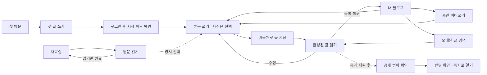

# SNS형 블로그 상세 설계 — 사용 흐름 우선

2026-10-18, Asia/Seoul. 사용자 요청: “더 디테일하게 꼼꼼하게 설계해봐. 단 사용 흐름 먼저 고려하고 그걸 중심으로.”

**상태: 설계와 실행 추적.** 2026-10-18 후속 사용자 지시로 P0의 대표 홈·탭·작성·읽기·복귀·실패 복구를 구현했다. 실제 적용·검증 범위는 [실행 기록](../design-review/blog-user-journeys.md)을 따른다. 아래 원래의 목표·판정 기준은 보존하며 P1 공개·P2 확장은 별도 후속으로 남는다. 설계 전체가 구현 완료됐다는 뜻은 아니다. 현행 사실은 [제품 기준](../../PRODUCT.md), 실제 시각 규칙은 [디자인 기준](../../DESIGN.md), 앞선 구현은 [SNS형 UX·UI 기록](../design-review/sns-blog-experience.md)에 구분한다.

## 1. 사용자가 완수할 일부터 정한다

제품 설명은 **“생각과 사진을 글로 남기고, 필요할 때 다시 읽고, 원하는 글을 골라 보여주는 개인 블로그”**다. 첫 경험의 성공은 글 한 편의 비공개 저장과 재열기다. 프로필 완성·자료 가져오기·공개·다른 사람 팔로우를 첫 성공의 조건으로 만들지 않는다.

| 우선순위 | 사용자가 들어온 이유 | 성공한 종료 상태 |
| --- | --- | --- |
| 1 | 지금 떠오른 생각을 남기고 싶다 | 제목이나 사진이 없어도 글을 저장하고 완성된 모습으로 읽는다 |
| 2 | 전에 쓰던 글을 이어 쓰고 싶다 | 정확한 초안·수정 초안을 찾아 입력을 이어간다 |
| 3 | 예전에 남긴 글을 읽거나 고치고 싶다 | 글을 찾고 읽은 뒤 같은 목록 위치로 돌아온다 |
| 4 | 모아둔 자료를 읽거나 글에 활용하고 싶다 | 원문과 내 생각을 구별하며 읽기 또는 작성 중 원하는 쪽으로 종료한다 |
| 5 | 다른 사람에게 글을 보여주고 싶다 | 고른 내용의 실제 공개 결과를 확인하고 독자 주소를 얻는다. 후속 구현이 필요하다 |

설계 순서는 **목적 → 진입 → 행동 → 결과 → 다음 행동 → 실패 복구 → 화면·UI**다. 화면의 여백이나 유행하는 컴포넌트가 흐름의 선행 조건이 되지 않는다.

## 2. 현재 흐름에서 먼저 풀 문제

| 확인한 현행 | 사용자에게 생기는 문제 | 설계 결정 |
| --- | --- | --- |
| 홈은 최근 내 글 5개, 글 관리는 내 페이지의 다른 피드 | 오래된 글을 찾으려면 새로운 관리 화면을 배운다 | 홈을 내 글의 대표 목록 하나로 만든다 |
| 홈·프로필·내 페이지·선택 자료 페이지의 진입이 겹친다 | ‘내 글’과 ‘자료를 골라 만든 페이지’가 혼동된다 | 블로그 글과 선택 자료 페이지를 다른 목적지로 표시한다 |
| 제목은 필수가 아닌데 최초 초점은 제목이고 빈 제목은 ‘제목 없는 글’로 보인다 | 짧은 기록도 제목부터 지어야 한다고 느낀다 | 본문부터 쓰고 제목은 선택한다. 빈 제목을 인위적인 제목으로 대체하지 않는다 |
| 저장 후 읽기 전환은 있으나 정상 저장 안내가 읽기에서 숨겨진다 | 자동초안과 완성 저장의 결과가 약하게 구분된다 | 성공 직후 짧은 완료 안내와 지속적인 보관 범위를 함께 둔다 |
| 작성기 닫기·목록 복귀는 내 페이지로 향한다 | 홈에서 들어왔어도 다른 목록으로 돌아온다 | 시작 화면·검색·필터·항목·위치를 복귀 문맥으로 유지한다 |
| 홈은 수정 시각 기준이고 신형 글 수정은 별도 초안을 거친다 | 오탈자 수정이 새 글처럼 보이거나 수정 초안이 중복 글로 느껴진다 | 초안의 원래 글 관계를 보여주고 정렬 이름과 실제 날짜를 맞춘다 |
| 기본 리치 글은 사진이 없어도 기존 공개 사본 대상이 아니다 | ‘블로그 글 저장’을 ‘게시’로 오해할 수 있다 | 현재는 비공개 저장으로 완결한다. 기본 작성 글의 공개는 별도 우선 후속으로 설계한다 |

위 판단은 코드·기존 문서 검토 결과다. 실제 사용자 이해도나 과업 성공률을 측정한 결과는 아니다.

## 3. 대표 동선과 정보 구조



### 하나의 글 목록, 네 개의 탐색 목적

최상위 네 자리는 유지하되 표시 이름을 **홈 / 자료실 / 도구 / 설정**으로 정리하는 안을 권고한다. 현재 기록·관리의 기능을 삭제하는 것이 아니라 역할을 드러내는 이름으로 바꾸는 제안이다. 글쓰기는 어느 메뉴와 동급인 빈 목적지가 아니라 홈·자료 읽기에서 시작하는 행동이다.

| 메뉴 | 사용자가 기대할 일 | 포함할 경로 |
| --- | --- | --- |
| 홈 | 내 글을 쓰고 다시 읽기 | 글·초안·보관함, 내 글 검색, 글쓰기, 프로필 편집 |
| 자료실 | 가져온 것을 찾고 읽기 | 원문·발췌/메모, 가져오기, 컬렉션, 묶음, 연표, 선택 자료 페이지 |
| 도구 | 기록으로 다른 작업 하기 | 다시 찾기, 회고, 책 만들기, 목표, 습관 |
| 설정 | 보관·계정·공개 상태 관리 | 작업공간, 기존 동기화, 형식별 백업·복원, 공개 페이지 관리 |

홈 제목은 `내 블로그`, 현재 메뉴 표시는 홈이다. 홈에서 시작한 글 읽기·작성·수정도 홈의 작업으로 표시한다. 자료 원문 읽기는 자료실의 작업으로 남는다. 기존 주소·저장 항목·계정 경계는 유지하고, 단순 메뉴명 변경으로 데이터 모델을 합치지 않는다.

`글 관리`라는 별도 대표 목록을 없애고 해당 작업을 홈의 탭과 글별 메뉴에 배치한다. 프로필 편집은 홈의 이름·소개 옆에서 열며 프로필에 또 다른 개인 글 목록을 만들지 않는다. 기존 내 페이지의 구성 편집은 자료실의 `선택 자료 페이지`로 구별한다. 해당 이름 변경의 이해도는 기존 사용자의 과업으로 확인한다.

기존 화면의 내용은 다음과 같이 옮긴다. 이름만 바꿔 기존 글·초안·신규 공개 경로를 잃지 않는다.

| 현행 내용 | 설계안의 목적지 | 보존 조건 |
| --- | --- | --- |
| `Writing.isOwnSource`로 판정한 직접 작성 원문의 최신 버전 | 홈의 글 목록 | 정확 `sourceVersionId`로 읽고 기존 수정 흐름을 사용. 가져온 내 메모 전체를 자동 블로그 글로 만들지 않음 |
| 기존 `workbench.page.posts`의 저장한 일반·첨부 글 | 홈의 글 목록 | 기존 작성기·첨부·revision·동기화 범위를 유지 |
| 저장됐고 보관되지 않은 사진/리치 글 | 홈의 글 목록 | 원본·로컬 저장·전용 ZIP 범위 유지 |
| 각 형식의 실제 작성 초안·수정 초안 | 홈의 초안 탭 | 해당 형식의 기존 이어쓰기 경로. 모두 동일 모델로 변환하지 않음 |
| 형식별 실제 보관 기능으로 보관한 글 | 홈의 보관함 | 지원하는 형식의 상태만 표시. 없는 보관 상태를 생성하지 않음 |
| 선택 원문 구성과 기존 페이지 표현 설정 | 자료실 → 선택 자료 페이지 | 기존 구성 편집·미리보기 유지 |
| 기존 선택 사본의 공개 검토·신규 게시·갱신 | 자료실 → 선택 자료 페이지 → 공개할 사본 검토 | 현재 지원되는 구성만 사용하며 새 기본 글 공개와 구분 |
| 기존 공개본의 목록·상태 확인·철회 | 설정 → 공개 페이지 관리 | 서버에서 확인한 공개본 관리. 개인 사본이 없는 기기에서도 가능한 관리 유지 |

## 4. F1 — 처음 와서 첫 글을 남기기

### 시작과 로그인

첫 화면은 설명 한 문장·실제 글 형태의 가상 예시·주행동 `첫 글 쓰기`로 구성한다. 예시는 가상이라고 표시한다. 작은 보조 진입 `로그인`은 재방문자를 위한 경로다.

첫 CTA 가까이에 `먼저 비공개로 시작해요. 새 글과 사진은 이 브라우저에 보관돼요.`를 표시한다. 기존 선택 공개의 세부 설명은 펼쳐 볼 수 있게 둔다. 설정 카드나 기능 전체 목록을 펼치지 않는다.

`첫 글 쓰기`를 눌렀다는 의도는 인증 왕복 뒤에도 유지해 작성기로 연결한다. 일반 로그인·일반 주소 방문은 홈으로 들어간다. 신규 계정이라고 추정해 작성기를 강제로 열지 않는다. 이름·주소·관심사 입력은 첫 작성의 앞에 두지 않는다.

인증 취소·실패는 입력할 글이 사라진 상태로 보이지 않게 원래 시작점과 다시 시도 경로를 남긴다. 계정 확인이 안 된 상태를 빈 개인 블로그로 렌더하지 않는다. 로그인 자체의 인증 방식을 이번 설계에서 교체하지 않는다.

### 빈 홈

```text
내 블로그                              검색

나   내 블로그                         소개 편집

생각나는 한 문장부터 남겨보세요.
사진은 나중에 붙여도 괜찮아요.

[ 첫 글 쓰기 ]

모아둔 자료 보기 →
──────────────────────────────────────────
홈          자료실          도구          설정
```

주행동은 첫 글 쓰기 하나다. 빈 상태의 큰 버튼과 같은 화면의 작성 프롬프트를 중복 배치하지 않는다. 글이 생기면 이 안내는 피드와 작성 진입으로 교체된다. 프로필 미완성 배지·진행률·강제 투어는 두지 않는다.

### 첫 성공

1. 본문에 한 문장을 쓴다. 제목과 사진은 없어도 된다.
2. 자동초안이 보관되면 `초안 보관됨`을 확인한다.
3. `글 저장`을 눌러 저장된 글로 확정한다.
4. 실제 글 읽기로 전환하고 `비공개 글을 저장했어요`를 짧게 알린다.
5. 글 옆에 `나만 보는 글 · 이 브라우저에 보관`을 유지한다.
6. `내 글로 돌아가기`를 누르면 방금 글이 보이고 다시 열 수 있다.

첫 성공의 완료 조건은 6번까지다. 공개·프로필·사진 추가를 요구하지 않는다. 새 글 반영은 성공 직후의 명시적 결과로 보여주되 읽는 중인 목록을 임의로 재정렬하지 않는다.

## 5. F2 — 쓰기·사진·초안·저장

### 작성 화면의 우선순위

```text
닫기      비공개 · 이 브라우저         [글 저장]
          초안 보관됨
──────────────────────────────────────────
제목 추가                              선택

어떤 이야기를 남길까요?
본문을 바로 씁니다.

사진 추가 · 굵게 · 링크 · 서식 · 실행 취소
```

일반 새 글은 본문에서 시작한다. 데스크톱 키보드 초점은 본문으로 두고, 모바일의 자동 키보드 열기는 사용자가 명시적으로 글쓰기를 누른 경우에 한해 실기로 확인한다. 화면 복원·뒤로가기만으로 키보드를 다시 열지 않는다.

상단의 닫기·상태·저장은 작성 중 계속 찾을 수 있어야 한다. 현재처럼 저장 명령 행을 실제 viewport 상단에 붙인다. 사진·기본 서식은 본문 가까이 두고 추가 서식은 접는다. 문서 전체를 가리는 상시 도구 패널은 만들지 않는다.

제목은 선택이다. 제목 없는 글은 피드에서 실제 첫 문장을 본문 미리보기로 보여준다. 그 문장을 저장 제목으로 복사하지 않는다. 읽기 화면에도 큰 `제목 없는 글`을 만들지 않는다. 사진만 있으면 실제 사진이 주체가 되며 접근 가능한 읽기 이름은 실제 사진 수 등을 사용한다.

### 사진 추가의 행동 계약

- 커서 위치에서 `사진 추가`를 누르고 파일을 고른다. 현재 로컬 보관을 `업로드`로 부르지 않는다.
- 선택창 취소는 오류를 만들지 않고 원래 작성 위치로 돌아온다.
- 확인 중에는 중복 실행을 막고 `사진 확인 중…`을 표시한다. 본문은 유지한다.
- 여러 파일을 현재처럼 전체 확인 후 한 번에 반영한다면 부분 성공으로 표시하지 않는다. 실패한 파일과 이유, 다시 고르기를 안내한다.
- 사진 아래 설명은 바로 쓸 수 있게 두고 대체 텍스트·이동·빼기는 해당 사진의 메뉴에 둔다.
- 사진을 빼도 본문 전체를 다시 만들지 않는다. 원본 바이트·순서·설명과 실행 취소를 보존한다.
- 사진 확인 중 이동·저장 요청은 완료를 기다리거나 현재 작업 중임을 알린다. 아직 반영되지 않은 파일까지 저장됐다고 말하지 않는다.

### 자동초안과 명시 저장

| 상태 | 표시 | 허용되는 다음 행동 |
| --- | --- | --- |
| 빈 새 글 | 기본 작성 안내 | 쓰기·사진 추가·닫기. 빈 글 저장은 실행하지 않는다 |
| 입력이 바뀜 | `초안 보관 중…` | 입력을 계속한다. 한글 조합·커서를 방해하지 않는다 |
| 초안 보관 성공 | `초안 보관됨` | 계속 쓰기·닫기·글 저장 |
| 글 저장 요청 | `글 저장 중…` | 중복 저장을 막고 실제 반영을 기다린다 |
| 글 저장 성공 | 완성된 글 읽기와 짧은 완료 안내 | 수정·원래 목록 복귀 |
| 초안/글 저장 실패 | `보관하지 못했어요. 입력은 여기에 남아 있어요.` | 다시 저장·계속 쓰기·지원되는 백업 받기 |
| 다른 탭 충돌 | `다른 탭에서 글이 바뀌었어요. 지금 입력은 남아 있어요.` | 현재 입력 백업 우선. 사본 저장·최신본 확인은 독립적인 입력 보존 경로를 구현한 뒤 제공. 자동 덮어쓰기 금지 |

초안의 자동보관은 글을 완성 목록에 넣는 행동이 아니다. 저장 완료를 단순 토스트에만 맡기지 않는다. 상태 문구는 작은 한 영역에서 바꾸고 스크린리더에 의미 있는 변화만 알린다.

한글 조합 중 자동 저장·서식 변경·클릭 때문에 DOM이나 입력값을 교체하지 않는다. 저장 요청을 조합 종료 뒤 한 번 실행하는 방식은 후속 후보로 검증하며, 실제 저장 완료 전 성공으로 표시하지 않는다.

### 닫기와 수정

작성 중 닫기는 초안 보관 성공 후 원래 화면으로 돌아간다. 평상시 매번 확인창을 띄우지 않는다. 보관이 실패하면 입력을 남기고 이동을 중지한다. 새로고침·앱 종료에서 복구를 약속하는 범위는 마지막으로 실제 보관된 초안까지다.

저장 글의 `수정`은 수정 초안으로 시작한다. 상단에는 기존 글을 고치는 중임을 알리고 원래 저장 글은 다음 명시 저장까지 유지한다. 이미 그 글의 수정 초안이 있으면 `이어 수정하기 / 저장된 글에서 새로 시작 / 취소`를 구분한다. 새로 시작은 현재 수정 초안을 버리는 뜻이 아니며 별도 보관·명시 선택이 필요하다.

`새 글 쓰기`는 새 글 의도로 존중한다. 기존 초안을 자동으로 열어 의도를 바꾸지 않는다. 초안 이어쓰기는 사용자가 선택하는 별도 진입이다.

## 6. F3 — 재방문·초안 이어쓰기

일반 재방문은 홈을 연다. 작성 중인 글이 있으면 프로필 아래 작은 한 행에 첫 문장/제목·마지막 수정 시각·`이어쓰기`를 표시한다. 여러 초안을 한꺼번에 펼치지 않는다. 자동으로 작성기로 들어가지 않는다.

홈의 상태 탭은 `글 / 초안 / 보관함`이다. 초안에 저장글 수정 중인 항목은 `기존 글 수정 중`, 새 글은 `새 글 초안`으로 구별한다. 초안 탭은 큰 사진 피드가 아니라 제목/첫 문장·시각·작은 사진 정보가 있는 작업 목록으로 만든다.

1. `초안`을 연다.
2. 해당 글을 선택하고 마지막 입력과 커서·사진 상태를 복원한다.
3. 이어 쓰고 `글 저장`한다.
4. 새 초안은 새 글로, 수정 초안은 원래 글의 변경으로 확정한다.
5. 실제 성공한 초안만 초안 목록에서 빠진다. 실패·충돌 초안을 숨기지 않는다.

빈 자동 생성 초안은 내용 있는 초안과 동등하게 강조하지 않는다. 다만 사진 처리 중·미반영 첨부를 빈 초안으로 판단해 없애지 않는다. 기존 형식별 초안을 하나의 화면에서 찾는 것은 표시 통합이며 저장 형식을 변환하는 것이 아니다.

## 7. F4 — 내 글 읽기·검색·수정·복귀

### 글이 있는 홈

```text
내 블로그                              검색
나   블로그 이름                       프로필 편집
     짧은 소개

[ 새 글 쓰기 ]
작성하던 글의 첫 문장…                  이어쓰기

글             초안 2             보관함
──────────────────────────────────────────
작성자 · 실제 날짜 · 보관/공개 상태
글 제목이 있을 때만 제목 표시
실제 본문 미리보기 3~5줄
[실제 사진 한 장 — 있을 때만]
글 읽기                                  더 보기
──────────────────────────────────────────
다음 글…
[ 글 더 보기 ]
```

프로필은 2~3행의 요약이다. 방문 수·작성 목표·가짜 반응을 두지 않는다. 피드는 실제 글을 읽을 수 있는 내용과 얇은 구분선으로 이어진다. 글별 큰 관리 버튼은 피하고 더 보기에서 수정·보관·파일 내보내기를 찾는다.

제목·사진·`글 읽기`는 실제 열기 조작이다. 전체 항목을 거대한 클릭 영역으로 만들면서 그 안에 메뉴를 중첩하지 않는다. 사진 없는 글도 본문과 여백으로 읽혀야 한다. 사진 로딩 전 비율을 예약하고 실패해도 제목·본문·읽기 진입은 남긴다.

글을 열면 작성자·실제 날짜·보관 범위, 본문·사진이 먼저 보인다. 수정은 가깝게, 백업·보관은 더 보기에 둔다. 글 끝에는 `내 글로 돌아가기`를 둔다. 긴 글을 다 읽은 뒤 맨 위까지 올라가야 돌아갈 수 있게 하지 않는다.

### 검색·긴 목록

- 홈의 검색은 `내 글 검색`임을 드러낸다. 기본 범위는 저장한 내 글이며 초안은 초안 탭, 보관 글은 보관함에서 찾는다.
- 세 글 집합 중 일부를 읽지 못했다면 결과 0건·전체 개수를 단정하지 않는다. `확인한 범위 0건 · 일부 글 확인 못함`과 실패 범위·재시도를 표시하고 성공한 결과는 유지한다.
- 전체 자료를 찾는 기존 통합검색은 `자료도 함께 찾기` 등의 명확한 보조 경로로 연결한다. 공개 서버 사본·작성 중 초안을 전역 검색에 몰래 포함하지 않는다.
- 제목·본문·사진 설명의 지원 범위와 일치 이유를 표시한다. 서로 다른 글 형식의 정확 위치를 계산할 수 없다면 해당 글을 열고, 가짜 일치 위치를 만들지 않는다.
- 첫 표시 20개와 `글 더 보기`를 제안한다. 20은 초기 설계값이며 긴 글·사진·저사양 기기의 측정으로 조정한다. 보이는 개수와 전체 검색 대상을 혼동하지 않는다.
- 기본 정렬은 당장 `최근 수정순`이라고 정확히 부른다. 안정적인 최초 작성일을 보장한 뒤 `최근 작성순`을 기본값으로 검토한다.
- 기존 신형 수정 저장의 새 문서와 원래 글의 관계를 해결하지 않고 `작성일`을 만들어내지 않는다. 과거 자료의 날짜가 없으면 미확인으로 둔다.
- 외부 변경·다른 탭 변경으로 읽는 도중 항목을 움직이지 않는다. 필요하면 `목록 업데이트`를 제안한다.

### 복귀 계약

왕복에 보존할 것은 **작업공간·목록 종류·탭·검색어·필터·정렬·표시 개수·항목 ID·화면 내 상대 위치·초점**이다. 작성·수정·검색으로 들어온 출발점을 구별한다.

상세 → 뒤로는 기존 항목이 보이던 위치로 돌아간다. 저장 직후에는 읽기 화면을 유지한다. 그 화면에서 목록으로 돌아갈 때는 원래 탭·검색·필터·정렬을 보존하되, 새 글 또는 수정 결과의 해당 글 앵커를 먼저 보여준다. 최근 수정순 때문에 그 글의 순위가 바뀌어도 저장 전의 숫자 스크롤 위치로 돌아가지 않는다. 초안 탭에서 저장한 경우에는 완료된 글이 초안 조건을 벗어나므로 읽기 화면에 `저장한 글에서 보기`를 제공한다. 이를 선택한 경우에만 글 탭으로 이동하고 기존 초안 조건은 별도로 남긴다. 다른 필터를 벗어나는 결과도 이유와 명시적 전환을 제공한다.

항목이 삭제·보관돼 사라졌다면 가까운 남은 항목 또는 목록 제목에 초점을 두고 설명한다. 사진 높이 변화 때문에 임의로 맨 위로 보내지 않는다. 팝업 닫기는 그 팝업을 연 조작으로, 검색 닫기는 검색 이전 상태로 돌아간다.

원문 읽기의 정확 버전·UTF-16 범위·검색/발췌 목적지는 일반 이어 읽기보다 우선한다. 없는 버전을 최신 버전으로 바꾸지 않는다. 복귀 상태는 개인 자료·공개 데이터에 저장하지 않는다.

## 8. F5 — 자료를 읽거나 내 글에 활용하기

자료실에서 읽고 끝내는 것도 완결된 사용이다. 글쓰기 팝업이나 완성 압박을 추가하지 않는다. 가져온 타인 글은 내 글 피드로 자동 편입하지 않는다.

### 쓰다가 자료가 필요한 경우 — 새 연결 제안

`작성 중 붙이기 → 내 자료 검색 → 정확한 원문/버전 미리보기 → 원문 연결 또는 인용 범위 확정 → 작성기로 복귀`로 설계한다.

원문 연결은 출처 카드이며 본문 복사가 아니다. 인용은 사용자가 선택한 구절만 본문과 구별해 넣는다. 취소는 아무 자료도 추가하지 않고 커서·입력을 복원한다. 자료실 원문·개인 메모·태그를 무심코 복사하지 않는다.

자료가 없을 때만 선택기 안에서 가져오기를 보조 경로로 제공한다. 원문 보관 성공 후 글에 붙이기를 취소해도 자료실의 원문은 남는다. 가져오기와 글에 연결하기를 같은 성공으로 표현하지 않는다.

### 읽다가 생각이 생긴 경우 — 새 연결 제안

`원문 읽기 → 이 자료로 글쓰기 → 연결할 버전/선택 구절 확인 → 빈 내 본문 작성 → 저장 → 글 읽기`로 이어진다. 종료 때 `읽던 자료로 돌아가기`도 제공한다.

기존 초안에 붙일지 새 글로 시작할지 사용자가 고른다. 기존 초안에 자료를 더해도 본문을 대체하지 않는다. 구절을 선택하지 않았다면 인용문을 자동 생성하지 않는다.

현행 책·음악·장소 등의 대상 첨부는 재사용한다. 원문의 정확 참조 첨부와 원문에서 기본 작성기로 시작하는 연결은 아직 별도 제안이다. 기존 `내 페이지에 담기`를 이 새 흐름이 이미 구현된 것으로 설명하지 않는다.

수천 원문은 자료실의 전체 검색·출처/경로·정확 버전 식별과 40개씩 결과 표시를 활용한다. 글 피드의 제안 20개와 자료 검색의 현행 40개는 다른 목록 정책이다. 두 숫자를 공통 데이터 제한으로 만들지 않는다.

## 9. F6 — 보여주기와 독자 경험

### 현 단계와 목표를 분리한다

현재 기본 작성기의 글은 사진이 없어도 기존 공개 사본으로 게시되지 않는다. 새 피드를 만든 사실만으로 공개 블로그가 완성된 것은 아니다. 현 단계에서는 비공개 글 저장으로 정상 종료하고 지원하지 않는 게시 버튼을 활성화하지 않는다. 기존 신규 게시·갱신은 `자료실 → 선택 자료 페이지 → 공개할 사본 검토`, 기존 공개본 확인·철회는 `설정 → 공개 페이지 관리`로 유지한다.

다음 공개 단위의 제품 목표는 **사용자가 기본 작성기로 쓴 텍스트 글 한 편을, 다른 작성기로 다시 작성하지 않고, 공개 검토 → 실제 게시 → 비로그인 읽기까지 연결하는 것**으로 제안한다. 기존 공개 형식으로 표현 가능한 일반 글의 최소 게시 왕복은 기술 재사용 후보지만 숨은 기존 작성기로 우회하는 일을 최종 사용자 흐름으로 삼지 않는다. 이는 [앞선 공개 후속](blog-platform-direction.md)의 ‘기존 공개 가능 일반 글 우선’ 설계의 완료 기준을 변경하는 제안이다. 기존 형식만의 공개는 기술 중간 단계이며, 기본 작성기의 텍스트 글을 재작성 없이 공개해야 사용자 흐름이 완료된다. 현재 구현이나 DB 변경의 확정은 아니다.

### 목표 공개 동선

1. 저장된 글에서 `공개하기`를 선택한다. 지원하는 내용일 때만 실행할 수 있다.
2. 블로그 이름·소개와 실제 공개 범위를 독자 형태로 확인한다. P1에서는 텍스트 본문과 실제 지원하는 출처·첨부, P2에서는 지원을 완료한 사진까지 포함한다. 사진이 포함된 글은 P2 전까지 이유를 설명하고 공개 실행을 막으며 사진을 자동 제외하지 않는다.
3. `이 내용 공개하기` 옆에 `링크를 아는 누구나 읽을 수 있어요`를 표시한다.
4. 실제 반영이 확인될 때까지 진행 상태를 유지한다. 요청만 보낸 것을 게시 완료로 부르지 않는다.
5. `공개 페이지 열기`를 주행동, `링크 복사`를 보조로 제공한다.
6. 로그인하지 않은 독자 환경에서 실제 글을 읽는다.
7. 독자는 블로그 이름 또는 `이 블로그의 다른 글`로 같은 공개 목록으로 돌아간다.

프로필 이름·소개는 사용자 선택값을 사용하고 계정 이메일을 공개 소개로 복사하지 않는다. 긴 본문이 접혀 있어도 전체가 공개되는 경우 그 사실을 검토에서 알린다. 읽기 모드의 접힘과 공개 범위 선택은 다른 행동이다.

### 독자 화면

개인 작업용 탐색·설정·초안·관리 버튼은 없다. 블로그 소개와 공개 글 목록, 글 상세와 출처, 같은 블로그로 돌아가기만 우선 제공한다. 링크로 온 독자에게 가입을 먼저 요구하지 않는다. 글별 안정 주소·공개 목록과 상세 왕복은 후속 공개 단위의 완료 조건이다.

비공개 글 편집은 공개본을 즉시 바꾸지 않는다. 소유자에게 `개인 글만 저장했어요. 공개본은 이전 내용이에요.`를 알리고 변경 검토 후 명시적으로 갱신한다. 상태는 `공개본 없음 / 공개본 있음 / 공개본 갱신 전 / 반영 확인 중`으로 구별하며 초안·저장·보관 상태와 혼합하지 않는다.

공개 응답이 끊기면 `공개 여부를 아직 확인하지 못했어요`와 상태 확인을 제공한다. 확정 실패와 결과 미확인은 다르다. 철회는 개인 글을 남기고 실제 독자 접근이 닫힌 것을 확인한다. 통신 오류를 철회 성공이나 영구 삭제로 표시하지 않는다.

사진 공개는 별도 자산 준비·게시 확정·직접 주소 접근 회수까지 지원한 다음 활성화한다. 사진을 조용히 빼고 텍스트만 공개했다고 성공 처리하지 않는다. 원본의 공개·내려받기·메타데이터 범위도 실제 검토에 포함한다. 이 문서는 해당 기반을 구현하거나 공개 업로드하지 않는다.

## 10. F7 — 보관·복원·설정으로 빠지더라도 글을 잃지 않기

보관은 글별 더 보기에서 시작한다. 보관하면 글 탭에서는 빠지고 보관함에 남는다. 되돌리기는 보관함에서 한다. 수정 초안과 공개본이 있다면 각각의 상태를 알리며, 보관을 공개 철회로 설명하지 않는다.

백업·복원은 설정에서 기존 형식별 범위를 유지한다. 사진 원본 포함 ZIP과 일반 자료 JSON은 다른 범위다. 파일 받기 요청과 사용자의 파일 보관 완료를 같은 상태로 단정하지 않는다.

계정·작업공간 전환은 현재 입력의 보관을 먼저 처리한다. 실패하면 입력을 유지하고 전환을 중지한다. 전환 후 이전 계정의 글·사진·검색 상태를 다음 계정에 보여주지 않는다. 다른 기기에서 같은 계정으로 들어왔다고 로컬 신형 글이 자동으로 나타난다고 약속하지 않는다.

앱과 계정 확인 상태를 사용할 수 있는 이미 열린 로컬 작업에서는 네트워크 단절과 로컬 저장 실패를 구별한다. 새 브라우저·차가운 재시작에서도 항상 인증 없이 열리는 것처럼 표현하지 않는다. 재연결 자체로 자동 공개·사진 전송을 실행하지 않는다.

## 11. 흐름에서 도출한 반응형·시각 규칙

| 장면 | 데스크톱 | 태블릿·분할 화면 | 휴대전화 |
| --- | --- | --- | --- |
| 홈 | 라벨 탐색 + 한 열의 글 피드 | 아이콘 레일 + 한 열 | 아이콘·라벨 하단 탐색 + 전체 너비 피드 |
| 작성 | 저장 명령 행 상단, 본문 중심 | 한 열 유지, 참고 자료는 명시적 전환 | 전역 하단 탐색을 감추고 닫기·저장으로 집중 |
| 긴 글 읽기 | 본문 최대 680px 중심 | 강제 목록/본문 이중 열 금지 | 본문 17px 이상, 글 끝에도 복귀 |
| 자료 고르기 | 충분한 폭에서만 검색/미리보기 분할 검토 | 선택→미리보기→복귀 | 같은 단계를 화면 전환으로 제공 |
| 검색/서식 열기 | 기존 초점·선택 유지 | 창 크기 변화로 입력 재생성 금지 | 키보드·안전 영역에 커서와 조작이 가리지 않아야 함 |

현행 흰색·차콜·파란 초점·가는 구분선과 한글 산세리프를 유지한다. 이 설계 때문에 다시 색 체계를 바꾸지 않는다. 글은 피드, 초안은 작업 행, 설정은 명확한 항목 목록으로 역할을 구별한다.

중요 조작은 최소 44×44px, 입력 글자는 16px 이상이다. 작은 상태 문구도 실제 바탕에서 읽혀야 한다. 주요 행동은 화면의 현재 과업에서 하나가 눈에 먼저 들어오게 한다. 삭제·보관·공개 등의 다른 결과를 같은 검정 버튼으로 나란히 강조하지 않는다.

전환은 선택·저장 상태의 짧은 반응으로 제한한다. 본문 등장 모션·끌 수 없는 자동스크롤·동작 없는 스와이프 손잡이를 두지 않는다. 모션 감소와 키보드 초점은 유지한다. OS 뒤로가기·브라우저 기록·화면 복귀가 같은 맥락을 가리키도록 설계하되 플랫폼이 보장하지 않는 종료 전 저장을 약속하지 않는다. 키보드를 먼저 닫는 플랫폼 동작을 존중하며 브라우저 기록 이동을 언제나 막을 수 있다고 전제하지 않는다.

모바일 실기에서는 키보드 열린 상태의 긴 문단·사진 설명·더 보기·저장, 화면 회전, iPad 분할 크기 변경, 앱 전환 후 돌아오기를 확인한다. 폭 390/820/1440 모사는 별도 검사이며 실제 Apple 기기·OS 한글 입력기·VoiceOver 검증을 대신하지 않는다.

## 12. 공통 상태·문구·실패 복구

| 상황 | 보여줄 내용 | 다음 행동과 보존 |
| --- | --- | --- |
| 개인 글 읽는 중 | 실제 글과 비공개/기기 보관 범위 | 읽기·수정·출발 목록 복귀 |
| 목록 조회 중 | 내용 영역의 안정적인 로딩 자리 | 프로필·작성 진입은 가능한 범위에서 유지. 늦은 응답이 초점을 빼앗지 않음 |
| 목록 읽기 실패 | `글을 불러오지 못했어요` | 다시 불러오기. 실패를 ‘글 없음’으로 바꾸지 않음 |
| 일부 저장소만 실패 | 읽을 수 있는 글 + 해당 범위 실패 안내 | 성공한 자료는 유지하고 실패한 범위만 재시도 |
| 검색 결과 없음 | `일치하는 내 글이 없어요` + 현재 조건 | 검색어 수정·필터 해제. 새 글 강요 금지 |
| 사진 읽기 실패 | 글 본문·사진 실패 표시 | 사진 재시도·글 읽기 유지 |
| 저장 공간 문제 | `보관하지 못했어요. 입력은 여기에 남아 있어요.` | 다시 저장·지원되는 사본 받기·계속 쓰기 |
| 두 탭 수정 | 다른 변경과 현재 입력이 함께 존재함을 설명 | 현재 입력 백업 우선. 현재 입력을 독립 보존한 다음 사본 저장·최신본 확인을 제공 |
| 참조 버전 없음 | `연결한 버전을 찾을 수 없어요` | 기존 글·출처 유지. 다른 버전 자동 대체 금지 |
| 공개 여부 미확인 | `공개 상태를 아직 확인하지 못했어요` | 상태 확인. 중복 새 게시 유도 금지 |
| 공개 철회 확인 | `더 이상 공개되지 않는 페이지예요` | 개인 데이터 노출 없이 종료·지원되는 공개 홈 복귀 |

문구는 `글 저장 / 초안 보관 / 공개하기 / 공개본 갱신 / 공개 중단`의 실제 결과를 구별한다. `완료` 하나로 모두 대체하지 않는다. 복구 조작은 오류 근처에 두고 더 보기 안에만 숨기지 않는다.

현행 `사본으로 이어 쓰기`와 `새 글로 저장`은 먼저 `flush()`하므로 초안 자체의 CAS 충돌에서는 같은 저장 단계에 막힐 수 있다. 이는 코드에서 확인한 제약이다. 현재 입력 백업은 동일 저장을 요구하지 않는다. 후속 구현은 **현재 화면의 입력을 원래 충돌 저장에 의존하지 않고 먼저 보존한 뒤 사본 저장·최신본 확인을 제공하는 경로**를 만들고 검증해야 한다. 해당 새 복구 경로는 아직 구현·검증 전이며, 최신본 확인 때문에 현재 입력을 교체해도 된다는 뜻이 아니다. 원본 보존·백업의 기존 회귀를 재사용한다.

## 13. 실제 구현 순서와 각 단계의 종료 조건

### P0-A. 대표 목록·탐색 정리

홈의 글/초안/보관함과 내 글 검색으로 입구를 모은다. 프로필과 선택 자료 페이지를 구별하고 네 메뉴의 역할을 분명히 한다. 3절 이동표의 직접 작성 원문·기존 첨부 글·사진/리치 글과 형식별 초안·보관 지원 범위를 모두 포함한다. 기존 형식은 표시 어댑터로 묶되 원문·사진·공개·백업 저장소를 합치지 않는다.

완료 조건: 오래된 내 글과 초안을 안내 없이 찾는다. 기존 연표·습관·자료 페이지도 계속 찾는다. 같은 글을 찾으려고 홈과 별도 관리 목록을 번갈아 다니지 않는다.

### P0-B. 짧은 글 한 편의 왕복

본문 우선·선택 제목·초안 상태·명시 저장 피드백·읽기·원래 목록 복귀를 연결한다. 인증 왕복의 시작 의도도 보존한다. 첫 사용에서 사진·프로필을 요구하지 않는다.

완료 조건: 제목 없는 한 문장 → 저장 → 읽기 → 목록 → 같은 글 재열기. 기존 수정 초안과 저장본을 구분하고, 실패하면 입력이 남는다.

### P0-C. 긴 글·사진·실패와 실기

사진 선택 취소·지원 외 파일·긴 글·한글 조합·초안 CAS·공간 부족·계정/공간 변경·키보드·뒤로가기와 복귀를 확인한다. 직전 UI 테스트 통과 수를 이 새 동선의 검증으로 재사용하지 않는다.

완료 조건: 실제 지원 범위에서 원본·입력·버전·초점·스크롤을 보존하고 실패 후 계속 쓸 수 있다. 테스트는 기능, 사용 흐름, 실제 기기 확인으로 나눠 보고한다.

### P1. 기본 작성 글 한 편의 공개 왕복

기본 작성기의 텍스트 글을 기준으로 공개 검토→게시 반영 확인→비로그인 읽기→같은 블로그 목록 복귀→명시 갱신/철회를 완결한다. 현재의 기본 작성 글 공개 미지원 상태를 실제로 해소해야 하는 별도 구현이다. 공개 데이터 모델·기존 사본 호환·안정 주소 검토가 선행된다.

완료 조건: 개인 편집이 공개본을 몰래 바꾸지 않고, 다른 브라우저에서 고른 내용만 읽힌다. 철회 후 목록과 직접 글 주소가 닫히며 개인 글은 남는다.

### P2. 사진 공개·자료와 작성 연결

사진 자산의 준비·게시·철회 계약을 완성하고, 별도 작업으로 원문 읽기→내 글 시작과 작성 중 정확 원문 연결을 붙인다. 사용자가 가장 필요로 하는 쪽을 먼저 검증하며 둘을 한 번에 배포할 선행 조건으로 묶지 않는다.

반응·댓글·팔로우·추천 피드·자동 계정 가져오기는 이 흐름들의 선행 과제가 아니다. 실제 독자·작가 사용 근거가 생기면 독립적으로 검토한다.

## 14. 사용자 과업과 판정 기준

설명 없는 소규모 사용성 확인부터 시작한다. 제안은 신규 5명과 기존 도구 사용자 2~3명으로, 통계적 선호도 조사나 검증 완료 인원 수가 아니다. 서로 다른 장면을 과업으로 나눠 관찰한다. 수치는 앞으로 사용할 목표이며 현재 측정 결과가 아니다.

| 과업 | 제공할 상황 | 관찰할 것 |
| --- | --- | --- |
| T1 첫 글 | “사진 없이 한 문장을 남기고 다시 찾아보세요” | 목적 이해, 첫 행동, 제목 강요 여부, 저장/초안 구분, 재열기 |
| T2 재방문 | 새 글 초안과 기존 글 수정 초안이 함께 있음 | 올바른 초안 선택, 기존 저장본 보존 이해 |
| T3 오래된 글 | 글 100개, 사진 없는 글·긴 제목 혼합 | 내 글 검색 범위 이해, 읽기와 같은 위치 복귀 |
| T4 사진·한글 | 휴대전화에서 본문·사진 설명 작성 | 키보드 가림, 조합 보존, 취소·undo·저장 접근 |
| T5 실패 | 저장/목록 읽기 실패를 주입 | 입력이 남았음을 아는지, 스스로 재시도/백업할 수 있는지 |
| T6 자료 활용 | 수천 원문 중 특정 구절 찾기 | 출처·정확 버전 이해, 내 글과 원문 구분, 왕복 위치 |
| T7 기존 도구 | “연표를 열고 오늘 습관을 확인하세요” | 메뉴명 변경 뒤 발견성, 기존 동작·자료 보존 |
| T8 공개 후속 | T1에서 기본 작성기로 저장한 텍스트 글을 재작성 없이 공개하고 독자 브라우저로 열기 | 다른 작성기 우회 없음, 로그인 없는 읽기, 개인 수정 후 공개본 유지, 명시 갱신, 철회 후 목록·직접 접근 차단 |

각 과업에서 첫 선택, 잘못 들어간 곳, 도움 요청, 뒤로가기 손실, 데이터 보존, 최종 결과를 기록한다. ‘서비스 설명/첫 글 위치/저장하면 누가 보는지’를 사용자 말로 확인한다. 완료 시간은 먼저 재고 병목을 비교한다. 사전에 임의의 30초·성공률 95%를 성과로 제시하지 않는다.

출고 조건은 핵심 과업을 도움 없이 끝내고, 저장/공개를 잘못 이해하는 중대한 문제가 없으며, 데이터·원본·계정 보존 검사를 통과하는 것이다. 한 사람이라도 입력 손실·원치 않은 공개를 겪으면 원인을 해결하기 전 다음 확장 단계로 넘어가지 않는다. 5명 모두 성공해도 모든 사용자에게 증명됐다고 확대하지 않는다.

## 15. 참고 사이트에서 가져오는 것은 흐름의 역할이다

| 참고 | 설계에 적용할 역할 | 해도에서 별도 판단할 것 |
| --- | --- | --- |
| [Threads](https://www.threads.com/) | 가벼운 작성 진입, 작성자·본문·사진 피드, 모바일 친숙함 | 공개 기본값·반응 수·타인 추천을 그대로 가져오지 않음 |
| [Substack](https://substack.com/) | 작가 정체성과 글 목록, 짧은 기록·긴 글의 공존 | 구독·메일 발송을 첫 글 조건으로 만들지 않음 |
| [Medium](https://medium.com/) | 집중 작성·읽기·작성자의 다른 글로 이동 | 제목·사진을 모든 짧은 글의 필수로 만들지 않음 |
| [브런치스토리](https://brunch.co.kr/) | 한국어 제목·문단의 위계, 작가 소개 | 작가 꾸미기보다 실제 첫 글 저장을 앞세움 |
| [velog](https://velog.io/) | 개인 글 찾기·글 정리의 단순한 구조 | 태그·시리즈 입력을 작성의 선행 조건으로 만들지 않음 |

이는 디자인 참고 대상과 적용 판단이다. 이 문서 작성 중 다섯 서비스의 최신 로그인 화면을 새로 실측하거나 사용자 계정으로 체험하지 않았다. 앞선 공식 자료 조사와 날짜·확인 범위는 [SNS형 UX·UI 기록](../design-review/sns-blog-experience.md)에 보존한다.

## 16. 코드 근거와 검토 범위

- [홈](../../assets/life/home.js): 실제 프로필, 작성 진입, 여러 저장 글의 투영, 최근 5개·수정 시각 정렬.
- [기본 작성기](../../assets/life/photo-post-ui.js)와 [문서 검증](../../assets/life/photo-post.js): 선택 제목, 초안/저장, 수정 초안, 사진·첨부·읽기·복구.
- [내 페이지·구성](../../assets/life/workbench-ui.js): 프로필·기존 글 피드·선택 자료 페이지·공개 검토의 현행 결합점.
- [공통 탐색](../../assets/haedo-navigation.js), [원문·검색 UI](../../assets/life/ui.js): 현재 네 메뉴, 하위 화면·정확 원문·왕복.
- [공개 렌더러](../../assets/life/share-view.js), [공개 후속 설계](blog-platform-direction.md): 기존 선택 사본과 향후 공개 목록·글 주소의 경계.

총괄이 통합하고 여섯 에이전트가 첫 사용, 작성, 재방문/읽기, 자료 활용, 공개 독자, 탐색/모바일을 병렬 검토했다. 앱 구현·운영 데이터·인증 설정·실제 게시·공개 배포를 변경하지 않았다. 이 설계의 새 흐름은 아직 사용성 검사나 새 브라우저 동작 검사로 검증되지 않았다.
